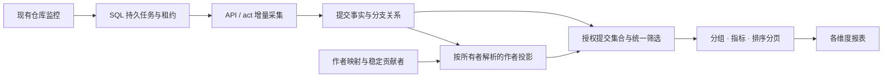

# 代码贡献分析实施计划与接入说明

日期：2026-11-02。贡献分析、纯 Git 统计及普通 Git 独立引用监控均已完成隔离验证，并已按用户要求整合进当前主工作区。本文对应 alpha.35 的集成功能；具体发布状态以 GitHub Release 为准。后文保留原设计基线与隔离阶段实测记录，其中“未合并”及旧版本说明均为历史状态。

最新实现：[独立代码洞察模块](code-insights-design.md)。已支持独立洞察、仓库多对多、洞察级作者映射及仪表盘，复用共享事实和 SQL 任务队列。服务端 265 项、前端 221 项通过，实际 MySQL/PostgreSQL、私有 HTTP/SSH、原生 Git 与公网 Hello-World 全分支采集均通过；重复执行新增事实为 0。完整工作区测试此前仍有未改动的桌面升级器 Windows IPC 失败，不能宣称所有工作区门禁通过。私有代码平台账户未实接；五平台 HTTP 契约测试不能替代实接验收。

此前稳定身份和查询优化的隔离验收通过：贡献分析 HTTP 17 项、连接授权回归 146 项，真实 act ZIP 导入三轮新增事实为 2、1、0；五次作者映射修改没有增加平台请求或采集任务。实际 PostgreSQL 17.6 与 Oracle MySQL 8.4.10 已验证完整迁移、七类报表、映射和集群任务竞争，并修复 MySQL 间隙锁死锁。公有 HTTPS、原生 git://、私有 HTTP 和 SSH 的真实统计链路也已通过。下文性能样本仍仅来自本地 SQLite；私有平台账户实接不等于私有 Git 协议测试，尚无前者的验收证据。

## 当前接入方式

> 2026-11-02 新补充要求：这是融合迁移，保留成熟功能并完善架构；作者多身份归并必须保留；采集入库与多维查询分离，优化扩展性和 SQL 性能。稳定身份和集合式查询已进入实现与验证，下文区分当前实现与后续优化；功能测试通过不等于生产规模性能验收完成。

左侧「构建 → 代码洞察」独立管理，创建洞察时选择连接及仓库；同一仓库可被多个洞察复用。连接详情显示相关洞察。默认覆盖所有可见分支，初始化最近 90 天，可调整，也可选完整可达历史。覆盖起点固定保存，后续不会按滚动窗口删除事实。完整历史用 0 表示，不排除 1970 年前的提交。

新建洞察默认定时更新，每 4 小时一次（`0 */4 * * *`），复用 Cron 编辑器，支持 IANA 时区，留空按 UTC。可切换事件更新，复用监控变更入队并保留每日兜底核对。旧洞察保持事件模式；初始化立即执行，手动同步不改变下一次计划时间。计划持久化，错过多个执行点时合并更新一次。共享仓库的看板复用最新事实，其他事件洞察可能提前更新数据；选择定时仅控制本洞察的触发频率。

普通平台优先使用连接 API；监控事件与轮询只是持久化脏任务，报表刷新只读本地事实。每日轻量仓库/分支头核对用于发现漏回调和权限变化。缺少文件明细、平台截断、重命名口径不兼容或多父差异无法证明完整时，记录错误；配置了 act 流水线才启动补全。不能将缺失数据当零。

统计按工作空间/稳定仓库身份/SHA 唯一存储，分支关系独立维护；同一 SHA 在不同仓库分别计数。平台提供仓库 ID 时使用平台实例与远端 ID 归一，以支持仓库改名。完整授权列表中已不可见的来源标记 unavailable，其事实不能通过该来源继续读取；其他仍授权来源不受影响。

作者匹配规则保留在兼容的配置 JSON 中并使用乐观版本控制；新增稳定贡献者、原始身份、按所有者解析的提交作者投影三张表，现有七张事实/关系/任务表继续复用。规则引用 contributor_id，查询通过索引关联投影，不再将映射展开为 SQL CASE。原有效值、说明类型、扩展名计数、两类日期、初始提交 0 行差异和多父合并统计均保留。重命名在原 DiffTree 中按删除/新增计算；平台采用重命名检测而无法还原时交由 Git 补全。

### 融合迁移的数据与查询架构

两条运行线路独立：监控 → SQL 任务 → API/act 采集 → 校验完整性 → 原始事实/关系原子发布；查询请求 → 权限与覆盖范围 → 公共筛选/维度/指标 → 合适的查询投影 → 报表。网页查询不访问远端代码平台，不触发 Git 分析。汇总投影是可重建的派生数据，原始事实是准确性依据。



**作者映射使用稳定身份关系。** 保留 Git 原始 author name/email 和 committer date，定义稳定 contributor ID；多个原始身份可指向同一 contributor，昵称可改而 ID 不变。同名不同邮箱不自动合并。贡献者按工作空间和连接所有者隔离，沿用连接私有的权限边界；配置中的匹配规则作用于该连接所选仓库，可引用同一贡献者实现跨仓库归并。共享仓库事实的不同所有者拥有独立解析投影。已有数据中，同一 Git 身份若被规则指向不同贡献者则报错，不依赖连接读取顺序决定归属。贡献者筛选、排行、趋势和参与项目数使用同一解析结果。修改映射只更新本地身份投影，不获取提交或计算 diff；原始提交仍可审计。原配置的姓名/邮箱 OR 匹配能力和旧昵称归并通过本地迁移保留。

| 数据层 | 保存内容与边界 |
| --- | --- |
| 提交事实 | 仓库/SHA 唯一；原始作者姓名/邮箱、作者和提交者两类日期、完整消息、父关系、合并标记、增删行、原有效值、规则版本和完整性；保持原 gitinsight 指标口径 |
| 关系与明细 | 来源权限/覆盖、分支可达关系及观察状态、文件或扩展名明细；分支为多对多关系，不复制提交事实。当前仅扩展名汇总，若未来需要逐文件路径分析，应增采明细并明确回填成本，不能声称已有事实能支持任意维度 |
| 身份维度 | 原始身份、稳定贡献者、别名/映射关系及版本；显示名称与真实分组键分离 |
| 派生查询投影 | 按洞察和原始 Git 身份保存独立作者投影，配置、发布及恢复时更新；报表只读。旧连接级投影兼容保留；日级指标汇总仅为后续按实测负载选择的方向，尚未引入 |

**不预计算所有维度笛卡尔积。** 可加指标如提交数/增删行/有效值可由日汇总组合；贡献人数、参与仓库数、活跃天数需按集合去重，不能直接相加。任意分支组合必须先取符合条件的 SHA 并集，避免一份提交在多个分支重复计入；不能把各分支汇总简单相加。SHA、消息内容、单提交有效值上下限、精确时刻等过滤无法从日汇总无损回答时，查询提交事实。不同统计路径必须以同一组样例校验完全一致。

**扩展点是公共维度和指标定义，不是任意 SQL 编辑器。** 统一维护类型化的过滤条件、权限边界、日期口径、可选维度、指标公式和排序分页；各报表只选择维度/指标，复用查询构建与结果类型。增加已有事实能表达的报表无需修改采集；增加确实尚未存储的原始信息，需要有版本的 schema/采集扩展与补采策略。SQL 仍是查询执行手段，不承诺永远不改 SQL 或不新增索引；目标是把变更集中到可测试的公共模块，避免每张报表手写一套复杂联表和归并。

**当前实现与后续优化：** `query.rs` 统一授权、覆盖范围、SHA 去重和事实筛选，身份通过 `(commit_id,user_id)` 投影与贡献者表关联；分支使用集合式聚合，列表排序/分页在数据库执行，原始姓名/邮箱按当前页批量读取。旧版动态 CASE、逐分支查询、排行全量加载后分页已替换。热力图/趋势继续返回完整 series，不静默截断。身份投影在配置编辑/提交写入事务内更新；启动通过 identity_version 只做一次本地迁移，改映射不触发采集。配置编辑只重建受影响连接的仓库；普通每日核对不重复重建身份投影，新增/恢复来源或改名才本地对齐。

日级指标汇总和缓存暂不添加，先测查询计划与负载，再判断收益。后续若需要，汇总应按事实发布代次、统计规则及映射版本刷新，过期时明确回退事实或展示更新中；身份映射、分支改写和权限撤销均参与失效处理。不引入额外 OLAP 服务，不预计算所有维度组合。

本地 SQLite/debug 样本实测：1 万提交、100 个原始作者、32 分支、32 万条分支关系，页面大小 10。同一最终代码重复样本的总览约 567–660 ms、排行约 410–460 ms、分支约 3.20–3.48 s；各报表均为 9 次 SQL。分支报表在本轮针对性调整前约 15.51 s。调整包括：总数直接查分支目录；先聚合再关联目录；展开分支关系前计算授权提交 ID 集合；只传递聚合所需列；作者列表只查当前页分支。测试核对了提交数、增删行、作者集合、总条数与数据库分页，不用延迟阈值掩盖错误。这是单机样本，不能推断生产 p95 或其他数据库性能。

可重复执行：`cargo test -p ferry-server large_fact_cohort_reports_preserve_counts_and_sql_pagination -- --ignored --nocapture`。常规测试另以 128 提交、1/64 分支验证查询次数固定；SQLite EXPLAIN 验证身份与成员索引。MySQL/PostgreSQL 当前验证 SQL 构建与参数绑定，尚无运行环境证据。

**验收补充：** 多邮箱/姓名映射到同一人后，各报表一致；更改显示名身份键不变；撤销映射恢复原始身份；跨仓库同名不误合并；映射修改不产生远端 API/Git 请求；事实与汇总路径在分支并集、合并提交、日期边界、映射更新后结果一致；分支数增长时 SQL 查询次数不线性增长；数据库分页不加载全量排行结果。性能数字必须基于明确数据规模、硬件、SQLite/PostgreSQL/MySQL 查询计划与实际压测报告，不以功能夹具测试替代性能证据。

迁移特别约束：现有姓名/邮箱按忽略大小写的 OR 规则匹配，需要保留匹配能力并审计冲突，不能依赖多连接读取顺序决定归属。日期筛选沿用 committer date，趋势分桶沿用 author date，单一 author-day 汇总无法回答任意 committer-date 条件，必须选择足够粒度或回退事实。图表数据量也需通过明确粒度和分段查询约束，不静默截断。迁移按「保存原报表基线 → 新身份关系回填与旧映射审计 → 新旧查询影子比对 → 增量投影与精确回退 → 可回退切换读取」推进；统计规则升级应保留版本与来源证据，避免历史口径无记录地变化。

### 队列、执行顺序与并发

采用现有 SQL 的持久任务记录和租约，由 Rust 异步消费者执行，不新增消息中间件。监控事件与分析脏代次在同一事务落库；消费者每 2 秒检查可执行任务。这里的轮询只领取任务，不扫描提交历史。既有 NATS 不承担分析任务的唯一存储，将来如需降低唤醒延迟，可以增加通知，SQL 仍是事实来源。

同一仓库持有独占租约；连续变更合并到递增代次，运行期间收到的新事件留给下一轮。统计事实按仓库与 SHA 幂等写入，分支可达关系完成后统一发布，因此采用可重试执行而不依赖消息“恰好一次”。崩溃后租约到期可重新领取，恢复已保存的 act run，避免重复启动流水线；失去租约的旧消费者不得发布结果。

并发目标为**集群全局默认 1**，通过 `FERRY_REPOSITORY_ANALYSIS_CONCURRENCY` 配置正整数；所有服务节点使用相同配置。SQL 槽位租约限制全局活动仓库数，不能只用各进程的 semaphore。槽位和仓库租约一起领取、续租、校验与释放。提高并发后，不同仓库按待执行顺序尝试领取，完成顺序取决于耗时；同一仓库始终串行。具体实现和验证状态以 MEMORY.md 最新检查点为准。

不根据服务节点或 Runner 注册数量自动扩大并发：API 请求受平台授权额度约束，Git 任务受实际可用且匹配条件的 Runner、内存和磁盘约束。首版统一限制涵盖 API 与等待 act 完成的任务；有实测负载后再决定是否需要分离 API 和 Git 的并发预算。增加节点只提高容错，不自行改变吞吐策略。降低配置应统一重启节点，已在执行的任务通过租约恢复。

| 方案 | 适用性与取舍 |
| --- | --- |
| SQL 任务队列 | 本次采用；复用数据库与锁，无额外常驻服务，事件与任务可原子保存，便于查看状态和恢复 |
| NATS Core | 可作可丢失的唤醒提示，不适合作为唯一可靠任务队列 |
| NATS JetStream | 有持久化和确认能力；仍需处理重复投递、SQL/消息双写和仓库互斥，目前增加的运维与一致性成本无对应收益 |
| Redis / 其他独立队列 | 当前没有必须引入的新能力，增加服务、持久化和备份管理成本 |

### act 流水线模板

Windows act 验收脚本覆盖初始化、增量和重复执行三轮，校验分别新增 2、1、0 条提交事实。脚本与下方模板使用标准 `uses: actions/upload-artifact@v4`；主机任务由现有 Actions worker 的内置 v4 helper 处理，无需下载 Action 或安装 Node。产物通过 act 授权的 artifact runtime 上传，再由 Ferry 下载 ZIP 并校验摘要、内容和分支关系，不向数据库注入测试产物。不同 Runner 环境仍需运行脚本验证实际执行条件。

为当前连接配置一个 Actions 源码节点并选择执行主机。模板中当前连接必须且仅能有一个源码节点，其路径建议为 `source`。分析触发时只在本次运行快照中替换该节点的仓库地址和全分支 refspec `+refs/heads/*:refs/remotes/origin/*`，因此同一连接的多个仓库可复用模板；保存的流水线和普通手动运行不变。全部凭据继续由现有连接检出机制处理，不在 inputs 中传递令牌。

以下 workflow 的 `source` 节点需在 Ferry 中绑定当前仓库连接；`vars.CONTRIBUTION_COLLECTOR` 指向执行主机上的可信 `scripts/collect-contributions.py`，执行主机需要 Git 与 Python 3。不要用被分析仓库里的同名脚本替代可信采集器。

```yaml
name: Contribution collection
on:
  workflow_dispatch:
    inputs:
      analysis_task_id: {type: string, required: true}
      analysis_generation: {type: string, required: true}
      analysis_repository: {type: string, required: true}
      analysis_coverage_start: {type: string, required: true}
      analysis_known_complete: {type: string, required: true}
jobs:
  collect:
    runs-on: self-hosted
    steps:
      - uses: actions/cache@v4
        with:
          path: source/.git
          key: contribution-git-${{ inputs.analysis_task_id }}-${{ inputs.analysis_generation }}
          restore-keys: contribution-git-${{ inputs.analysis_task_id }}-
      - id: source
        uses: actions/checkout@v4
        with:
          path: source
      - name: Collect missing facts
        shell: bash
        env:
          COLLECTOR: ${{ vars.CONTRIBUTION_COLLECTOR }}
          TASK: ${{ inputs.analysis_task_id }}
          GENERATION: ${{ inputs.analysis_generation }}
          REPOSITORY: ${{ inputs.analysis_repository }}
          START: ${{ inputs.analysis_coverage_start }}
          KNOWN: ${{ inputs.analysis_known_complete }}
        run: |
          python -c 'import os,pathlib; pathlib.Path("known.json").write_text(os.environ["KNOWN"],encoding="utf-8")'
          python "$COLLECTOR" --repository source --task-id "$TASK" \
            --generation "$GENERATION" --repository-id "$REPOSITORY" \
            --coverage-start "$START" --known-complete known.json \
            --output contribution-analysis.json
      - uses: actions/upload-artifact@v4
        with:
          name: contribution-analysis
          path: contribution-analysis.json
```

缓存由 Actions 执行主机保存，首次 fetch 全部可达历史，以后恢复 Git 对象并 fetch/prune；缓存命中和存储清理由现有 Actions 缓存机制负责。采集器每次核对 refs/父图，只为未知的范围内 SHA 计算差异；旧图元数据仍可能传输，不能称为零扫描或零请求。示例缓存步骤需按执行环境验证，不能将一次性采集器测试当缓存命中证明。

产物 schema/analysis version、任务、代次、仓库、范围、哈希、父图和每分支可达集合均需匹配才发布；已成功写入的事实可重用，失败不前移分支基线。服务重启恢复已保存 run ID；触发后尚未保存运行 ID 的极小窗口属于启动状态未知，需查看流水线运行记录后手动重试，禁止自动重复启动。手动重试不会与仍持有租约的任务并发。

### 验证命令

```text
cargo check --workspace
cargo test --workspace
npm run typecheck
npm run build
npm test
python scripts/test-collect-contributions.py
python scripts/test-contribution-analysis.py
python scripts/test-contribution-actions-windows.py SERVER RUNNER WORKERS_DIR
node scripts/test-contribution-ui.mjs
```

HTTP 平台测试使用本地文档形状的服务替身，Git 测试使用真实临时仓库。它们均不能替代 Codeup 私有账号、各自建平台版本与限流/大仓库的实测。完整测试结果持续记录在 MEMORY.md；实际未执行的命令不得标为通过。

## 目标与要求

完整保留固定版本 gitinsight 的功能基线，覆盖现有全部平台与所有分支；完整历史可选，默认使用可配置的初始化天数。优先 API，必要时 act；首次回填后尽量增量，无第二套周期历史扫描器。

功能、指标、筛选条件见 `contribution-analytics-proposal.md` 的逐项矩阵。原 `effectives`、扩展名文件计数、提交分类与作者映射均保留；修复重复计数单独验收。

## 当前实现与复用

- 源码基线 `d099ca2`；本次检查主 worktree 已提交 HEAD 相同，但有进行中的未提交 Windows Actions 改动。当前不与其合并，不读取其未提交改动作为稳定契约。
- `repository_auth.rs` 的 MonitorAccess 复用连接授权、刷新和安全请求；补完整分页、单提交、父关系与差异读取，而非另建认证客户端。
- `repository_monitor.rs` 的验签、归一化、事务、权限检查以及 `repository_monitor/polling.rs` 的快照、租约、版本栅栏复用。
- 现有 `cron_jobs.rs` 调度 act 兜底；Actions 负责执行与产物传回，不修改 act 内核。
- 数据访问沿用 SeaORM 实体、SeaQuery 迁移、工作空间提取器和 shared list/form DSL。新增迁移追加到末尾，不改已发布迁移。

## 数据模型提案

表名为建议，实施时结合现有命名定稿；每张表有独立持久化职责。

| 建议表 | 主要职责与约束 |
| --- | --- |
| repository_analysis_configs | 每连接的开启状态、所选仓库、完整历史/初始化天数、版本、act 执行配置；复用凭据引用，不存令牌 |
| repository_analysis_repositories | 工作空间内的稳定仓库身份：provider instance + provider remote ID；无远端 ID 时用校验后的规范地址，改名不直接当新仓库 |
| repository_analysis_sources | 连接与分析仓库的授权绑定、初始化固定起点、覆盖进度；同仓库多个连接的访问必须分别校验 |
| repository_analysis_refs | 分支名、远端目标 SHA、已发布 SHA、存在状态及同步代次；保留删除信息 |
| repository_analysis_commits | 唯一 workspace/repository/SHA，作者/提交者、两类日期、完整说明、父关系、指标、扩展名统计、analysis_version、完整性状态；只在分析版本变化或补缺时重算 |
| repository_analysis_ref_commits | 分支与提交的可达关系；唯一 ref/SHA，带发布代次，避免半成品关系污染报表 |
| repository_analysis_jobs | 每仓库合并待同步任务，保存脏代次、领取租约、目标分支头、分页/图遍历断点、失败信息与 act run 关联；同仓库并发更新受栅栏保护 |
| repository_analysis_author_aliases | 工作空间中的原始姓名/邮箱到显示贡献者的明确映射；无映射保留上游回退能力，不将同名不同人静默合并 |

最初不引入每日聚合表。先基于去重提交事实与必要索引查询，实测后再评估汇总缓存。分支关系量可能接近提交数乘分支数，需用代表性大仓库测量；增量只更新受影响关系，不每次复制全量。

## 原子性与增量流程

1. 启用分析时先持久化订阅/脏代次，再固定各分支目标 SHA 并回填，避免初始化期间事件丢失。
2. 监控采集范围取通知需求与分析需求并集，按各自规则分发。不能让通知选择或通知失败影响统计同步。
3. push 验证成功后，任务入队与相关监控状态落盘同事务；poll 基线更新与任务入队同事务。不要仅在通知函数后追加内存回调。
4. 消费者按仓库领取可续期租约并冻结目标 SHA，先取轻量父图/提交列表，已有完整分析事实直接复用，只对缺失 SHA 获取差异。
5. 不能在分页遇到任意一个已知 SHA 就结束：需证明剩余祖先已覆盖；同样不能仅依靠作者日期或最近一次同步时间截断。
6. 写入完整提交事实可逐批幂等提交；分支覆盖只有完整成功后才发布。失败保留已成功事实和待恢复断点，不将部分覆盖标记为完成。
7. 报表读取分支已发布代次，发布状态与可见可达关系原子切换。失败或重试不得因 JOIN 重复累计。
8. 同步中又有 push 时脏代次递增。消费者只确认自己处理的代次，不能将更新的任务误标完成；完成后继续追赶。
9. 默认读取筛选分支并集的提交集合后聚合，按仓库/SHA 去重。单分支报表各自包含共享提交，分支数字不可直接求和替代总览。
10. 事件遗漏通过同一监控体系低频核对仓库/分支头发现。此过程不重新下载完整历史，不增加另一套全历史扫描服务。

## 平台采集契约

| 平台 | 提交列表（固定目标 SHA） | 明细与统计策略 |
| --- | --- | --- |
| GitHub | /repos/{owner}/{repo}/commits?sha={target}&page=&per_page= | 仅缺失 SHA 请求 /commits/{sha}；收集 parents/stats/files，完整遍历文件分页；超出 3000 文件不能宣称文件指标完整 |
| GitLab | /projects/{id}/repository/commits?ref_name={target}&with_stats=true | 保留 parent_ids/authored_date/committed_date；需要文件扩展名时补 /commits/{sha}/diff；不设置 first_parent=true，防止漏合并祖先 |
| Gitee | /repos/{owner}/{repo}/commits?sha={target}&page=&per_page= | 公开实测列表无 stats，按未分析 SHA 补 /commits/{sha}，检查提交和文件 truncated |
| Gitea | /repos/{owner}/{repo}/commits?sha={target}&page=&limit=&stat=true&files=true | 公开实测有统计与文件路径；单提交为 /git/commits/{sha}，不能误用 GitHub 单提交路径；具体版本做能力检测 |
| Codeup | /oapi/v1/codeup/[organizations/{id}/]repositories/{id}/commits?refName={target}&page=&perPage= | 官方列表和单提交均定义可选 stats，缺失不是零；实际分页终止、文件差异、中心/Region 版需真实连接验证 |
| 普通 Git | act 内固定仓库源，获取 refs/heads/* | Git 父图和 numstat 增量采集，排除浅历史不完整结果；无平台 API 依赖 |

调用方能力描述应包含历史分页、父关系、完整提交总量统计、变更文件、截断信号、合并多父差异等。缺少能力时明确补接口或 act，不通过隐藏分析维度迁就平台。

比较 API 可能采用 merge-base 三点比较，不能未经验证当作父树到子树的直接 diff。需要同时验证合并提交多父统计、初始提交、重命名、二进制、换行、超大文件及扩展名规则；无法保证等价则使用同一语义的 Git 采集器。

## act 兜底与结果契约

- 由 Ferry 控制的一次性分析工作流运行采集器，不执行目标仓库自带构建脚本，也不启动 gitinsight 常驻服务。
- 建议独立 Rust CLI crate `crates/contribution-collector`，使用本机 Git 读取父图与差异；共用产物结构放 `crates/protocol`，不往服务端塞一套 clone 流程，也不修改 act 内核。
- 调度输入：任务 ID/代次、仓库身份、固定目标 refs、覆盖起点、analysis_version、缺失 SHA/已覆盖边界。完整历史只有首次回填或显式扩大范围需要。
- 缓存放执行主机，按工作空间和仓库隔离并加锁；优先 bare repository，后续 fetch。没有缓存也能重建，去重状态仍以服务端数据库为准。
- 分析完成输出 manifest + 分片提交事实/父关系/分支覆盖，manifest 包含 schema_version、task/generation、仓库身份、目标 SHA、analysis_version、每分片摘要/条数、完整性与覆盖说明。
- 使用现有流水线产物通道传回。服务端任务消费者读取本次 run 的产物并校验与任务绑定后导入；无需让脚本持有数据库密码，也无需额外发长期 API 令牌。
- 分片导入幂等，最终发布前校验所有分片和覆盖状态。失败、取消、错仓库、过期代次、损坏/缺失分片不能标记同步完成。
- 产物保留期限不能决定分析数据寿命；导入成功后事实存在业务数据库，后续产物过期不影响报表。

## API 与模块边界

建议全部放 `/api/workspaces/{workspace}` 下：

- `/code-connections/{id}/analysis`：读取/保存配置，版本冲突控制。
- `/code-connections/{id}/analysis-runs`：读取初始化/同步状态，显式请求回填或重试。
- `/code-contributions/{overview|contributors|branches|commits|heatmap|period}`：对应完整 gitinsight 查询能力。名称待实施前结合现有路由定稿；列表保持共享 envelope，聚合响应说明覆盖范围和完整性。
- 作者映射使用共享资源列表/表单；读取/修改分别沿用 repositories.read/update 并校验连接所有权，后台取凭据还需 credentials.read。执行 act 沿用 pipelines.run；不借分析入口绕过现有权限。

工作空间必须来自 Scope。筛选参数里的仓库、分支、作者、SHA 不构成授权；先建立当前操作者可读来源集合，再查询事实。同仓库多个来源不会因另一个用户的连接被授权而自动向当前用户开放。

预期修改：

- `crates/server/src/migration.rs`、`entities.rs`：追加 schema、索引、实体。
- `repository_auth.rs`：扩展现有平台读取；保持 OAuth、PAT、接入点安全校验。
- `repository_monitor.rs`、`repository_monitor/polling.rs`：分析订阅与可靠入队，维持通知语义。
- `main.rs`：路由、消费者生命周期与优雅停止。
- 新增 `repository_analysis.rs` 及按职责拆分的同步/查询模块；内部同步、报表共享同一提交事实口径，不建平行认证或数据库框架。
- `src/App.tsx`、`src/resources.tsx` 及分析专用组件：沿用 shared list/form DSL，实现完整功能矩阵；不预先裁剪成少数卡片。
- `crates/protocol` 与新采集器 crate：act 产物结构和一次性采集。是否需要 runner 安装附带新二进制按实际分发方案评估。

不修改：已发布迁移、act 内核、部署实例、现有凭据归属、发布配置，以及其他会话进行中的小版本改动。

## 验收与实施顺序

| 阶段 | 产出与验收 |
| --- | --- |
| A 兼容基线 | 固定上游版本，功能/查询条件逐项清单；建立日期、周边界、作者映射、提交分类、merge、初始提交等可复现实例 |
| B 数据与同步 | 数据迁移在 SQLite/MySQL/PostgreSQL 验证；重复、乱序、重启、租约、分页中断、任务竞态、force push 不丢不重 |
| C 各平台与 act | 全平台契约测试；API 能力不足时 act 兜底；实际平台测试标注账号/版本/可见范围，不能把 mock 当真实验证 |
| D 报表功能 | 六类后端查询与完整页面功能；所有筛选组合；共享 SHA 跨分支、跨仓库计数明确；原 effectives 与扩展名统计保留 |
| E 回归验收 | 现有连接/授权/监控通知/流水线回归，权限撤销和跨空间隔离，构建/测试及真实浏览器验收 |

实施门槛包括 `cargo check --workspace`、相关 Rust 测试、`npm run typecheck`、`npm run build`，以及连接/监控/分析和 act 的真实集成用例。实际已执行结果与环境限制见 MEMORY.md 最新检查点。

性能验收用计数证明：新分支指向已知历史不新增差异分析；多个分支推同一 SHA 只分析一次；重复事件不重复导入；新增 N 个未分析 SHA 只新增 N 次分析；页面刷新不触发远端采集。API 调用数单独计量，不能将重复传输的列表响应声称为零请求。

## 原始产品细节建议（后续确认已覆盖，保留背景）

- 初始化默认 90 天，可修改；完整历史开关覆盖天数限制。用户只确认可配置天数，未确认具体默认值。
- 已采集但已不可达的贡献默认保留，并标识历史分支状态，避免删除开发分支后贡献消失；当前分支视角按当前可达关系过滤。需确认此展示策略。
- push 模式轻量核对频率建议每日，支持配置；已有主动轮询模式复用原间隔。未收到 webhook 不代表仓库无变化。
- 原有日期筛选/分桶与周界差异先建立样例，再明确兼容或修复，不能通过统一时间字段悄悄改变历史报表。

以上为原始调研阶段的建议，方案和默认值随后已确认。分析功能已在独立工作区实现并完成隔离验证，未合并、未部署、未发布；当前状态以本文接入说明和 MEMORY.md 为准。

## 普通 Git 独立监控

普通 Git 监控只需仓库读取权限，不依赖代码平台 API，也不要求启用贡献分析。配置为主动轮询、明确的完整仓库地址、执行检查的 Runner 和订阅事件。复用既有 HostChannel 与凭据文件传输，Runner 执行 `git ls-remote --heads --tags --refs -- URL`；服务端不执行 Git，不创建本地仓库，引用检查也不启动 act。

引用检查复用监控 SQL 任务、加密快照、连接租约及发布流程，并与贡献分析共用 `FERRY_REPOSITORY_ANALYSIS_CONCURRENCY` 限制的集群槽位，默认合计并发 1。首次成功仅建立基线；后续完整快照比较分支创建、删除、头变更和标签创建、删除、目标变更。`tag.updated` 仅用于普通 Git，不能将移动标签伪造成删除加新增。Git 协议不提供平台 PR、评审和可靠推送操作人。

成功基线、事件记录和已启用贡献分析的脏任务在同一事务落库，事务提交后投递通知。认证失败、离线、输出不完整、配置变更、权限撤销或租约失效均不能覆盖成功基线或制造删除事件。失败保留错误状态，恢复后与最后成功快照比较。轮询只能看到采样时的状态，间隔内发生又撤销的操作可能无法捕获。

配置新增 `runner_id`，保存在已有加密配置 JSON，旧配置无需数据库迁移。执行前和发布前检查当前连接所有者的仓库、凭据及主机终端权限，Runner 必须属于当前工作空间。复用受限临时目录和现有凭据 helper，支持路径含空格；错误不返回 Git 原始 stderr。取消会通知已启动命令停止，由持有通道的任务完成临时凭据清理；不继续执行剩余仓库。

## 实际验证入口

- 真实数据库：新建本机空库，名称以 `ferry_contribution_test_` 开头。设置 `FERRY_CONTRIBUTION_TEST_DATABASE_URL` 后运行 `cargo test -p ferry-server real_database_migrations_identity_reports_and_cluster_queue -- --ignored --nocapture --test-threads=1`。测试拒绝非本机或非空库，执行完整迁移并保留数据；已实际通过 PostgreSQL 17.6 和 MySQL 8.4.10。
- 公开采集器：`python scripts/test-collect-contributions.py --public-repository https://github.com/octocat/Hello-World.git --public-repository git://git.savannah.gnu.org/hello.git`。11 项通过；分别为 3 分支/5 个唯一提交、1 分支/530 个提交。元数据、所有父差异行数、历史范围及重复去重与独立 Git 对照。
- 真实统计链路：`python scripts/test-contribution-actions-windows.py SERVER RUNNER WORKERS_DIR`。可设置 `FERRY_TEST_GIT_AUTH=basic` 或 `ssh` 测私有认证、撤权和恢复；`FERRY_TEST_PUBLIC_GIT_URL` 可额外测试公开仓库完整链路。上述四类传输的统计已实测通过，重复执行新增事实为 0。独立镜像仅用于临时测试对照，服务端不 clone。
- 独立监控链路：设置 `FERRY_TEST_GIT_MONITOR=1`，运行同一 Windows 测试入口。此模式不创建 act 流水线，先独立测试 Runner 引用采样、加密基线、事件及通知，最后单独启用分析订阅验证变化触发任务。私有 HTTP/SSH、公开 HTTPS/原生 Git 已实测通过，包括撤权恢复、重启、重复事件抑制、标签移动、路径含空格和 SCP 根路径配置。最终服务端测试 231 通过、0 失败、7 忽略，工作区检查通过；完整证据见 MEMORY.md 当前检查点。

Windows 测试需 Git、Python、匹配的 Runner 和 worker；当前主机原生上传测试无需 Node。可设置 `FERRY_TEST_PUBLIC_GIT_URL=local-native` 启动临时 Git daemon，用现有完整导入、独立 Git 对照和重复去重断言验证原生协议；外部仓库对照 clone 超时为 90 秒，此本机模式不能替代外部公有服务验收。可选 SSH fixture 使用 Paramiko 测试依赖，可安装到忽略目录 `data/maintenance/ssh-test-deps`，不增加产品依赖或安装系统 SSH 服务。临时 SSH 信任固定主机密钥，不修改用户配置。原研究基于 alpha.32，当前集成工作区基于 alpha.33，保留新版原生产物上传、DSL、版本及迁移顺序；未合并主分支。
