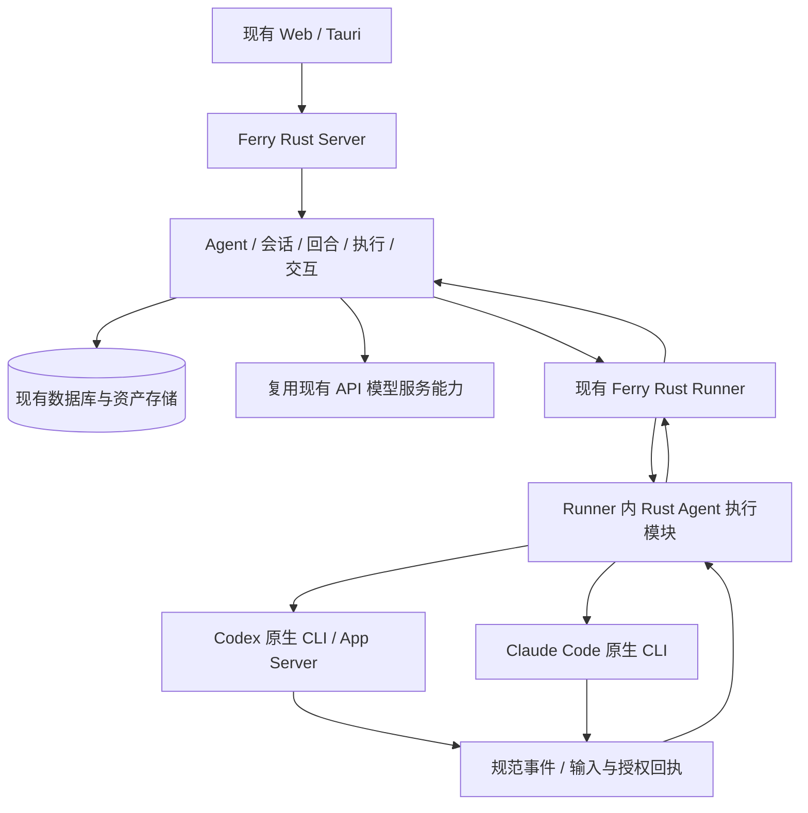

# Ferry · AI Agent 与会话融合迁移计划

> 日期：2026-11-08。状态：Rust 原生执行、智能体管理、模型档案选择和 CLI 私聊/群聊基本闭环已实现并通过 Windows / SQLite 验证；API 直连会话、会话内模型切换、CLI 自动安装、持久记忆及跨库实测仍待完成。此文只依赖本仓库内的设计与实现。
>
> **先在工作空间「维护」增加 AI Agent 管理，再增加一级「会话」，优先交付一个真实可用的单 Agent 会话闭环。** 两个来源项目能复用的代码直接迁入；不适合 Ferry 的部分舍弃或只参考，不为了“融合”搬进另一套平台。
>
> **技术约束：本项目以 Rust 为后端与执行底座，新增 Agent 服务和 CLI 适配在现有 Rust Server / Runner 中实现。来源项目的 Go/TS 执行代码用于参考协议、业务规则与测试场景；兼容的 React/TS 前端代码可以直接迁入。**

## 1. 这次融合要得到什么

Ferry 继续作为唯一产品、服务端和数据底座。保留已有主机连接、仓库连接、工作流、应用部署，在其上增加可以管理、交谈并实际完成操作的 AI Agent。

三者的分工：

| 项目 | 在融合中的价值 | 迁移方式 |
| --- | --- | --- |
| Ferry | 工作空间、成员权限、凭据、主机 Runner、工作流、仓库、部署、存储和桌面壳 | 继续扩展现有架构 |
| 来源会话设计 | 已运行的多端 AI 会话设计、原生会话续接、模型/能力检测、消息与交互呈现 | 优先迁 React/TS 局部逻辑、运行契约和测试用例；不搬整个平台 |
| 来源协作设计 | 智能体协作 产品定义，以及更完整的 Agent、会话、执行与原生 CLI 控制基础代码 | 提取协议、领域规则和测试场景，在 Ferry Rust 模块中实现；兼容的前端逻辑按需迁入 |

**第一期的完成标准不是“菜单和聊天界面出来了”，而是：**

工作空间管理员创建智能体并选择模型档案 → 有权成员从会话入口选择智能体 → 为执行单独分配节点与托管目录 → 发送消息 → 真实运行并保存输出 → 必要时处理工具授权 → 查看结果 → 刷新后仍能读取消息并继续会话。

正式任务、计划、SOP、多人协作、独立质量验证与交付回执属于后续扩展。第一期称为 **智能体协作 基础会话与执行闭环**，不称为完整 PRD 已实现。

## 2. 调研结论与证据边界

本节保留迁入本仓库的设计与执行边界。P0 使用本仓库的 Rust 适配器调用真实 CLI 验证，结果见第 8 节；验收以本仓库实际执行的测试为准。

本仓库实现与验证记录是交付依据；本文直接保留所需设计与约束，不依赖外部工作区、外部版本号或开发者机器目录。

### 2.1 Ferry 已有的底子

| 能力 | 代码入口 | 对本期的意义 |
| --- | --- | --- |
| 工作空间和权限 | `crates/server/src/accounts/` | 复用身份和工作空间提取器；增加 Agent/会话对象授权 |
| 工作空间维护菜单 | `src/app/nav.ts` 的 `ops` 分组 | 在现有维护下增加 AI Agent，不另建管理后台 |
| AI 服务商、调用与成本账本 | `crates/server/src/workflows/ai.rs` | 复用 OpenAI/Anthropic API 接入、凭据与成本事实；目前是工作流调用能力，不是完整聊天服务 |
| 工作流运行与租约 | `crates/server/src/workflows/run.rs`、`executions.rs`、`executions/lease.rs` | 复用已存在的调度与防旧执行写入机制，补齐会话执行适配 |
| 定义版本与文件资产 | `definitions.rs`、`content_assets.rs`、`artifact_store.rs` | 复用版本、文件保管与输出关联能力，不把所有附件塞进消息正文 |
| 主机 Agent 与协议 | `crates/runner/src/`、`crates/protocol/src/lib.rs` | 沿用接入、认证、出站连接与生命周期，增加 AI 执行能力 |
| 现有 Actions worker | `workers/actions/` | 属于既有构建实现；不据此推导新增 Agent 能力也采用 Go |
| Web 与桌面 | `src/app`、`src/features`、`src/shared`、`desktop` | 沿用 React/Vite、共享组件、六种语言与 Tauri |

注意：工作流设计文档中的人工节点等能力，不能仅因有设计就记为已实现。当前 `workflows/run.rs` 对部分设置和节点明确拒绝运行，实施前应按实际支持矩阵接入。

### 2.2 已迁入的会话与执行设计

当前实现入口为 `src/features/conversations/`、`src/app/pages/ConversationsWorkspace.tsx`、`crates/server/src/conversations/` 与 `crates/runner/src/agent/`。聊天设计保留侧栏会话列表、作者与发送时间、按实际到达顺序显示消息、独立草稿、附件预览下载、成员信息和会话操作。新增消息交互由 `crates/server/src/conversations/interactions.rs` 实现：个人未读与收藏、人类成员 @ 提及、回复线程、本人消息编辑/撤回和群成员管理；验证入口为 `scripts/test-chat.mjs`。

### 2.3 执行协议与迁移边界

- Codex 采用原生 App Server 双向协议，Claude 使用原生结构化控制协议；具体适配见 `crates/runner/src/agent/`。
- 原生会话 ID 绑定执行环境，不能作为跨节点可携带的历史；平台消息独立持久化。
- 权限、幂等、审批、取消、未知结果不自动重放和进程回收使用本仓库实现与回归测试。
- 附件可下载不代表模型已读取文件内容；按实际支持能力展示。
- 不引入其他平台的服务框架、单管理员 token 或单节点简化权限。

### 2.4 PRD 取哪一份、哪些约束进入本期

本期确认的需求与约束直接记录于本文；实际能力以本仓库源码及测试为准。

本期继承：Agent 身份与模型/节点解耦；会话与执行分离；真实状态；权限和版本校验；取消有回执；未知副作用不自动重放；消息与决定持久化。

后续迁移仍须遵守：

- 探索进入普通工作项和同一工作流，不新设用户可创建的 ADHOC 执行入口；旧 ADHOC 只做兼容。
- 本机供应商配置、切换、MCP/Skills 管理优先直接复用 cc-switch / cc-switch-cli；平台只补授权、版本、下发及回执，不自建同等配置引擎。
- 消息默认长期保留，归档与物理删除分开；不能照搬预览版删除会话就删除历史的行为。
- 计划、成果接受、检查通过、对外交付和生产发布分别记录，聊天里的“好的”不能替代正式授权。

Ferry 的 Rust、SQLite/MySQL/PostgreSQL、六语言和现有协议继续作为目标约束。原 PRD 的 Go 后端、纯 Go Runner、Centrifugo 等选型不自动成为 Ferry 的技术迁移要求。

## 3. 第一期产品范围

### 3.1 第一步：维护 → AI Agent

Agent 是可持续使用的工作身份，不是一个模型别名，也不强制对应常驻模型进程。

| 功能 | 第一期内容 | 验收要点 |
| --- | --- | --- |
| 名册 | 搜索、筛选、分页、查看、新建、编辑、停用/归档 | 复用共享资源列表和表单；不可伪造在线状态 |
| 基本资料 | 名称、说明、用途/角色、Human 负责人 | 属于当前工作空间，ID 稳定 |
| 执行配置 | runtime、模型、可用的推理参数、运行位置、工作目录、提示词 | 参数由实际适配器能力决定；不支持的参数明确拒绝 |
| 运行方式 | 首期优先本机/远程主机的 Codex 与 Claude Code；已有 API 服务商能力按独立适配器接入 | CLI 登录留在目标用户环境；API 使用 Ferry 凭据引用 |
| 许可与可见范围 | 谁可使用、谁可管理、是否允许文件写入/工具请求 | 使用权不自动获得主机终端权限，管理权不自动获得私密会话正文 |
| 能力检测 | 路径、版本、连接状态、检测时间；支持时返回模型与工具目录 | CLI 存在不等于已登录；在线不等于模型可用；未知如实显示 |
| 快速验证 | 发起一次明确标识的测试会话，复用正式执行链路 | 有真实结果、失败原因和用量归属，不制造另一条测试执行路径 |

新增与更新保存配置修订。已有运行冻结原修订；编辑 Agent 不偷偷改变正在执行的请求。

**停用的最小语义：**阻止新会话和新回合；历史仍可读，运行中的回合仍有显式取消入口。停用不冒充已经杀死原生进程。删除与数据清除政策不在本期自行扩展。

### 3.2 第二步：一级「会话」

位置示意：

```text
工作空间
├─ 会话（新增一级入口）
│  ├─ 会话目录 / 搜索 / 最近使用
│  └─ 当前会话：消息、执行状态、输入或授权请求、结果
├─ 主机 / 仓库 / 工作流 / 应用部署（现有能力）
└─ 维护
   ├─ AI Agent（新增）
   └─ 成员 / 角色 / 变量 / 设置 / 字典 / 活动（现有能力）
```

新建会话先选择有权使用的 Agent；运行节点和模型默认取 Agent 配置。允许的覆盖项集中在会话设置，不要求用户每次重新填一张执行表单。

一期提供：文本/Markdown/代码消息、会话命名、历史恢复、执行和工具事件展开、发送/停止、真实等待状态、重连补拉、只读/无权/离线提示。先保证文本与代码工作，图片、音视频、Office 转换不作为第一批聊天门槛。

附件按所用 runtime 能力接入现有资产服务；首期至少支持受限文本文件，区分“模型已收到的文本”和“仅可下载原件”。不能拿 来源会话设计 的文本附件组件承诺图片理解。

一期先做 Human ↔ 单 Agent 的会话。频道、Human 私信、多人共享、多 Agent 群聊后续再加；数据库与权限设计预留参与者关系，但不提前建设完整 IM。

### 3.3 与现有运维能力的连接方式

第一期只接入 **已授权工作目录中的受控 Agent 执行**，不把全平台主机、凭据和生产部署直接暴露给模型。

第二期再提供明确的平台工具，例如读取工作流状态、创建草稿、发起一次获准的工作流运行。每个工具调用复用现有业务权限和命令，保留来源会话、输入版本和执行引用。操作生产部署仍走独立授权。

这样先做到“Agent 能聊、能做、可追踪”，再做到“通过会话驱动 Ferry”，不会因为接入聊天就意外扩大权限。

## 4. 目标架构与语言复用策略

### 4.1 推荐结构



**在现有 Rust Server 与 Rust Runner 内增加 Agent 和 runtime 适配模块。** Server 负责配置、会话、权限与执行事实；Runner 的 Rust 适配器负责启动原生 CLI、解析结构化事件、传递逐项授权/输入和控制进程。优先复用本仓库已有进程、连接、取消和租约机制。

Codex 需要交互式审批时采用原生 App Server 协议；Claude 按原生双向控制协议接入。旧项目实现可用于核对请求、响应、完成与错误语义，适配器通过 Rust 契约测试和真实 CLI 验证。仅支持单向 exec 的路径必须明确能力限制。

Ferry Rust Runner 继续负责平台连接、身份和生命周期，不新增另一套节点服务。Runner 与原生 CLI 子进程通过各自支持的结构化 stdin/stdout 协议通信，诊断与产品事件区分。CLI 自身需要的运行环境单独检测，不因此引入来源项目的 Go/Node 服务包装层。

### 4.2 明确的搬运清单

| 来源 | 处理 | 目标落点 / 原因 |
| --- | --- | --- |
| CLI 双向控制、事件解析、进程控制及对应测试 | **参考协议与用例，Rust 实现** | `crates/runner/src/` 的 Agent 执行模块；补会话输出、续聊和 Ferry 消息协议 |
| 来源会话设计 的模型选择、Skills 输入、文本附件与消息呈现局部逻辑 | **可直接迁代码主体，改适配层** | `src/features/agents/`、`src/features/conversations/`；替换硬编码文案、API、样式及权限 |
| 来源会话设计 的原生会话 ID 校验、结束事件判定、缓存错误处理 | **迁规则与用例，Rust 实现** | Rust Runner 适配器与会话服务 |
| 来源业务模块的智能体、会话与执行规则 | **迁领域规则，不直接搬服务框架** | Ferry Rust 模块；旧 GORM、IAM、生成查询和 API 契约不适配现有架构 |
| 来源前端的执行会话组件 | **按组件评估后复用** | 可用的回执/草稿/错误处理逻辑迁入，去掉外部组件库、旧 API schema 和项目服务耦合 |
| 来源会话设计 Go Server、Computer Daemon、SQLite schema | **不整体迁入** | 现有 Ferry Server、Runner 和三数据库迁移已承担这些职责 |
| 来源会话设计 Next.js/Electron 壳 | **不迁入** | Ferry 使用 Vite/Tauri，复用内容组件即可 |
| 旧单管理员 token、bootstrap、整段会话快照、内存请求账本 | **不继承为目标机制** | 使用 Ferry 工作空间授权、结构化持久化和幂等命令 |
| API 网关、TUI、完整 PRD 原型及全部业务模块 | **本期不迁** | 与首个闭环无直接依赖，避免范围膨胀 |
| cc-switch / cc-switch-cli | **后续直接集成上游** | 工具配置维护不自研替代；集成前核实版本、许可和实际接口 |

“直接迁入”仍须检查授权/许可证、最小依赖、路径与品牌配置、协议版本和回归测试，不代表原样复制后立即上线。迁移后的设计、适配边界和验证入口记录在本仓库，不引用外部本机路径。

### 4.3 运行身份是必须先解决的集成点

现有 Runner 可能运行在系统服务账号下，而用户的 Codex/Claude 登录、HOME、MCP 与 Skills 在用户账号下。**不能假设主机在线就能复用该用户的 CLI 登录。**

Agent 配置必须标明实际执行账号/环境。第一轮推荐用已有“当前用户”接入方式跑通；系统级服务如果没有相应 runtime 和有效登录，应显示不可用原因。禁止复制用户 CLI 凭据到平台数据库来绕过这个差异。

普通 SSH 主机也不自动等于支持完整交互式 AI 执行；首期先支持具备 Rust Agent 执行模块和能力上报的 Runner 主机。

## 5. 最小数据与状态设计

表名和 API 名称在实现前按现有约定细化，以下是业务边界，不是要求现在一次性建完全部 PRD schema。

| 对象 | 保存内容 | 关系 / 边界 |
| --- | --- | --- |
| Agent / 配置修订 | 工作空间、负责人、使用范围、状态、runtime/模型/主机/目录、提示词及许可引用 | 修改模型不改变 Agent ID |
| Conversation / 参与者 | 工作空间、Agent、发起人、名称、归档、可见范围 | 长期交流身份，不等于某次执行；一期默认仅发起人可读 |
| Message | 作者、顺序、正文/修订、附件引用、来源 | 模型输出与工具事件区分；不靠日志猜测聊天正文 |
| Turn / Execution | 请求幂等键、输入与配置快照、尝试、实际 runtime/节点、状态、用量、结果 | 会话有多个回合；回合可有多个明确关联的尝试 |
| Interaction / Decision | 所属执行、原生请求 ID、输入 schema、作用范围、有效期、结果与理由 | 逐项批准，只作用于那个有效请求 |
| RuntimeBinding | 原生会话 ID、节点、执行账号/配置、目录和兼容信息 | 满足绑定条件才原生续聊；不能跨节点盲用 |
| Event / Outbox | 执行 ID、尝试/租约标识、事件序号、确认水位 | 先持久化后推送；重连补拉并去重 |

会话执行应复用 `executions.rs` 的调度基础，并明确与 `workflow_executions`、`pipeline_runs` 的关联，不能让一个字符串 ID 在三个表间靠猜测解析。建议增加 Agent 执行种类/业务记录，复用租约与编号基础，而不是把聊天消息硬塞成某个工作流节点输出。

一期只有会话和回合执行，不引入完整 WorkItem 管理。第二期把行动请求提升为工作项，并关联现有执行；普通问答无需创建任务。这个分期是基础闭环的范围，不代表已满足 PRD 的正式工作和验收流程。

运行状态至少区分：排队、运行、等待输入、等待授权、停止中、成功、失败、已取消、中断/结果待核实。具体枚举以共享协议统一。

关键规则：

1. 同一会话串行执行；同一可写目录先采用单执行锁。没有隔离能力时不开放并发写入。
2. 提交成功、节点收到、runtime 已采用分别显示；无运行中 steer 能力时明确排队到下一回合，不伪装已应用。
3. 有明确完成事件才记成功。原生进程成功不等于任务验收通过，更不等于已经生产发布。
4. 取消收到原生停止回执后再记终态；超时或节点失联时显示待核实，不直接重新运行。
5. 原生续聊失败时保留原历史；需要重建上下文就新建关联尝试并说明，不静默从空会话继续。
6. Agent 停用、授权撤回、凭据失效和节点离线独立处理；每次提交及重要工具动作重新校验权限。
7. CLI 用量与 API 费用按来源记录，无法获得则标未知/估算，不记零、不把网关累计用量重复累加。
8. 平台消息是长期权威历史，原生 CLI 历史只是执行环境依赖，不替代服务端持久化。

## 6. 分阶段实施顺序

各阶段以验收通过作为下一阶段入口，不先承诺未经编译和真机验证的日期。

### P0 · 锁定复用边界与 Rust 执行契约

**工作：**固定来源版本；提取可直接迁入的前端逻辑与 CLI 协议用例；在现有 Rust Runner 中验证最小适配器的启动、事件、一次授权、取消和原生续聊；确定运行账号及协议。分别登记 Codex、Claude 的能力，不互相推定。

**交付：**可编译的 Rust 适配器验证代码、协议草案、复用来源清单及真实能力矩阵。仅为后续实现准备，不引入第二套平台。

**通过条件：**至少一条真实本机执行链路可复现；输出正文和原生结束可识别；如果要进入正式工具执行，逐项批准/拒绝都须验证。无法直接复用的源码只保留必要行为参考，不为搬代码增加异语言执行服务。

### P1 · 工作空间维护中的 AI Agent 管理

**工作：**实现 Agent 数据、配置修订、权限和共享资源页；关联现有主机及凭据；能力检测、停用与归档；准备含 Agent 执行模块的 Rust Runner 版本。

**通过条件：**管理员建 Agent 并刷新重开后配置一致；普通成员仅见可使用的 Agent；另一个工作空间不可访问；无 CLI、未登录或离线有真实原因；修改配置不影响已冻结的运行。

**此时只完成管理，不宣称会话闭环。**

### P2 · 一级会话与真实回合执行——首个交付目标

**工作：**会话目录/详情、消息持久化、输入与输出、节点执行、原生续聊、逐项授权/输入、停止、断线恢复、受限文本附件及用量显示；Web 与现有 Tauri 共用界面。

**建议验证顺序：**先选本机已有有效登录的一种 CLI 走通纵向链路，再接另一种；若某适配器未过真实验收，单独标受限，不将整个模型目录视为已支持。API 型聊天可以复用已有 provider 基础，但流式、历史、工具循环须作为同样的适配器验收，不能以工作流已有 API 调用代替。

**通过条件：**下节 A01–A12 通过，至少一个可写执行方式真实可用，支持范围逐项记录；第一批优先覆盖 Codex 和 Claude Code，不以二者同时“填上选择项”作为完成。

### P3 · 会话驱动 Ferry 工作与工作流

**工作：**从消息生成可确认的行动草稿；引入轻量工作项、来源双向引用；调用已有工作流/构建/仓库能力；固定输入和输出引用；展示结果与人工确认。探索也使用同一工作项/流程，不另起执行引擎。

**通过条件：**从一句操作请求 → 确认草稿 → 真实工作流执行 → 文件/结果 → 会话回写的完整链路；重复点击不重复创建工作或运行；无权主机和生产动作不能通过聊天越权。

### P4 · 按实际使用扩展 智能体协作

依赖先后逐步增加：多人频道和私信 → Agent 分派与共享边界 → 计划/SOP 与交接 → 独立检查、成果接受和交付 → 知识/记忆、报告/目标与专业业务包。工具配置管理按 PRD 集成 cc-switch，手机壳、远程服务预览和外部 IM 另做能力验收。

OKR、绩效、完整项目管理、多 Agent 编制、全行业模板不是 P1/P2 前置条件；保留为方向，届时用实际业务驱动，不把庞大 PRD 的全部表和菜单提前迁进来。

## 7. 首个闭环的验收清单

以下是 P1/P2 产品闭环验收，尚未完整执行；P0 底层验证不能代替页面、权限、持久化与恢复的整体验收。模型测试要记录 CLI/Runner/Server 版本、实际节点、执行账号、模型和证据位置。

| 编号 | 场景 | 必须观察到的结果 |
| --- | --- | --- |
| A01 | 创建 Agent 后刷新页面、重启服务 | 配置、权限和修订不丢失 |
| A02 | 两个工作空间与两个普通成员访问 | Agent 使用范围、会话正文、附件、事件都按对象授权；管理员不因能改 Agent 就可旁观私聊 |
| A03 | 新建会话，提问后刷新、另开页面、关闭再回来 | 同一会话、消息和执行身份恢复，关闭页面不取消任务 |
| A04 | 首轮说明随机标记，次轮要求回忆；两轮之间重启 Runner | 正常条件下正确原生续聊；不可续聊时明确失败/重建方式，不声称无损恢复 |
| A05 | 在临时目录真实读取并修改测试文件 | 结果与磁盘实际内容一致；写入限于批准范围，有可核对输出 |
| A06 | runtime 请求工具许可，分别允许和拒绝 | 只批准当前请求；拒绝确实阻止动作；旧授权卡片不能批准新回合 |
| A07 | 运行中补充信息或回应原生问题 | 待处理、已采用、拒绝有实际回执；不支持时明确说明 |
| A08 | 运行中取消，重复点击取消，取消后再发消息 | 停止状态真实、子进程按协议回收；新回合不接收旧输入/旧决定 |
| A09 | 临时断网、Runner 退出、Server 重启 | 事件补拉去重；旧租约写入拒绝；不确定的文件/外部操作不自动重放 |
| A10 | 编辑/停用 Agent、节点离线、CLI 未登录、模型错误 | 正确冻结配置、阻止新派发并显示具体失败，不静默切模型 |
| A11 | 附件超限、无权附件、输出量大、正文含不安全 Markdown | 服务端校验、原件权限、分页/限流、安全渲染生效；不拖垮会话 |
| A12 | Web/桌面、手机宽度、六语言、深链接与返回 | 同一身份与数据、草稿和位置正确；沿用主题组件，旧运维菜单仍正常 |

实现检查：受影响 Rust workspace 检查/测试、Rust runtime 适配器契约测试与目标平台构建、前端类型与生产构建；数据库迁移在 SQLite/MySQL/PostgreSQL 验证；Runner 协议需验证新旧版本行为。真实模型调用与审批/取消不能只用 mock 代替。

回归重点：主机终端与传输、现有工作流与构建、仓库凭据、应用部署、Runner 生命周期。首轮本机验收不等于 Linux/macOS 真机、生产网络或正式发布已验收。

## 8. 文件落点与迁移边界

建议新增业务目录 `src/features/agents/`、`src/features/conversations/`；管理页使用现有资源 DSL，会话消息流使用独立业务视图并复用 shared。按实际职责选择 Rust 模块边界，不为每个表机械新建一层框架。

预计扩展：

- `src/app/nav.ts` 与现有路由/资源注册：维护中的 AI Agent、一级会话及深链接。
- `crates/server/src/`：Agent/会话业务模块、迁移、权限声明、运行与事件接口。
- `crates/protocol/src/` 与 `crates/runner/src/`：AI 能力上报、Rust Agent 执行模块、原生 runtime 适配器及输入/授权/取消回执；更改协议须明确兼容策略，不能静默修改现有严格版本检查。
- `src/shared/i18n/locales/` 等现有国际化入口：补齐六种语言，不引进来源项目第二套 i18n。
- 既有构建/分发流程：含新适配器的 Rust Runner 构建、完整性验证、版本匹配和排空更新；外部 CLI 依赖明确检测。

现有主机、仓库、工作流和部署的接口、ID、历史与存储保持兼容。底层扩展以明确能力为单位，不因做聊天而重构整套 Server/Runner。

### 数据迁移怎么做

第一轮建议只迁代码和设计，旧会话是否导入作为独立事项；不能因用户说“迁功能”就扫描和上传全部私人聊天。

后续若需要历史导入：先由用户选择来源和目标工作空间/会话归属 → 只读导出 → dry-run 展示数量、映射和无法读取项 → 用来源项目+原 ID 建幂等映射 → 导入正文、附件和实际历史状态 → 核对计数/哈希/关联。历史审批不得作为新的有效授权，历史 native ID 不自动获得跨机器恢复能力。导入前备份；失败回滚只撤销本次新建记录，不覆盖现有数据。

### 上线与回退

新增能力用工作空间级开关灰度；迁移优先新增表/字段，不重写旧工作流记录。回退时关闭新派发，先排空或明确终止 Agent 执行，再恢复兼容版本；新会话历史保留，不靠删除数据回退。发布包要标明 Server/Runner 与原生 CLI 协议的兼容范围。

方案已获开始实施确认；P0 已增加 Rust 协议与原生 CLI 执行代码，验证状态见下节。尚未修改业务数据库、重启现有服务、提交推送或发布。

### P0 实施结果（2026-11-08）

已增加 `crates/protocol/src/agent.rs` 和 `crates/runner/src/agent/`，复用现有 Runner 专用连接及进程回收。Codex 使用 app-server；Claude 使用双向 stream-json。包含原生会话标识、文本/工具事件、用量、逐项授权、取消、超时和明确结束。能力位仅表示支持协议，不代表已安装或已登录 CLI；旧 Runner 缺少能力位时拒绝 Agent 派发。

Windows 当前用户身份下，Codex 0.167.0 与 Claude Code 2.1.316 各自真实验证了首轮回复与原生续聊、文件写入允许/拒绝、等待工具授权时取消，以及经过 Runner WebSocket 的授权/取消；隔离临时目录中的磁盘结果符合决定，模型沿用原生配置。Runner 41 个单测和 3 个 CLI 回归、协议 7 项、服务端 Runner 33 项通过，workspace（含 tests）检查通过；覆盖错误协议、输出边界、背压、超时、消费者断开与 Windows 子进程清理。完整记录与后续检查见根目录 `MEMORY.md`；原始日志和执行环境/源码哈希保留在忽略目录 `data/maintenance/agent-p0-validation/`。

P0 当时未包含维护 Agent 配置、会话页面、Server 持久化与权限闭环；后续实现见 P1/P2。结构化问题回答和运行中追加输入未实现；未知请求失败退出。`DecisionSent` 仅代表决定写入原生进程。Claude 只读模式禁用工具，并非 OS 沙箱；本地 CLI 已有许可规则仍可能自动允许部分操作。页面关闭不断任务由 Server 持有执行连接实现，不能直接将 P0 执行连接交给浏览器。

### P1 实施结果（2026-11-08）

已增加维护中的 AI Agent 共享资源页、Rust CRUD API、增量迁移与不可变配置修订；负责人私有/空间共享与既有角色权限叠加，创建及执行绑定变更要求主机管理权限。可配置 Codex/Claude、模型、Runner 主机、目录、提示词、工具许可、负责人、状态与使用范围。停用/归档保留配置和历史；实际执行准入由 P2 实现。

新增独立 Runner 环境检测能力位与专用检测会话，只返回执行账号、CLI 路径/版本、登录状态和目录状态，不调用模型、不返回原始认证诊断。缺少 CLI、目录不可访问、主机离线及旧 Runner 能力不足均已有实测；六语言详情及按钮、共享表单真实创建/编辑、只读成员无越权选项请求、跨空间隔离、过期版本冲突和 Server 重启后的持久化通过。当前账号 Codex 未登录、Claude 已登录，检测结果与实际一致；不改变 CLI 登录。

复现：`cargo build -p ferry-server -p ferry-runner` 后运行 `node scripts/test-ai-agents.mjs`（需 Chrome），自动启动隔离实例并关闭自建进程，临时数据/日志保留供核对。报告和截图在 `data/maintenance/agent-p1-validation/`；可通过 `FERRY_TEST_DATABASE_URL` 指向专用空库运行同一验收。当前仅 SQLite 已实跑，MySQL/PostgreSQL、Linux/macOS、系统服务身份及集群检测尚未验证。尚未提交推送、更新现有服务或发布；P2 进展见下节。

### P2 实施与本机验收（2026-11-08）

已增加一级「会话」、共享列表/创建/编辑表单和独立消息页。Rust Server 保存私有会话、回合与有序事件，后台持有 Runner 执行连接；浏览器关闭不会取消。消息、UTF-8 文本附件、工具请求、审批决定与原生回执、用量和终态均保存；按序号分页补拉。管理员也不能读取其他成员私聊。重命名、归档和恢复支持版本校验；interrupted 会话不能通过修改状态绕过恢复边界。

新会话冻结 Agent 修订/配置、Runner 注册身份、执行账号环境指纹、CLI 绝对路径与规范目录。后续回合复核使用权限和范围；停用阻止新准入，已有执行保留审批及显式取消。Server 租约拒绝过期写入，Runner 目录内核锁排斥同时执行。只在确认完成后保存原生会话供续聊；未知中断不重放，运行中追加消息明确拒绝。审计保存动作/回合标识，不记录私聊正文。

真实 Windows/SQLite/Claude 已验证：附件中的随机标记被回复、关闭浏览器继续完成、Runner 重启后原生回忆、Agent 编辑不改冻结配置、页面/Server 重启历史与事件保留、同目录第二次执行被拒绝、逐项允许确实写文件、拒绝不写入、旧决定不能复用、重复取消及下一回合，以及审批等待时 Server 重启/Runner 退出后中断且不重放。脚本 `scripts/test-conversations.mjs` 使用新临时目录与已有 CLI 登录，报告/截图在 `data/maintenance/conversation-validation-claude/`。

回归：Server 543 PASS/9 ignored（含会话状态机/权限6项）、Runner42 PASS/6 ignored、CLI3 PASS、协议7 PASS，前端491 PASS/1 skip；workspace含tests检查与Rust/前端生产构建通过。P1真实管理11组回归通过。P2最终12组真实验收通过，包含六语言会话页、归档恢复和停用中浏览器审批；已查看桌面、手机和审批截图。

边界：当前 Codex 未登录，P2 Codex 产品链路未实测；P0适配器既有测试不能替代产品验收。MySQL/PostgreSQL、集群、Linux/macOS、系统服务账号及桌面壳尚未实测，当前本机验收不覆盖它们。尚未提交推送、更新现有服务或发布；不导入来源历史，不实现多 Agent 协作、结构化问题回复或运行中追加输入。

## 9. 实施前需要确定的少量选择

不影响本方案交付；以下建议在进入对应实现阶段时冻结，不能把推荐写成已获用户批准的政策。

| 选择 | 推荐 | 冻结时点 |
| --- | --- | --- |
| 首个真实运行环境 | 当前用户身份的已有 Runner 主机，已有有效 CLI 登录 | P0；解决系统服务与用户登录差异 |
| Rust 适配器边界 | 复用现有 Rust Runner 机制，参考来源协议/测试实现最小 runtime 适配器；后端与执行语言已确定为 Rust | P0 明确接口并做真机验证 |
| 首批 runtime | 先跑通本机可用的一种，再补 Codex/Claude 另一种；逐项公布能力 | P0/P2 |
| 会话隐私 | 一期发起人私有；Agent 可共享使用，使用者的会话不自动共享 | P1 数据与权限设计 |
| API 型聊天与 CLI 先后 | CLI 为代码复用重点；已有 API provider 适配可随后接入同一会话内核 | P2 资源评估 |
| 历史数据 | 首轮不导入；如需迁移，先明确数据与归属 | 单独数据迁移前 |
| 正式工具执行范围 | 先限定测试/工作目录；生产平台操作后续逐工具接入 | P0/P3 |

**下一阶段：在具备专用空库/对应运行环境时补齐跨库和平台验收。先使用已有单 Agent 会话链路实际完成小任务，再确定下一批 智能体协作 功能。**

## 10. 仓库内设计与实现入口

- [产品与技术方案](./ferry-运维平台产品与技术方案.md)、[工作流总体设计](./ferry-工作流平台v3总体设计.md)。
- 智能体与模型：`src/features/agents/`、`src/features/models/`、`crates/server/src/agents.rs`、`crates/server/src/models.rs`。
- 会话交互与独立消息存储：`src/features/conversations/`、`src/app/pages/ConversationsWorkspace.tsx`、`crates/server/src/conversations/`。
- 原生执行适配与协议：`crates/runner/src/agent/`、`crates/protocol/src/agent.rs`。
- 验证：`scripts/test-ai-agents.mjs`、`scripts/test-chat.mjs`、`scripts/test-conversations.mjs`；未运行的环境不能记为已验收。

需要保留的参考内容必须先复制或适配进当前仓库，再引用仓库相对路径；文档不依赖开发者本机存在的其他项目。

## 11. 本机验收后的设计修正（2026-11-08）

### 会话就是聊天工作台

用户明确要求一级「会话」下左侧直接列真实会话，右侧为消息流与输入区；不再显示同名二级菜单、资源表格或资源页的重复标题/面包屑。左侧可搜索、新建并切换会话，当前项高亮；手机以侧栏抽屉切换。新建/重命名/归档仍复用统一表单，创建成功直接打开聊天。会话切换保留当前页面生命周期内各自未发送草稿。

会话工作台实现见 `src/app/pages/ConversationsWorkspace.tsx` 与 `src/features/conversations/`；复用本仓库主题、权限和移动抽屉。

### 模型配置 → Agent → 执行环境

用户进一步明确先提供「模型」菜单，类似Web版cc-switch，再在创建Agent时选择已有配置。这里的模型配置指可复用的连接/执行档案，可包含多个实际模型名。

| 层 | 内容 | 不应混入 |
| --- | --- | --- |
| 模型配置 | API或CLI类型、协议/工具、连接地址、凭据引用、自动发现/手填模型列表、默认模型、CLI版本及安装状态 | 会话目录、聊天正文 |
| 人工Agent | 名称、负责人、模型配置引用及具体模型选择、角色/提示词、使用范围、启停 | 工作目录、工具许可、无必要的说明字段 |
| AI派生Agent | 来源类型、父Agent、来源会话/执行、模型引用、任务、状态/生命周期 | 冒充人工维护对象、隐式扩大权限 |
| 会话/执行 | 模型配置修订快照、实际Runner身份、独立目录、工具许可、事件/产物/回收状态 | 改写全局CLI配置来切换供应商 |

Agent页分「人工创建」「AI创建」两个tab。不能仅根据owner_id区分来源；AI派生对象需保留父子与来源执行关联。临时子Agent的创建和工具权限应受父任务授权约束，不能因模型提出请求就获得平台管理权限。该项属于后续协作执行能力，不能用空tab宣称已经支持派生执行。

API首先覆盖OpenAI兼容和Anthropic协议；「OpenAPI」在此按用户语境理解为OpenAI兼容接口，协议值需明确。模型列表优先调用供应商支持的发现接口，同时始终允许手填；无列表接口或发现失败不静默填入臆造模型。API密钥复用既有加密credentials/vault，Web不回显明文，列表/Agent读取不等于凭据使用授权。现有`workflows/ai.rs`已有OpenAI/Anthropic调用、ai_providers、预算与费用账本，应先扩展并复用，而非新增平行API调用栈。

CLI首先覆盖Codex、Claude Code；从cc-switch借用供应商档案、认证类型、CLI原生配置映射与模型选择交互。已读取上游`farion1231/cc-switch`的README、MIT LICENSE（Copyright 2025 Jason Young）及`src-tauri/src/provider.rs`，确认Provider包含settings_config/metadata及各工具配置映射。直接移植适用代码时保留许可证与来源声明；Tauri桌面IPC、用户全局配置切换流程须适配为Server/Runner协议，不能整应用照搬。当前没有拷贝其产品源代码，也未宣称全部执行模式兼容。

用户已确认：缺失CLI由Runner自动安装到Ferry专用目录，使用独立配置；不得改已有CLI登录、PATH或全局cc-switch配置。执行准备应有检查→安装/校验→配置→就绪/失败的可见状态，按OS/架构使用受支持安装方式和锁定版本，并发只安装一次；安装失败明确失败，不静默改工具或模型。CLI版本可共享只读安装缓存，各次执行的HOME/配置/凭据文件分别隔离；短期凭据按需下发并在执行清理时撤销。API模式不安装CLI。已有用户CLI登录的复用属于明确的兼容模式，不能把个人登录复制到新HOME后假称已经隔离。

### 独立目录与自动清理

用户要求流水线、AI执行器和临时子Agent都在各自执行环境中使用独立可写目录，互不影响。目录由Runner管理并与workspace/执行对象/attempt绑定，来源仓库以独立checkout/worktree或受控输入复制到目录，不能以源项目目录直接充当可回收临时目录。只读工具缓存可以共享；协作写入需显式共享区或受控产物传递。

建议结构（运行根目录来自配置，不硬编码磁盘路径）：

```text
<runner-data>/tools/<tool>/<version>/                  # 受控安装缓存
<runner-data>/cache/<workspace>/<cache-key>/           # 配额/过期管理
<runner-data>/workspaces/<workspace>/runs/<run>/<attempt>/
<runner-data>/workspaces/<workspace>/conversations/<conversation>/
<runner-data>/workspaces/<workspace>/subagents/<task>/<attempt>/
```

流水线每次run/job/attempt目录独立，临时子Agent按任务独立；AI会话保留自己的持久目录以支持续聊，每回合再分隔可清理的临时目录。会话归档不自动等于删除续聊状态，保留策略必须显式可配置。目录隔离不等于OS沙箱；进程/网络/系统权限隔离复用既有执行沙箱策略，另行验证。

统一顺序：停止接收执行输入 → 等待进程及后代退出 → 收集/校验日志和产物 → 持久归档成功 → 删除执行凭据与临时文件 → 标记回收完成。API聊天本身无本地文件任务时不制造无用目录，但一旦派发工具执行，工具调用也必须有独立上下文。

| 数据 | 回收规则 |
| --- | --- |
| 临时checkout、编译中间文件、运行时TMP与临时工具配置 | 执行结束且产物归档后回收，失败/取消也走同一流程 |
| 成品、日志、报告、清单及哈希 | 存入现有产物/内容存储，按其保留策略回收 |
| AI会话工作成果/native状态 | 会话生命周期内保留，按会话保留策略或明确删除请求处理 |
| CLI安装、可复用依赖/模型缓存 | 单独版本/配额/TTL管理，活动引用期间禁止回收 |
| 未确认退出或产物归档失败的现场 | 保留并标记待回收/失败，不靠租约过期推断可删除 |

回收状态与执行结果分开，需记录pending/collecting/archived/cleaning/cleaned/failed及错误；幂等重试不改写原执行成败。Runner掉线或服务崩溃后用持久清单补扫，只清理可证明无活动引用的Ferry托管目录。删除前校验规范根目录/归属/租约，不跟随符号链接或Windows junction，不删除用户仓库、已归档产物或会话历史。首次引入自动回收须用隔离fixture验证跨对象目录不被误删。

既有实现边界：`pipelines/actions_run/job.rs`已创建每job私有目录，并在执行收尾调用删除；`workers/actions/main.go`已配置AutoRemove。需要进一步验证产物归档失败和进程失联时的保留/补偿边界，不能仅据此宣称已有完整回收器。当前AI执行只有进程回收和目录内核锁，尚未实现上述托管目录/安装缓存/回收状态机。

### 后续实施顺序与验收

模型档案首阶段采用独立的工作空间配置资源，API/CLI档案引用现有ai_providers，复用其加密凭据和供应商编辑入口；保存模型列表、默认模型、CLI版本要求、启停与定义修订。模型列表可以手填，或通过供应商的models接口加载；发现失败不影响手填。当前已接通智能体模型档案引用与新CLI会话的自动节点分配；API会话执行、CLI私有安装仍未接通，CLI版本字段不表示已安装该版本。旧会话保留执行快照，显式切换模型另行实现。实际验证和交付状态以MEMORY.md为准。

先交付并更新正在验收的会话布局、Agent字段调整；随后实现模型资源/修订/权限与模型发现，Agent模型引用和来源分类；再接入独立CLI安装配置、API/CLI共同执行契约、托管目录与归档/回收。多Agent派生执行在这些底座完成后实现。

新增验收必须覆盖：两套供应商/模型并行不互相覆盖；Agent选择与冻结修订；API/CLI实际调用；CLI缺失、安装失败、并发安装、私有配置不改用户全局登录；两次流水线/两会话/两子Agent目录互不干扰；产物归档后临时目录回收；归档失败保留现场；取消/崩溃/离线回收补偿；原仓库/其他任务/活动缓存/会话续聊状态不被误删。上述新增底座仍是设计与待实现范围，不由前一轮Claude本机验收替代。

## 12. 长期智能体身份与执行解耦（2026-11-08，用户追加确认）

中文产品文案统一使用「智能体」，首次介绍可写「AI 智能体」，英文保留AI Agent；代码/API继续使用agent。人与智能体平等协作：智能体是可长期拥有的成员，不能绑定某台Computer/Runner或某种本机CLI。维护下可先创建智能体，无在线Runner时也能维护其定义。

| 对象 | 持久内容与职责 |
| --- | --- |
| 智能体身份 | 稳定ID、名称、负责人、角色、使用范围、人工/派生来源、启停与版本 |
| 智能体定义 | system prompt、默认user prompt任务模板、默认模型引用、Skills、MCP绑定及其授权范围 |
| 智能体记忆 | 由平台持久管理，与模型和节点无关；有来源、可见范围、修订/删除及检索授权，不能等同CLI本地历史 |
| 会话 | 单独会话保持私有；群聊明确邀请人和多个智能体，只有被明确@的智能体回复，模型回复不得自动触发无限互调 |
| 执行实例 | 每次任务绑定实际模型/修订、Runner/节点、账号环境、工作目录、工具权限、产物和日志；可手动选择或按策略调度 |

system prompt定义长期行为，智能体上的user prompt是默认模板；成员每次发出的消息是当前任务输入，不能用它覆盖长期定义。Skills和MCP是带版本、凭据引用和授权的能力，不是默认拥有全平台权限。长期记忆需区分智能体私有、指定会话/群共享、任务临时上下文；私聊内容未经授权不能进入另一私聊或群聊，也不能因群中邀请智能体而暴露它的所有历史。

运行时流程：解析任务与智能体修订 → 选实际模型和满足能力的节点 → 检查/准备CLI及独立配置、Skills/MCP → 分配执行目录和最小所需记忆上下文 → 冻结执行绑定 → 执行/审批 → 归档成果与有来源的记忆候选 → 清理临时状态。API纯聊天可不需要Runner；工具/CLI执行需要Runner。节点选择失败应明确报告，不能静默换模型或权限。

跨节点指新任务可派发不同节点；运行中迁移必须有明确检查点与状态/文件传递能力。未知中断仍不重放；CLI原生会话未证明可移植时，不把旧native session ID发给另一账号/节点。智能体长期记忆不受此限制，但每次检索仍受会话授权约束。

迁移时保留现有会话已冻结的身份绑定；旧Agent.host_id作为兼容默认候选，新智能体无需配置主机。智能体管理已移除固定主机字段并引用模型档案；新CLI会话可自动选择在线授权节点。持久记忆/Skills/MCP、CLI自动安装与跨节点续跑尚未实现，不把节点分配等同完整调度器。

### 与节点绑定方案的区别及调度边界

按用户描述，Raft的流程是先启动Computer Runner，再在创建智能体时绑定Runner及该节点已检测到的CLI；此处未独立核验Raft现有产品能力。Ferry目标是先建立智能体身份与默认能力配置，实际任务到来后再选择可用执行环境。CLI检测用于报告节点能力、版本和可复用安装，不作为创建智能体的前置条件；缺失且受支持的CLI按既定策略安装到专用目录，不覆盖用户全局环境。

智能体可跨节点承担不同任务，但任务仍受OS/架构、网络、仓库与数据访问、工具版本、凭据授权等约束。调度范围是满足约束的节点集合，不是任意机器。节点离线不影响身份存在，只影响相关任务的执行就绪状态；无可用节点或安装不受支持时应明确等待/失败原因。

默认模型、能力声明与可选节点偏好属于智能体配置；实际模型、节点、工具版本、凭据引用和目录属于执行快照。平台保存可移植的身份、授权记忆和已归档成果，CLI原生历史及未归档本地文件不能默认跨节点恢复。先完成手动选择节点与执行准备闭环，再扩展按约束自动调度；不以完整集群调度器作为首版前提。

### 当前聊天升级实施范围

会话可由创建者确认删除，执行未退出时拒绝删除；删除消息并释放附件引用交给既有GC，不删除原仓库。单独会话与明确成员群聊复用既有调度/租约/事件流。群里每个智能体冻结独立原生会话状态，被@的多个回复按消息顺序执行；工具审批及取消属于触发人。创建时多选成员和智能体；创建者可在成员管理中增删参与者。成员修改使用独立版本标记，不受普通新消息干扰；真实成员并发修改拒绝覆盖，执行中拒绝修改。移出后保留历史并立即收回会话及附件访问权。

文件复用加密内容存储、配额与引用回收，支持图片/语音/视频/任意文件上传及对应预览/下载（每文件32MiB、每消息10个）；当前CLI只自动读取受限UTF-8文本，媒体语义理解待适配，不能宣称已支持模型视觉/语音/视频。录音使用浏览器麦克风授权，不加入外部转录服务。

输入区右下角使用发送组合按钮：主按钮显示「发送（Enter）」或「发送（Ctrl+Enter）」，相邻下三角展开菜单切换并记忆（用户最新要求，替代原左下角独立选择器）。默认Enter发送/Ctrl+Enter换行，可反转；中文IME不误发，Shift+Enter换行。右上角拖拽柄向上增加输入高度，支持键盘调整并记住高度。复用主题/共享AutoForm与六语言，验证桌面和手机、附件权限/真实字节、群内可见性、仅@执行、删除后不可访问。

## 13. 聊天体验与模型切换补充（2026-11-08）

新建聊天只处理会话类型、参与者与可选标题。单聊选一个智能体；群聊直接多选人员和智能体，显示已选项并可搜索，不要求用户指定主智能体。群聊所有智能体地位相同，仅被明确@时回复。目录与工具许可不放在新建聊天表单中。

普通聊天不要求用户提供工作目录。CLI底座仍需进程工作目录时，由Runner在该实例私有状态目录下按会话和智能体分配独立托管目录；不使用用户项目作为默认目录，不覆盖旧会话的目录绑定。托管续聊目录不等于随回合删除的运行缓存，清理仍遵守§11的归档和生命周期条件。任务可以访问多个经授权目录；聊天根据实际执行记录汇总目录及所属节点，不根据消息中的路径字符串猜测，更不能自动扩大写权限。托管初始目录与工具实际使用的多目录是不同能力。

智能体默认模型、会话选择和某次执行实际模型必须区分。已有P2实现把执行配置冻结在会话上，修改智能体不影响旧会话；这解释了智能体改成Codex后旧会话仍走Claude的行为，但不能作为新方案的最终体验。聊天需始终显示当前实际执行器/模型，并支持显式切换；默认配置变化时让用户看清旧会话当前仍用哪个配置。

切换模型保留平台聊天消息，创建新的执行绑定与原生上下文，不把Claude的native session ID交给Codex，也不把节点A的本机会话直接交给节点B。历史回合保留当时模型和配置证据；新上下文只能使用当前会话有权访问且有界的历史。运行中禁止切换，未知执行不得借切换自动重放。验收以服务端派发配置和执行记录为准，不以模型自报身份为依据。实现进度只记录在MEMORY.md。

### 聊天消息交互与个人状态

共享消息支持回复线程、人类成员提及、本人编辑与撤回；编辑采用版本校验，撤回保留占位。个人收藏与单调阅读位置独立持久化，左侧显示个人未读数，右侧可筛选未读、@我和收藏。编辑/撤回不改写已执行请求与CLI原生历史，执行中拒绝操作。附件仅被撤回消息引用时，原下载链接也拒绝访问；仍有正常消息共享引用时继续可用。

上述状态使用现有SQL数据库，迁移入口为 `crates/server/src/migration/chat_interactions.rs`。升级时保留旧消息及作者名称，不迁入外部项目的数据库或本机会话历史；跨数据库部署仍需对应数据库的实际验收。
