# Ferry 工作流平台 PRD

## 1. 文档信息

| 项目 | 内容 |
|---|---|
| 版本、日期 | v1.4-draft，2026-11-02 |
| 状态 | 已按独立评审修订，待复核 |
| 读者 | 产品负责人、设计师、前后端开发、测试、部署与运维人员 |
| 产品范围 | 研发交付、通用自动化、AI 内容生产，共用工作空间、执行、资产与权限体系 |
| 变更记录 | 2026-11-02：v1.4-draft，新增§1c.1–9及代码/规范证据、既有模块审计事件表；逐格复核338个待补并重分类，保留专属缺项；只修改本PRD及自查，无commit/push。 |
| 本次变更 | §1c统一审计、删除保留、错误、名称、联动、配置生效、HTML替代及R01；模块与§14同步关闭已解决全局缺口，保留精确专属项。 |
| 变更记录 | 2026-11-02：v1.3-draft，新增FR-RV-01–26、AC-RV-01–26与G-01–26来源缺口；配套逐功能设计评审自查；仅修改本PRD及自查文档，不提交或推送。 |
| 变更记录 | 2026-11-02：v1.1-draft，折入 V1–V15、D1–D17 与 Q01–Q15 决议；D4 按发布绑定修订，D5/D6 标明已被实现取代；新增具体 FR/AC，保留 ADR 未覆盖的细节于 §13「仍待澄清」。 |
| 变更记录 | 2026-11-02 根据独立评审修订（12 Important / 3 Minor） |

关联文档及本文简称：

- [v3 总体设计](../ferry-工作流平台v3总体设计.md)，简称「v3」；**§18 为规范性补充，覆盖同文前面的冲突内容**。
- [v2 流水线设计](../ferry-流水线全功能设计.md)，简称「v2」；§27 为 D1–D13。
- [流水线对标功能清单](../ferry-流水线对标功能清单.md)，简称「流水线清单」；§3.1 为 D14–D17，§3.2 为补充项。
- [工作流能力清单](../ferry-工作流能力清单.md)，简称「能力清单」；是逐项功能覆盖与验收来源，完整节点及家族成员不在本 PRD 重复抄录。
- [产品与技术总方案](../ferry-运维平台产品与技术方案.md)，简称「总方案」；§4–§8 约束角色、路由、REST、共享列表和表单。
- [ADR](../../ADR.md)：确认 Windows Actions 既有方案（2026-11-01）、D1–D17（其中 D5/D6 已被已实现的方案取代，见 ADR 2026-11-02「D5/D6 superseded」）、三平面范围、V1–V15 及 Q03–Q15（2026-11-02 最新决议）；D4 按发布绑定身份修订；补充遵循最新「PRD review follow-up defaults」（跳过、退回、上传及统计默认值）。另遵循 2026-10-31「Unified list and form migration」。
- [原型 HTML 目录](prototypes/)与[截图目录](images/)：01–16 一一对应；产品文字与图示的使用方式见下节。

来源优先级：已确认 ADR 决策和用户明确范围 → v3 §18 → v3 其他章节及 v2、两份清单；总方案的共享资源契约继续有效。跨文档仍无法消解的差异列入 §13。技术实现、存储结构、调度算法和接口细节引用原设计，不在本文重写。

## 1a. 原型与截图使用规则

原型用于说明需求、减少理解偏差，**不是像素规范，不得盲目照抄**。发生不一致时，按以下顺序理解：**本 PRD 功能需求与验收标准文字 > 原型上的编号标注（callouts，标注要素是必须实现的需求点）> 原型未标注部分（仅示意）> 对标产品截图（仅帮助理解行为）**。文字仍存在歧义时，先按 §13 提请产品负责人确认。

**必须遵循（规范性）**：每个编号要素的存在、展示信息（字段、列、状态）、交互流程与状态迁移、本文明确引用为必需的中文文案、随权限变化的可见性，以及本文规定的错误态、空态和加载态。所有截图标注均在对应模块逐条映射到 FR 或 AC；脱离截图也能验收。分期尚未交付的标注按其所属分期验收，不要求提前开放。

**可以调整（示意性）**：精确布局与位置、尺寸、间距、颜色、图标、虚构示例数据、未被本文引用为必需的文案措辞、组件选型。实现应遵循 Ferry 既有共享列表/表单组件、主题令牌和响应式规则（总方案 §7/§8，ADR「Unified list and form migration」）。每个资源页都是共享列表与表单的配置；特殊画布、媒体预览和编辑器通过配置、组合及共享字段框架承载。共享组件与原型呈现不同时，**共享组件优先，但所有编号需求仍须满足**，不得另外手写一套资源表格或表单。

若某个编号需求无法按图实现，或原型与文字冲突，实施前必须记录到「待澄清」并向产品负责人提出，不能自行改业务规则。原型中 20 MB、3 个文件、3 轮重做、虚构金额、模型名及人员名都不自动成为全平台默认值。

第三方截图（n8n/ComfyUI，保存在本机 `D:\bench\shots`，仓库公开，**不得提交**）仅用于理解所引用行为，不得复制其布局、视觉、图标、措辞或品牌标识。本文只嵌入 `docs/prd/images` 下 Ferry 原型；第三方截图若作为证据，只能引用本地文件名，不能嵌图。对标产品名称只用于对标说明。

每幅图下给出「示意图：标注①…为需求点，其余为示意」及逐条文字映射。测试依据 **FR/AC 文字**验收，不做原型像素差异验收。下文「提示文案」除标为「必需」外均是中文整句示例，可在不改变含义的情况下调整。

## 1b. v1.3评审口径与共用交付契约

本次只补需求与证据，不实现模型/迁移/原型/代码。关联[逐功能设计评审自查](ferry-工作流平台设计评审自查.md)、[新数据模型](ferry-工作流平台数据模型.md)与[响应式交付](prototypes/RESPONSIVE.md)。事实层区分当前实现、已确认需求、来源缺口；原型静态按钮不证明后端已经可用。（来源：用户本次任务；§1a；§10）

### 33维口径

用户原始清单按竖线分为30项；为形成33列，仅将“权限规则(端/角色/租户/门店)”拆为4维，其余29项保持原意。维度结论是文档覆盖程度，不是开发完成率；部分覆盖且仍有来源空缺记待补，不能用统一说明掩盖逐功能缺口。每个功能补充块以FR-RV-01–26/AC-RV-01–26标识，详细缺口G-01–26见§14。（来源：用户本次评审结构要求）

### 权限、删除、审计及迁移

Web与Desktop(Tauri WebView)共用权限/资源契约；公开页仅本次受限提交或任务数据且不读取后台会话；API逐请求鉴权，不能靠隐藏按钮代替。租户=workspace，空间ID由路径提取并验证；门店不适用（无门店业务）。复用owner/admin/developer/operator/viewer及自定义角色；按对应资源view/edit/run等权限。P2对象owner/all/run/view受空间权限上限约束，组与直接授权并集、无deny；reveal、终端和保护绕过独立鉴权。具体模块限制以本功能状态矩阵及FR-AUTH-01–05为准。（来源：总方案 §4/§6；ADR Q03；FR-AUTH-01–05）

Ferry当前无软删除。定义按ADR Q12先归档：撤销发布/停生产触发与公开入口、保历史、恢复仅草稿；仅归档后才可物理删除，仍须引用保护。归档是业务状态，不新增deleted_at/is_deleted。执行/日志/产物/回应/成本遵来源保留策略；活动租约、等待任务、恢复输出与意图不可被终态清理器误清。全局保留、删除弹窗和引用保护按§1c.2/§1c.3；专属GC及覆盖保留载体仍见§14。（来源：ADR Q12；数据模型 §8.3/§8.4；crates/server/src/pipelines.rs物理删除及应用引用保护）

每个新业务表及存量新增的每个xx_at，均配同前缀xx_by BIGINT NOT NULL DEFAULT 0，0=system；含created/updated/started/finished/expires/verified/last_used。expires_by记录设定期限的人。triggered_by/user_id不能代替配对。新业务表version BIGINT NOT NULL DEFAULT 1；不为存量原时间批量补列或伪造历史操作者。字段、可空性及单位以数据模型 §2/§4为准；未来缺口字段定型后同样遵守。（来源：用户时间审计要求；数据模型 §1/§2）

up按数据模型 §5.2增量builder与缺失值回填，保快照/原始来源，不把未知0改为当前版本。down不自动删除业务数据、默认返回错误；手工回退全停、备份、检查状态/格式/引用，保schema退二进制；旧版不能读取时隔离新资源或恢复备份并说明升级后数据损失。P0-1必须停止全部实例，不能滚动混跑；迁移设计不是已经执行的数据库变更。数据模型中的建议注册名和未定列不能当已实现迁移；发布名、ACL、人工关联、预留预算、GC等缺口见§14。（来源：v2 §8.4/§23；数据模型 §5.1/§5.2/§9）

### 文案、配置与响应式

当前没有i18n框架；界面为硬编码zh-CN，日期格式示例见src/components/HostFiles.tsx的toLocaleString("zh-CN")。本稿交付zh-CN关键文案，en-US/ms-MY统一为「仍待澄清 R01」（§1c.9）；是否引入i18n及其分期仅列§13 R01，不在此决定。各文案表的键仅用于审查，不代表已建立翻译资源。（来源：当前src代码；用户明确事实）

ms-MY长度预留仅是布局验收要求：允许比zh-CN长≥40%的占位文本换行/扩展，不遮挡按钮、帮助和错误；不得将排版占位当真实翻译或已验收多语言。没有Figma；HTML prototypes + PNG screenshots替代screen/variant交付。三端基础尺寸与所有48张截图见RESPONSIVE；异常按§6.16文字，无独立截图；语言variant仍待澄清R01，正常业务专属屏缺映射仍待补（§1c.8）。（来源：用户布局要求；RESPONSIVE共享规则）

| 共用场景 | zh-CN | en-US | ms-MY | ms-MY 长度预留 |
|---|---|---|---|---|
| 保存/运行/取消 | 保存 / 运行 / 取消 | 仍待澄清 R01 | 仍待澄清 R01 | ≥40%更长占位文本，操作可换行 |
| 并发编辑 | 这条记录已被他人修改，请刷新后重试 | 仍待澄清 R01 | 仍待澄清 R01 | ≥40%更长；整句可读，不遮挡字段 |
| 权限拒绝 | 你没有处理此任务的权限。 | 仍待澄清 R01 | 仍待澄清 R01 | ≥40%更长；保留返回/刷新入口 |
| 预算缺价 | 请为该凭据配置单价，否则无法执行预算控制 | 仍待澄清 R01 | 仍待澄清 R01 | ≥40%更长；字段关联可读 |
| Phone图只读 | 只读节点列表 · 在桌面端编辑 | 仍待澄清 R01 | 仍待澄清 R01 | ≥40%更长；详情与日志入口保留 |

共用文案来源：原PRD §6、v3 §18.13及RESPONSIVE；其他关键文案在各功能补充块列出。错误反馈不设错误码，遵§1c.4；英文/马来文仍待澄清R01（§1c.9），不宣称已有翻译资源。税SST/GST、库存扣减、折扣对全部功能不适用（无电商）；成本/预算、统计、限额分别遵§6.10/§8/§7，不得以“不适用”跳过这些数值规则。（来源：用户计算维度要求；ADR Q11；v3 §18.13/§18.15）

## 1c. 全局通用规则

适用于§5–§8及FR-RV-01–26，模块明确的例外优先。代码证据说明当前行为；新模块沿用约定是需求，不等于已经实现。专属Schema、索引、业务枚举、非删除确认和真实环境证据未被本节自动补齐，剩余项见§14。

### 1c.1 操作记录与审计事件

| 规则 | 约定 | 精确证据 |
|---|---|---|
| 存储与事件身份 | 表`activity`含id、workspace_id、actor_id、actor_name、action、resource、resource_id、details（long_text）、created_at。事件身份为(resource, action)，使用create/update/delete及领域动词，不另设event_code。 | [migration.rs](../../crates/server/src/migration.rs#L591) L591–640；[hosts.rs](../../crates/server/src/hosts.rs#L1112) activity_in/activity_record |
| 写入与原子性 | 变更同一事务中调用`crate::hosts::activity_in(state, tx, scope, action, resource, id, details_json)`，失败一并回滚；真实用户按scope记录，系统动作按system身份。纯拒绝/访问事件记录实际结果，不能伪造修改成功。 | [maintenance.rs](../../crates/server/src/maintenance.rs#L374) L374/482/503；[workspace_admin.rs](../../crates/server/src/workspace_admin.rs#L517) L517 |
| details与脱敏 | 只记关联ID、编号/计数、变更字段名及结果摘要；绝不记变量值、密钥/token、输入值、提示词、命令或回应正文。意见、成本和结果内容保存在业务记录，审计只关联记录ID；许可确认关联具体模型/许可记录及版本身份。 | v2 §20；v3 §18.14；FR-AUTH-04 |
| 保留 | 当前没有activity清理代码，操作记录永久保留。这是当前行为，不随history_retention_days清理，也不新设可调期限。 | migration.rs activity；maintenance.rs清理路径；本轮用户核实的无pruning现状 |

下表仅将各模块已经命名的审计事件规范化，不增加事件种类；斜线分隔表示分别取用的资源/动作，不拼成单个字符串。它是PRD扩展事件约定，不宣称所有字符串均已在当前代码注册。每行details还须遵守上述脱敏规则。

| resource | action | 触发点 | details 内容 |
|---|---|---|---|
| pipelines / workflows | create / update / copy | §6.1编辑、§6.2创建修改复制、§6.3保存 | 定义/源定义/修订ID、版本号、变更字段名 |
| pipelines / workflows | archive / restore / delete | §6.2、§6.8归档恢复与删除 | 定义/修订ID、状态/引用检查结果摘要 |
| definition_revisions | save / restore / publish / unpublish | §6.1、§6.8版本保存恢复发布撤销 | 定义/修订ID、版本号、发布指针变更字段名 |
| definition_revisions | confirm_identity | §6.8发布身份确认、FR-AUTH-04 | 修订ID、旧/新发布者ID |
| pipeline_runs / workflow_executions | run / rerun / cancel | §6.1触发执行、§6.6执行重跑取消 | 定义/修订/执行/原执行ID、轮次、发布者/执行者ID、结果摘要 |
| workflow_executions | pause / resume / confirm_risk / annotate | §6.6暂停继续、未知提交风险选择、标注 | 执行/意图/标注记录ID、轮次、选择结果及变更字段名 |
| pipeline_runs | update | §6.1运行备注修改 | 执行ID、变更字段名，不含备注正文 |
| pipeline_run_jobs | start / skip | §6.1手动任务启动与跳过 | 执行/任务ID、attempt、结果、原因记录关联，不含输入/意见正文 |
| trigger_deliveries | redeliver | §6.1人工重投 | 原/新投递及执行ID、redelivery_seq、结果 |
| trigger_deliveries | accept / reject / deliver | §6.5触发受理、鉴权失败及投递结果 | 入口/投递/执行ID、发布者ID、HTTP状态/结果；无认证头/正文 |
| deployments | deploy / cancel / resume / rollback | §6.1部署发起/意图、取消、应用继续回滚 | 应用/环境/部署/意图/执行ID、结果摘要 |
| pipeline_contexts | update_protection / auto_approve / bypass | §6.1/§6.15保护修改、超时自动通过、管理员绕过 | 环境/执行/门禁ID、变更字段名、会签数量、结果 |
| human_tasks | qualify / respond / return / timeout / revoke / confirm_risk | §6.7资格、回应、退回、超时、外链撤销及风险；环境/通知卡片回应同源 | 任务/回应/外链记录ID、轮次、结果；无令牌/意见/结果内容 |
| nodes | register / upgrade / confirm_risk | §6.3/§6.4节点注册升级、风险确认 | 类型/版本身份、节点/修订ID、影响数量、确认结果 |
| assets | upload / pin / unpin / delete / access | §6.9上传固定取消固定删除、来源敏感访问 | 资产/来源执行/引用ID、大小/数量、变更字段名、结果 |
| credentials | update / reveal / update_price / update_budget | §6.10、FR-AUTH-04凭据/价格/预算变更与敏感查看 | 凭据/预算记录ID、变更字段名、授权/结果；无密钥/配置输入值 |
| cost_records | record / confirm_risk | §6.10调用成本与风险确认 | 执行/调用/凭据/成本记录ID、计数、结果摘要；金额查业务账本 |
| models | create / update / confirm_license / download / cancel | §6.11登记修改、许可首次确认、下载取消 | 模型/主机/许可记录ID、具体版本身份、下载结果；无许可正文/URL密钥 |
| workflow_node_runs | run | §6.11 GPU执行 | 执行/节点/主机/模型ID、轮次、结果 |
| webhook_endpoints | update / submit / rate_limit / revoke | §6.12公开配置、提交、限频、撤销 | 入口/定义/执行/提交记录ID、发布者/触发者身份区分、计数/结果；无表单内容 |
| pipeline_run_notifications | deliver | §6.1/§6.13投递账本关联事件、渠道与结果 | 通知/执行/投递ID、channel_index、结果；无URL密钥/响应正文 |
| workflows / pipelines | transfer | §6.14归属转让 | 对象/旧owner/新owner ID、结果 |
| hosts | terminal | §6.1主机终端敏感操作 | 主机/会话记录ID、授权/结果；无命令/终端内容 |
| settings | update | §6.17配置修改 | 设置记录ID、变更字段名，无设置值 |
| workflows | sync | §6.17同步 | 定义/修订/同步记录ID、冲突/结果摘要 |
| extensions | register | §6.17扩展注册 | 扩展/版本身份、结果 |
| components | upgrade | §6.17组件升级 | 组件/修订ID、旧/新版本身份、影响数量 |
| workflow_executions | reject / recover | §7安全拒绝与恢复 | 执行/租约/意图ID、栅栏编号、拒绝/接管结果摘要 |
| pipeline_run_reports | generate / export | §8报告生成导出 | 报告/执行ID、样本数量、截断/结果；无报告正文 |

导航/状态渲染/统计查看筛选无新增审计事件（§5、§6.16、§8），实际修改/执行按所属资源记录。审计action与通知业务event、执行state/end_reason不同；本表不补造通知skip、图终态或人工任务枚举。

### 1c.2 删除确认、物理删除与引用保护

| 规则 | 约定 | 精确证据 |
|---|---|---|
| 确认 | 共用DeleteConfirmDialog：标题「确认{action}“{target}”？」，默认说明「请确认操作对象。此操作无法撤销。」；取消/确认按钮，无键入名称的确认输入框。提交中禁重复，失败留在弹窗显示错误。 | [DeleteConfirmDialog.tsx](../../src/components/DeleteConfirmDialog.tsx#L6) L6–29 |
| 删除与级联边界 | 无软删除，物理删除前检查空间、权限及引用；受保护引用存在时拒删，不能因删除父对象级联清除被保护历史、固定资产或共享资源。具体清理对象仍按数据模型§8.3/§8.4；未定GC账本/并发实现仍待补。 | crates/server/src/pipelines.rs delete_many及应用引用保护；v2/v3；数据模型§8.3/§8.4 |
| 归档 | Q12适用于工作流/流水线：先归档，撤销发布、停止生产触发/公开入口、保历史；恢复为草稿；仅归档后可物理删除且仍须引用保护。归档不是软删除列。非删除的发布/归档/绕过/转让等确认与可逆性不能由删除弹窗推断。 | ADR Q12；FR-PIPE-14、FR-LIST-05、FR-VER-04 |

### 1c.3 保留期与清理

| 规则 | 约定 | 精确证据 |
|---|---|---|
| 全局历史 | history_retention_days平台设置默认0=永久，范围0–36500天；执行、日志、产物、报告、投递、审批回应、通知按它保留。repository_event_retention_days同默认/范围，仅用于仓库事件，不用于activity。 | [maintenance.rs](../../crates/server/src/maintenance.rs#L27) SETTINGS L27–48；v2 §21 |
| 资产/缓存/修订例外 | 固定/有引用资产不随来源执行过期删除；无引用资产经24小时宽限复查后GC；缓存按v3 §6.6/§15失效清理；修订保护引用版本及最近50版。主机缓存/24h现场继续遵FR-PIPE-16。不能用全局天数覆盖这些保护。 | v3 §5.5/§6.6/§15；数据模型§8.3/§8.4；§6.8/§6.9；FR-PIPE-16 |
| 保护及未定项 | 活动租约、等待任务、恢复输出/意图不能作为终态历史清理；定义级覆盖保留、单产物/缓存闲置字段、预算跨月保留边界、对象删除失败恢复账本仍待补。默认0不解决这些专属载体缺口。 | 数据模型§8.4/§9；v2 §21；§14 G-04/16/17 |

### 1c.4 错误反馈

| 规则 | 约定 | 精确证据 |
|---|---|---|
| 格式与定位 | 不另设错误码，使用HTTP状态+一句完整中文，可选fields映射：`{ "error": "…", "fields": {…} }`。校验错误指出步骤/节点和字段，保留输入并定位修复；无需新增“错误码→文案”字典，模块具体中文优先。 | 总方案§6.2；v2 §7.6；各模块FR/AC |
| 冲突 | HTTP 409，「这条记录已被他人修改，请刷新后重试」；保留本地草稿，按§6.16刷新/重新处理，不静默覆盖。未定字段合并算法不等于通用反馈缺失。 | 总方案§6.3；FR-EDIT-13；§6.16 |

### 1c.5 名称与文本校验

| 规则 | 约定 | 精确证据 |
|---|---|---|
| 名称 | trim首尾空白后1–60个字符（服务端Unicode字符计数），全空白非法；默认用于工作流、环境、分组等资源名称。错误句「请填写名称（60 字以内）。」；模块显式例外优先，例如版本名1–64字符。 | [pipelines.rs](../../crates/server/src/pipelines.rs#L123) L123–125；[hosts.rs](../../crates/server/src/hosts.rs#L99) L99–104；FR-VER |
| 其他文本 | 描述、标签、reason、输入键、URL、脚本和节点JSON参数不套名称长度/trim；按模块FR，未定义长度/正则/精度仍待补。SQL列宽不是产品限制。 | 各模块字段/FR；数据模型§1/§4/§7 |

### 1c.6 字段联动与草稿

| 规则 | 约定 | 精确证据 |
|---|---|---|
| 默认联动 | 上游选择改变后重置依赖选择，重校验可选范围，丢弃旧上下文异步结果，迟到回调不能重新绑定旧仓库/模型/目标；保留用户手工输入的名称、命令及草稿文字。已保存/历史引用不因前端切换静默重写。模块冻结/失效规则优先。 | [T13](../tasks/T13-connected-builds.md) checklist（reset selection、preserve name/commands）及Review focus “stale callbacks after connection change”；[PipelineRepository.tsx](../../src/components/PipelineRepository.tsx#L76) L76–106 |
| 边界 | 解决已知依赖的清空和旧回调，不补造未声明的逐节点依赖图、默认回填来源或失效资源重定向。 | T13；各模块联动；§14 G-01/02/11 |

### 1c.7 配置来源与生效

| 规则 | 约定 | 精确证据 |
|---|---|---|
| 开发 | 编译期常量/资源DSL/注册表，变更需发布；不承诺热更新。 | src/resources.tsx、src/components/dsl.ts；maintenance.rs SETTINGS；总方案§7/§8 |
| 运维 | FERRY_*环境变量启动读取，变更需重启；不绕过业务权限。 | [main.rs](../../crates/server/src/main.rs#L72) L72 FERRY_DATABASE_URL、L88 FERRY_BIND的启动参数；FERRY_PUBLIC_ORIGIN；总方案部署配置 |
| 平台 | maintenance设置表，管理员修改，按已声明min/max校验，保存立即生效并审计；未声明的设置不因此变为可配。 | maintenance.rs SETTINGS及更新事务/activity_in（L374/482/503） |
| 用户 | 资源字段按版本保存；草稿保存影响草稿，生产按模块保存/发布契约及D16生效，运行中快照不改；操作资格由模块规定。 | D16；ADR Q14；§6.8；共享资源version/409契约 |
| 频率/语言 | 由发布/重启/管理员或用户操作决定，无固定变更周期；当前设置与枚举标签均非多语言。未定枚举、配置载体/操作资格仍须补。 | 当前src硬编码zh-CN；数据模型§6；R01 |

### 1c.8 HTML原型、截图与状态交付

| 规则 | 约定 | 精确证据 |
|---|---|---|
| 替代交付 | 没有Figma；HTML原型+PNG替代并标记。D=1440×900、P=768×1024、M=390×844；全部三布局都有规则→AC→TC→截图文件+callout映射时，验收追踪/响应式格可标「✔ 已覆盖（HTML 原型替代，无 Figma，已标记）」。 | [RESPONSIVE](prototypes/RESPONSIVE.md)；§1a；各FR-RV三端/TC表 |
| 异常状态 | 异常/空/权限/409/受理后结果视觉交互由§6.16文字规定，没有独立异常截图；不声称已截图实测，也不因无Figma/无独立异常PNG重复记缺口。正常业务专属屏/长尾能力缺映射仍待补。展示状态不要求发明持久化字符串码，实际业务state/event缺码仍须补。 | §6.16、AC-UI-01–04；各模块状态及TC-RV-xx-02/05 |
| 语言/长度 | 语言variant依R01标「仍待澄清 R01」；ms-MY≥40%更长只是布局占位要求，不是译文或语言验收。 | R01；NFR-UX；RESPONSIVE |

### 1c.9 文案与语言范围

| 规则 | 约定 | 精确证据 |
|---|---|---|
| 文案 | zh-CN关键文案已在模块/共用表给出，其他错误遵§1c.4完整中文反馈；en-US/ms-MY及语言variant统一「仍待澄清 R01」，不以缺译文记待补，也不默认决定引入i18n。 | §1b/各模块文案表；当前src硬编码zh-CN及HostFiles.tsx/ManifestEditor.tsx日期；§13 R01 |

## 2. 产品概述

Ferry 定位为工作空间制的工作流平台，覆盖研发交付、通用自动化与 AI 内容生产。流水线保留适合构建部署的定义与任务体验；工作流提供条目数据处理、类型化连线、人工交互和云端/主机/GPU 能力；用户共享版本、队列、凭据、资产和执行视图。（v3 §1–§5、§18.1；ADR 2026-11-02）

目标是让用户完成 §4 的七类旅程，并能解释一次执行用了哪个版本、谁的权限、哪些输入、哪些结果来自缓存或重跑复用、为何等待以及花费多少。功能覆盖以能力清单逐项结果和真实场景验收衡量，不用界面相似度或节点名称数量代替。（v3 §10、§18.5）

非目标：不提供托管构建集群，不实现 Maven/npm 等自有包管理协议仓库，不做 Go template 式 YAML 预渲染；不将工作流部署节点变成绕开应用/流水线的直接部署入口。K8s 分批、蓝绿、灰度属于应用模块 K8s 计划，不能标为永久不做。流水线主机任务不因输入哈希自动跳过；纯节点缓存属于工作流。服务端不嵌入 Python，复杂主机代码由用户主机承担隔离。暂不承诺支持尚未验证的模型家族、插件或多 GPU 单模型切分。（v3 §16 V4、§18.1–§18.4；V14 已确认）

对标原则：云效 Flow 用于交付能力覆盖，n8n 用于自动化与数据流行为覆盖，ComfyUI 用于媒体/GPU 能力覆盖。**不兼容 n8n/ComfyUI 文件格式、npm/custom-node 生态或任意插件**；兼容范围按 Ferry 能力清单而非第三方全部生态判断。流水线既有 Actions 兼容边界仍依 v2，不扩展为工作流格式兼容。（v3 §3、§18.5；ADR 三平面范围）

## 3. 用户与角色

以下是用户画像，不新增内置权限角色。实际权限通过总方案 §4.2 的 owner/admin/developer/operator/viewer 与自定义角色配置；外部审阅走受限令牌，不自动成为成员。

| 用户 | 核心任务 | 权限边界 |
|---|---|---|
| 平台管理员 | 平台账号与工作空间管理、全局安全配置 | 超管与工作空间角色独立；全局页面在 `/_platform/...`；内网出站白名单仅平台管理员可配置，不默认绕过环境保护（D15）。 |
| 工作空间管理员 | 管理成员、角色、凭据、预算、资源归属 | owner/admin 按既有权限；工作空间隔离仍由服务端逐请求校验，不能通过修改 ID 跨空间。 |
| 开发/运维 | 编排构建部署、排队诊断、重跑、主机操作 | developer 默认构建部署读写执行、主机只读；operator 默认主机操作、构建部署只读；终端和执行分别授权，不能把画像当成授权。 |
| 内容创作者 | 编排生成、修改提示、挑选编辑、追溯资产与成本 | 用自定义权限组合；有编辑权不等于有主机执行权、凭据明文权或预算管理权。 |
| 审阅者（含外部、免登录） | 审批、填表、挑选、编辑 | 内部按任务受理资格；外部仅见指定任务必要数据，以短期一次性令牌操作，不获得工作空间浏览权；匿名开关依已确认 V9，工作空间默认关闭。 |
| 只读成员 | 查看授权定义、执行与产物 | viewer 不含密钥明文；不显示编辑、发布、执行、审批等未经授权操作。 |

D14 在 P2 将流水线级 owner/all/run/view、归属转让、分组继承及「仅显示有权限」扩展至工作流；不另造角色体系。工作空间权限为上限；对象与分组授权取并集，不设显式拒绝，判定矩阵见 FR-AUTH-02。（总方案 §4.2–§4.3；流水线清单 §3.1 D14；v3 §11）

## 4. 典型场景与用户旅程

| 场景、角色、前置条件 | 用户视角步骤与涉及页面 | 成功标准 | 可用分期与边界 |
|---|---|---|---|
| 研发交付：开发、运维、审批人；已有仓库授权、真实构建主机、应用及环境映射、已发布流水线 | 推送命中规则 → 在[编辑器 12](images/12-pipeline-editor.png)查看触发/依赖 → 在[执行 DAG 13](images/13-pipeline-run-graph.png)看构建 → 经[环境规则 14](images/14-environment-protection.png)及定义审批 → 部署 → 收通知 | 检出事件精确提交；门禁未过不运行任何任务、不下发受保护变量；产物来源可查；失败回滚结果不伪装成功 | P0 可靠性；P1 核心规则前置后，P1 其余形成闭环；P2 报告/红线等增强。来源 v2 §9、§12–§14。 |
| AI 编程代理：开发、审阅者；真实模型凭据、可执行主机、代码仓库 | 在[02](images/02-workflow-editor.png)连聊天/输入 → Agent 分析 → 主机检出并调用 CLI → 查看差异和测试 → 审批 → 通过流水线交付；用[05](images/05-execution-detail.png)定位失败 | 非可信输入进入 CLI 前有审批或发布者风险确认；命令不插值；部署经过流水线/应用；密钥不进日志 | S1 主机/审批基础；S2 Agent、聊天和工具形成完整旅程。来源 v3 §10.1、§18.11。 |
| 视频生成：创作者、挑选者；真实云账号、预算/价格、ffmpeg 主机 | 表单输入 → 文案/分镜 → 并行生成候选 → [07](images/07-human-pick.png)挑选或重做 → 主机合成 → [09](images/09-assets-library.png)保存/预览 | 同轮只下传选中项；重做生成新候选且不命中旧缓存；合成产物能追溯参数、模型和执行 | S3 云端完整；S4 可换已验收本地推理。来源 v3 §10.2、§15、§18.7。 |
| 短剧：创作者、审阅者；角色素材与场景数据、真实媒体服务商和合成主机 | 结构化剧本 → 按镜头循环 → 看候选并挑选 → 配音/视频 → 合成 → 在[05](images/05-execution-detail.png)按轮次重跑 → [09](images/09-assets-library.png)追溯 | 1 集、10 镜头；仅改第 3 镜头提示后符合缓存条件的其余镜头为 cached，服务商新增调用为 1；异步等待释放执行槽 | S3 场景闭环，S5 官方模板扩充；服务商由 V7 决定。来源 v3 §10.3、§15。 |
| 长篇写作：作者、编辑；大纲、真实文本服务商、审阅权限 | 修改并确认大纲 → 顺序循环逐章生成 → [08](images/08-human-edit.png)保留原稿、改稿并对比 → 提交 → 摘要/伏笔成为下一轮 carry → 保存文本资产 | 完成大纲编辑、章节审阅与续写，至少真实生成3章；修改原稿不覆盖模型来源，后章使用已审修订稿指定的摘要/伏笔 | S1 提供基础文本编辑；S2 完成大纲修改、章节审阅、续写三章闭环（FR-HUM-05/06/11，AC-HUM-10–12）；S3 媒体增强；S5 场景模板。来源 v3 §10.4、§15、§18.7。 |
| 管理员准备：平台/空间管理员及具备对应资源管理权的成员；已建立工作空间 | 在成员/角色页授予定义、主机执行及凭据管理权限 → 在[凭据/预算16](images/16-provider-credential.png)准备模型凭据、价格与月预算 → 在[环境保护14](images/14-environment-protection.png)配置准入及审批 → 在[版本发布15](images/15-publish-diff.png)检查缺项并确认发布身份 → 观察生产执行 → 撤销发布或撤销发布者执行权 | 页面与直接请求同样鉴权；缺价时 AI 调用数为0；门禁不默认被管理员绕过；撤销发布后入口停止，撤权后下一次自动执行拒绝并有原因。关联 AC-AUTH-01/02/03/07、AC-AI-01/02/04/05、AC-VER-01/02/04/05、AC-ENV-03。失败出口：缺配置回问题面板；预算不足回设置；权限不足由有权管理员处理，不能绕行启动 | S0 授权/版本基础；P1 环境；S1 图生产；S2 AI准备；P2 对象授权。维护/凭据页及路径沿用 §5；来源：v3 §11、§18.6/§18.13，v2 §13，总方案 §4。 |
| 只读查看历史：viewer；已获空间及定义/执行查看权，无执行/编辑/reveal权 | 从[工作流列表01](images/01-workflow-list.png)打开定义只读页 → 从[执行列表06](images/06-executions-queue.png)筛选历史 → 在[执行详情05](images/05-execution-detail.png)看状态、日志、来源与授权产物 → 在[版本15](images/15-publish-diff.png)查看该次不可变定义及成本信息 | 不显示编辑、运行、重跑、发布、审批或密钥明文操作，直接 API 也拒绝；历史不被当前草稿覆盖，成本遵守凭据币种口径。关联 AC-AUTH-01/04/05、AC-VER-01/04、AC-AI-07、AC-STAT-03。失败出口：权限撤销显示无权并返回授权列表；节点数据已清理显示原因，不冒充空输出（§6.16） | S0 列表/版本；S1 节点历史；S2 AI成本；P2 叠加对象 view 上限。页面路线见 §5；来源：总方案 §4，v3 §9.3、§11、§18.6。 |

## 5. 信息架构

保留总方案 §5.1 的现有导航；下列新增项是 v3 §5/§9 页面在现有菜单中的产品归类，不另建第二份路由表。菜单树管理导航与路由；凭据、变量、定时任务仍是同一资源页加预置 scope，不复制页面。新增项具体菜单顺序可调整。

```text
仪表盘〔现有〕
应用〔现有〕：应用部署、应用模版、应用市场、凭据、密钥变量、报警监控、定时任务
构建〔现有〕：仓库连接、流水线、流水线模版、凭据、密钥变量、定时任务
  流水线草稿/发布〔P1 D16〕、环境保护入口〔P1〕
工作流〔新增〕
  工作流列表/定义版本〔S0〕、编辑器〔S1〕
  执行（含流水线/工作流筛选与队列）〔S0；节点详情 S1〕
  待我处理〔S1 表单/审批/文本编辑；S3 媒体挑选/编辑〕
  资产库〔S0；媒体能力 S3〕
  模型库与 GPU〔S4〕
主机〔现有〕：节点、分组、凭据、标签、定时任务〔GPU 信息 S4〕
维护〔现有〕：成员、角色、变量、配置项、字典、操作记录
  模型服务商凭据、AI 成本与预算入口〔S2，复用凭据/设置〕
```

认证页面统一以 `W=/workspaces/{workspaceId}` 表示前缀。workspaceId、资源 ID 均为十进制雪花 ID 字符串，不转 JS Number；分组不进入路径，过滤/排序/page/page_size/at 写查询参数并 replaceState，切页才 pushState。未登录在当前地址渲染登录层，登录后恢复原目标及视图状态。（总方案 §5.2–§5.3）

| 页面 | 路由形状 | 原型 | 分期 |
|---|---|---|---|
| 流水线列表、创建、查看、编辑 | `W/pipelines`、`/new`、`/{id}`、`/{id}/edit` | 12（编辑） | 现有 → P1/P2 |
| 流水线执行详情 | `W/pipeline-runs/{id}` | 13 | P1/P2 |
| 环境保护配置 | `W/environments/{id}/edit` 的保护分区 | 14 | P1 |
| 工作流列表/创建/只读/编辑 | `W/workflows`、`/new`、`/{id}`、`/{id}/edit` | 01、02、03、04 | S0/S1 |
| 统一执行列表与队列 | `W/executions`，以类型、状态查询筛选 | 06 | S0，详情 S1 |
| 工作流执行详情 | `W/workflow-executions/{id}` | 05 | S1，媒体轮次 S3 |
| 待我处理/人工任务 | `W/human-tasks`、`/{id}` | 07、08 | S1/S3 |
| 版本对比/发布 | 工作流详情下的版本与发布视图；保留列表视图状态 | 15 | S0，完整编辑 S1 |
| 资产列表/详情 | `W/assets`、`/{id}` | 09 | S0/S3 |
| 模型列表/登记/详情 | `W/models`、`/new`、`/{id}` | 10 | S4 |
| AI 服务商凭据 | 既有 `W/credentials`、`/{id}/edit`，业务范围由配置过滤 | 16 | S2 |
| 成本、预算 | 既有工作空间设置及执行统计视图 | 16（预算分区） | S2 |
| 应用模式 | 工作流的简化运行视图，不另建应用资源模型 | 11（公开输入参考） | S3 |

本表为 Q13 已确认的前端路由；新增列表分别为 `/workspaces/{id}/workflows`、`/executions`、`/assets`、`/models`、`/human-tasks`（后四项同一工作空间前缀）。环境保护沿用环境编辑页。节点详情、问题面板、挑选/编辑和发布对比可作为页面内视图，无须全部独立 URL。

公开路由沿用 v3 §12.2：`/forms/{id}`、`/chat/{id}`、`/review/{token}`；生产 Webhook 为 `POST /api/hooks/{endpoint_id}/{path}`，测试为 `POST /api/hooks-test/{endpoint_id}/{path}`。endpoint_id 由服务器随机生成，用户仅自定义 path；公开页不放入工作空间后台导航，不暴露可枚举工作空间入口。表单 S1、聊天 S2、外部审阅随对应人工任务开放，应用模式 S3，只读限时分享/iframe S5。V9/V15 已确认，公开访问默认关闭，来源隔离按 FR-PUBLIC-04。

REST 遵循总方案 §6 与 ADR 2026-11-02 Q13：工作空间资源统一在 `/api/workspaces/{workspaceId}/{resource}`；资源及非 CRUD 操作均用复数、小写、连字符名词子资源，由 HTTP 方法表达操作，不使用 `/actions/{verb}`；DELETE 不带 body，原总方案的批量 DELETE 带 ids 示例不适用。页面内视图不据此产生重复 API。

| 编号 | 需求 | 规则与边界 | 分期 | 来源 |
|---|---|---|---|---|
| FR-IA-01 | 固定新增页面与 REST 资源契约 | 按上表工作空间路由提供工作流、统一执行、资产、模型、人工任务；节点与问题面板可为页内视图；API 按上述名词子资源和无 DELETE body 契约。 | 随对应模块 | ADR 2026-11-02 Q13 |

| 编号 | Given / When / Then |
|---|---|
| AC-IA-01 | Given 同一工作空间与有权成员，When 访问上述五个新增列表并执行资源操作，Then 路由保持该空间前缀并进入对应资源；API 操作用名词子资源，DELETE 无 body，不因页面视图另建重复 API。（FR-IA-01） |

<a id="rv-01"></a>

#### 评审补充 01：信息架构（FR-RV-01）

来源：总方案 §5–§8；ADR Q13；既有规则 FR-IA-01；行为验收 AC-IA-01；数据结构以[数据模型](ferry-工作流平台数据模型.md) §2/§4–§9为准。以下为来源规则的评审投影，标「源未定义，待补」的内容不是已定规则；缺口登记 G-01（§14）。

**模式差异（入口/操作/可编辑范围）**：列表保留过滤/排序/分页；新增 /new；编辑 /{id}/edit；查看 /{id} 使用可复制只读值；公开 /forms、/chat、/review 不展示后台菜单。（来源：总方案 §5–§8；ADR Q13；总方案 §5/§7/§8）

**字段与校验**：workspaceId/资源ID为十进制雪花字符串，不转Number；page_size默认20、上限200；过滤/排序/page/page_size/at进入URL；导航顺序可调整，不新增业务字段。资源名称默认trim后1–60字符（§1c.5），模块显式例外优先；其他字段来源/默认/回填/可编辑条件及未定长度/正则/上下限不从原型推导；未列出的节点/JSON子字段约束为「源未定义，待补」，不将DDL映射宽度当产品限制。（来源：总方案 §5–§8；ADR Q13；数据模型 §1/§4/§7）

**字段联动与清空**：切换筛选使用replaceState，翻页pushState；登录后恢复目标；资源失效后的具体重定向源未定义，待补。已保存/历史引用不得因前端切换静默改写；已知依赖选择重置、旧异步结果和手工草稿按§1c.6；未声明的逐节点依赖/回填来源仍按模块缺口。（来源：总方案 §5–§8；ADR Q13；总方案 §8；数据模型 §7）

**状态操作矩阵**：状态覆盖 未登录、已登录有权、无权、加载、加载失败。表中“无”指无需额外输入；不把未知的确认输入补成强制输入名称。表外状态的新增操作规则为「源未定义，待补」。（来源：总方案 §5–§8；ADR Q13；数据模型 §6）

| 状态 | 操作 | 可见/可用条件 | 确认/输入 | 副作用 | 失败反馈/可逆性 |
|---|---|---|---|---|---|
| 未登录 | 登录 | 可见；认证成功后恢复目标 | 登录信息 | 恢复URL | 认证失败显示原因；可重试 |
| 已登录有权 | 列表/新增/编辑/查看 | 按资源权限显示与启用 | 无；未保存离开确认 | 切换模式，保留URL状态 | 读取失败可重试 |
| 无权 | 直接URL/API访问 | 入口不显示；服务端拒绝 | 无 | 不返回对象数据 | 拒绝反馈；权限改变后重试 |

**操作记录（审计事件）**：导航查看无新增审计要求；资源操作按FR-AUTH-04；登录审计沿用现有机制。事件身份、details和永久保留遵§1c.1；修改同事务写activity，不记录秘密或输入值。（来源：FR-AUTH-04；总方案 §5–§8；ADR Q13；数据模型 §2）

**删除与保留**：无独立删除入口；关联资源删除沿本模块引用的原资源规则。 删除弹窗/物理删除及引用保护按§1c.2，保留期/保护例外按§1c.3；不因缺外键跳过范围校验。（来源：ADR Q12；数据模型 §8.3/§8.4）

**数据模型、时间审计、索引与SQL**：无新增业务表；workspaces及各资源表。无独立新增时间字段；原资源按数据模型 §2配每个xx_at同前缀xx_by BIGINT NOT NULL DEFAULT 0；0=system；不回填猜测历史操作者。索引：无（导航无独立持久化查询）。SQL证据：无（路由不是SQL资源；资源查询见各模块）。（来源：数据模型 §2/§4/§5/§8/§9）

**配置来源表**：按§1c.7对应开发发布/运维重启/平台立即/用户保存发布生效，当前无多语言设置。（来源：总方案 §5–§8；ADR Q13；总方案 §7/§8；src/components/dsl.ts、ResourceForm.tsx；现状无i18n）：

| 配置项/来源 | 修改主体与频率 | 多语言/枚举 |
|---|---|---|
| 开发：菜单树/路由/字段DSL，随版本变化；用户：URL筛选；中文标签硬编码，枚举来自资源配置 | 按已授权用户/开发/运维来源修改；生效按§1c.7：开发发布/运维重启/平台立即/用户保存发布，无固定周期 | 业务枚举见数据模型 §6；展示中文硬编码，en-US/ms-MY仍待澄清R01 |
| 原型数据/截图 | 静态示意，非配置中心 | 不得将示例金额/模型/人员或3轮当平台默认 |

**影响与兼容**：本期 随各资源交付，沿用菜单树与工作空间路由；不做 不建第二套路由/资源表单；公开页不进入后台导航；灰度 无。核心流程：目标链接→登录层→恢复目标及筛选→服务端空间鉴权→资源页。异常：未登录恢复原URL；越权拒绝；资源读取失败保留目标地址。历史up/down：无独立DDL；资源历史变更随对应模块，数据模型 §5.2；共用回退边界见§1b。三方：无（浏览器 History API 与现有认证）。版本兼容：沿用工作空间路由、共享列表/表单和REST信封；DELETE无body。计算：不适用（导航无数值计算）。（来源：总方案 §5–§8；ADR Q13；数据模型 §5.2；NFR-COMP-01–03）

**文案表**（zh-CN来自原PRD提示/必需文案、v3、共享组件或RESPONSIVE中的原文；不据此引入i18n。en-US/ms-MY统一仍待澄清R01（§1c.9））：

| 场景/文案键（评审标识） | zh-CN | en-US | ms-MY | ms-MY 长度预留 |
|---|---|---|---|---|
| IA.key | 这条记录已被他人修改，请刷新后重试 | 仍待澄清 R01 | 仍待澄清 R01 | 允许比zh-CN长≥40%；换行/区域滚动保持完整操作，不代表已有翻译 |

**验收追踪与响应式交付**：FR-IA-01 → AC-IA-01 / AC-RV-01 → 下表测试规格。规则对应原型编号；异常按§6.16文字，无独立截图，正常业务专属屏缺口仍逐项列出（§1c.8）；无Figma，Figma screen/variant不适用（当前交付为HTML+PNG），不能声称Figma覆盖。D=1440×900、P=768×1024、M=390×844，full-page PNG可高于视口；断点/键盘/Phone只读图规则见[RESPONSIVE.md](prototypes/RESPONSIVE.md)。

| Desktop / Pad / Phone截图 | 编号与覆盖边界 |
|---|---|
| [Desktop](images/01-workflow-list.png) / [Pad](images/pad/01-workflow-list.png) / [Phone](images/phone/01-workflow-list.png) | ①：列表与分组；异常/权限视觉按§6.16文字，无独立截图；长文本按RESPONSIVE验收，语言variant仍待澄清R01（§1c.8）；HTML为prototypes/01-workflow-list.html |
| [Desktop](images/11-public-form.png) / [Pad](images/pad/11-public-form.png) / [Phone](images/phone/11-public-form.png) | ④：公开隔离；异常/权限视觉按§6.16文字，无独立截图；长文本按RESPONSIVE验收，语言variant仍待澄清R01（§1c.8）；HTML为prototypes/11-public-form.html |

| 规则→AC | 测试用例（规格，未执行） | Given / When / Then | 设计/状态证据 |
|---|---|---|---|
| FR-RV-01 → AC-RV-01 | TC-RV-01-01 | Given 本期有权用户与有效配置，When 按本功能闭环操作，Then 目标链接→登录层→恢复目标及筛选→服务端空间鉴权→资源页 | 01-workflow-list.png ①；其余状态待补 |
| FR-IA-01 → AC-RV-01 | TC-RV-01-02 | Given 本功能异常或边界输入，When 执行对应操作，Then 未登录恢复原URL；越权拒绝；资源读取失败保留目标地址 | 异常视觉交互见§6.16文字，无独立截图，不代表已实测（§1c.8） |
| FR-AUTH-01–05 → AC-RV-01 | TC-RV-01-03 | Given 跨空间/无权成员或失效公开令牌，When 绕过界面直接请求，Then 拒绝且不产生本次业务副作用；公开者不获得后台权限 | 权限拒绝专属状态待补 |
| 数据模型 §5.2 → AC-RV-01 | TC-RV-01-04 | Given 升级前历史夹具与新状态，When 按迁移方案up/人工回退评审，Then 无独立DDL；资源历史变更随对应模块，数据模型 §5.2 | 后端迁移规格，无Figma/截图适用 |
| §1b/RESPONSIVE → AC-RV-01 | TC-RV-01-05 | Given 三布局与中文及长度≥140%的排版占位文本，When 查看本功能操作与错误，Then 核心字段/按钮不被遮挡；Phone图只读、区域内滚动；翻译内容未验收 | 三端基础PNG+callout见上表；异常按§6.16文字，无独立截图；语言variant仍待澄清R01（§1c.8） |

AC-RV-01：本功能已定规则按上述测试规格及既有AC验收；G-01列出的来源缺口须补来源/设计后才可认定对应能力验收通过。本次为需求文档审查，不声称运行测试、迁移或真实三方通过。（来源：用户评审清单；§10；总方案 §5–§8；ADR Q13）

## 6. 功能需求

编号 FR 为功能要求，AC 为可测试验收条件。表中「来源」引用的能力清单完整子项是验收补充，不因本表摘要而缩减。所有资源列表/表单共同遵守总方案 §6–§8：列表信封 items/total/page/page_size，默认 20、上限 200；新建/编辑/只读同一表单配置；字段错误就地呈现，未保存离开确认；并发编辑 version 冲突返回 409 与必需文案「这条记录已被他人修改，请刷新后重试」。加载、空态、错误与权限过滤由共享组件统一承载，不能空白页吞掉失败。每个模块按下列 MVP 分期开放，未交付能力不得以可用入口误导用户。

### 6.1 流水线（PIPE）

**目标**：将 v2 的构建、审批、部署闭环转为可配置、可追溯、可恢复的用户体验。**用户故事**：作为开发/运维，我希望在同一执行视图中知道提交、任务、审批和产物来源，以便安全发布并定位失败。

| 编号 | 需求 | 规则与边界 | 分期 | 来源 |
|---|---|---|---|---|
| FR-PIPE-01 | 编辑与保存使用同一校验结果 | 校验徽标、问题列表、字段错误定位同一任务；不支持语法明确拒绝；保留 YAML 原文与注释；v1 信封可读、可执行、可编辑。旧 JSON 格式已经由迁移转换为 Actions 格式（提交 c32c4ee/02df78a），不再作为独立格式存在。 | P1 | v2 §7.6、§19.1.8、§23；ADR 2026-11-02 D5 superseded；原型12① |
| FR-PIPE-02 | 区分画布布局与执行依赖 | needs 是真实依赖，阶段仅布局；新阶段任务自动生成设计规定的 needs；主机/服务端任务有可读区别。 | P1 DAG/P2 阶段 | v2 §19.1；流水线清单 §3.2；原型12② |
| FR-PIPE-03 | 展示并校验推送、MR、手动与输入 | 0–10 个代码源；五类输入 string/choice/boolean/number/environment；fork MR 不自动执行；不允许通过输入更改资源绑定或传密钥。 | P1 | v2 §9、§19.4、D10/D11；原型12③ |
| FR-PIPE-04 | 环境映射到应用与产物 | 绑定保存在信封而非任意表达式；默认当前执行有效成功任务产物，可显式选最近成功；环境保护始终生效。 | P1 | v2 §7.3、§12、§19.1.6；原型12④ |
| FR-PIPE-05 | 每次重跑建立新执行并展示链路 | 顶部有新编号、原执行、尝试次序；不覆盖旧记录；可从任务开始、重跑失败任务、全部重跑。 | P1 | v2 §8.6、§19.2；原型13① |
| FR-PIPE-06 | 重跑仍执行环境门禁与审批 | __environment__ 在任何任务前检查；审批不可复用，受影响审批及其下游重做；受保护变量只在门禁通过后下发。 | P1 | v2 §8.6、§13.0–§13.1；原型13②④ |
| FR-PIPE-07 | 标识重跑复用及有效产物 | 复用任务淡化并可查来源；复制产物到新执行路径；后续只消费当前有效成功尝试，不能消费 superseded 失败尝试。 | P1 | v2 §8.6、D9、§19.2；原型13③ |
| FR-PIPE-08 | 提供任务上下文与执行抽屉 | 从此任务重跑、定位原执行；底部查看日志、outputs、产物、报告、变量快照、触发及审批历史、部署链接；waiting 审批可直达任务。 | P1/P2 报告 | v2 §19.2；原型13④⑤ |
| FR-PIPE-09 | 可解释触发投递与队列 | 精确事件提交、ref/path/目标分支过滤、同语义标签去重；比较失败或未知路径不得静默运行；未匹配环境记 skipped；失败/跳过投递可手动重投且保留旧记录，不自动重投。 | P1 | v2 §9.3–§9.6；D1/D3/D5/D8/D10/D11 |
| FR-PIPE-10 | 暴露重试、并发与取消边界 | 自动重试默认关，总尝试1–5、间隔0–3600秒；审批/部署不自动重试；并发组 none/pipeline/pipeline_ref，限制1–20，事件默认 queue_latest；已发起部署取消不等于停止部署，子执行不级联取消。 | P0/P1 | v2 §7.4、§8.2–§8.7；D12/D13 |
| FR-PIPE-11 | 手动运行任务到达后等待人工启动 | 手动运行任务在依赖满足后停住并显示等待运行，未点击前不执行任务内容，也不放行依赖其成功的下游。任何具有 pipelines.run 且满足当前对象授权的用户均可在执行详情点击「运行」；不配置审批人、不形成审批结论。取消执行后不能再启动；暂停后继续或故障恢复均保留尚未点击的等待状态，已经受理的启动不得重复执行。其他执行辅助信息见 FR-PIPE-21。 | P1；P2 叠加对象权限 | 流水线清单 B9、§3.2；v2 §8；ADR D14 |
| FR-PIPE-12 | 支持质量、产物与缓存增强 | 报告、矩阵、缓存等在 P2 交付；包括 JUnit 报告、表达式质量红线、单产物保留与缓存闲置天数。质量红线失败或求值出错均使任务失败。部署状态另按 FR-PIPE-20。 | P2 | v2 §8.8、§11–§13；流水线清单 §3.2；v3 §18.2 |
| FR-PIPE-13 | 完成补充编辑与诊断能力 | 用户可批量运行、收藏、停用任务及添加注释；画布提供缩略图、命令面板、陈旧结果标记、表达式补全与步骤预设。用户可执行到指定任务、从保留目录打开在线终端，并查看标题进度、复制诊断、搜索日志锚点与执行摘要。模板支持参数和静态校验；定时触发可设仅代码变化时运行，另支持上游完成触发。 | P2 | 流水线清单 §3.2；v2 §19、§24 |
| FR-PIPE-14 | 落实对象授权、发布与通用入口 | D14 流水线级权限见 AUTH；D16 自动触发用发布版、手动可选草稿；D17 secret Webhook 异步运行，body 映射 inputs；D15 管理员不默认绕过；归档自动撤销发布、停止触发与公开入口、保留历史、恢复为草稿，仅归档后可删除。 | P1 D16/D17；P2 D14；S1 归档 | 流水线清单 §3.1 D14–D17；v3 §18.2；ADR 2026-11-02 Q12 |
| FR-PIPE-15 | 覆盖补充对标能力 | 镜像仓库推送解析模板、交互卡片审批、失败触发错误工作流、按定义保留策略；版本组件批量升级先看影响，资源选择器、限时只读嵌入按规划提供。 | S1 错误/归档；S2 回调/卡片；P2 保留；S5 组件/资源/嵌入 | v3 §18.2；流水线清单 §3.2 |
| FR-PIPE-16 | 说明主机本地缓存与保留现场边界 | 缓存按工作空间/流水线隔离、不跨主机共享；每流水线每主机2 GiB、每主机全部默认10 GiB可调，超限LRU，支持清空；MR只读不写。actions/cache@v4须真实兼容验证，不兼容时明确拒绝。任务可为本次尝试保留工作目录，24小时后由下次任务启动清理，旧格式用户指定workdir不随此规则删除。 | P2 | v2 §11.2–§11.4、§24 |
| FR-PIPE-17 | 受控跳过失败主机任务 | 操作者须有对象 all 权限且受工作空间权限上限约束；仅 failed/timed-out 主机任务可跳过，审批、部署任务及环境门禁不可跳过。跳过不创建新 attempt；任务变为 skipped，记录 skipped_by 与 reason，失败尝试的日志保留在历史中；下游继续，操作审计可查，不能借此绕过门禁或审批。 | P2，与 D14 对象权限一同交付 | ADR 2026-11-02 Q04、PRD review follow-up defaults |
| FR-PIPE-18 | 合并 MR 检出事件精确提交 | merged MR 执行检出事件携带的精确 merge commit，冻结该 SHA，绝不替换为目标分支最新提交；未合并 MR 仍按精确 head SHA，fork MR 不自动执行。 | P1 | ADR 2026-11-02 Q05 |
| FR-PIPE-19 | 流水线发布时绑定自动执行身份 | 自动身份绑定本次发布者；保存草稿不重绑身份、不改变生产版本；其他人发布时确认身份变化，运行前实时鉴权；此规则修订 D4 的保存时重绑，与 D16 及工作流一致。 | P1 | ADR 2026-11-02 Q14 |
| FR-PIPE-20 | 展示部署分批与暂停状态 | P1 部署任务展示分批／暂停状态，并链接应用页继续或回滚；部署操作由应用模块承载，回滚失败仍显示失败；环境等待时间单独展示。具体 K8s 策略随应用能力交付。 | P1 展示与跳转；策略随应用能力 | 流水线清单 §3.2；v2 §12–§13；v3 §18.2 |
| FR-PIPE-21 | 提供列表与执行辅助信息 | 列表可复制定义及按最近状态筛选；执行可维护运行备注、查看队列原因、区分取消与失败、下载完整日志、选择或筛选版本并只读打开历史定义；代码源可配置子模块和克隆深度，合并提交按 FR-PIPE-18。跳过入口仅在 P2 按 FR-PIPE-17 开放，接口遵守名词子资源契约。 | P1；跳过失败任务 P2 | 流水线清单 §3.2；ADR Q04/Q05/Q13、PRD review follow-up defaults |

**页面与交互**：流水线列表和任务配置复用共享资源组件，画布是专用编辑区，问题面板与字段定位联动。

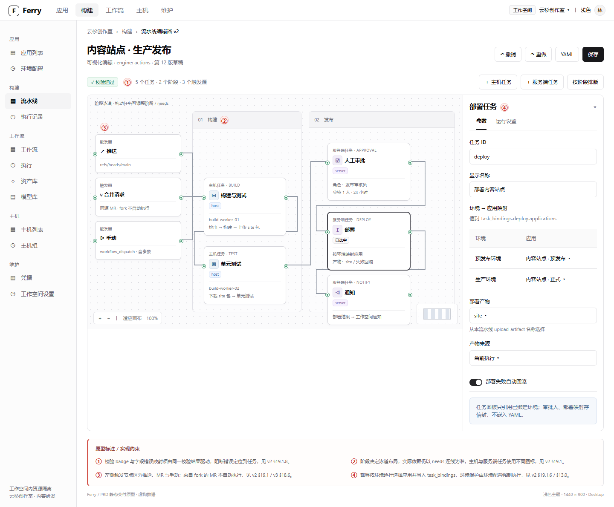

示意图：标注①…④为需求点，其余为示意。①校验徽标及定位→FR-PIPE-01；②阶段/needs、运行位置区别→02；③三类触发及 fork 限制→03；④环境到应用映射与门禁→04。

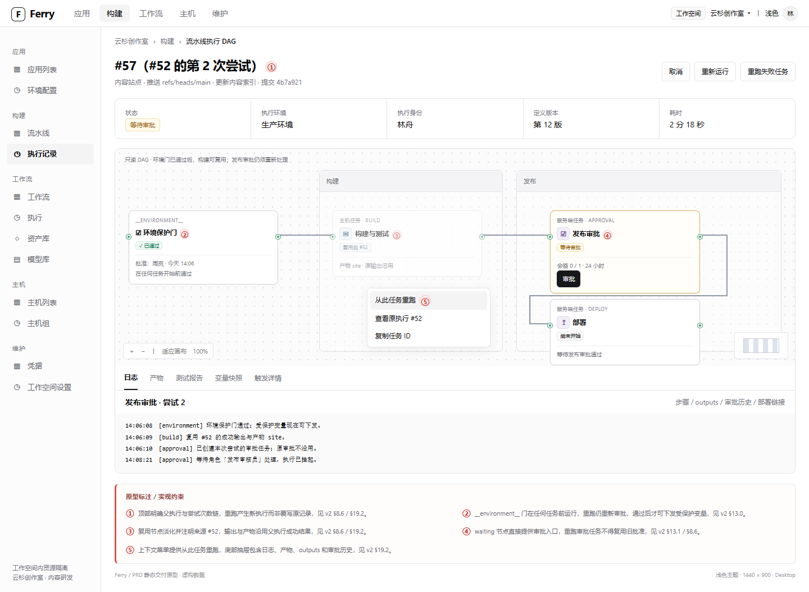

示意图：标注①…⑤为需求点，其余为示意。①新执行/尝试链→FR-PIPE-05；②前置环境门禁→06；③复用来源及产物→07；④审批入口与重新审批→06/08；⑤从任务重跑及日志/产物/outputs/历史→08。原型14在 §6.15 嵌入并逐条转写，其规则同样是本模块要求。

**提示文案**（示例）：「该合并请求来自外部仓库，不会自动执行。」「部署已启动，请前往部署记录处理停止或回滚。」「请选择本次执行使用的定义版本。」

| 编号 | Given / When / Then |
|---|---|
| AC-PIPE-01 | Given 保存含不支持语法的任务，When 校验/保存，Then 同一错误出现在问题面板与对应字段，定位任务，不能保存成可执行定义。（01–04） |
| AC-PIPE-02 | Given fork MR、路径比较失败和不匹配环境三种事件，When 分别投递，Then 均不偷偷运行；显示对应拒绝/跳过原因及投递记录；人工重投生成新记录。（03/09） |
| AC-PIPE-03 | Given A 成功、B 审批、C 失败，When 按 v2 重跑闭包重跑，Then 新编号关联原执行；复用 A 的成功输出并复制产物；需重做的 B 不继承审批；门禁先于任何任务。（05–08） |
| AC-PIPE-04 | Given 自动重试总次数设为5、延迟0秒，When 可重试任务持续失败，Then 总计5次；审批/部署不因该配置自动重试；取消状态与失败分开。（10） |
| AC-PIPE-05 | Given 原版已发布又保存新草稿，When 自动事件与手动草稿执行分别发生，Then 各自使用已选版本；历史定义可只读打开，输入冻结且不重绑应用。（14/21） |
| AC-PIPE-06 | Given P2 报告超过单文件10 MiB或总50 MiB，When 采集，Then 截断并告警而不伪称完整；用例最多5000条、单条消息最多4 KiB；质量表达式 false/错误均失败。（12） |
| AC-PIPE-07 | Given 手动运行任务依赖已满足，When 执行到达该任务但无人点击，Then 任务停住等待、任务内容未运行、依赖其成功的下游未启动，页面提供「运行」且没有审批人字段。（FR-PIPE-11，P1） |
| AC-PIPE-08 | Given 同流水线在不同主机执行与MR触发，When 读写缓存，Then 主机间不声称共享，MR不写缓存，达到2/10 GiB配置边界按LRU处理；保留工作目录只作用于本次尝试，24小时后按下次启动清理规则验证。（16） |
| AC-PIPE-09 | Given P2 对象 all 且有工作空间相应权限的成员及 failed/timed-out 主机任务，When 跳过并填写 reason，Then 任务变为 skipped、attempt 数不增加，skipped_by/reason 可查，原失败尝试日志保留、下游继续且有审计；仅 run/view 或无工作空间相应权限者请求被拒绝。（17） |
| AC-PIPE-10 | Given P2 失败或超时的审批、部署任务或环境门禁，When 即使有 all 权限仍请求跳过，Then 服务端拒绝、下游不能借此绕过审批或门禁，受保护变量仍不下发。（06/17） |
| AC-PIPE-11 | Given merged MR 事件 merge SHA 为 A，随后目标分支已到 B，When 执行检出，Then 使用 A 并保留其 SHA；不得检出 B，fork 自动执行禁令仍生效。（18） |
| AC-PIPE-12 | Given A 发布流水线后 B 仅保存草稿，When 自动触发，Then 仍用 A 身份与已发布版本；B 确认并发布后后续自动执行绑定 B，运行前重查权限，在途执行不变。（19） |
| AC-PIPE-13 | Given 正在等待点击的手动运行任务，When 非发起人但具有 pipelines.run 及相应对象授权的用户点击运行，Then 任务开始且下游按任务结果继续，无需审批人同意；重复点击不启动第二份任务。（FR-PIPE-11） |
| AC-PIPE-14 | Given 没有 pipelines.run 的用户，When 从页面或直接向服务端请求启动手动运行任务，Then 服务端拒绝，任务仍等待且没有执行任务内容。（FR-PIPE-11） |
| AC-PIPE-15 | Given 尚未点击的手动运行任务，When 暂停后继续或故障恢复，Then 仍等待点击；When 取消执行后再请求启动或继续，Then 拒绝且保持 cancelled，不自动运行等待任务。（FR-PIPE-11） |
| AC-PIPE-16 | Given 可读写流水线列表，When 复制定义并按最近失败筛选，Then 产生独立副本且筛选只返回最近失败的授权定义；复制不改变原定义。（FR-PIPE-21） |
| AC-PIPE-17 | Given 有执行编辑权且日志未超过容量上限，When 保存运行备注并下载完整日志，Then 备注重新打开仍在，下载包含该次执行完整日志；超过上限时按 NFR-CAP-04 明示截断。（FR-PIPE-21） |
| AC-PIPE-18 | Given 配置子模块与克隆深度的代码源，When 在真实主机检出，Then 子模块是否检出及历史深度与配置一致，检出 SHA 仍按事件冻结。（FR-PIPE-21） |
| AC-PIPE-19 | Given P1 应用部署处于分批或暂停状态，When 查看部署任务并点击应用链接，Then 显示真实状态并进入对应应用的继续／回滚入口；回滚失败不显示成功。（FR-PIPE-20） |
| AC-PIPE-20 | Given 多个定义版本与不同版本的历史执行，When 按版本筛选并打开本次定义，Then 仅列该版本执行且只读显示执行冻结的定义，不显示当前草稿冒充历史。（FR-PIPE-21） |
| AC-PIPE-21 | Given P2 矩阵定义与不同组合的任务输出，When 展开并执行，Then 每个合法组合产生可区分任务、参数与产物来源可查，超过 NFR-CAP-04 的矩阵/展开上限时拒绝，不静默省略组合。（FR-PIPE-12） |
| AC-PIPE-22 | Given 为单个产物设置保留期且为缓存设置闲置天数，When 到达各自清理条件，Then 仅符合条件的对象被清理，其他仍有效产物/缓存保留，已清理来源有说明。（FR-PIPE-12/16） |
| AC-PIPE-23 | Given P2 多条可运行流水线与一条无执行权定义，When 批量运行或收藏筛选，Then 每条执行独立编号，无执行权项被拒绝且不启动；收藏/取消收藏影响筛选，不改变权限。（FR-PIPE-13） |
| AC-PIPE-24 | Given 停用任务及带注释的画布，When 保存再执行，Then 注释与布局保留，停用任务为 skipped 且不运行任务内容；命令面板/缩略图可定位，配置变化使受影响旧结果标为陈旧。（FR-PIPE-13） |
| AC-PIPE-25 | Given 表达式编辑器及步骤预设，When 使用补全插入已有上下文字段并应用预设，Then 生成可继续编辑的字段/步骤配置，静态校验定位不支持语法；参数模板实例按填写值生成且缺必填时拒绝。（FR-PIPE-13） |
| AC-PIPE-26 | Given 目标任务及其上游和无关分支，When 选择执行到该任务，Then 仅运行目标必要上游及目标，仍执行前置环境门禁；运行时浏览器标题显示进度、结束后显示真实状态。（FR-PIPE-13） |
| AC-PIPE-27 | Given 保留工作目录的失败任务，When 有主机终端权限者打开在线终端，Then 定位该目录；无终端权限直接请求被拒绝，目录已清理时说明原因而非进入错误路径。（FR-PIPE-13/16） |
| AC-PIPE-28 | Given 包含已知关键词的任务日志，When 搜索并打开锚点、复制诊断或查看摘要，Then 定位到对应任务/日志位置，摘要关联真实结果，复制内容脱敏且不含凭据正文。（FR-PIPE-13） |
| AC-PIPE-29 | Given 仅代码变化的定时触发及上游完成触发配置，When 定时发现提交未变化或上游满足完成条件，Then 前者不产生重复运行，后者产生关联上游的执行；提交变化时定时执行仍冻结精确提交。（FR-PIPE-13） |
| AC-PIPE-30 | Given 已发布流水线的 secret Webhook，When 使用有效/无效secret分别提交body，Then 有效请求异步受理且body映射声明的inputs，无效请求拒绝且不启动；保存未发布草稿不改变生产映射。（FR-PIPE-14） |
| AC-PIPE-31 | Given 绑定镜像仓库推送解析模板的触发器，When 收到匹配及不匹配推送，Then 仅匹配事件按模板解析的镜像/标签进入声明输入，不匹配记录原因；错误工作流按失败事件关联原执行。（FR-PIPE-15） |
| AC-PIPE-32 | Given S5 资源选择器及限时只读嵌入，When 选择资源或访问分享，Then 只列授权资源且使用稳定引用；分享只可读指定结果，过期不可访问，不能借分享执行/编辑或读取其他对象。（FR-PIPE-15） |

<a id="rv-02"></a>

#### 评审补充 02：流水线·编辑与校验（FR-RV-02）

来源：v2 §7、§19、§21、§23；流水线清单 B/C；ADR D5 superseded、Q06；既有规则 FR-PIPE-01/02/03/13/21；行为验收 AC-PIPE-01/18/24/25；数据结构以[数据模型](ferry-工作流平台数据模型.md) §2/§4–§9为准。以下为来源规则的评审投影，标「源未定义，待补」的内容不是已定规则；缺口登记 G-02（§14）。

**模式差异（入口/操作/可编辑范围）**：列表复制/最近状态筛选；新增编辑名称与定义；编辑YAML/画布；历史版本仅查看，修改必须回到草稿。（来源：v2 §7、§19、§21、§23；流水线清单 B/C；ADR D5 superseded、Q06；总方案 §5/§7/§8）

**字段与校验**：现有流水线名称required、maxLength=60（src/components/ResourceForm.tsx）；定义≤128KiB；jobs 1–50，展开≤200，矩阵≤64；代码源0–10；输入string/choice/boolean/number/environment；各输入名正则和精确长度源未定义，待补。资源名称默认trim后1–60字符（§1c.5），模块显式例外优先；其他字段来源/默认/回填/可编辑条件及未定长度/正则/上下限不从原型推导；未列出的节点/JSON子字段约束为「源未定义，待补」，不将DDL映射宽度当产品限制。（来源：v2 §7、§19、§21、§23；流水线清单 B/C；ADR D5 superseded、Q06；数据模型 §1/§4/§7）

**字段联动与清空**：needs决定依赖，阶段仅布局；环境/应用/主机绑定在信封中，不许通过inputs重绑；子模块/克隆深度按配置检出，具体范围源未定义，待补。已保存/历史引用不得因前端切换静默改写；已知依赖选择重置、旧异步结果和手工草稿按§1c.6；未声明的逐节点依赖/回填来源仍按模块缺口。（来源：v2 §7、§19、§21、§23；流水线清单 B/C；ADR D5 superseded、Q06；总方案 §8；数据模型 §7）

**状态操作矩阵**：状态覆盖 草稿有效、保存阻断、已发布有变更、只读历史、加载失败、409冲突。表中“无”指无需额外输入；不把未知的确认输入补成强制输入名称。表外状态的新增操作规则为「源未定义，待补」。（来源：v2 §7、§19、§21、§23；流水线清单 B/C；ADR D5 superseded、Q06；数据模型 §6）

| 状态 | 操作 | 可见/可用条件 | 确认/输入 | 副作用 | 失败反馈/可逆性 |
|---|---|---|---|---|---|
| 草稿有效 | 保存/发布 | 编辑/发布权限且对应阶段校验通过 | 发布信息见VER | 保存不重绑身份；发布影响后续触发 | 409保留稿；可再编辑 |
| 保存阻断 | 保存 | 可见但校验拒绝 | 无 | 不生成可执行定义 | 定位语法错误；修复可逆 |
| 只读历史 | 查看/复制为草稿 | 查看权限；原历史不可编辑 | 恢复确认见VER | 不覆盖历史 | 读取失败可重试 |

**操作记录（审计事件）**：创建、修改、复制、版本恢复、发布及身份确认（FR-AUTH-04）。事件身份、details和永久保留遵§1c.1；修改同事务写activity，不记录秘密或输入值。（来源：FR-AUTH-04；v2 §7、§19、§21、§23；流水线清单 B/C；ADR D5 superseded、Q06；数据模型 §2）

**删除与保留**：定义先归档后物理删除，归档停生产且保历史，恢复为草稿（ADR Q12）；引用版本/最近50版保护。 删除弹窗/物理删除及引用保护按§1c.2，保留期/保护例外按§1c.3；不因缺外键跳过范围校验。（来源：ADR Q12；数据模型 §8.3/§8.4）

**数据模型、时间审计、索引与SQL**：pipelines、definition_revisions；JSON信封不擅自拆新表。本模块新表/存量新增时间按数据模型 §2配每个xx_at同前缀xx_by BIGINT NOT NULL DEFAULT 0；0=system；不回填猜测历史操作者。索引：definition_revisions_number(subject_kind,subject_id,number)唯一；发布名唯一键仍待定。SQL证据：数据模型 §8.3：按subject_kind/subject_id查询最近50版本。（来源：数据模型 §2/§4/§5/§8/§9）

**配置来源表**：按§1c.7对应开发发布/运维重启/平台立即/用户保存发布生效，当前无多语言设置。（来源：v2 §7、§19、§21、§23；流水线清单 B/C；ADR D5 superseded、Q06；总方案 §7/§8；src/components/dsl.ts、ResourceForm.tsx；现状无i18n）：

| 配置项/来源 | 修改主体与频率 | 多语言/枚举 |
|---|---|---|
| 开发：语法/输入类型/固定上限；用户：YAML、needs、阶段、绑定、输入；中文提示硬编码；配置随定义版本变化 | 按已授权用户/开发/运维来源修改；生效按§1c.7：开发发布/运维重启/平台立即/用户保存发布，无固定周期 | 业务枚举见数据模型 §6；展示中文硬编码，en-US/ms-MY仍待澄清R01 |
| 原型数据/截图 | 静态示意，非配置中心 | 不得将示例金额/模型/人员或3轮当平台默认 |

**影响与兼容**：本期 P1 YAML/DAG/输入，P2阶段/预设/矩阵等效率增强；不做 不做Go template预渲染；不将阶段当needs；不另保留旧JSON引擎；灰度 无（按P1/P2交付；未交付入口不开放）。核心流程：读取草稿→编辑YAML或图→同源校验→定位字段→修复保存→发布确认→运行冻结版本。异常：不支持语法/循环依赖/非法绑定拒绝；校验和字段定位一致；409保留本地稿。历史up/down：数据模型 §5.2第2/4项：现存定义number=1；旧执行revision_id=0表示未知，不冒用当前版；共用回退边界见§1b。三方：Actions worker/act、Git；具体版本兼容需真实用例。版本兼容：v1信封可读可执行可编辑；旧JSON已迁移为Actions；YAML原文/注释保留。计算：限额按字节/任务数量校验；税SST/GST、库存扣减、折扣不适用（无电商）。（来源：v2 §7、§19、§21、§23；流水线清单 B/C；ADR D5 superseded、Q06；数据模型 §5.2；NFR-COMP-01–03）

**文案表**（zh-CN来自原PRD提示/必需文案、v3、共享组件或RESPONSIVE中的原文；不据此引入i18n。en-US/ms-MY统一仍待澄清R01（§1c.9））：

| 场景/文案键（评审标识） | zh-CN | en-US | ms-MY | ms-MY 长度预留 |
|---|---|---|---|---|
| PE.key | 请选择本次执行使用的定义版本。 | 仍待澄清 R01 | 仍待澄清 R01 | 允许比zh-CN长≥40%；换行/区域滚动保持完整操作，不代表已有翻译 |

**验收追踪与响应式交付**：FR-PIPE-01/02/03/13/21 → AC-PIPE-01/18/24/25 / AC-RV-02 → 下表测试规格。规则对应原型编号；异常按§6.16文字，无独立截图，正常业务专属屏缺口仍逐项列出（§1c.8）；无Figma，Figma screen/variant不适用（当前交付为HTML+PNG），不能声称Figma覆盖。D=1440×900、P=768×1024、M=390×844，full-page PNG可高于视口；断点/键盘/Phone只读图规则见[RESPONSIVE.md](prototypes/RESPONSIVE.md)。

| Desktop / Pad / Phone截图 | 编号与覆盖边界 |
|---|---|
| [Desktop](images/12-pipeline-editor.png) / [Pad](images/pad/12-pipeline-editor.png) / [Phone](images/phone/12-pipeline-editor.png) | ①②③：校验、依赖、输入；异常/权限视觉按§6.16文字，无独立截图；长文本按RESPONSIVE验收，语言variant仍待澄清R01（§1c.8）；HTML为prototypes/12-pipeline-editor.html |

| 规则→AC | 测试用例（规格，未执行） | Given / When / Then | 设计/状态证据 |
|---|---|---|---|
| FR-RV-02 → AC-RV-02 | TC-RV-02-01 | Given 本期有权用户与有效配置，When 按本功能闭环操作，Then 读取草稿→编辑YAML或图→同源校验→定位字段→修复保存→发布确认→运行冻结版本 | 12-pipeline-editor.png ①②③；其余状态待补 |
| FR-PIPE-01/02/03/13/21 → AC-RV-02 | TC-RV-02-02 | Given 本功能异常或边界输入，When 执行对应操作，Then 不支持语法/循环依赖/非法绑定拒绝；校验和字段定位一致；409保留本地稿 | 异常视觉交互见§6.16文字，无独立截图，不代表已实测（§1c.8） |
| FR-AUTH-01–05 → AC-RV-02 | TC-RV-02-03 | Given 跨空间/无权成员或失效公开令牌，When 绕过界面直接请求，Then 拒绝且不产生本次业务副作用；公开者不获得后台权限 | 权限拒绝专属状态待补 |
| 数据模型 §5.2 → AC-RV-02 | TC-RV-02-04 | Given 升级前历史夹具与新状态，When 按迁移方案up/人工回退评审，Then 数据模型 §5.2第2/4项：现存定义number=1；旧执行revision_id=0表示未知，不冒用当前版 | 后端迁移规格，无Figma/截图适用 |
| §1b/RESPONSIVE → AC-RV-02 | TC-RV-02-05 | Given 三布局与中文及长度≥140%的排版占位文本，When 查看本功能操作与错误，Then 核心字段/按钮不被遮挡；Phone图只读、区域内滚动；翻译内容未验收 | 三端基础PNG+callout见上表；异常按§6.16文字，无独立截图；语言variant仍待澄清R01（§1c.8） |

AC-RV-02：本功能已定规则按上述测试规格及既有AC验收；G-02列出的来源缺口须补来源/设计后才可认定对应能力验收通过。本次为需求文档审查，不声称运行测试、迁移或真实三方通过。（来源：用户评审清单；§10；v2 §7、§19、§21、§23；流水线清单 B/C；ADR D5 superseded、Q06）

<a id="rv-03"></a>

#### 评审补充 03：流水线·触发与投递（FR-RV-03）

来源：v2 §9；流水线清单 C；ADR D3/D11/D13/D16/D17、Q05/Q14；既有规则 FR-PIPE-03/09/14/18/19；行为验收 AC-PIPE-02/11/12/29/30/31；数据结构以[数据模型](ferry-工作流平台数据模型.md) §2/§4–§9为准。以下为来源规则的评审投影，标「源未定义，待补」的内容不是已定规则；缺口登记 G-03（§14）。

**模式差异（入口/操作/可编辑范围）**：列表查看投递状态与原因；新增/编辑声明触发和输入映射；查看历史事件快照；重投是新记录。（来源：v2 §9；流水线清单 C；ADR D3/D11/D13/D16/D17、Q05/Q14；总方案 §5/§7/§8）

**字段与校验**：0–10源；body仅映射声明inputs；trigger_environments显式环境映射；endpoint/secret不能进日志；事件去重键与redelivery_seq由服务端；映射完整schema/长度源未定义，待补。资源名称默认trim后1–60字符（§1c.5），模块显式例外优先；其他字段来源/默认/回填/可编辑条件及未定长度/正则/上下限不从原型推导；未列出的节点/JSON子字段约束为「源未定义，待补」，不将DDL映射宽度当产品限制。（来源：v2 §9；流水线清单 C；ADR D3/D11/D13/D16/D17、Q05/Q14；数据模型 §1/§4/§7）

**字段联动与清空**：发布绑定发布者；仅保存不重绑；merged MR冻结merge commit，未合并冻结head；fork禁令优先于匹配。已保存/历史引用不得因前端切换静默改写；已知依赖选择重置、旧异步结果和手工草稿按§1c.6；未声明的逐节点依赖/回填来源仍按模块缺口。（来源：v2 §9；流水线清单 C；ADR D3/D11/D13/D16/D17、Q05/Q14；总方案 §8；数据模型 §7）

**状态操作矩阵**：状态覆盖 pending、created、skipped、failed。表中“无”指无需额外输入；不把未知的确认输入补成强制输入名称。表外状态的新增操作规则为「源未定义，待补」。（来源：v2 §9；流水线清单 C；ADR D3/D11/D13/D16/D17、Q05/Q14；数据模型 §6）

| 状态 | 操作 | 可见/可用条件 | 确认/输入 | 副作用 | 失败反馈/可逆性 |
|---|---|---|---|---|---|
| pending | 投递 | dispatcher领取且事务校验通过 | 无 | 创建执行并关联run | 事务失败不得部分受理 |
| skipped/failed | 人工重投 | 授权者显式请求，保留原记录 | 具体确认输入源未定义，待补 | redelivery_seq+1，非覆盖 | 失败可查原因；不自动重试 |
| created | 查看执行 | 有执行查看权 | 无 | 只读关联执行 | 已创建不再自动投递 |

**操作记录（审计事件）**：自动/手动执行、发布身份；人工重投关联旧投递（v2 §9、FR-AUTH-04）；事件载荷脱敏。事件身份、details和永久保留遵§1c.1；修改同事务写activity，不记录秘密或输入值。（来源：FR-AUTH-04；v2 §9；流水线清单 C；ADR D3/D11/D13/D16/D17、Q05/Q14；数据模型 §2）

**删除与保留**：定义先归档后物理删除，归档停生产且保历史，恢复为草稿（ADR Q12）；引用版本/最近50版保护。 删除弹窗/物理删除及引用保护按§1c.2，保留期/保护例外按§1c.3；不因缺外键跳过范围校验。（来源：ADR Q12；数据模型 §8.3/§8.4）

**数据模型、时间审计、索引与SQL**：trigger_bindings、trigger_deliveries、pipeline_runs、pipelines、cron_jobs。本模块新表/存量新增时间按数据模型 §2配每个xx_at同前缀xx_by BIGINT NOT NULL DEFAULT 0；0=system；不回填猜测历史操作者。索引：trigger_bindings_lookup；trigger_deliveries_dedupe/dispatch/history；workflow泛化键待补。SQL证据：数据模型 §8.1发件箱事务条件更新、§8.2绑定查询。（来源：数据模型 §2/§4/§5/§8/§9）

**配置来源表**：按§1c.7对应开发发布/运维重启/平台立即/用户保存发布生效，当前无多语言设置。（来源：v2 §9；流水线清单 C；ADR D3/D11/D13/D16/D17、Q05/Q14；总方案 §7/§8；src/components/dsl.ts、ResourceForm.tsx；现状无i18n）：

| 配置项/来源 | 修改主体与频率 | 多语言/枚举 |
|---|---|---|
| 用户：触发过滤、inputs和环境映射；开发：事件适配/去重规则；运维/用户定时资源按既有权限；多语言标签仍待澄清R01 | 按已授权用户/开发/运维来源修改；生效按§1c.7：开发发布/运维重启/平台立即/用户保存发布，无固定周期 | 业务枚举见数据模型 §6；展示中文硬编码，en-US/ms-MY仍待澄清R01 |
| 原型数据/截图 | 静态示意，非配置中心 | 不得将示例金额/模型/人员或3轮当平台默认 |

**影响与兼容**：本期 P1事件/手动/通用Webhook，P2上游与仅代码变化定时；不做 fork MR不自动运行；YAML on.schedule拒绝；不自动重投失败事件；灰度 草稿/发布：自动入口只用发布版，保存草稿不影响生产。核心流程：发布派生绑定→事件验签/过滤→冻结SHA/ref→事务写投递→创建执行→关联run；人工重投新增记录。异常：路径比较失败/未知不静默执行；环境不匹配skipped；secret错误拒绝；merge SHA不替换head。历史up/down：数据模型 §5.2第6项：停dispatcher再回退，保留pending账本；不从旧事件补投；共用回退边界见§1b。三方：GitHub/GitLab/Gitee/Codeup等按v2 §9.3a逐平台验签与事件映射。版本兼容：同语义去重；无历史自动补投；D4保存重绑由Q14发布重绑取代。计算：每事件最多触发50流水线；不适用税/库存/折扣。（来源：v2 §9；流水线清单 C；ADR D3/D11/D13/D16/D17、Q05/Q14；数据模型 §5.2；NFR-COMP-01–03）

**文案表**（zh-CN来自原PRD提示/必需文案、v3、共享组件或RESPONSIVE中的原文；不据此引入i18n。en-US/ms-MY统一仍待澄清R01（§1c.9））：

| 场景/文案键（评审标识） | zh-CN | en-US | ms-MY | ms-MY 长度预留 |
|---|---|---|---|---|
| PT.key | 该合并请求来自外部仓库，不会自动执行。 | 仍待澄清 R01 | 仍待澄清 R01 | 允许比zh-CN长≥40%；换行/区域滚动保持完整操作，不代表已有翻译 |

**验收追踪与响应式交付**：FR-PIPE-03/09/14/18/19 → AC-PIPE-02/11/12/29/30/31 / AC-RV-03 → 下表测试规格。规则对应原型编号；异常按§6.16文字，无独立截图，正常业务专属屏缺口仍逐项列出（§1c.8）；无Figma，Figma screen/variant不适用（当前交付为HTML+PNG），不能声称Figma覆盖。D=1440×900、P=768×1024、M=390×844，full-page PNG可高于视口；断点/键盘/Phone只读图规则见[RESPONSIVE.md](prototypes/RESPONSIVE.md)。

| Desktop / Pad / Phone截图 | 编号与覆盖边界 |
|---|---|
| [Desktop](images/12-pipeline-editor.png) / [Pad](images/pad/12-pipeline-editor.png) / [Phone](images/phone/12-pipeline-editor.png) | ③：事件声明；异常/权限视觉按§6.16文字，无独立截图；长文本按RESPONSIVE验收，语言variant仍待澄清R01（§1c.8）；HTML为prototypes/12-pipeline-editor.html |
| [Desktop](images/13-pipeline-run-graph.png) / [Pad](images/pad/13-pipeline-run-graph.png) / [Phone](images/phone/13-pipeline-run-graph.png) | ⑤：触发详情；异常/权限视觉按§6.16文字，无独立截图；长文本按RESPONSIVE验收，语言variant仍待澄清R01（§1c.8）；HTML为prototypes/13-pipeline-run-graph.html |

| 规则→AC | 测试用例（规格，未执行） | Given / When / Then | 设计/状态证据 |
|---|---|---|---|
| FR-RV-03 → AC-RV-03 | TC-RV-03-01 | Given 本期有权用户与有效配置，When 按本功能闭环操作，Then 发布派生绑定→事件验签/过滤→冻结SHA/ref→事务写投递→创建执行→关联run；人工重投新增记录 | 12-pipeline-editor.png ③；其余状态待补 |
| FR-PIPE-03/09/14/18/19 → AC-RV-03 | TC-RV-03-02 | Given 本功能异常或边界输入，When 执行对应操作，Then 路径比较失败/未知不静默执行；环境不匹配skipped；secret错误拒绝；merge SHA不替换head | 异常视觉交互见§6.16文字，无独立截图，不代表已实测（§1c.8） |
| FR-AUTH-01–05 → AC-RV-03 | TC-RV-03-03 | Given 跨空间/无权成员或失效公开令牌，When 绕过界面直接请求，Then 拒绝且不产生本次业务副作用；公开者不获得后台权限 | 权限拒绝专属状态待补 |
| 数据模型 §5.2 → AC-RV-03 | TC-RV-03-04 | Given 升级前历史夹具与新状态，When 按迁移方案up/人工回退评审，Then 数据模型 §5.2第6项：停dispatcher再回退，保留pending账本；不从旧事件补投 | 后端迁移规格，无Figma/截图适用 |
| §1b/RESPONSIVE → AC-RV-03 | TC-RV-03-05 | Given 三布局与中文及长度≥140%的排版占位文本，When 查看本功能操作与错误，Then 核心字段/按钮不被遮挡；Phone图只读、区域内滚动；翻译内容未验收 | 三端基础PNG+callout见上表；异常按§6.16文字，无独立截图；语言variant仍待澄清R01（§1c.8） |

AC-RV-03：本功能已定规则按上述测试规格及既有AC验收；G-03列出的来源缺口须补来源/设计后才可认定对应能力验收通过。本次为需求文档审查，不声称运行测试、迁移或真实三方通过。（来源：用户评审清单；§10；v2 §9；流水线清单 C；ADR D3/D11/D13/D16/D17、Q05/Q14）

<a id="rv-04"></a>

#### 评审补充 04：流水线·执行与重跑（FR-RV-04）

来源：v2 §8、§11、§19、§23；流水线清单 F/G/J；ADR D9；既有规则 FR-PIPE-05/06/07/08/10/16/21；行为验收 AC-PIPE-03/04/08/17/20/22/26/27/28；数据结构以[数据模型](ferry-工作流平台数据模型.md) §2/§4–§9为准。以下为来源规则的评审投影，标「源未定义，待补」的内容不是已定规则；缺口登记 G-04（§14）。

**模式差异（入口/操作/可编辑范围）**：列表筛选版本/状态；新增执行冻结输入/版本；查看历史只读；运行备注可编辑，不能改快照；重跑建新执行。（来源：v2 §8、§11、§19、§23；流水线清单 F/G/J；ADR D9；总方案 §5/§7/§8）

**字段与校验**：重试默认关闭，总尝试1–5，间隔0–3600秒；并发none/pipeline/pipeline_ref，限制1–20；主机槽默认2范围1–32；保留工作目录24h后下次启动清理；备注长度源未定义，待补。资源名称默认trim后1–60字符（§1c.5），模块显式例外优先；其他字段来源/默认/回填/可编辑条件及未定长度/正则/上下限不从原型推导；未列出的节点/JSON子字段约束为「源未定义，待补」，不将DDL映射宽度当产品限制。（来源：v2 §8、§11、§19、§23；流水线清单 F/G/J；ADR D9；数据模型 §1/§4/§7）

**字段联动与清空**：重跑闭包外成功项reused并追来源；审批重做，环境门在任何任务前；变量按门禁后下发；主机缓存MR只读。已保存/历史引用不得因前端切换静默改写；已知依赖选择重置、旧异步结果和手工草稿按§1c.6；未声明的逐节点依赖/回填来源仍按模块缺口。（来源：v2 §8、§11、§19、§23；流水线清单 F/G/J；ADR D9；总方案 §8；数据模型 §7）

**状态操作矩阵**：状态覆盖 queued、running、waiting、cancelling、succeeded、failed、cancelled；任务另有timed_out/skipped/reused。表中“无”指无需额外输入；不把未知的确认输入补成强制输入名称。表外状态的新增操作规则为「源未定义，待补」。（来源：v2 §8、§11、§19、§23；流水线清单 F/G/J；ADR D9；数据模型 §6）

| 状态 | 操作 | 可见/可用条件 | 确认/输入 | 副作用 | 失败反馈/可逆性 |
|---|---|---|---|---|---|
| queued/running/waiting | 取消 | 执行操作权且仍非终态 | 具体确认输入源未定义，待补 | 停止后续调度；部署/子执行边界独立 | 失败反馈实际状态；取消不撤回外部副作用 |
| succeeded/failed/cancelled | 全部/失败集合/从任务重跑 | run权限及闭包数据可用 | 选择原版/当前版按既有重跑规则 | 新编号，新尝试链、复制产物 | 不改旧执行；源数据清理时限制重跑 |
| waiting | 查看审批/任务/原因 | 相应查看/处理权 | 回应见HUM/ENV | 按等待类型处理 | 不能把等待当失败 |

**操作记录（审计事件）**：执行、重跑、取消、备注修改及主机终端敏感操作按FR-AUTH-04/总方案权限。事件身份、details和永久保留遵§1c.1；修改同事务写activity，不记录秘密或输入值。（来源：FR-AUTH-04；v2 §8、§11、§19、§23；流水线清单 F/G/J；ADR D9；数据模型 §2）

**删除与保留**：不新增软删除；保留/物理删除按§1c.2/§1c.3及原资源保护例外。 删除弹窗/物理删除及引用保护按§1c.2，保留期/保护例外按§1c.3；不因缺外键跳过范围校验。（来源：ADR Q12；数据模型 §8.3/§8.4）

**数据模型、时间审计、索引与SQL**：pipeline_runs、pipeline_run_jobs/steps/logs、pipeline_artifacts、definition_revisions、execution_intents。本模块新表/存量新增时间按数据模型 §2配每个xx_at同前缀xx_by BIGINT NOT NULL DEFAULT 0；0=system；不回填猜测历史操作者。索引：pipeline_runs_dispatch/concurrency/root/pipeline；pipeline_run_steps_attempt_order；pipeline_artifacts_run/lookup。SQL证据：数据模型 §8.1租约条件写，§8.2尝试和日志游标查询。（来源：数据模型 §2/§4/§5/§8/§9）

**配置来源表**：按§1c.7对应开发发布/运维重启/平台立即/用户保存发布生效，当前无多语言设置。（来源：v2 §8、§11、§19、§23；流水线清单 F/G/J；ADR D9；总方案 §7/§8；src/components/dsl.ts、ResourceForm.tsx；现状无i18n）：

| 配置项/来源 | 修改主体与频率 | 多语言/枚举 |
|---|---|---|
| 用户：重试/并发/保留策略；运维：实例槽/存储；开发：状态码与上限；默认queue_latest用于事件 | 按已授权用户/开发/运维来源修改；生效按§1c.7：开发发布/运维重启/平台立即/用户保存发布，无固定周期 | 业务枚举见数据模型 §6；展示中文硬编码，en-US/ms-MY仍待澄清R01 |
| 原型数据/截图 | 静态示意，非配置中心 | 不得将示例金额/模型/人员或3轮当平台默认 |

**影响与兼容**：本期 P0租约/并发/版本，P1 DAG重跑，P2缓存/报告/现场诊断；不做 不覆盖旧执行；不跨主机共享缓存；不承诺取消已发部署或级联取消子执行；灰度 P0-1全停升级；无滚动混跑或feature flag。核心流程：统一create_run→排队/租约→任务尝试→日志产物→终态；重跑新编号→闭包重算→成功产物复制→新链路。异常：失租约旧实例拒写；主机断连；超时；重试用尽；产物superseded不消费；日志到限标截断。历史up/down：数据模型 §5.2第1/3/9项：attempt=1/job_key=''；先新唯一键后删旧键；产物先可空回填再收紧，解析失败待补；共用回退边界见§1b。三方：Runner/SSH、act worker、local/S3 ArtifactStore；真实取消需主机。版本兼容：Windows既有act主机模式；容器Linux-only；Windows强杀可能无post；不另造P3执行器。计算：缓存每流水线每主机2GiB/每主机默认10GiB、LRU；日志32/128MiB；税/库存/折扣不适用。（来源：v2 §8、§11、§19、§23；流水线清单 F/G/J；ADR D9；数据模型 §5.2；NFR-COMP-01–03）

**文案表**（zh-CN来自原PRD提示/必需文案、v3、共享组件或RESPONSIVE中的原文；不据此引入i18n。en-US/ms-MY统一仍待澄清R01（§1c.9））：

| 场景/文案键（评审标识） | zh-CN | en-US | ms-MY | ms-MY 长度预留 |
|---|---|---|---|---|
| PR.key | 部署已启动，请前往部署记录处理停止或回滚。 | 仍待澄清 R01 | 仍待澄清 R01 | 允许比zh-CN长≥40%；换行/区域滚动保持完整操作，不代表已有翻译 |

**验收追踪与响应式交付**：FR-PIPE-05/06/07/08/10/16/21 → AC-PIPE-03/04/08/17/20/22/26/27/28 / AC-RV-04 → 下表测试规格。规则对应原型编号；异常按§6.16文字，无独立截图，正常业务专属屏缺口仍逐项列出（§1c.8）；无Figma，Figma screen/variant不适用（当前交付为HTML+PNG），不能声称Figma覆盖。D=1440×900、P=768×1024、M=390×844，full-page PNG可高于视口；断点/键盘/Phone只读图规则见[RESPONSIVE.md](prototypes/RESPONSIVE.md)。

| Desktop / Pad / Phone截图 | 编号与覆盖边界 |
|---|---|
| [Desktop](images/13-pipeline-run-graph.png) / [Pad](images/pad/13-pipeline-run-graph.png) / [Phone](images/phone/13-pipeline-run-graph.png) | ①②③④⑤：新执行、门禁、复用及详情；异常/权限视觉按§6.16文字，无独立截图；长文本按RESPONSIVE验收，语言variant仍待澄清R01（§1c.8）；HTML为prototypes/13-pipeline-run-graph.html |

| 规则→AC | 测试用例（规格，未执行） | Given / When / Then | 设计/状态证据 |
|---|---|---|---|
| FR-RV-04 → AC-RV-04 | TC-RV-04-01 | Given 本期有权用户与有效配置，When 按本功能闭环操作，Then 统一create_run→排队/租约→任务尝试→日志产物→终态；重跑新编号→闭包重算→成功产物复制→新链路 | 13-pipeline-run-graph.png ①②③④⑤；其余状态待补 |
| FR-PIPE-05/06/07/08/10/16/21 → AC-RV-04 | TC-RV-04-02 | Given 本功能异常或边界输入，When 执行对应操作，Then 失租约旧实例拒写；主机断连；超时；重试用尽；产物superseded不消费；日志到限标截断 | 异常视觉交互见§6.16文字，无独立截图，不代表已实测（§1c.8） |
| FR-AUTH-01–05 → AC-RV-04 | TC-RV-04-03 | Given 跨空间/无权成员或失效公开令牌，When 绕过界面直接请求，Then 拒绝且不产生本次业务副作用；公开者不获得后台权限 | 权限拒绝专属状态待补 |
| 数据模型 §5.2 → AC-RV-04 | TC-RV-04-04 | Given 升级前历史夹具与新状态，When 按迁移方案up/人工回退评审，Then 数据模型 §5.2第1/3/9项：attempt=1/job_key=''；先新唯一键后删旧键；产物先可空回填再收紧，解析失败待补 | 后端迁移规格，无Figma/截图适用 |
| §1b/RESPONSIVE → AC-RV-04 | TC-RV-04-05 | Given 三布局与中文及长度≥140%的排版占位文本，When 查看本功能操作与错误，Then 核心字段/按钮不被遮挡；Phone图只读、区域内滚动；翻译内容未验收 | 三端基础PNG+callout见上表；异常按§6.16文字，无独立截图；语言variant仍待澄清R01（§1c.8） |

AC-RV-04：本功能已定规则按上述测试规格及既有AC验收；G-04列出的来源缺口须补来源/设计后才可认定对应能力验收通过。本次为需求文档审查，不声称运行测试、迁移或真实三方通过。（来源：用户评审清单；§10；v2 §8、§11、§19、§23；流水线清单 F/G/J；ADR D9）

<a id="rv-05"></a>

#### 评审补充 05：流水线·跳过/手动任务（FR-RV-05）

来源：流水线清单 B9、§3.2；ADR Q04/Q16、review follow-up；既有规则 FR-PIPE-11/17/21；行为验收 AC-PIPE-07/09/10/13/14/15；数据结构以[数据模型](ferry-工作流平台数据模型.md) §2/§4–§9为准。以下为来源规则的评审投影，标「源未定义，待补」的内容不是已定规则；缺口登记 G-05（§14）。

**模式差异（入口/操作/可编辑范围）**：任务配置选择手动；执行详情等待态提供运行；失败态all可跳过；历史查看保留失败日志与reason。（来源：流水线清单 B9、§3.2；ADR Q04/Q16、review follow-up；总方案 §5/§7/§8）

**字段与校验**：启动无审批人字段；reason及skipped_by服务端记录，reason精确长度/是否空白裁剪源未定义，待补；attempt跳过前后不变。资源名称默认trim后1–60字符（§1c.5），模块显式例外优先；其他字段来源/默认/回填/可编辑条件及未定长度/正则/上下限不从原型推导；未列出的节点/JSON子字段约束为「源未定义，待补」，不将DDL映射宽度当产品限制。（来源：流水线清单 B9、§3.2；ADR Q04/Q16、review follow-up；数据模型 §1/§4/§7）

**字段联动与清空**：启动和审批分离；暂停继续/故障恢复不能自动启动；跳过只改变任务状态不抹旧尝试。已保存/历史引用不得因前端切换静默改写；已知依赖选择重置、旧异步结果和手工草稿按§1c.6；未声明的逐节点依赖/回填来源仍按模块缺口。（来源：流水线清单 B9、§3.2；ADR Q04/Q16、review follow-up；总方案 §8；数据模型 §7）

**状态操作矩阵**：状态覆盖 依赖未满足、waiting手动启动、已受理、failed/timed_out主机任务、skipped、cancelled。表中“无”指无需额外输入；不把未知的确认输入补成强制输入名称。表外状态的新增操作规则为「源未定义，待补」。（来源：流水线清单 B9、§3.2；ADR Q04/Q16、review follow-up；数据模型 §6）

| 状态 | 操作 | 可见/可用条件 | 确认/输入 | 副作用 | 失败反馈/可逆性 |
|---|---|---|---|---|---|
| waiting手动启动 | 运行 | pipelines.run及对象授权；非发起人也可 | 无审批人 | 仅一次启动 | 重复请求不再执行；取消后拒绝 |
| failed/timed_out主机任务 | 跳过 | 对象all且空间上限允许；P2 | 填写reason；长度源未定义，待补 | skipped；不增attempt；下游继续；审计 | 失败日志保留；逆转方式源未定义，待补 |
| 审批/部署/环境门或cancelled | 跳过/启动 | 禁止跳过保护任务；取消后禁止启动 | 无 | 不推进任务 | 明确拒绝 |

**操作记录（审计事件）**：启动任务与跳过记录对象/操作者/结果；skipped_by/reason保留失败历史。事件身份、details和永久保留遵§1c.1；修改同事务写activity，不记录秘密或输入值。（来源：FR-AUTH-04；流水线清单 B9、§3.2；ADR Q04/Q16、review follow-up；数据模型 §2）

**删除与保留**：不新增软删除；保留/物理删除按§1c.2/§1c.3及原资源保护例外。 删除弹窗/物理删除及引用保护按§1c.2，保留期/保护例外按§1c.3；不因缺外键跳过范围校验。（来源：ADR Q12；数据模型 §8.3/§8.4）

**数据模型、时间审计、索引与SQL**：pipeline_run_jobs、pipeline_runs；手动受理持久化载体待补。本模块新表/存量新增时间按数据模型 §2配每个xx_at同前缀xx_by BIGINT NOT NULL DEFAULT 0；0=system；不回填猜测历史操作者。索引：沿用jobs既有键；手动启动防重键源未定义，待补。SQL证据：数据模型 §8.2按run_id/job_key/attempt查历史；启动受理条件写SQL因载体未知源未定义，待补。（来源：数据模型 §2/§4/§5/§8/§9）

**配置来源表**：按§1c.7对应开发发布/运维重启/平台立即/用户保存发布生效，当前无多语言设置。（来源：流水线清单 B9、§3.2；ADR Q04/Q16、review follow-up；总方案 §7/§8；src/components/dsl.ts、ResourceForm.tsx；现状无i18n）：

| 配置项/来源 | 修改主体与频率 | 多语言/枚举 |
|---|---|---|
| 用户：手动任务模式、跳过原因；开发：资格与状态判定；中文按钮硬编码 | 按已授权用户/开发/运维来源修改；生效按§1c.7：开发发布/运维重启/平台立即/用户保存发布，无固定周期 | 业务枚举见数据模型 §6；展示中文硬编码，en-US/ms-MY仍待澄清R01 |
| 原型数据/截图 | 静态示意，非配置中心 | 不得将示例金额/模型/人员或3轮当平台默认 |

**影响与兼容**：本期 手动启动P1；受控跳过P2与D14同交付；不做 不把run权限当all；不跳审批/部署/环境门；跳过不新增attempt；灰度 无（P2前不开放跳过入口）。核心流程：依赖满足→等待点击→run授权启动一次→结果推进；失败主机任务→all填写reason跳过→下游继续。异常：重复点击不得双执行；取消后拒绝启动；恢复保持未点击等待；无all直接API跳过拒绝。历史up/down：数据模型 §5.2第13项及§9第11项：P2 skipped_by/reason；不补造历史跳过；共用回退边界见§1b。三方：Runner/SSH执行主机任务；无额外审批服务。版本兼容：手动等待不是审批；与D14同步交付，无临时all替代。计算：跳过attempt增量=0；税/库存/折扣不适用。（来源：流水线清单 B9、§3.2；ADR Q04/Q16、review follow-up；数据模型 §5.2；NFR-COMP-01–03）

**文案表**（zh-CN来自原PRD提示/必需文案、v3、共享组件或RESPONSIVE中的原文；不据此引入i18n。en-US/ms-MY统一仍待澄清R01（§1c.9））：

| 场景/文案键（评审标识） | zh-CN | en-US | ms-MY | ms-MY 长度预留 |
|---|---|---|---|---|
| PM.key | 你没有处理此任务的权限。 | 仍待澄清 R01 | 仍待澄清 R01 | 允许比zh-CN长≥40%；换行/区域滚动保持完整操作，不代表已有翻译 |

**验收追踪与响应式交付**：FR-PIPE-11/17/21 → AC-PIPE-07/09/10/13/14/15 / AC-RV-05 → 下表测试规格。规则对应原型编号；异常按§6.16文字，无独立截图，正常业务专属屏缺口仍逐项列出（§1c.8）；无Figma，Figma screen/variant不适用（当前交付为HTML+PNG），不能声称Figma覆盖。D=1440×900、P=768×1024、M=390×844，full-page PNG可高于视口；断点/键盘/Phone只读图规则见[RESPONSIVE.md](prototypes/RESPONSIVE.md)。

| Desktop / Pad / Phone截图 | 编号与覆盖边界 |
|---|---|
| [Desktop](images/13-pipeline-run-graph.png) / [Pad](images/pad/13-pipeline-run-graph.png) / [Phone](images/phone/13-pipeline-run-graph.png) | ④⑤：任务处理与历史；跳过/手动专属状态截图待补；异常/权限视觉按§6.16文字，无独立截图；长文本按RESPONSIVE验收，语言variant仍待澄清R01（§1c.8）；HTML为prototypes/13-pipeline-run-graph.html |

| 规则→AC | 测试用例（规格，未执行） | Given / When / Then | 设计/状态证据 |
|---|---|---|---|
| FR-RV-05 → AC-RV-05 | TC-RV-05-01 | Given 本期有权用户与有效配置，When 按本功能闭环操作，Then 依赖满足→等待点击→run授权启动一次→结果推进；失败主机任务→all填写reason跳过→下游继续 | 13-pipeline-run-graph.png ④⑤；其余状态待补 |
| FR-PIPE-11/17/21 → AC-RV-05 | TC-RV-05-02 | Given 本功能异常或边界输入，When 执行对应操作，Then 重复点击不得双执行；取消后拒绝启动；恢复保持未点击等待；无all直接API跳过拒绝 | 异常视觉交互见§6.16文字，无独立截图，不代表已实测（§1c.8） |
| FR-AUTH-01–05 → AC-RV-05 | TC-RV-05-03 | Given 跨空间/无权成员或失效公开令牌，When 绕过界面直接请求，Then 拒绝且不产生本次业务副作用；公开者不获得后台权限 | 权限拒绝专属状态待补 |
| 数据模型 §5.2 → AC-RV-05 | TC-RV-05-04 | Given 升级前历史夹具与新状态，When 按迁移方案up/人工回退评审，Then 数据模型 §5.2第13项及§9第11项：P2 skipped_by/reason；不补造历史跳过 | 后端迁移规格，无Figma/截图适用 |
| §1b/RESPONSIVE → AC-RV-05 | TC-RV-05-05 | Given 三布局与中文及长度≥140%的排版占位文本，When 查看本功能操作与错误，Then 核心字段/按钮不被遮挡；Phone图只读、区域内滚动；翻译内容未验收 | 三端基础PNG+callout见上表；异常按§6.16文字，无独立截图；语言variant仍待澄清R01（§1c.8） |

AC-RV-05：本功能已定规则按上述测试规格及既有AC验收；G-05列出的来源缺口须补来源/设计后才可认定对应能力验收通过。本次为需求文档审查，不声称运行测试、迁移或真实三方通过。（来源：用户评审清单；§10；流水线清单 B9、§3.2；ADR Q04/Q16、review follow-up）

<a id="rv-06"></a>

#### 评审补充 06：流水线·环境保护（FR-RV-06）

来源：v2 §13.0–§13.1；ADR D12/D15；既有规则 FR-PIPE-04/06/14；FR-ENV-01/02/03/04；行为验收 AC-PIPE-03/10；AC-ENV-01/02/03/04；数据结构以[数据模型](ferry-工作流平台数据模型.md) §2/§4–§9为准。以下为来源规则的评审投影，标「源未定义，待补」的内容不是已定规则；缺口登记 G-06（§14）。

**模式差异（入口/操作/可编辑范围）**：列表显示阻断执行；编辑环境保护规则；查看门禁/审批历史；执行审批不修改环境配置。（来源：v2 §13.0–§13.1；ADR D12/D15；总方案 §5/§7/§8）

**字段与校验**：min_approvals=1–10；timeout_minutes=0–43200，0无限；allow_initiator=false；人员/角色ID并集；拒绝意见必填≤500字符；allowed_refs格式源未定义，待补。资源名称默认trim后1–60字符（§1c.5），模块显式例外优先；其他字段来源/默认/回填/可编辑条件及未定长度/正则/上下限不从原型推导；未列出的节点/JSON子字段约束为「源未定义，待补」，不将DDL映射宽度当产品限制。（来源：v2 §13.0–§13.1；ADR D12/D15；数据模型 §1/§4/§7）

**字段联动与清空**：环境资源独立于定义，门前不下发受保护变量；规则与YAML审批叠加；角色删除不得放宽资格。已保存/历史引用不得因前端切换静默改写；已知依赖选择重置、旧异步结果和手工草稿按§1c.6；未声明的逐节点依赖/回填来源仍按模块缺口。（来源：v2 §13.0–§13.1；ADR D12/D15；总方案 §8；数据模型 §7）

**状态操作矩阵**：状态覆盖 ref拒绝、waiting门禁、部分会签、通过、拒绝、超时通过/拒绝。表中“无”指无需额外输入；不把未知的确认输入补成强制输入名称。表外状态的新增操作规则为「源未定义，待补」。（来源：v2 §13.0–§13.1；ADR D12/D15；数据模型 §6）

| 状态 | 操作 | 可见/可用条件 | 确认/输入 | 副作用 | 失败反馈/可逆性 |
|---|---|---|---|---|---|
| waiting/部分会签 | 同意/拒绝 | 实时资格；不同人计票；自审按显式开关 | 拒绝意见必填1–500字符 | 会签满足才放行；任一拒绝失败 | 重复受理保护；不可覆写回应 |
| waiting | 管理员绕过 | 环境显式开启且操作者具对应资格 | 确认输入源未定义，待补 | 绕过审计后推进 | 默认关闭拒绝 |
| ref拒绝/拒绝终态 | 查看/新发起 | 查看/执行权限分别校验 | 新执行输入 | 原执行不改 | 修正规则后新发起 |

**操作记录（审计事件）**：保护修改、审批回应、超时自动通过、管理员绕过均记录操作者/对象/结果。事件身份、details和永久保留遵§1c.1；修改同事务写activity，不记录秘密或输入值。（来源：FR-AUTH-04；v2 §13.0–§13.1；ADR D12/D15；数据模型 §2）

**删除与保留**：不新增软删除；保留/物理删除按§1c.2/§1c.3及原资源保护例外。 删除弹窗/物理删除及引用保护按§1c.2，保留期/保护例外按§1c.3；不因缺外键跳过范围校验。（来源：ADR Q12；数据模型 §8.3/§8.4）

**数据模型、时间审计、索引与SQL**：pipeline_contexts.protection、human_tasks/responses、pipeline_run_jobs __environment__。本模块新表/存量新增时间按数据模型 §2配每个xx_at同前缀xx_by BIGINT NOT NULL DEFAULT 0；0=system；不回填猜测历史操作者。索引：human_responses_once；环境沿用既有索引；通用人工关联键待补。SQL证据：数据模型 §8.2尝试查询；会签事务完整SQL源未定义，待补。（来源：数据模型 §2/§4/§5/§8/§9）

**配置来源表**：按§1c.7对应开发发布/运维重启/平台立即/用户保存发布生效，当前无多语言设置。（来源：v2 §13.0–§13.1；ADR D12/D15；总方案 §7/§8；src/components/dsl.ts、ResourceForm.tsx；现状无i18n）：

| 配置项/来源 | 修改主体与频率 | 多语言/枚举 |
|---|---|---|
| 用户（环境编辑权）：人员角色/ref/会签/超时/自审绕过；开发：默认关闭与校验；多语言枚举仍待澄清R01 | 按已授权用户/开发/运维来源修改；生效按§1c.7：开发发布/运维重启/平台立即/用户保存发布，无固定周期 | 业务枚举见数据模型 §6；展示中文硬编码，en-US/ms-MY仍待澄清R01 |
| 原型数据/截图 | 静态示意，非配置中心 | 不得将示例金额/模型/人员或3轮当平台默认 |

**影响与兼容**：本期 P1独立环境门禁；重跑同样生效；不做 不通过删除YAML审批绕过；不默认允许自审/管理员绕过；灰度 环境显式自审/绕过开关默认关闭；不是发布灰度设施。核心流程：创建校验ref→__environment__门→人员角色实时判资格→会签/拒绝/超时→通过后下发变量→任务。异常：非法ref手动400，事件skipped/protection_denied；删除角色导致空资格保持等待；重复同人不增票。历史up/down：数据模型 §5.2第7/8项：protection NULL保持原行为；旧审批迁移待补；旧版无保护禁止无隔离回退；共用回退边界见§1b。三方：无新增三方；可选机器人交互仍走人工资格。版本兼容：保护独立于YAML；管理员身份不等于绕过；历史不伪造审批。计算：会签计不同人，1–10；超时0无限；税/库存/折扣不适用。（来源：v2 §13.0–§13.1；ADR D12/D15；数据模型 §5.2；NFR-COMP-01–03）

**文案表**（zh-CN来自原PRD提示/必需文案、v3、共享组件或RESPONSIVE中的原文；不据此引入i18n。en-US/ms-MY统一仍待澄清R01（§1c.9））：

| 场景/文案键（评审标识） | zh-CN | en-US | ms-MY | ms-MY 长度预留 |
|---|---|---|---|---|
| PG.key | 执行正在等待环境审批，受保护变量尚未下发。 | 仍待澄清 R01 | 仍待澄清 R01 | 允许比zh-CN长≥40%；换行/区域滚动保持完整操作，不代表已有翻译 |

**验收追踪与响应式交付**：FR-PIPE-04/06/14；FR-ENV-01/02/03/04 → AC-PIPE-03/10；AC-ENV-01/02/03/04 / AC-RV-06 → 下表测试规格。规则对应原型编号；异常按§6.16文字，无独立截图，正常业务专属屏缺口仍逐项列出（§1c.8）；无Figma，Figma screen/variant不适用（当前交付为HTML+PNG），不能声称Figma覆盖。D=1440×900、P=768×1024、M=390×844，full-page PNG可高于视口；断点/键盘/Phone只读图规则见[RESPONSIVE.md](prototypes/RESPONSIVE.md)。

| Desktop / Pad / Phone截图 | 编号与覆盖边界 |
|---|---|
| [Desktop](images/14-environment-protection.png) / [Pad](images/pad/14-environment-protection.png) / [Phone](images/phone/14-environment-protection.png) | ①②③④：门禁、会签、ref、自审绕过；异常/权限视觉按§6.16文字，无独立截图；长文本按RESPONSIVE验收，语言variant仍待澄清R01（§1c.8）；HTML为prototypes/14-environment-protection.html |

| 规则→AC | 测试用例（规格，未执行） | Given / When / Then | 设计/状态证据 |
|---|---|---|---|
| FR-RV-06 → AC-RV-06 | TC-RV-06-01 | Given 本期有权用户与有效配置，When 按本功能闭环操作，Then 创建校验ref→__environment__门→人员角色实时判资格→会签/拒绝/超时→通过后下发变量→任务 | 14-environment-protection.png ①②③④；其余状态待补 |
| FR-PIPE-04/06/14；FR-ENV-01/02/03/04 → AC-RV-06 | TC-RV-06-02 | Given 本功能异常或边界输入，When 执行对应操作，Then 非法ref手动400，事件skipped/protection_denied；删除角色导致空资格保持等待；重复同人不增票 | 异常视觉交互见§6.16文字，无独立截图，不代表已实测（§1c.8） |
| FR-AUTH-01–05 → AC-RV-06 | TC-RV-06-03 | Given 跨空间/无权成员或失效公开令牌，When 绕过界面直接请求，Then 拒绝且不产生本次业务副作用；公开者不获得后台权限 | 权限拒绝专属状态待补 |
| 数据模型 §5.2 → AC-RV-06 | TC-RV-06-04 | Given 升级前历史夹具与新状态，When 按迁移方案up/人工回退评审，Then 数据模型 §5.2第7/8项：protection NULL保持原行为；旧审批迁移待补；旧版无保护禁止无隔离回退 | 后端迁移规格，无Figma/截图适用 |
| §1b/RESPONSIVE → AC-RV-06 | TC-RV-06-05 | Given 三布局与中文及长度≥140%的排版占位文本，When 查看本功能操作与错误，Then 核心字段/按钮不被遮挡；Phone图只读、区域内滚动；翻译内容未验收 | 三端基础PNG+callout见上表；异常按§6.16文字，无独立截图；语言variant仍待澄清R01（§1c.8） |

AC-RV-06：本功能已定规则按上述测试规格及既有AC验收；G-06列出的来源缺口须补来源/设计后才可认定对应能力验收通过。本次为需求文档审查，不声称运行测试、迁移或真实三方通过。（来源：用户评审清单；§10；v2 §13.0–§13.1；ADR D12/D15）

<a id="rv-07"></a>

#### 评审补充 07：流水线·部署任务（FR-RV-07）

来源：v2 §7.3、§8.5、§12–§13；流水线清单 I、§3.2；ADR V14；既有规则 FR-PIPE-04/06/20；行为验收 AC-PIPE-03/10/19；数据结构以[数据模型](ferry-工作流平台数据模型.md) §2/§4–§9为准。以下为来源规则的评审投影，标「源未定义，待补」的内容不是已定规则；缺口登记 G-07（§14）。

**模式差异（入口/操作/可编辑范围）**：编辑绑定环境/应用/产物源；查看执行和应用部署详情；继续/回滚在应用页；不在执行历史修改绑定。（来源：v2 §7.3、§8.5、§12–§13；流水线清单 I、§3.2；ADR V14；总方案 §5/§7/§8）

**字段与校验**：task_bindings绑定应用/环境；默认本次执行有效成功产物，可显式选最近成功；pipeline_intent_id可空唯一；参数长度/回滚确认输入源未定义，待补。资源名称默认trim后1–60字符（§1c.5），模块显式例外优先；其他字段来源/默认/回填/可编辑条件及未定长度/正则/上下限不从原型推导；未列出的节点/JSON子字段约束为「源未定义，待补」，不将DDL映射宽度当产品限制。（来源：v2 §7.3、§8.5、§12–§13；流水线清单 I、§3.2；ADR V14；数据模型 §1/§4/§7）

**字段联动与清空**：inputs不能重绑应用；门禁通过才下发变量；取消后已发部署继续遵应用边界。已保存/历史引用不得因前端切换静默改写；已知依赖选择重置、旧异步结果和手工草稿按§1c.6；未声明的逐节点依赖/回填来源仍按模块缺口。（来源：v2 §7.3、§8.5、§12–§13；流水线清单 I、§3.2；ADR V14；总方案 §8；数据模型 §7）

**状态操作矩阵**：状态覆盖 门禁等待、待部署、部署中、分批、暂停、成功、失败、回滚失败、unknown意图。表中“无”指无需额外输入；不把未知的确认输入补成强制输入名称。表外状态的新增操作规则为「源未定义，待补」。（来源：v2 §7.3、§8.5、§12–§13；流水线清单 I、§3.2；ADR V14；数据模型 §6）

| 状态 | 操作 | 可见/可用条件 | 确认/输入 | 副作用 | 失败反馈/可逆性 |
|---|---|---|---|---|---|
| 待部署 | 启动部署 | 执行权限、门禁通过、有效产物 | 定义已绑定目标 | 先记录意图后提交应用 | 提交未知先关联查询，不能重复部署 |
| 分批/暂停 | 前往应用继续/回滚 | 应用对应权限 | 应用现有确认；输入细节源未定义，待补 | 应用模块推进/回滚 | 回滚失败不能标成功 |
| 部署中 | 取消流水线 | 执行取消权 | 具体确认输入源未定义，待补 | 不等于停止已发部署 | 显示前往部署记录处理 |

**操作记录（审计事件）**：部署发起/意图、取消、应用继续/回滚；保护与审批按AUTH/ENV。事件身份、details和永久保留遵§1c.1；修改同事务写activity，不记录秘密或输入值。（来源：FR-AUTH-04；v2 §7.3、§8.5、§12–§13；流水线清单 I、§3.2；ADR V14；数据模型 §2）

**删除与保留**：不新增软删除；保留/物理删除按§1c.2/§1c.3及原资源保护例外。 删除弹窗/物理删除及引用保护按§1c.2，保留期/保护例外按§1c.3；不因缺外键跳过范围校验。（来源：ADR Q12；数据模型 §8.3/§8.4）

**数据模型、时间审计、索引与SQL**：execution_intents、deployment_revisions.pipeline_intent_id、pipeline_artifacts、pipeline_contexts。本模块新表/存量新增时间按数据模型 §2配每个xx_at同前缀xx_by BIGINT NOT NULL DEFAULT 0；0=system；不回填猜测历史操作者。索引：execution_intents_once；deployment_revisions_pipeline_intent可空唯一；产物lookup。SQL证据：数据模型 §8.2意图/下游关联查询；写入与租约需完整事务。（来源：数据模型 §2/§4/§5/§8/§9）

**配置来源表**：按§1c.7对应开发发布/运维重启/平台立即/用户保存发布生效，当前无多语言设置。（来源：v2 §7.3、§8.5、§12–§13；流水线清单 I、§3.2；ADR V14；总方案 §7/§8；src/components/dsl.ts、ResourceForm.tsx；现状无i18n）：

| 配置项/来源 | 修改主体与频率 | 多语言/枚举 |
|---|---|---|
| 用户：应用与环境映射、产物选择；应用模块：部署策略；开发：服务端任务类型与状态适配 | 按已授权用户/开发/运维来源修改；生效按§1c.7：开发发布/运维重启/平台立即/用户保存发布，无固定周期 | 业务枚举见数据模型 §6；展示中文硬编码，en-US/ms-MY仍待澄清R01 |
| 原型数据/截图 | 静态示意，非配置中心 | 不得将示例金额/模型/人员或3轮当平台默认 |

**影响与兼容**：本期 P1部署任务状态/跳转；K8s策略随应用能力交付；不做 不从工作流直接部署绕过应用/流水线；不将流水线取消当停止部署；不跳过部署任务；灰度 无（K8s灰度是应用发布策略，不是平台功能开关）。核心流程：环境映射→门禁→选择有效产物→意图持久化→应用部署→跟踪分批/暂停→应用继续/回滚→结果。异常：产物不存在或superseded拒绝；部署未知先查意图；回滚失败显示失败。历史up/down：数据模型 §5.2第9/10项：旧部署保留NULL唯一意图；不造历史意图；回退停部署且保留账本；共用回退边界见§1b。三方：应用部署引擎、Runner/SSH/目标平台；S3产物按部署配置。版本兼容：旧部署不强填0；K8s蓝绿/分批/灰度随应用计划，不承诺当前全有。计算：不适用（部署无计价；资源限额沿NFR，税/库存/折扣不适用）。（来源：v2 §7.3、§8.5、§12–§13；流水线清单 I、§3.2；ADR V14；数据模型 §5.2；NFR-COMP-01–03）

**文案表**（zh-CN来自原PRD提示/必需文案、v3、共享组件或RESPONSIVE中的原文；不据此引入i18n。en-US/ms-MY统一仍待澄清R01（§1c.9））：

| 场景/文案键（评审标识） | zh-CN | en-US | ms-MY | ms-MY 长度预留 |
|---|---|---|---|---|
| PD.key | 部署已启动，请前往部署记录处理停止或回滚。 | 仍待澄清 R01 | 仍待澄清 R01 | 允许比zh-CN长≥40%；换行/区域滚动保持完整操作，不代表已有翻译 |

**验收追踪与响应式交付**：FR-PIPE-04/06/20 → AC-PIPE-03/10/19 / AC-RV-07 → 下表测试规格。规则对应原型编号；异常按§6.16文字，无独立截图，正常业务专属屏缺口仍逐项列出（§1c.8）；无Figma，Figma screen/variant不适用（当前交付为HTML+PNG），不能声称Figma覆盖。D=1440×900、P=768×1024、M=390×844，full-page PNG可高于视口；断点/键盘/Phone只读图规则见[RESPONSIVE.md](prototypes/RESPONSIVE.md)。

| Desktop / Pad / Phone截图 | 编号与覆盖边界 |
|---|---|
| [Desktop](images/12-pipeline-editor.png) / [Pad](images/pad/12-pipeline-editor.png) / [Phone](images/phone/12-pipeline-editor.png) | ④：应用产物绑定；异常/权限视觉按§6.16文字，无独立截图；长文本按RESPONSIVE验收，语言variant仍待澄清R01（§1c.8）；HTML为prototypes/12-pipeline-editor.html |
| [Desktop](images/13-pipeline-run-graph.png) / [Pad](images/pad/13-pipeline-run-graph.png) / [Phone](images/phone/13-pipeline-run-graph.png) | ②⑤：门禁和部署入口；异常/权限视觉按§6.16文字，无独立截图；长文本按RESPONSIVE验收，语言variant仍待澄清R01（§1c.8）；HTML为prototypes/13-pipeline-run-graph.html |

| 规则→AC | 测试用例（规格，未执行） | Given / When / Then | 设计/状态证据 |
|---|---|---|---|
| FR-RV-07 → AC-RV-07 | TC-RV-07-01 | Given 本期有权用户与有效配置，When 按本功能闭环操作，Then 环境映射→门禁→选择有效产物→意图持久化→应用部署→跟踪分批/暂停→应用继续/回滚→结果 | 12-pipeline-editor.png ④；其余状态待补 |
| FR-PIPE-04/06/20 → AC-RV-07 | TC-RV-07-02 | Given 本功能异常或边界输入，When 执行对应操作，Then 产物不存在或superseded拒绝；部署未知先查意图；回滚失败显示失败 | 异常视觉交互见§6.16文字，无独立截图，不代表已实测（§1c.8） |
| FR-AUTH-01–05 → AC-RV-07 | TC-RV-07-03 | Given 跨空间/无权成员或失效公开令牌，When 绕过界面直接请求，Then 拒绝且不产生本次业务副作用；公开者不获得后台权限 | 权限拒绝专属状态待补 |
| 数据模型 §5.2 → AC-RV-07 | TC-RV-07-04 | Given 升级前历史夹具与新状态，When 按迁移方案up/人工回退评审，Then 数据模型 §5.2第9/10项：旧部署保留NULL唯一意图；不造历史意图；回退停部署且保留账本 | 后端迁移规格，无Figma/截图适用 |
| §1b/RESPONSIVE → AC-RV-07 | TC-RV-07-05 | Given 三布局与中文及长度≥140%的排版占位文本，When 查看本功能操作与错误，Then 核心字段/按钮不被遮挡；Phone图只读、区域内滚动；翻译内容未验收 | 三端基础PNG+callout见上表；异常按§6.16文字，无独立截图；语言variant仍待澄清R01（§1c.8） |

AC-RV-07：本功能已定规则按上述测试规格及既有AC验收；G-07列出的来源缺口须补来源/设计后才可认定对应能力验收通过。本次为需求文档审查，不声称运行测试、迁移或真实三方通过。（来源：用户评审清单；§10；v2 §7.3、§8.5、§12–§13；流水线清单 I、§3.2；ADR V14）

<a id="rv-08"></a>

#### 评审补充 08：流水线·通知（FR-RV-08）

来源：v2 §14；ADR D7；v3 §18.8；既有规则 FR-NOTIFY-01/02/03；行为验收 AC-NOTIFY-01/02；数据结构以[数据模型](ferry-工作流平台数据模型.md) §2/§4–§9为准。以下为来源规则的评审投影，标「源未定义，待补」的内容不是已定规则；缺口登记 G-08（§14）。

**模式差异（入口/操作/可编辑范围）**：定义通知配置新增/编辑；执行子列表只读投递历史；卡片操作属于人工任务回应。（来源：v2 §14；ADR D7；v3 §18.8；总方案 §5/§7/§8）

**字段与校验**：渠道webhook/dingtalk/feishu/wecom；事件started/waiting/succeeded/failed/cancelled；skip展示需求存在而持久化event码待补；URL/mention长度和完整schema源未定义，待补。资源名称默认trim后1–60字符（§1c.5），模块显式例外优先；其他字段来源/默认/回填/可编辑条件及未定长度/正则/上下限不从原型推导；未列出的节点/JSON子字段约束为「源未定义，待补」，不将DDL映射宽度当产品限制。（来源：v2 §14；ADR D7；v3 §18.8；数据模型 §1/§4/§7）

**字段联动与清空**：发送取执行真实状态；卡片写human_responses不新建旁路；渠道顺序关联channel_index。已保存/历史引用不得因前端切换静默改写；已知依赖选择重置、旧异步结果和手工草稿按§1c.6；未声明的逐节点依赖/回填来源仍按模块缺口。（来源：v2 §14；ADR D7；v3 §18.8；总方案 §8；数据模型 §7）

**状态操作矩阵**：状态覆盖 sending、sent、failed、unknown。表中“无”指无需额外输入；不把未知的确认输入补成强制输入名称。表外状态的新增操作规则为「源未定义，待补」。（来源：v2 §14；ADR D7；v3 §18.8；数据模型 §6）

| 状态 | 操作 | 可见/可用条件 | 确认/输入 | 副作用 | 失败反馈/可逆性 |
|---|---|---|---|---|---|
| sending | 发送/接管 | 服务端单次；接管不重发 | 无 | 成功sent，错误failed，接管unknown | 警告不改主执行；无自动补发 |
| sent/failed/unknown | 查看 | 执行查看权 | 无 | 只读历史 | 手动重发规则源未定义，待补 |
| 等待人工 | 卡片回应 | 人工任务实时资格/一次性校验 | 同人工回应 | 持久化回应再唤醒 | 重复/过期拒绝 |

**操作记录（审计事件）**：通知事件/渠道/结果以投递账本记录；卡片审批审计；不记录URL密钥或响应正文。事件身份、details和永久保留遵§1c.1；修改同事务写activity，不记录秘密或输入值。（来源：FR-AUTH-04；v2 §14；ADR D7；v3 §18.8；数据模型 §2）

**删除与保留**：不新增软删除；保留/物理删除按§1c.2/§1c.3及原资源保护例外。 删除弹窗/物理删除及引用保护按§1c.2，保留期/保护例外按§1c.3；不因缺外键跳过范围校验。（来源：ADR Q12；数据模型 §8.3/§8.4）

**数据模型、时间审计、索引与SQL**：pipeline_run_notifications、execution_intents；通用workflow通知归属待补。本模块新表/存量新增时间按数据模型 §2配每个xx_at同前缀xx_by BIGINT NOT NULL DEFAULT 0；0=system；不回填猜测历史操作者。索引：pipeline_run_notifications_once(run_id,job_key,event,channel_index)。SQL证据：数据模型 §8.2意图恢复；通知pending/sending不自动重发；完整通用投递SQL待补。（来源：数据模型 §2/§4/§5/§8/§9）

**配置来源表**：按§1c.7对应开发发布/运维重启/平台立即/用户保存发布生效，当前无多语言设置。（来源：v2 §14；ADR D7；v3 §18.8；总方案 §7/§8；src/components/dsl.ts、ResourceForm.tsx；现状无i18n）：

| 配置项/来源 | 修改主体与频率 | 多语言/枚举 |
|---|---|---|
| 用户：通知事件、渠道与提及；运维：服务端密钥存储；开发：渠道枚举/至多一次策略 | 按已授权用户/开发/运维来源修改；生效按§1c.7：开发发布/运维重启/平台立即/用户保存发布，无固定周期 | 业务枚举见数据模型 §6；展示中文硬编码，en-US/ms-MY仍待澄清R01 |
| 原型数据/截图 | 静态示意，非配置中心 | 不得将示例金额/模型/人员或3轮当平台默认 |

**影响与兼容**：本期 P1机器人/Webhook；S2交互卡片；不做 不含邮件；不重发unknown；不跟重定向、不记录响应正文；灰度 无。核心流程：执行事件→渠道选择→写sending→单次服务端投递→sent/failed；接管sending变unknown。异常：失败仅警告不改执行结果；URL/密钥不发主机、定义或日志；卡片回调须资格和一次回应。历史up/down：数据模型 §5.2第11项：不补发旧事件；回退先停发并保留账本；共用回退边界见§1b。三方：钉钉/飞书/企业微信/Webhook接收端。版本兼容：至多一次投递语义；started为event不是run.state；D7无邮件。计算：单次投递；不适用税/库存/折扣。（来源：v2 §14；ADR D7；v3 §18.8；数据模型 §5.2；NFR-COMP-01–03）

**文案表**（zh-CN来自原PRD提示/必需文案、v3、共享组件或RESPONSIVE中的原文；不据此引入i18n。en-US/ms-MY统一仍待澄清R01（§1c.9））：

| 场景/文案键（评审标识） | zh-CN | en-US | ms-MY | ms-MY 长度预留 |
|---|---|---|---|---|
| PN.key | 通知发送失败，执行结果不受影响。 | 仍待澄清 R01 | 仍待澄清 R01 | 允许比zh-CN长≥40%；换行/区域滚动保持完整操作，不代表已有翻译 |

**验收追踪与响应式交付**：FR-NOTIFY-01/02/03 → AC-NOTIFY-01/02 / AC-RV-08 → 下表测试规格。规则对应原型编号；异常按§6.16文字，无独立截图，正常业务专属屏缺口仍逐项列出（§1c.8）；无Figma，Figma screen/variant不适用（当前交付为HTML+PNG），不能声称Figma覆盖。D=1440×900、P=768×1024、M=390×844，full-page PNG可高于视口；断点/键盘/Phone只读图规则见[RESPONSIVE.md](prototypes/RESPONSIVE.md)。

| Desktop / Pad / Phone截图 | 编号与覆盖边界 |
|---|---|
| [Desktop](images/13-pipeline-run-graph.png) / [Pad](images/pad/13-pipeline-run-graph.png) / [Phone](images/phone/13-pipeline-run-graph.png) | ⑤：仅关联执行历史，通知专属屏/状态待补；异常/权限视觉按§6.16文字，无独立截图；长文本按RESPONSIVE验收，语言variant仍待澄清R01（§1c.8）；HTML为prototypes/13-pipeline-run-graph.html |

| 规则→AC | 测试用例（规格，未执行） | Given / When / Then | 设计/状态证据 |
|---|---|---|---|
| FR-RV-08 → AC-RV-08 | TC-RV-08-01 | Given 本期有权用户与有效配置，When 按本功能闭环操作，Then 执行事件→渠道选择→写sending→单次服务端投递→sent/failed；接管sending变unknown | 13-pipeline-run-graph.png ⑤；其余状态待补 |
| FR-NOTIFY-01/02/03 → AC-RV-08 | TC-RV-08-02 | Given 本功能异常或边界输入，When 执行对应操作，Then 失败仅警告不改执行结果；URL/密钥不发主机、定义或日志；卡片回调须资格和一次回应 | 异常视觉交互见§6.16文字，无独立截图，不代表已实测（§1c.8） |
| FR-AUTH-01–05 → AC-RV-08 | TC-RV-08-03 | Given 跨空间/无权成员或失效公开令牌，When 绕过界面直接请求，Then 拒绝且不产生本次业务副作用；公开者不获得后台权限 | 权限拒绝专属状态待补 |
| 数据模型 §5.2 → AC-RV-08 | TC-RV-08-04 | Given 升级前历史夹具与新状态，When 按迁移方案up/人工回退评审，Then 数据模型 §5.2第11项：不补发旧事件；回退先停发并保留账本 | 后端迁移规格，无Figma/截图适用 |
| §1b/RESPONSIVE → AC-RV-08 | TC-RV-08-05 | Given 三布局与中文及长度≥140%的排版占位文本，When 查看本功能操作与错误，Then 核心字段/按钮不被遮挡；Phone图只读、区域内滚动；翻译内容未验收 | 三端基础PNG+callout见上表；异常按§6.16文字，无独立截图；语言variant仍待澄清R01（§1c.8） |

AC-RV-08：本功能已定规则按上述测试规格及既有AC验收；G-08列出的来源缺口须补来源/设计后才可认定对应能力验收通过。本次为需求文档审查，不声称运行测试、迁移或真实三方通过。（来源：用户评审清单；§10；v2 §14；ADR D7；v3 §18.8）

### 6.2 工作流列表与组织（LIST）

**目标**：在工作空间内组织并发现可运行的定义。**用户故事**：作为创作者，我希望区分草稿、发布与最近执行，以便选对工作流和版本。

| 编号 | 需求 | 规则与边界 | 分期 | 来源 |
|---|---|---|---|---|
| FR-LIST-01 | 分组树与列表共享筛选状态 | 名称搜索、分组、列表分页；使用共享列表，保留 URL 状态；分组组织不制造跨空间资源。 | S0 资源/S1 组织 | v3 §5.1、§9.2；能力清单 A；原型01①；总方案 §7 |
| FR-LIST-02 | 同时展示草稿/发布状态 | 区分未发布、已发布及有未发布变更；生产不因保存草稿切换。 | S0 | v3 §5.1；原型01② |
| FR-LIST-03 | 展示最近执行和近7日成本 | 状态、编号、相对时间能跳执行；近7日成本按 §8 每凭据币种汇总，不跨币换算；无价或无 AI 成本记「—」。 | S0 状态/S2 成本 | v3 §5.6–§5.7、§9.2；原型01③；ADR 2026-11-02 Q11 |
| FR-LIST-04 | 展示可读触发类型及授权操作 | 类型不能仅靠图标识别；打开、运行、复制、归档按权限与分期显示；归档行为按 FR-LIST-05。 | S1 | v3 §9.2、§18.2；能力清单 A；原型01④；ADR 2026-11-02 Q12 |
| FR-LIST-05 | 归档、恢复与删除有明确状态 | 归档自动撤销发布，停止触发与公开入口，保留历史；可恢复为草稿，恢复不自动发布；仅已归档定义可删除。 | S1 | ADR 2026-11-02 Q12 |

**页面与交互**：搜索后回第1页，清空保留 page_size；请求中显示加载态，无记录给创建/调整过滤指引，失败显示中文错误与共享刷新入口。

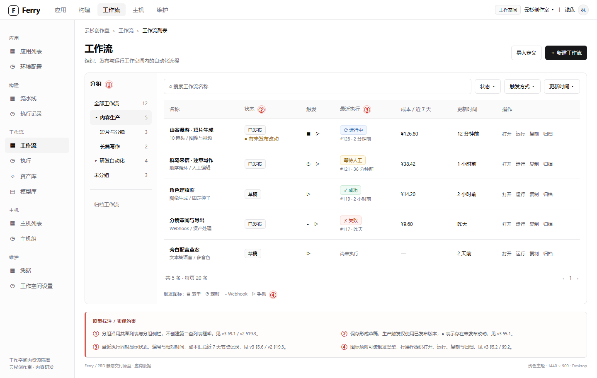

示意图：标注①…④为需求点，其余为示意。①分组树与共享列表→FR-LIST-01；②版本状态→02；③最近执行与近7日成本→03；④触发及操作→04。

**提示文案**（示例）：「尚无工作流，请创建工作流。」「草稿有未发布变更，生产触发仍使用已发布版本。」

| 编号 | Given / When / Then |
|---|---|
| AC-LIST-01 | Given 分组和名称筛选及第2页状态，When 复制地址重新进入并登录，Then 恢复筛选/页码，列表 total 对应同一权限范围；无权限操作不渲染。（01/04） |
| AC-LIST-02 | Given 已发布后修改草稿，When 列表刷新，Then 显示未发布变更且最近执行可跳转；没有 AI 成本显示「—」，不显示虚构0元。（02/03） |
| AC-LIST-03 | Given 已发布且有生产触发/公开入口的定义，When 归档，Then 自动撤销发布，触发及公开入口停止，历史仍可查看；恢复后是草稿，未重新发布不恢复生产入口。（05） |
| AC-LIST-04 | Given 未归档与已归档两个定义，When 分别请求删除，Then 前者拒绝，后者在授权范围内允许删除。（05） |

<a id="rv-09"></a>

#### 评审补充 09：工作流列表与组织（FR-RV-09）

来源：v3 §5.1、§9.2、§18.3；能力清单 A；ADR Q11/Q12；既有规则 FR-LIST-01/02/03/04/05/06；行为验收 AC-LIST-01/02/03/04/05；数据结构以[数据模型](ferry-工作流平台数据模型.md) §2/§4–§9为准。以下为来源规则的评审投影，标「源未定义，待补」的内容不是已定规则；缺口登记 G-09（§14）。

**模式差异（入口/操作/可编辑范围）**：列表搜索/过滤/分页；新增默认草稿；编辑名称/描述/标签/分组；查看只读；收藏不改定义权限。（来源：v3 §5.1、§9.2、§18.3；能力清单 A；ADR Q11/Q12；总方案 §5/§7/§8）

**字段与校验**：page_size默认20上限200；定义草稿/发布指针服务端维护；描述/标签精确长度与归档物理列仍待补；名称按§1c.5。资源名称默认trim后1–60字符（§1c.5），模块显式例外优先；其他字段来源/默认/回填/可编辑条件及未定长度/正则/上下限不从原型推导；未列出的节点/JSON子字段约束为「源未定义，待补」，不将DDL映射宽度当产品限制。（来源：v3 §5.1、§9.2、§18.3；能力清单 A；ADR Q11/Q12；数据模型 §1/§4/§7）

**字段联动与清空**：分组与过滤进入URL；归档同时撤销发布/触发/公开页，恢复不自动发布；收藏撤权后不见。已保存/历史引用不得因前端切换静默改写；已知依赖选择重置、旧异步结果和手工草稿按§1c.6；未声明的逐节点依赖/回填来源仍按模块缺口。（来源：v3 §5.1、§9.2、§18.3；能力清单 A；ADR Q11/Q12；总方案 §8；数据模型 §7）

**状态操作矩阵**：状态覆盖 未发布、已发布、已发布有未发布变更、归档、空库、无匹配。表中“无”指无需额外输入；不把未知的确认输入补成强制输入名称。表外状态的新增操作规则为「源未定义，待补」。（来源：v3 §5.1、§9.2、§18.3；能力清单 A；ADR Q11/Q12；数据模型 §6）

| 状态 | 操作 | 可见/可用条件 | 确认/输入 | 副作用 | 失败反馈/可逆性 |
|---|---|---|---|---|---|
| 未发布/已发布/有变更 | 打开/运行/复制/归档 | 按查看/run/编辑权限与分期显示 | 归档确认输入源未定义，待补 | 归档停入口保历史 | 失败保留原状态 |
| 归档 | 恢复/删除 | 对象相应权限与引用保护 | 共用删除确认，无键入名称输入框（§1c.2） | 恢复草稿；删除物理且保历史引用 | 引用拒删；删除不可逆 |

**操作记录（审计事件）**：创建/复制/修改/归档/恢复/删除按关键业务事件记录；事件对按§1c.1。事件身份、details和永久保留遵§1c.1；修改同事务写activity，不记录秘密或输入值。（来源：FR-AUTH-04；v3 §5.1、§9.2、§18.3；能力清单 A；ADR Q11/Q12；数据模型 §2）

**删除与保留**：定义先归档后物理删除，归档停生产且保历史，恢复为草稿（ADR Q12）；引用版本/最近50版保护。 删除弹窗/物理删除及引用保护按§1c.2，保留期/保护例外按§1c.3；不因缺外键跳过范围校验。（来源：ADR Q12；数据模型 §8.3/§8.4）

**数据模型、时间审计、索引与SQL**：workflows、definition_revisions；分组/收藏/标签/归档正式载体待补。本模块新表/存量新增时间按数据模型 §2配每个xx_at同前缀xx_by BIGINT NOT NULL DEFAULT 0；0=system；不回填猜测历史操作者。索引：workflows无新增二级索引；收藏/组继承/版本名键待补。SQL证据：数据模型 §8.3版本引用保护；列表排序/ACL完整SQL源未定义，待补。（来源：数据模型 §2/§4/§5/§8/§9）

**配置来源表**：按§1c.7对应开发发布/运维重启/平台立即/用户保存发布生效，当前无多语言设置。（来源：v3 §5.1、§9.2、§18.3；能力清单 A；ADR Q11/Q12；总方案 §7/§8；src/components/dsl.ts、ResourceForm.tsx；现状无i18n）：

| 配置项/来源 | 修改主体与频率 | 多语言/枚举 |
|---|---|---|
| 用户：分组、标签、描述、收藏及URL过滤；开发：状态标签/菜单；不新增字典体系 | 按已授权用户/开发/运维来源修改；生效按§1c.7：开发发布/运维重启/平台立即/用户保存发布，无固定周期 | 业务枚举见数据模型 §6；展示中文硬编码，en-US/ms-MY仍待澄清R01 |
| 原型数据/截图 | 静态示意，非配置中心 | 不得将示例金额/模型/人员或3轮当平台默认 |

**影响与兼容**：本期 S0列表版本状态，S1分组/收藏/归档，S2成本；不做 不跨空间分组或收藏授权；不直接删除未归档定义；灰度 草稿/发布隔离；归档撤销生产入口。核心流程：搜索筛选→打开/复制/运行→归档停止入口保留历史→恢复草稿或受保护物理删除。异常：无权对象连总数均不可见；空库与无匹配区分；归档后链接停止。历史up/down：数据模型 §5.2第4/12项，无历史工作流回填；§9收藏/归档缺口不造列；共用回退边界见§1b。三方：无额外三方；执行/成本依相应模块。版本兼容：共享列表信封；恢复不发布；物理删除不能抹历史快照。计算：近7日成本按凭据币种汇总，无价/无AI为—；不适用税/库存/折扣。（来源：v3 §5.1、§9.2、§18.3；能力清单 A；ADR Q11/Q12；数据模型 §5.2；NFR-COMP-01–03）

**文案表**（zh-CN来自原PRD提示/必需文案、v3、共享组件或RESPONSIVE中的原文；不据此引入i18n。en-US/ms-MY统一仍待澄清R01（§1c.9））：

| 场景/文案键（评审标识） | zh-CN | en-US | ms-MY | ms-MY 长度预留 |
|---|---|---|---|---|
| LIST.key | 这条记录已被他人修改，请刷新后重试 | 仍待澄清 R01 | 仍待澄清 R01 | 允许比zh-CN长≥40%；换行/区域滚动保持完整操作，不代表已有翻译 |

**验收追踪与响应式交付**：FR-LIST-01/02/03/04/05/06 → AC-LIST-01/02/03/04/05 / AC-RV-09 → 下表测试规格。规则对应原型编号；异常按§6.16文字，无独立截图，正常业务专属屏缺口仍逐项列出（§1c.8）；无Figma，Figma screen/variant不适用（当前交付为HTML+PNG），不能声称Figma覆盖。D=1440×900、P=768×1024、M=390×844，full-page PNG可高于视口；断点/键盘/Phone只读图规则见[RESPONSIVE.md](prototypes/RESPONSIVE.md)。

| Desktop / Pad / Phone截图 | 编号与覆盖边界 |
|---|---|
| [Desktop](images/01-workflow-list.png) / [Pad](images/pad/01-workflow-list.png) / [Phone](images/phone/01-workflow-list.png) | ①②③④：组织、发布状态、成本及操作；异常/权限视觉按§6.16文字，无独立截图；长文本按RESPONSIVE验收，语言variant仍待澄清R01（§1c.8）；HTML为prototypes/01-workflow-list.html |

| 规则→AC | 测试用例（规格，未执行） | Given / When / Then | 设计/状态证据 |
|---|---|---|---|
| FR-RV-09 → AC-RV-09 | TC-RV-09-01 | Given 本期有权用户与有效配置，When 按本功能闭环操作，Then 搜索筛选→打开/复制/运行→归档停止入口保留历史→恢复草稿或受保护物理删除 | 01-workflow-list.png ①②③④；其余状态待补 |
| FR-LIST-01/02/03/04/05/06 → AC-RV-09 | TC-RV-09-02 | Given 本功能异常或边界输入，When 执行对应操作，Then 无权对象连总数均不可见；空库与无匹配区分；归档后链接停止 | 异常视觉交互见§6.16文字，无独立截图，不代表已实测（§1c.8） |
| FR-AUTH-01–05 → AC-RV-09 | TC-RV-09-03 | Given 跨空间/无权成员或失效公开令牌，When 绕过界面直接请求，Then 拒绝且不产生本次业务副作用；公开者不获得后台权限 | 权限拒绝专属状态待补 |
| 数据模型 §5.2 → AC-RV-09 | TC-RV-09-04 | Given 升级前历史夹具与新状态，When 按迁移方案up/人工回退评审，Then 数据模型 §5.2第4/12项，无历史工作流回填；§9收藏/归档缺口不造列 | 后端迁移规格，无Figma/截图适用 |
| §1b/RESPONSIVE → AC-RV-09 | TC-RV-09-05 | Given 三布局与中文及长度≥140%的排版占位文本，When 查看本功能操作与错误，Then 核心字段/按钮不被遮挡；Phone图只读、区域内滚动；翻译内容未验收 | 三端基础PNG+callout见上表；异常按§6.16文字，无独立截图；语言variant仍待澄清R01（§1c.8） |

AC-RV-09：本功能已定规则按上述测试规格及既有AC验收；G-09列出的来源缺口须补来源/设计后才可认定对应能力验收通过。本次为需求文档审查，不声称运行测试、迁移或真实三方通过。（来源：用户评审清单；§10；v3 §5.1、§9.2、§18.3；能力清单 A；ADR Q11/Q12）

### 6.3 工作流编辑器（EDIT）

**目标**：用可解释数据和类型连线构建流程。**用户故事**：作为编排者，我希望在运行前发现配置问题，并在节点旁检查输入输出，以便修正流程而非猜测。

| 编号 | 需求 | 规则与边界 | 分期 | 来源 |
|---|---|---|---|---|
| FR-EDIT-01 | 类型化端口与兼容连线 | json<schema> 显示结构约束；拖线高亮兼容端口，空白释放进入类型过滤搜索；不兼容给原因；gpu 内部类型限同一 GPU 段。 | S1 基础/S3 媒体/S4 GPU | v3 §6.3、§9.2；原型02① |
| FR-EDIT-02 | 可展开循环容器与轮次 | 展示 parallel foreach 输入顺序与默认并发4；顺序 carry 和 while 的行为见 RUN；嵌套最多3。 | S1；媒体重做 S3 | v3 §18.7；原型02② |
| FR-EDIT-03 | 纯节点缓存提示可追溯 | 标明缓存命中、来源、具体模型版本及固定 seed 等依据；只有成功结果可缓存；模型只有别名时不得缓存；允许手动清缓存。 | S1 基础/S3 媒体 | v3 §18.4、§18.9；原型02③ |
| FR-EDIT-04 | 显示节点真实运行位置 | 服务端、主机、GPU 依节点能力选择；ffmpeg 仅主机；不能任意把云节点拖为 GPU 节点；媒体端口与预览可辨识。 | S1 主机/S3 媒体/S4 GPU | v3 §6.5、§16 V8、§18.4；原型02④ |
| FR-EDIT-05 | 节点显示运行结果与自动试运行边界 | 成功/失败/运行/缓存、耗时、成本与预览可查；含副作用节点关闭自动试运行；静默不发送外部消息。 | S1 状态/S2 成本/S3 自动试运行 | v3 §8.5、§9.2；原型02⑤ |
| FR-EDIT-06 | 节点详情具备输入、参数/设置、输出逻辑区 | 支持 Schema/Table/JSON 与相应媒体预览；无输入/未运行等状态不可伪装为有效输出。 | S1/S3 媒体 | v3 §9.2；原型03① |
| FR-EDIT-07 | 表达式编辑与逐条预览 | 以 = 使用 JS，支持 {{}} 插值、上游溯源与补全；无 $env 与 secrets；.item 不唯一时提示用 .all/.first。 | S1 | v3 §6.4、§18.7、§18.11；原型03② |
| FR-EDIT-08 | 统一节点设置与测试数据 | 可配置重试次数/间隔、停止/继续/错误输出、始终输出、执行一次、备注、缓存开关及允许运行位置/目标；固定数据可编辑 JSON，仅测试使用，生产忽略；active/bypass/mute 区分执行/透传/跳过；节点升级须确认。 | S1 | v3 §6.6、§7.1、§18.9；原型03③④ |
| FR-EDIT-09 | 问题面板定位凭据错误 | 凭据类型及工作空间匹配；缺凭据阻止发布，允许保存草稿；问题可定位；只通过凭据槽使用，不进入条目与日志。 | S1 | v3 §6.4、§9.2、§14；原型04①；ADR 2026-11-02 Q06 |
| FR-EDIT-10 | 检查模型目标与就绪状态 | 缺模型或主机绑定阻止发布，允许保存草稿；已配置模型但目标主机尚未就绪阻止执行，可定位并查看或下载模型。 | S4 | v3 §8.3、§9.2；原型04②；Q06；ADR 2026-11-02 Q06 |
| FR-EDIT-11 | 阻止命令直接插值 | 命令文本含 {{ 时拒绝保存；提示改用 FERRY_INPUT_* 环境变量或文件；密钥不作命令行参数。 | S1 | v3 §18.11；原型04③ |
| FR-EDIT-12 | 定位预算缺价问题 | 预算启用而单价缺失时阻止执行；展示缺价凭据/模型供修正，允许保存与发布；预算未启用的无价金额显示「—」。 | S2 | v3 §18.13；原型04④；Q06；ADR 2026-11-02 Q06；ADR 2026-11-02 Q11 |
| FR-EDIT-13 | 完成编辑辅助与组件复用 | 撤销/重做、复制粘贴、搜索、注释、框选、快捷操作、执行到此节点、问题定位、Markdown 诊断复制；组件保存时内联；遮罩编辑新建资产，widget 可转端口，seed 可固定/递增/随机并在运行开始确定。 | S1 辅助/S3 组件媒体/S5 版本组件 | v3 §9.2、§18.3–§18.4；能力清单 A/E |
| FR-EDIT-14 | 显式展示默认纯度与可覆盖边界 | 控制、转换、解析、编辑及模板节点默认纯；JS、HTTP、LLM、Agent、主机及 Python 节点默认具有副作用，仅满足 v3 §18.9 条件时可显式允许缓存。JS 声明纯后随机值与时间须确定，且不可使用 $http。人工、等待、触发及发送节点禁止缓存；子工作流一律按副作用处理，容器与组件的纯度由内部节点推导；生成节点须满足具体模型版本及 seed 的缓存条件。 | S1 基础/S2 AI/S3 媒体 | v3 §18.9 |
| FR-EDIT-15 | 问题面板区分三个阻断阶段与提示 | 按下表标明阻止保存、阻止发布、阻止执行或仅提示，定位相应节点/字段；不得将所有问题统一阻断保存。 | S1；预算 S2；模型 S4 | ADR 2026-11-02 Q06 |

问题严重性（三个阻断阶段，另有仅提示；来源：ADR 2026-11-02 Q06）：

| 级别 | 示例 | 行为 |
|---|---|---|
| 阻止保存 | 语法错误、主机命令中的表达式插值 | 拒绝保存并定位错误；不能发布或执行该无效修改。 |
| 阻止发布 | 缺凭据、主机绑定或模型 | 允许保存草稿，拒绝发布并定位缺项。 |
| 阻止执行 | 启用预算但缺单价；模型在目标主机未就绪 | 允许保存/发布，在执行入口拒绝相应执行。 |
| 仅提示 | 其余问题（如固定数据密钥/PII 扫描警告） | 提示并定位，不升级为上述阻断。 |

**页面与交互**：画布不替代共享资源表单；节点参数以共享字段框架配置，专用代码/媒体控件为自定义渲染器。问题面板分清错误和需处理提示，不能将原型标题当成全部问题同一阻断级别。

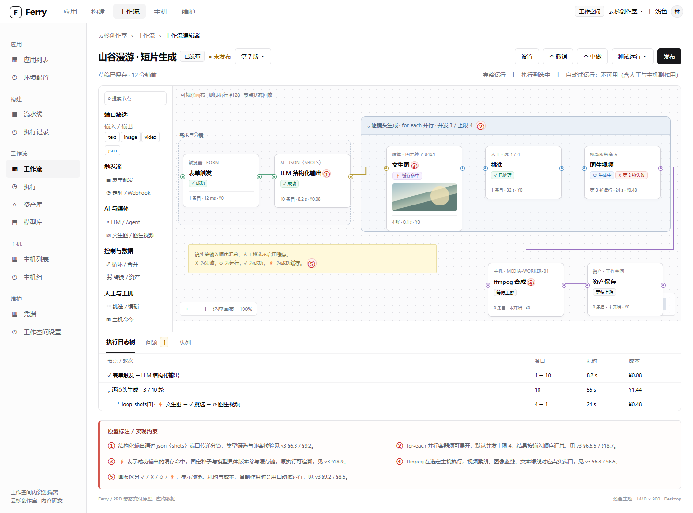

示意图：标注①…⑤为需求点，其余为示意。①结构类型→FR-EDIT-01；②循环→02；③缓存→03；④主机 ffmpeg/媒体线→04；⑤状态/预览/自动试运行→05。

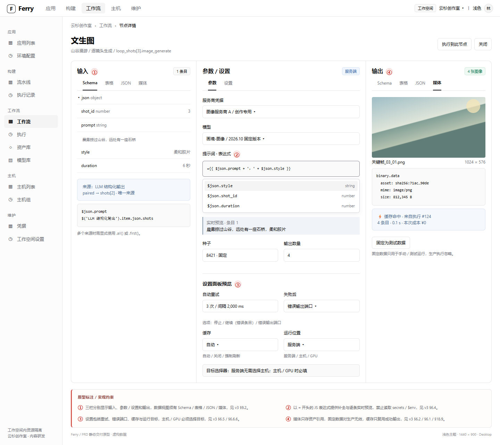

示意图：标注①…④为需求点，其余为示意。①三区及视图→FR-EDIT-06；②表达式→07；③重试/错误/缓存/运行位置→08；④资产引用、测试固定数据与成功缓存→03/08、FR-ASSET-03。

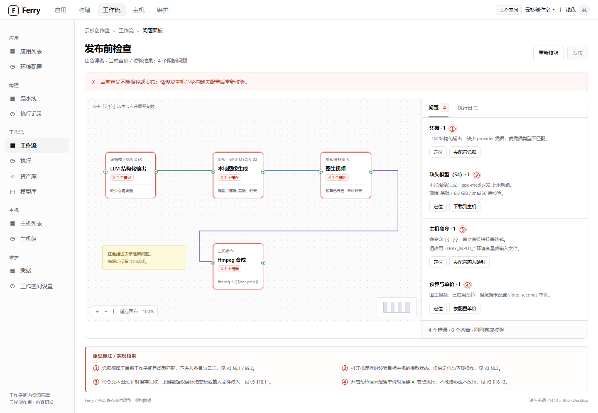

示意图：标注①…④为需求点，其余为示意。①凭据→FR-EDIT-09；②模型就绪→10；③命令插值→11；④缺价预算→12。阻断阶段按 FR-EDIT-15 的严重性表。

**提示文案**：「无法连接这两个端口，请选择兼容类型。」（示例）；「命令文本不能包含 {{，请通过环境变量或输入文件传递数据。」（示例）；「请为该凭据配置单价，否则无法执行预算控制」（必需，来源 v3 §18.13）。

| 编号 | Given / When / Then |
|---|---|
| AC-EDIT-01 | Given 类型不兼容端口，When 拖动连接，Then 不建立错误连线并说明原因；在空白释放时只列兼容节点；gpu 内部端口不跨段。（01/04） |
| AC-EDIT-02 | Given 固定测试数据和节点 mute/bypass，When 测试与生产各运行一次，Then 测试按设置执行，生产不使用固定数据；mute 为 skipped，bypass 透传，不能混为缓存。（03/08） |
| AC-EDIT-03 | Given 多个上游来源无法唯一对应，When 预览 .item，Then 提示溯源歧义和 .all/.first；表达式读不到 secrets/$env。（06/07） |
| AC-EDIT-04 | Given 命令含 {{ 与预算缺价两种配置，When 分别保存/执行，Then 前者保存被拒绝并定位；后者在预算执行入口被拒绝，不能自行推导同样禁止保存。（09–12） |
| AC-EDIT-05 | Given 具体模型/固定 seed 的纯节点成功缓存，When 仅100条输入中1条变化，Then 仅重算该条；更换工作空间不得命中原缓存；失败结果不命中。（03） |
| AC-EDIT-06 | Given 含发送消息等副作用节点，When 用户开启自动试运行，Then 按设计禁用此模式；升级节点版本须确认，遮罩保存产生新资产而非覆盖来源。（05/13） |
| AC-EDIT-07 | Given JS节点显式声明纯，When 同输入重复求值，Then 时间/随机值确定且$http不可用；人工/等待/触发/发送节点不能打开缓存；HTTP即使GET也不默认纯，失败但继续的错误条目不缓存。（14） |
| AC-EDIT-08 | Given 语法错误或主机命令表达式插值，When 保存，Then 拒绝保存并在问题面板与字段定位同一错误。（11/15） |
| AC-EDIT-09 | Given 缺凭据、主机绑定或模型，When 保存后尝试发布，Then 草稿可保存，发布被拒绝且逐项定位缺失配置。（09/10/15） |
| AC-EDIT-10 | Given 预算启用但缺价，或配置模型在目标主机未就绪，When 保存、发布后尝试执行，Then 保存/发布不因该级别受阻，相应执行被拒绝且说明原因。（10/12/15） |
| AC-EDIT-11 | Given 仅提示类问题且无其他阻断，When 保存、发布、执行，Then 提示可见且均不因该提示被阻止。（15） |
| AC-EDIT-12 | Given 媒体节点的控件和seed设置，When 将控件转输入端口并分别按固定/递增/随机执行，Then 端口类型及连线校验生效，seed在每次执行开始确定并写入记录，同次执行可追溯，不在中途悄然更换。（FR-EDIT-13/14） |

<a id="rv-10"></a>

#### 评审补充 10：工作流编辑器（FR-RV-10）

来源：v3 §6、§9.2、§18.7/18.9/18.11；ADR Q06；既有规则 FR-EDIT-01–15；行为验收 AC-EDIT-01–11；AC-UI-01；数据结构以[数据模型](ferry-工作流平台数据模型.md) §2/§4–§9为准。以下为来源规则的评审投影，标「源未定义，待补」的内容不是已定规则；缺口登记 G-10（§14）。

**模式差异（入口/操作/可编辑范围）**：新增空图/模板；编辑草稿/节点参数；查看历史只读；测试固定数据生效、生产忽略；Phone纵向节点只读。（来源：v3 §6、§9.2、§18.7/18.9/18.11；ADR Q06；总方案 §5/§7/§8）

**字段与校验**：图≤2MiB/500节点；固定数据≤1MiB；嵌套≤3；表达式=JS/{{}}；命令含{{拒绝；模型/主机/凭据同空间且类型匹配；节点各参数schema来自注册表，未给长度/正则源未定义，待补。资源名称默认trim后1–60字符（§1c.5），模块显式例外优先；其他字段来源/默认/回填/可编辑条件及未定长度/正则/上下限不从原型推导；未列出的节点/JSON子字段约束为「源未定义，待补」，不将DDL映射宽度当产品限制。（来源：v3 §6、§9.2、§18.7/18.9/18.11；ADR Q06；数据模型 §1/§4/§7）

**字段联动与清空**：类型决定可连端口；GPU内部类型限同段；修改参数标下游陈旧；切换模型/目标重新检查；不兼容依赖选择按§1c.6重置重校验，保留手工草稿。已保存/历史引用不得因前端切换静默改写；已知依赖选择重置、旧异步结果和手工草稿按§1c.6；未声明的逐节点依赖/回填来源仍按模块缺口。（来源：v3 §6、§9.2、§18.7/18.9/18.11；ADR Q06；总方案 §8；数据模型 §7）

**状态操作矩阵**：状态覆盖 active/bypass/mute；未运行/运行/成功/失败/cached/pinned；保存/发布/执行阻断；加载失败/409。表中“无”指无需额外输入；不把未知的确认输入补成强制输入名称。表外状态的新增操作规则为「源未定义，待补」。（来源：v3 §6、§9.2、§18.7/18.9/18.11；ADR Q06；数据模型 §6）

| 状态 | 操作 | 可见/可用条件 | 确认/输入 | 副作用 | 失败反馈/可逆性 |
|---|---|---|---|---|---|
| 草稿可编辑 | 保存/测试/发布 | 权限及分阶段校验分别判断 | 发布信息；风险确认见NFR | 保存不切生产；测试不发静默副作用 | 定位错误/保留本地稿 |
| 缺凭据/主机/模型 | 保存/发布 | 可保存草稿；发布阻断 | 无 | 问题面板定位 | 补绑定后重新校验 |
| 只读历史/Phone图 | 查看/开详情 | 查看权限；图结构只读 | 无 | 不改快照 | 详情加载失败可重试 |

**操作记录（审计事件）**：修改、发布、测试执行、节点升级/风险确认；固定数据密钥/PII扫描提示（FR-AUTH-04）。事件身份、details和永久保留遵§1c.1；修改同事务写activity，不记录秘密或输入值。（来源：FR-AUTH-04；v3 §6、§9.2、§18.7/18.9/18.11；ADR Q06；数据模型 §2）

**删除与保留**：定义先归档后物理删除，归档停生产且保历史，恢复为草稿（ADR Q12）；引用版本/最近50版保护。 删除弹窗/物理删除及引用保护按§1c.2，保留期/保护例外按§1c.3；不因缺外键跳过范围校验。（来源：ADR Q12；数据模型 §8.3/§8.4）

**数据模型、时间审计、索引与SQL**：workflows、definition_revisions、workflow_node_runs、node_cache、assets。本模块新表/存量新增时间按数据模型 §2配每个xx_at同前缀xx_by BIGINT NOT NULL DEFAULT 0；0=system；不回填猜测历史操作者。索引：node_cache_key；workflow_node_runs_attempt；节点Schema内部字段不额外建列。SQL证据：数据模型 §8.2节点意图查询、§8.3资产引用查询；图JSON不伪造可移植JSON索引。（来源：数据模型 §2/§4/§5/§8/§9）

**配置来源表**：按§1c.7对应开发发布/运维重启/平台立即/用户保存发布生效，当前无多语言设置。（来源：v3 §6、§9.2、§18.7/18.9/18.11；ADR Q06；总方案 §7/§8；src/components/dsl.ts、ResourceForm.tsx；现状无i18n）：

| 配置项/来源 | 修改主体与频率 | 多语言/枚举 |
|---|---|---|
| 开发：注册表Schema/纯度/端口类型；用户：节点参数/缓存/目标/固定数据；运维：平台限额 | 按已授权用户/开发/运维来源修改；生效按§1c.7：开发发布/运维重启/平台立即/用户保存发布，无固定周期 | 业务枚举见数据模型 §6；展示中文硬编码，en-US/ms-MY仍待澄清R01 |
| 原型数据/截图 | 静态示意，非配置中心 | 不得将示例金额/模型/人员或3轮当平台默认 |

**影响与兼容**：本期 S1类型化编排/文本，S3媒体，S4模型检查，S5版本组件；不做 不让表达式读$env/secrets；人工/等待/触发/发送禁止缓存；Phone图只读；灰度 草稿保存与生产发布隔离，无额外开关。核心流程：搜节点→连线/参数→逐条预览→分阶段校验→保存草稿→发布→测试或生产；错误定位回字段。异常：语法/命令{{阻保存；缺凭据/主机/模型阻发布；预算缺价/目标未ready阻执行；其他警告。历史up/down：数据模型 §5.2第12/15项，graph schema/type_version按FR-PLAT-17检查；seed/组件载体待补；共用回退边界见§1b。三方：ferry-sandbox、节点适配器；媒体/模型依各分期。版本兼容：Ferry图JSON与Actions YAML并存；不导入n8n/ComfyUI格式；节点升级须确认。计算：默认并行循环4、执行节点并发8上限64；纯缓存20GiB/LRU；不适用税/库存/折扣。（来源：v3 §6、§9.2、§18.7/18.9/18.11；ADR Q06；数据模型 §5.2；NFR-COMP-01–03）

**文案表**（zh-CN来自原PRD提示/必需文案、v3、共享组件或RESPONSIVE中的原文；不据此引入i18n。en-US/ms-MY统一仍待澄清R01（§1c.9））：

| 场景/文案键（评审标识） | zh-CN | en-US | ms-MY | ms-MY 长度预留 |
|---|---|---|---|---|
| EDIT.key | 请为该凭据配置单价，否则无法执行预算控制 | 仍待澄清 R01 | 仍待澄清 R01 | 允许比zh-CN长≥40%；换行/区域滚动保持完整操作，不代表已有翻译 |

**验收追踪与响应式交付**：FR-EDIT-01–15 → AC-EDIT-01–11；AC-UI-01 / AC-RV-10 → 下表测试规格。规则对应原型编号；异常按§6.16文字，无独立截图，正常业务专属屏缺口仍逐项列出（§1c.8）；无Figma，Figma screen/variant不适用（当前交付为HTML+PNG），不能声称Figma覆盖。D=1440×900、P=768×1024、M=390×844，full-page PNG可高于视口；断点/键盘/Phone只读图规则见[RESPONSIVE.md](prototypes/RESPONSIVE.md)。

| Desktop / Pad / Phone截图 | 编号与覆盖边界 |
|---|---|
| [Desktop](images/02-workflow-editor.png) / [Pad](images/pad/02-workflow-editor.png) / [Phone](images/phone/02-workflow-editor.png) | ①②③④⑤：连线、循环、缓存、位置、结果；异常/权限视觉按§6.16文字，无独立截图；长文本按RESPONSIVE验收，语言variant仍待澄清R01（§1c.8）；HTML为prototypes/02-workflow-editor.html |
| [Desktop](images/03-node-detail.png) / [Pad](images/pad/03-node-detail.png) / [Phone](images/phone/03-node-detail.png) | ①②③④：输入参数输出；异常/权限视觉按§6.16文字，无独立截图；长文本按RESPONSIVE验收，语言variant仍待澄清R01（§1c.8）；HTML为prototypes/03-node-detail.html |
| [Desktop](images/04-problems-panel.png) / [Pad](images/pad/04-problems-panel.png) / [Phone](images/phone/04-problems-panel.png) | ①②③④：分阶段问题；异常/权限视觉按§6.16文字，无独立截图；长文本按RESPONSIVE验收，语言variant仍待澄清R01（§1c.8）；HTML为prototypes/04-problems-panel.html |

| 规则→AC | 测试用例（规格，未执行） | Given / When / Then | 设计/状态证据 |
|---|---|---|---|
| FR-RV-10 → AC-RV-10 | TC-RV-10-01 | Given 本期有权用户与有效配置，When 按本功能闭环操作，Then 搜节点→连线/参数→逐条预览→分阶段校验→保存草稿→发布→测试或生产；错误定位回字段 | 02-workflow-editor.png ①②③④⑤；其余状态待补 |
| FR-EDIT-01–15 → AC-RV-10 | TC-RV-10-02 | Given 本功能异常或边界输入，When 执行对应操作，Then 语法/命令{{阻保存；缺凭据/主机/模型阻发布；预算缺价/目标未ready阻执行；其他警告 | 异常视觉交互见§6.16文字，无独立截图，不代表已实测（§1c.8） |
| FR-AUTH-01–05 → AC-RV-10 | TC-RV-10-03 | Given 跨空间/无权成员或失效公开令牌，When 绕过界面直接请求，Then 拒绝且不产生本次业务副作用；公开者不获得后台权限 | 权限拒绝专属状态待补 |
| 数据模型 §5.2 → AC-RV-10 | TC-RV-10-04 | Given 升级前历史夹具与新状态，When 按迁移方案up/人工回退评审，Then 数据模型 §5.2第12/15项，graph schema/type_version按FR-PLAT-17检查；seed/组件载体待补 | 后端迁移规格，无Figma/截图适用 |
| §1b/RESPONSIVE → AC-RV-10 | TC-RV-10-05 | Given 三布局与中文及长度≥140%的排版占位文本，When 查看本功能操作与错误，Then 核心字段/按钮不被遮挡；Phone图只读、区域内滚动；翻译内容未验收 | 三端基础PNG+callout见上表；异常按§6.16文字，无独立截图；语言variant仍待澄清R01（§1c.8） |

AC-RV-10：本功能已定规则按上述测试规格及既有AC验收；G-10列出的来源缺口须补来源/设计后才可认定对应能力验收通过。本次为需求文档审查，不声称运行测试、迁移或真实三方通过。（来源：用户评审清单；§10；v3 §6、§9.2、§18.7/18.9/18.11；ADR Q06）

### 6.4 节点目录（NODE）

**目标**：让用户明确每期可用的节点类别和能力。**用户故事**：作为编排者，我希望搜索到真实支持的节点，以便不把占位入口误当成已支持集成。

| 编号 | 需求 | 规则与边界 | 分期 | 来源 |
|---|---|---|---|---|
| FR-NODE-01 | 控制、数据、网络和主机基础节点 | 提供条件、分支、合并、三类循环、等待、转换、聚合、拆分、HTTP、JS、主机 Python/命令/检出/CLI、人工审批/表单/基础文本编辑、子工作流及运行流水线节点；部署只能经过流水线或应用。子工作流另须通过 FR-RUN-13 的调用策略检查。 | S1 | v3 §7.4、§10.1、§18.11；能力清单 B/D |
| FR-NODE-02 | AI 文本与第一批集成 | LLM/结构化输出、Agent 工具/记忆/MCP、嵌入/向量、数据表、聊天、持久轮询、文档转换；第一批协作、数据库、对象存储、代码平台及自集成按完整清单逐成员验收。 | S2 | v3 §7.4、§18.3；能力清单 B/C/D |
| FR-NODE-03 | 云端媒体处理与交互节点 | 图像/视频/音频生成、挑选/编辑、ffmpeg、遮罩、组件与媒体预览；服务商按 V7 选定；不能把能力清单全部媒体候选提前算作首批。 | S3 | v3 §7.4、§18.4；能力清单 E/F/G；V7 |
| FR-NODE-04 | 本地推理节点 | 模型加载、编码/采样/解码、图像/视频/TTS、模型合并/保存、分块VAE/低显存等按已选家族与矩阵验收。 | S4 | v3 §7.4、§8、§18.4；能力清单 F；V6 |
| FR-NODE-05 | 长尾扩展与模板 | 原生服务商/外部向量和记忆后端、完整长尾集成、WASM 扩展、3D GLB、训练辅助、Git同步、版本组件批量升级及官方场景模板按清单分期；不承诺完整训练平台。 | S5；WASM 规范 S2 | v3 §18.2–§18.4；能力清单 C/D/F/G/H |
| FR-NODE-06 | 首批模型与证据缺口按选择和验收推进 | AI辅助编排、instant模式及其他清单中独立行为证据不足的项目，均须补测并取得对应FR/AC的行为证据后才标已验证；V6 本地家族在 S4 前、V7 云服务商在 S3 前选定；能力清单有证据缺口的行（即时模式、摄像头/屏幕采集权限、单模型多 GPU 等）在选择前保持「未开始」，选定也须逐行逐成员取得证据才可标已验证，不提前承诺全部候选。 | S3/S4 选择；长尾 S5 | ADR 2026-11-02 Q15 |

**页面与交互**：复用编辑器02的节点搜索和03的节点配置，不新增截图。显示节点类别、关键输入输出、运行位置和可用版本；完整节点表以能力清单各行及其家族成员为准。通用聊天兼容节点不等于全部原生服务商节点，普通发信协议不等于专属邮箱 API，Kafka 生产者不等于消费者。

**提示文案**（示例）：「该节点尚未在当前分期交付，请查看能力清单。」

| 编号 | Given / When / Then |
|---|---|
| AC-NODE-01 | Given 各期节点目录，When 按能力清单核查每一行及家族每个成员，Then 只有有独立能力证据的成员标已覆盖，未选家族与未验证扩展保留未开始。（01–05） |
| AC-NODE-02 | Given 工作流需部署应用，When 搜索交付节点，Then 使用运行流水线/查询部署结果完成闭环，不能经新增直接部署旁路跳过门禁。（01） |
| AC-NODE-03 | Given V6/V7 尚未选定及能力清单有证据缺口的行，When 审核目录或阶段覆盖声明，Then 对应行仍为「未开始」，全部候选不算首批承诺；instant等模式须补测独立触发时机/差异，AI编排须有生成/修改图证据，入口不算覆盖；选定后仍须逐成员真实验证，多槽不替代单模型多 GPU 证据。（06） |

<a id="rv-11"></a>

#### 评审补充 11：节点目录（FR-RV-11）

来源：v3 §7.1/7.4、§18.3–§18.5；能力清单 B–H；ADR V6/V7/Q15；既有规则 FR-NODE-01–06；行为验收 AC-NODE-01/02/03；数据结构以[数据模型](ferry-工作流平台数据模型.md) §2/§4–§9为准。以下为来源规则的评审投影，标「源未定义，待补」的内容不是已定规则；缺口登记 G-11（§14）。

**模式差异（入口/操作/可编辑范围）**：目录仅选择/查看注册项；新增/编辑自定义节点按S2规范/S5 SDK；实例参数在编辑器；查看不可改历史版本。（来源：v3 §7.1/7.4、§18.3–§18.5；能力清单 B–H；ADR V6/V7/Q15；总方案 §5/§7/§8）

**字段与校验**：注册表声明type/type_version、端口、参数、凭据槽、允许运行位置；逐节点必填/默认/长度来自注册Schema；源未定义部分待补，不从截图推断。资源名称默认trim后1–60字符（§1c.5），模块显式例外优先；其他字段来源/默认/回填/可编辑条件及未定长度/正则/上下限不从原型推导；未列出的节点/JSON子字段约束为「源未定义，待补」，不将DDL映射宽度当产品限制。（来源：v3 §7.1/7.4、§18.3–§18.5；能力清单 B–H；ADR V6/V7/Q15；数据模型 §1/§4/§7）

**字段联动与清空**：选运行位置受能力约束；凭据槽类型必须匹配；版本升级先影响确认；已知依赖清空按§1c.6；逐节点未声明的依赖关系/回填来源仍待补。已保存/历史引用不得因前端切换静默改写；已知依赖选择重置、旧异步结果和手工草稿按§1c.6；未声明的逐节点依赖/回填来源仍按模块缺口。（来源：v3 §7.1/7.4、§18.3–§18.5；能力清单 B–H；ADR V6/V7/Q15；总方案 §8；数据模型 §7）

**状态操作矩阵**：状态覆盖 未开始、进行中、已验证（证据状态）；可用/不支持type或版本。表中“无”指无需额外输入；不把未知的确认输入补成强制输入名称。表外状态的新增操作规则为「源未定义，待补」。（来源：v3 §7.1/7.4、§18.3–§18.5；能力清单 B–H；ADR V6/V7/Q15；数据模型 §6）

| 状态 | 操作 | 可见/可用条件 | 确认/输入 | 副作用 | 失败反馈/可逆性 |
|---|---|---|---|---|---|
| 可用且版本支持 | 加入图/执行到节点 | 编辑/执行分别授权 | 节点升级需确认 | 生成实例，仍须校验 | 配置错误定位 |
| 未知type/version | 打开/导入/执行 | 显示具体版本错误；不静默运行 | 无 | 保留原定义 | 升级支持后重试 |
| 证据不足 | 声明覆盖 | 不得标已验证 | 无 | 保持未开始或实际证据阶段 | 补真实行为证据 |

**操作记录（审计事件）**：节点注册/升级事件对按§1c.1；实例修改/执行、许可与风险确认按AUTH。事件身份、details和永久保留遵§1c.1；修改同事务写activity，不记录秘密或输入值。（来源：FR-AUTH-04；v3 §7.1/7.4、§18.3–§18.5；能力清单 B–H；ADR V6/V7/Q15；数据模型 §2）

**删除与保留**：不新增软删除；保留/物理删除按§1c.2/§1c.3及原资源保护例外。 删除弹窗/物理删除及引用保护按§1c.2，保留期/保护例外按§1c.3；不因缺外键跳过范围校验。（来源：ADR Q12；数据模型 §8.3/§8.4）

**数据模型、时间审计、索引与SQL**：注册表以代码/声明为源，无独立node_registry表；图内type_version；data_tables/rows、vector_collections/items见模型。本模块新表/存量新增时间按数据模型 §2配每个xx_at同前缀xx_by BIGINT NOT NULL DEFAULT 0；0=system；不回填猜测历史操作者。索引：数据表最多5索引列，i1..i5类型/索引待补；向量键与维度待补。SQL证据：已知意图查询见数据模型 §8.2；数据表/向量完整查询SQL因schema缺失源未定义，待补。（来源：数据模型 §2/§4/§5/§8/§9）

**配置来源表**：按§1c.7对应开发发布/运维重启/平台立即/用户保存发布生效，当前无多语言设置。（来源：v3 §7.1/7.4、§18.3–§18.5；能力清单 B–H；ADR V6/V7/Q15；总方案 §7/§8；src/components/dsl.ts、ResourceForm.tsx；现状无i18n）：

| 配置项/来源 | 修改主体与频率 | 多语言/枚举 |
|---|---|---|
| 开发/扩展作者：节点Schema及版本枚举；用户：参数/绑定；服务商/家族待V6/V7选择，非硬编码全候选 | 按已授权用户/开发/运维来源修改；生效按§1c.7：开发发布/运维重启/平台立即/用户保存发布，无固定周期 | 业务枚举见数据模型 §6；展示中文硬编码，en-US/ms-MY仍待澄清R01 |
| 原型数据/截图 | 静态示意，非配置中心 | 不得将示例金额/模型/人员或3轮当平台默认 |

**影响与兼容**：本期 S1基础，S2AI/集成，S3云媒体，S4本地，S5长尾；清单逐行逐成员验收；不做 不兼容第三方插件/源码/格式；不提前承诺全部模型或完整训练；灰度 无（未验证成员保持未开始；按发布版本交付）。核心流程：分类/端口搜索→选节点版本→配置Schema与凭据→校验→运行→逐成员证据。异常：未知type/version拒绝、不静默丢字段；缺能力/平台不兼容说明原因。历史up/down：数据模型 §5.2第12/14/15/16项；未知格式不得隐式迁移；共用回退边界见§1b。三方：逐成员集成/API/数据库/模型服务商；V6/V7按S4/S3前选型。版本兼容：自有声明式/WASM/主机扩展；不加载n8n custom-node或ComfyUI插件。计算：表≤100000行/5索引列，SQLite/MySQL向量≤20000；不适用税/库存/折扣。（来源：v3 §7.1/7.4、§18.3–§18.5；能力清单 B–H；ADR V6/V7/Q15；数据模型 §5.2；NFR-COMP-01–03）

**文案表**（zh-CN来自原PRD提示/必需文案、v3、共享组件或RESPONSIVE中的原文；不据此引入i18n。en-US/ms-MY统一仍待澄清R01（§1c.9））：

| 场景/文案键（评审标识） | zh-CN | en-US | ms-MY | ms-MY 长度预留 |
|---|---|---|---|---|
| NODE.key | 该节点尚未在当前分期交付，请查看能力清单。 | 仍待澄清 R01 | 仍待澄清 R01 | 允许比zh-CN长≥40%；换行/区域滚动保持完整操作，不代表已有翻译 |

**验收追踪与响应式交付**：FR-NODE-01–06 → AC-NODE-01/02/03 / AC-RV-11 → 下表测试规格。规则对应原型编号；异常按§6.16文字，无独立截图，正常业务专属屏缺口仍逐项列出（§1c.8）；无Figma，Figma screen/variant不适用（当前交付为HTML+PNG），不能声称Figma覆盖。D=1440×900、P=768×1024、M=390×844，full-page PNG可高于视口；断点/键盘/Phone只读图规则见[RESPONSIVE.md](prototypes/RESPONSIVE.md)。

| Desktop / Pad / Phone截图 | 编号与覆盖边界 |
|---|---|
| [Desktop](images/02-workflow-editor.png) / [Pad](images/pad/02-workflow-editor.png) / [Phone](images/phone/02-workflow-editor.png) | ①：节点库/类型过滤；各长尾成员专属设计待补；异常/权限视觉按§6.16文字，无独立截图；长文本按RESPONSIVE验收，语言variant仍待澄清R01（§1c.8）；HTML为prototypes/02-workflow-editor.html |

| 规则→AC | 测试用例（规格，未执行） | Given / When / Then | 设计/状态证据 |
|---|---|---|---|
| FR-RV-11 → AC-RV-11 | TC-RV-11-01 | Given 本期有权用户与有效配置，When 按本功能闭环操作，Then 分类/端口搜索→选节点版本→配置Schema与凭据→校验→运行→逐成员证据 | 02-workflow-editor.png ①；其余状态待补 |
| FR-NODE-01–06 → AC-RV-11 | TC-RV-11-02 | Given 本功能异常或边界输入，When 执行对应操作，Then 未知type/version拒绝、不静默丢字段；缺能力/平台不兼容说明原因 | 异常视觉交互见§6.16文字，无独立截图，不代表已实测（§1c.8） |
| FR-AUTH-01–05 → AC-RV-11 | TC-RV-11-03 | Given 跨空间/无权成员或失效公开令牌，When 绕过界面直接请求，Then 拒绝且不产生本次业务副作用；公开者不获得后台权限 | 权限拒绝专属状态待补 |
| 数据模型 §5.2 → AC-RV-11 | TC-RV-11-04 | Given 升级前历史夹具与新状态，When 按迁移方案up/人工回退评审，Then 数据模型 §5.2第12/14/15/16项；未知格式不得隐式迁移 | 后端迁移规格，无Figma/截图适用 |
| §1b/RESPONSIVE → AC-RV-11 | TC-RV-11-05 | Given 三布局与中文及长度≥140%的排版占位文本，When 查看本功能操作与错误，Then 核心字段/按钮不被遮挡；Phone图只读、区域内滚动；翻译内容未验收 | 三端基础PNG+callout见上表；异常按§6.16文字，无独立截图；语言variant仍待澄清R01（§1c.8） |

AC-RV-11：本功能已定规则按上述测试规格及既有AC验收；G-11列出的来源缺口须补来源/设计后才可认定对应能力验收通过。本次为需求文档审查，不声称运行测试、迁移或真实三方通过。（来源：用户评审清单；§10；v3 §7.1/7.4、§18.3–§18.5；能力清单 B–H；ADR V6/V7/Q15）

### 6.5 触发（TRIG）

**目标**：让用户知道流程如何进入、使用何版本以及怎样回应调用方。**用户故事**：作为编排者，我希望区分测试和生产入口，以便调试不影响生产。

| 编号 | 需求 | 规则与边界 | 分期 | 来源 |
|---|---|---|---|---|
| FR-TRIG-01 | 手动、定时、代码事件与上游/错误触发 | 手动可选草稿；生产使用发布版；工作流 cron 节点为唯一可编辑源，定时任务资源只读派生项；流水线 schedule 不写 YAML；fork MR 禁止自动执行；流水线失败可触发错误工作流。 | P1/S1；流水线上游补充 P2 | v3 §5.2、§18.2、§18.6；v2 D3/D11；流水线清单 §3.2 |
| FR-TRIG-02 | 区分 Webhook 测试与生产 | 随机 endpoint_id 加自定义 path，测试仅调试窗口、生产需发布；流水线通用 Webhook 校验 secret、body→inputs、异步返回。 | P1 D17/S1 工作流 | v3 §5.2、§12.2；流水线清单 D17 |
| FR-TRIG-03 | 工作流同步回应有明确模式与超时 | 即时/最后节点/Respond 节点；默认30秒、可设1–300秒，超时504而后台继续；回应前进入人工/等待则202并带执行ID；连接丢失可见未送达。 | S1 | v3 §18.10 |
| FR-TRIG-04 | 同步入口遵守容量与并发 | 满并发组503与 Retry-After；不允许 queue_latest/cancel_in_progress 同步配置；独立同步 in-flight 默认64但仍受并发组约束。 | S1 | v3 §18.10、§18.15 |
| FR-TRIG-05 | 表单、聊天、应用事件轮询 | 表单多页与上传走公开约束；聊天支持流式；轮询游标加密持久化，接管不能从零产生重复事件。 | S1 表单/S2 聊天轮询流式 | v3 §5.2、§9.6、§18.3；能力清单 B |
| FR-TRIG-06 | MR 合并事件冻结检出 SHA | merged MR 触发冻结事件中的精确 merge commit，执行检出该 SHA，绝不跟随目标分支最新提交；fork MR 仍不自动运行。 | P1/S1 代码事件 | ADR 2026-11-02 Q05 |
| FR-TRIG-07 | 工作流 Webhook 安全与输入响应契约 | 测试与生产入口均支持 basic/header/JWT 认证配置、CORS 允许来源和 IP 白名单，并在创建执行前校验；无效认证、禁止来源或非白名单 IP 不得启动执行。输入可选原始正文或二进制体并保留原始字节；回应可配置状态码和响应头，适用于所选回应模式，不能覆盖安全响应头或绕过 FR-TRIG-03/04 的超时与容量规则。密钥走凭据槽位，不进条目/日志。 | S1 | v3 §18.3、§18.10；能力清单 A021 |

**页面与交互**：触发节点配置在02/03；生产变更确认见15，表单见11（在 PUBLIC 模块嵌图）。展示入口类型、测试/生产状态、回应模式与超时，不把测试 URL 提供为稳定生产链接。

**提示文案**（示例）：「请求已超时，执行仍在后台继续。」「执行已挂起，请使用执行编号查看后续结果。」必需状态说明：「同步回应未送达」（v3 §18.10）。

| 编号 | Given / When / Then |
|---|---|
| AC-TRIG-01 | Given 保存 cron 节点并发布，When 从定时任务页查看，Then 只读显示派生项、提供回到工作流入口，不存在第二个可编辑 cron 事实来源。（01） |
| AC-TRIG-02 | Given 同步超时30秒且任务持续运行，When 达到超时，Then 客户端504，执行继续；先等待人工时则202带ID；接管丢连接显示未送达。（03） |
| AC-TRIG-03 | Given 同步并发组已满或配置 queue_latest，When 分别请求/保存，Then 前者503带 Retry-After，后者明确拒绝不兼容同步配置。（02/04） |
| AC-TRIG-04 | Given S2 轮询已保存基线与游标，When 实例重启接管，Then 继续既有状态、不重复首轮事件；真实渠道独立验收，不以夹具代替。（05） |
| AC-TRIG-05 | Given MR 合并事件记录 SHA A 且目标分支之后更新为 B，When 事件投递并执行检出，Then 上下文与实际检出均为 A，不能使用 B；fork MR 不自动执行。（06） |
| AC-TRIG-06 | Given 分别配置 basic、header、JWT 的工作流 Webhook，When 使用各自有效认证、允许来源及白名单 IP 请求，Then 按所选模式受理一次执行，输入和响应符合配置；测试入口仍只在调试窗口生效。（07） |
| AC-TRIG-07 | Given 已配置认证的测试或生产 Webhook，When 缺失/错误 basic 或 header 凭据、JWT 签名无效或过期，Then 拒绝且不创建执行，错误与日志不泄露认证值。（07） |
| AC-TRIG-08 | Given CORS 仅允许来源 A，When A 预检及请求、来源 B 预检及请求分别到达，Then A 得到匹配的 CORS 头，B 不获允许且实际请求被拒绝、不创建执行；非浏览器直请求仍受认证及 IP 校验。（07） |
| AC-TRIG-09 | Given IP 白名单仅含测试地址 A，When 从 A 和不在名单的 B 分别请求，Then 仅 A 可在其他校验通过后启动执行，B 被拒绝且不创建执行。（07） |
| AC-TRIG-10 | Given 原始正文与二进制体两种配置及包含零字节的输入，When 通过认证提交并使用自定义201状态及 X-Result 响应头，Then 下游收到未被 JSON/文本转换破坏的原始字节，调用方收到201及该头；试图覆盖安全头的配置被拒绝，超时仍按504规则。（07） |

<a id="rv-12"></a>

#### 评审补充 12：触发（FR-RV-12）

来源：v3 §5.2、§12.2、§18.3/18.6/18.10；ADR D3/D11/D17/Q05；既有规则 FR-TRIG-01–07；行为验收 AC-TRIG-01–06；AC-PIPE-30；数据结构以[数据模型](ferry-工作流平台数据模型.md) §2/§4–§9为准。以下为来源规则的评审投影，标「源未定义，待补」的内容不是已定规则；缺口登记 G-12（§14）。

**模式差异（入口/操作/可编辑范围）**：新增/编辑触发节点；测试URL仅窗口可用；生产URL稳定取发布版；派生定时项只读；历史投递只读。（来源：v3 §5.2、§12.2、§18.3/18.6/18.10；ADR D3/D11/D17/Q05；总方案 §5/§7/§8）

**字段与校验**：endpoint_id服务端随机；path用户配置；sync timeout默认30、1–300秒，in-flight默认64；auth none/basic/header/jwt；CORS/IP/响应头配置；path正则/窗口期限/头白名单源未定义，待补。资源名称默认trim后1–60字符（§1c.5），模块显式例外优先；其他字段来源/默认/回填/可编辑条件及未定长度/正则/上下限不从原型推导；未列出的节点/JSON子字段约束为「源未定义，待补」，不将DDL映射宽度当产品限制。（来源：v3 §5.2、§12.2、§18.3/18.6/18.10；ADR D3/D11/D17/Q05；数据模型 §1/§4/§7）

**字段联动与清空**：发布更新生产绑定不变URL；Responder不能覆盖安全响应头；轮询游标加密持久化接管不从0。已保存/历史引用不得因前端切换静默改写；已知依赖选择重置、旧异步结果和手工草稿按§1c.6；未声明的逐节点依赖/回填来源仍按模块缺口。（来源：v3 §5.2、§12.2、§18.3/18.6/18.10；ADR D3/D11/D17/Q05；总方案 §8；数据模型 §7）

**状态操作矩阵**：状态覆盖 测试窗口关闭/打开、生产未发布/已发布、已受理、等待202、超时504、满组503、未送达。表中“无”指无需额外输入；不把未知的确认输入补成强制输入名称。表外状态的新增操作规则为「源未定义，待补」。（来源：v3 §5.2、§12.2、§18.3/18.6/18.10；ADR D3/D11/D17/Q05；数据模型 §6）

| 状态 | 操作 | 可见/可用条件 | 确认/输入 | 副作用 | 失败反馈/可逆性 |
|---|---|---|---|---|---|
| 测试窗口打开/生产已发布 | 调用 | 认证/来源/IP、空间开关与容量通过 | 声明输入 | 冻结版本身份并执行 | 无效认证拒绝且零执行 |
| 执行等待/超时/断连 | 查询执行 | 本次受限结果或执行查看权 | 无 | HTTP结果不等于后台停止 | 202/504/未送达区分 |
| 未发布/窗口关闭/归档 | 生产或测试调用 | 对应入口不可受理 | 无 | 不启动生产执行 | 修正窗口/发布状态后重试 |

**操作记录（审计事件）**：触发受理、鉴权失败及执行身份/投递结果；日志不含认证密钥/原始敏感正文。事件身份、details和永久保留遵§1c.1；修改同事务写activity，不记录秘密或输入值。（来源：FR-AUTH-04；v3 §5.2、§12.2、§18.3/18.6/18.10；ADR D3/D11/D17/Q05；数据模型 §2）

**删除与保留**：不新增软删除；保留/物理删除按§1c.2/§1c.3及原资源保护例外。 删除弹窗/物理删除及引用保护按§1c.2，保留期/保护例外按§1c.3；不因缺外键跳过范围校验。（来源：ADR Q12；数据模型 §8.3/§8.4）

**数据模型、时间审计、索引与SQL**：webhook_endpoints、trigger_bindings/deliveries、workflow_executions、cron_jobs；trigger_state未定载体。本模块新表/存量新增时间按数据模型 §2配每个xx_at同前缀xx_by BIGINT NOT NULL DEFAULT 0；0=system；不回填猜测历史操作者。索引：webhook_endpoints_id及route唯一存在冲突评审缺口；bindings_lookup。SQL证据：数据模型 §8.1/8.2；测试窗口/轮询游标SQL源未定义，待补。（来源：数据模型 §2/§4/§5/§8/§9）

**配置来源表**：按§1c.7对应开发发布/运维重启/平台立即/用户保存发布生效，当前无多语言设置。（来源：v3 §5.2、§12.2、§18.3/18.6/18.10；ADR D3/D11/D17/Q05；总方案 §7/§8；src/components/dsl.ts、ResourceForm.tsx；现状无i18n）：

| 配置项/来源 | 修改主体与频率 | 多语言/枚举 |
|---|---|---|
| 用户：认证/来源/IP/回应模式/cron；运维：in-flight与公开来源；开发：协议/状态码；枚举原码未定待补 | 按已授权用户/开发/运维来源修改；生效按§1c.7：开发发布/运维重启/平台立即/用户保存发布，无固定周期 | 业务枚举见数据模型 §6；展示中文硬编码，en-US/ms-MY仍待澄清R01 |
| 原型数据/截图 | 静态示意，非配置中心 | 不得将示例金额/模型/人员或3轮当平台默认 |

**影响与兼容**：本期 S1手动/定时/Webhook/表单，S2聊天/轮询；流水线上游P2；不做 不双写cron可编辑源；不让同步入口使用queue_latest/cancel_in_progress；灰度 测试仅调试窗口；生产需发布；公开访问空间默认关闭。核心流程：认证/CORS/IP→解析输入→容量校验→创建执行→即时/末节点/Respond回应→超时或等待可追踪。异常：认证失败不启动；满组503+Retry-After；等待202+执行ID；超时504后台继续；断连标未送达。历史up/down：数据模型 §5.2第6/12/14项，保留游标/投递账本，不补投旧事件；共用回退边界见§1b。三方：外部调用方、代码平台、轮询集成；验证码若启用依具体方案待补。版本兼容：Actions schedule拒绝；工作流cron节点唯一源；同步连接故障不可恢复。计算：同步30秒/1–300秒、64 in-flight仍受组限制；税/库存/折扣不适用。（来源：v3 §5.2、§12.2、§18.3/18.6/18.10；ADR D3/D11/D17/Q05；数据模型 §5.2；NFR-COMP-01–03）

**文案表**（zh-CN来自原PRD提示/必需文案、v3、共享组件或RESPONSIVE中的原文；不据此引入i18n。en-US/ms-MY统一仍待澄清R01（§1c.9））：

| 场景/文案键（评审标识） | zh-CN | en-US | ms-MY | ms-MY 长度预留 |
|---|---|---|---|---|
| TRIG.key | 请求过于频繁，请稍后重试。 | 仍待澄清 R01 | 仍待澄清 R01 | 允许比zh-CN长≥40%；换行/区域滚动保持完整操作，不代表已有翻译 |

**验收追踪与响应式交付**：FR-TRIG-01–07 → AC-TRIG-01–06；AC-PIPE-30 / AC-RV-12 → 下表测试规格。规则对应原型编号；异常按§6.16文字，无独立截图，正常业务专属屏缺口仍逐项列出（§1c.8）；无Figma，Figma screen/variant不适用（当前交付为HTML+PNG），不能声称Figma覆盖。D=1440×900、P=768×1024、M=390×844，full-page PNG可高于视口；断点/键盘/Phone只读图规则见[RESPONSIVE.md](prototypes/RESPONSIVE.md)。

| Desktop / Pad / Phone截图 | 编号与覆盖边界 |
|---|---|
| [Desktop](images/11-public-form.png) / [Pad](images/pad/11-public-form.png) / [Phone](images/phone/11-public-form.png) | ①③④：公开触发；Webhook专属屏/状态待补；异常/权限视觉按§6.16文字，无独立截图；长文本按RESPONSIVE验收，语言variant仍待澄清R01（§1c.8）；HTML为prototypes/11-public-form.html |

| 规则→AC | 测试用例（规格，未执行） | Given / When / Then | 设计/状态证据 |
|---|---|---|---|
| FR-RV-12 → AC-RV-12 | TC-RV-12-01 | Given 本期有权用户与有效配置，When 按本功能闭环操作，Then 认证/CORS/IP→解析输入→容量校验→创建执行→即时/末节点/Respond回应→超时或等待可追踪 | 11-public-form.png ①③④；其余状态待补 |
| FR-TRIG-01–07 → AC-RV-12 | TC-RV-12-02 | Given 本功能异常或边界输入，When 执行对应操作，Then 认证失败不启动；满组503+Retry-After；等待202+执行ID；超时504后台继续；断连标未送达 | 异常视觉交互见§6.16文字，无独立截图，不代表已实测（§1c.8） |
| FR-AUTH-01–05 → AC-RV-12 | TC-RV-12-03 | Given 跨空间/无权成员或失效公开令牌，When 绕过界面直接请求，Then 拒绝且不产生本次业务副作用；公开者不获得后台权限 | 权限拒绝专属状态待补 |
| 数据模型 §5.2 → AC-RV-12 | TC-RV-12-04 | Given 升级前历史夹具与新状态，When 按迁移方案up/人工回退评审，Then 数据模型 §5.2第6/12/14项，保留游标/投递账本，不补投旧事件 | 后端迁移规格，无Figma/截图适用 |
| §1b/RESPONSIVE → AC-RV-12 | TC-RV-12-05 | Given 三布局与中文及长度≥140%的排版占位文本，When 查看本功能操作与错误，Then 核心字段/按钮不被遮挡；Phone图只读、区域内滚动；翻译内容未验收 | 三端基础PNG+callout见上表；异常按§6.16文字，无独立截图；语言variant仍待澄清R01（§1c.8） |

AC-RV-12：本功能已定规则按上述测试规格及既有AC验收；G-12列出的来源缺口须补来源/设计后才可认定对应能力验收通过。本次为需求文档审查，不声称运行测试、迁移或真实三方通过。（来源：用户评审清单；§10；v3 §5.2、§12.2、§18.3/18.6/18.10；ADR D3/D11/D17/Q05）

### 6.6 执行、重试与队列（RUN）

**目标**：说明执行身份、当前轮次和等待原因，并支持可预测的恢复。**用户故事**：作为执行者，我希望只重算需要修改的部分，并明确哪些旧结果被沿用，以便避免误操作和重复付费。

| 编号 | 需求 | 规则与边界 | 分期 | 来源 |
|---|---|---|---|---|
| FR-RUN-01 | 展示触发者与执行身份 | 自动生产绑定发布者；手动/测试/重跑/从节点/按轮次是操作者；子工作流继承父身份；每次实时复核成员与执行/主机权限；公开提交者不是身份。 | S1；S0 绑定 | v3 §18.6；原型05① |
| FR-RUN-02 | 展示轮次及三种重跑 | 全部、失败集合加下游、从指定节点及下游；可限定轮次；支持原版本/当前版本选择；外部成功节点标 reused 与来源；不是 cached。 | S1 基础/S3 按轮次 | v3 §18.7；流水线清单 §3.2；原型05②④ |
| FR-RUN-03 | 重跑闭包与人工回应可解释 | 轮次3的X重跑重算该轮X及下游、容器后下游，其他轮复用；审批重做，表单/挑选/编辑默认复用回应且可逐项改选；数据已清理只准全部重跑。 | S1/S3 媒体人工 | v3 §18.7；原型05③ |
| FR-RUN-04 | 状态、历史与暂停语义可区分 | cancelled 不记 failed，新旧轮次与尝试分开。暂停后执行状态为 `waiting`，`end_reason` 为 `paused`；等待当前运行节点结束后释放执行槽。继续沿用原快照；「以当前版本继续」实际执行当前版本的按轮次重跑。 | S1；按轮次 S3 | v3 §6.7、§18.7；原型05⑤ |
| FR-RUN-05 | 统一执行列表按服务端权限过滤 | 类型、名称、编号、状态、触发、耗时、成本、开始时间；类型/状态/时间/触发/版本/待我处理/标注筛选，注释可搜索；等待我的任务由服务端判定。 | S0 列表/S1 过滤标注/S2 成本 | v3 §5.7、§18.3；原型06①② |
| FR-RUN-06 | 队列解释执行、主机、GPU 等待 | 队列视图为集群聚合，流水线/工作流执行槽分开，实例级默认4/16、同步64；具体等待原因含并发组、执行槽、主机或 GPU；成员只见其工作空间，不把聚合值当每空间独占额度；waiting 人工可跳任务，授权后可取消。 | P0/S0/S1；GPU S4 | v2 §8.2；v3 §5.3、§9.4、§18.15；原型06③④；ADR 2026-11-02 Q10 |
| FR-RUN-07 | 合并、空项、跳过及错误延续遵循稳定语义 | Merge 等所有前驱达到终态。所有输入均为空列表或 skipped 时，默认 Merge 记为 skipped；存在非空输入时按默认合并规则执行。wait-all 模式遇到 skipped 输入即记为 skipped，空列表仍参与等待；continue 模式将错误条目作为正常条目输出；always-output 不能使 skipped 分支重新运行。 | S1 | v3 §18.7 |
| FR-RUN-08 | 循环顺序、失败策略与限额可配置可见 | 并行循环默认并发4，结果按输入顺序输出；失败策略可选立即停止、全部继续（默认）或全部完成后失败。顺序循环的 carry 来自指定输出；while 在循环末尾判断，默认最多10轮、上限1000轮。循环最多嵌套3层，单执行同时运行节点默认8个、上限64个。 | S1 | v3 §18.7、§18.15 |
| FR-RUN-09 | 异步媒体等待与不确定提交显式处理 | 5–15秒轮询，长任务挂起释放执行槽；支持幂等的适配器才可防重复提交；未知提交不自动重提，用户选择按未提交重试或放弃；额度不足/内容审核拒绝不自动重试。 | S3 | v3 §8.1、§18.8–§18.9 |
| FR-RUN-10 | 保留策略影响重跑须提前提示 | 支持执行数据保存/保留策略及定义覆盖；运行期间先保存结果，终态再清理；关闭保存须提示不能局部重跑；纯缓存与新执行复用分开。 | S1；流水线覆盖 P2 | v3 §18.2、§18.7、§18.14 |
| FR-RUN-11 | 跨实例队列按空间展示可解释聚合 | 聚合集群各实例的队列/槽位信息并明确聚合口径，逐执行列明实际并发组、主机或 GPU 等等待原因；成员仅见所属工作空间信息，过滤和总数均按服务端权限处理。 | P0/S0/S1；GPU S4 | ADR 2026-11-02 Q10 |
| FR-RUN-12 | 取消排队、运行或挂起的执行 | 仅具有相应执行操作权限者可取消，服务端再次鉴权；取消后为 cancelled，停止后续调度并按运行节点的取消边界处理。人工等待被取消后不能再提交回应来唤醒执行；详情仍可查看取消原因与历史。 | S1 | v3 §6.7、§9.3–§9.4；能力清单 A012/E018/E019 |
| FR-RUN-13 | 被调用子工作流配置调用方准入 | 被调用方可选择「任意本空间工作流」或「指定工作流列表」。每次子调用均在服务端校验真实父工作流、同空间、被调用方策略及继承身份的权限；不允许跨空间或仅伪造调用方 ID 绕过准入；调用深度受 NFR-CAP-02 约束。 | S1 | v3 §6.6.11、§18.6；能力清单 A024 |

**页面与交互**：统一列表使用共享分页和 total；执行详情按轮次选择输入输出、日志、预览和成本，操作前明确范围、版本和会重复的人工审批。

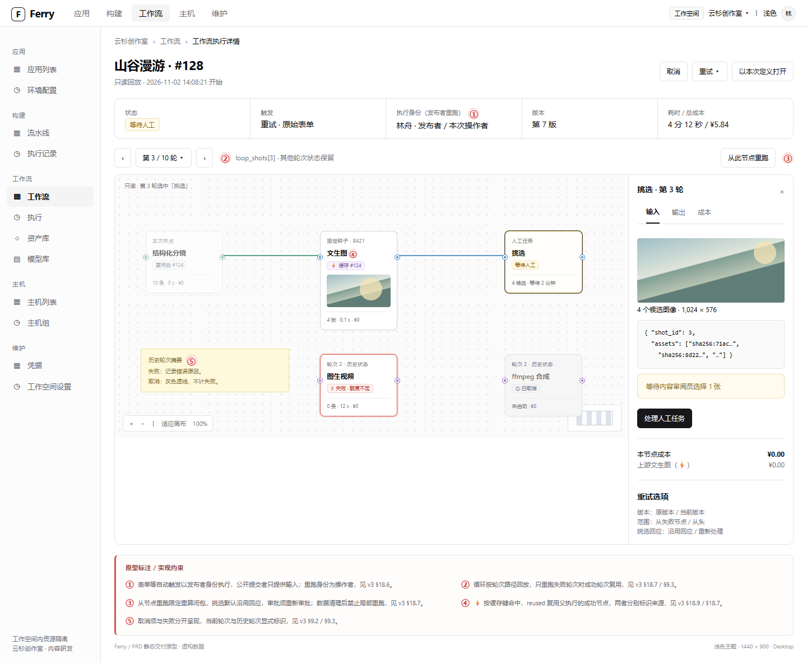

示意图：标注①…⑤为需求点，其余为示意。①身份→FR-RUN-01；②轮次重跑→02；③闭包/回应/清理边界→03；④缓存与复用来源→FR-EDIT-03/FR-RUN-02、AC-EDIT-05/AC-RUN-02；⑤取消/失败及历史轮次→04。

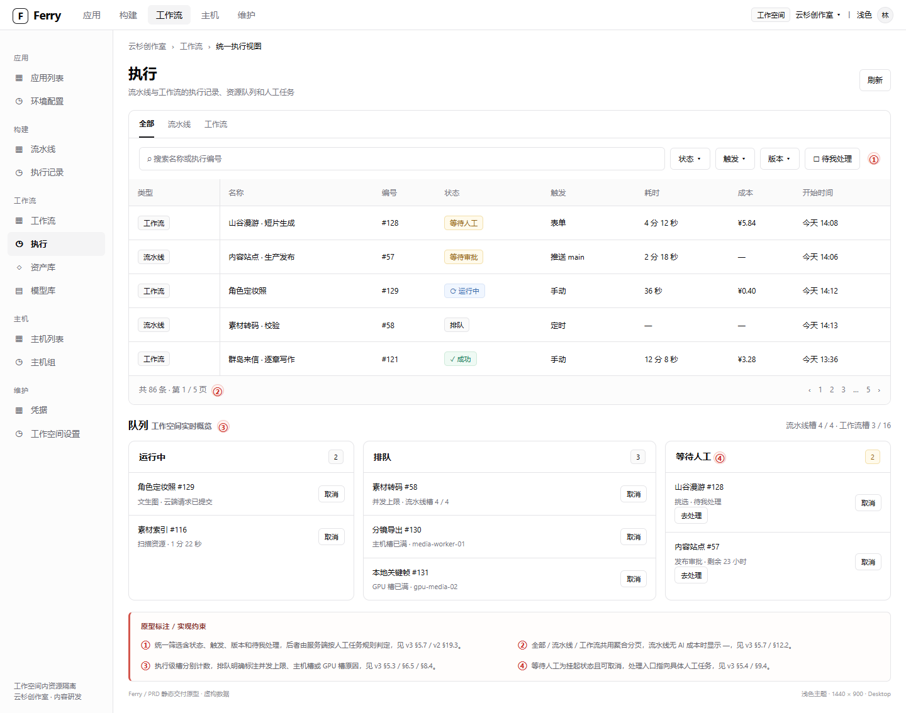

示意图：标注①…④为需求点，其余为示意。①筛选/待我处理→FR-RUN-05；②两类聚合分页/无成本「—」→05；③独立槽与等待原因→06；④挂起取消/人工入口→FR-RUN-12/FR-HUM-01、AC-RUN-14/AC-HUM-05。

**提示文案**：「该执行的中间数据已按保留策略清理，只能全部重跑」（必需）；「继续将使用原执行快照；如需当前版本，请选择按轮次重跑。」（示例）；「提交结果未知，请确认服务商任务后选择重试或放弃。」（示例）。

| 编号 | Given / When / Then |
|---|---|
| AC-RUN-01 | Given 自动发布者已移出空间，When 自动触发，Then 拒绝执行并解释权限失效；手动重跑以操作者身份重新检查，不继承已失效身份。（01） |
| AC-RUN-02 | Given 10轮第3轮节点X失败且中间数据在，When 从X指定第3轮重跑，Then 仅该轮闭包和容器后下游重算，其他轮标 reused 且来源可查，审批重做。（02/03） |
| AC-RUN-03 | Given 中间数据已清理，When 选择失败/局部重跑，Then 拒绝并显示必需文案，只能全部重跑。（03/10） |
| AC-RUN-04 | Given 正在运行节点，When 暂停后继续，Then 先等待节点完成，再将执行状态设为 waiting、end_reason 设为 paused 并释放槽，继续使用原快照；取消不计失败。（04） |
| AC-RUN-05 | Given 两类执行交错分页及无AI执行，When 过滤/翻页，Then 排序、total、权限一致，无成本为「—」；「待我处理」不能仅前端按姓名匹配。（05/06） |
| AC-RUN-06 | Given 一个前驱 skipped、另一个非空，When 默认 Merge 与 wait-all 分别运行，Then 前者消费非空，后者 skipped；always-output 不使未执行分支运行。（07） |
| AC-RUN-07 | Given parallel foreach 并发4且各轮完成顺序不同，When 汇总，Then 按输入序输出；默认失败策略为全部继续；超过嵌套3/while1000/节点并发64不能执行。（08） |
| AC-RUN-08 | Given 云任务提交后回写前杀死编排者，When 接管，Then 幂等服务商任务数为1；非幂等未知窗口标 unknown、自动重提数为0，等待期间不占执行槽。（09） |
| AC-RUN-09 | Given 集群两个实例承载同空间队列且另有其他空间任务，When 成员查看队列，Then 聚合本空间跨实例信息，显示集群聚合口径及具体并发组/主机/GPU 等原因，列表与总数不泄露其他空间，4/16 不被描述为本空间独占额度。（06/11） |
| AC-RUN-10 | Given 同空间父工作流 P 且继承身份权限有效，When 被调用方允许任意本空间工作流，或指定列表包含 P 时发起子调用，Then 允许创建子执行并继承父身份、记录真实父子关联。（13） |
| AC-RUN-11 | Given 被调用方采用指定列表且不包含父工作流 P，When P 发起子调用，Then 拒绝、不创建子执行、不执行被调用方节点，并显示调用策略不允许。（13） |
| AC-RUN-12 | Given 父工作流与目标不在同一工作空间，即使请求者在两空间均有权限，When 尝试子调用，Then 服务端拒绝、不创建跨空间子执行。（13） |
| AC-RUN-13 | Given 被调用方限制调用名单，When 直接向服务端请求子调用并伪造已允许的 caller ID、或没有真实父执行，Then 服务端拒绝且不调用节点；界面隐藏入口不能替代该校验。（13） |
| AC-RUN-14 | Given 有取消权限者分别取消排队、运行及人工挂起执行，When 取消被受理，Then 状态为 cancelled、停止后续调度、保留历史；已取消人工任务再提交不能唤醒，未授权直接请求取消被拒绝。（12） |

<a id="rv-13"></a>

#### 评审补充 13：执行、重试与队列（FR-RV-13）

来源：v3 §5.3/5.7、§18.6–§18.10/18.15；ADR Q10；既有规则 FR-RUN-01–13；行为验收 AC-RUN-01–13；AC-UI-02；数据结构以[数据模型](ferry-工作流平台数据模型.md) §2/§4–§9为准。以下为来源规则的评审投影，标「源未定义，待补」的内容不是已定规则；缺口登记 G-13（§14）。

**模式差异（入口/操作/可编辑范围）**：列表按服务端授权筛选含总数；新增/重跑选版本和范围；运行备注/标注按权限编辑；详情/历史快照只读。（来源：v3 §5.3/5.7、§18.6–§18.10/18.15；ADR Q10；总方案 §5/§7/§8）

**字段与校验**：并行foreach默认4按输入顺序，失败默认全部继续；while末尾判断默认10上限1000；嵌套3；节点并发默认8上限64；调用深度10；调用方任意本空间/指定名单；名单正式字段源未定义，待补。资源名称默认trim后1–60字符（§1c.5），模块显式例外优先；其他字段来源/默认/回填/可编辑条件及未定长度/正则/上下限不从原型推导；未列出的节点/JSON子字段约束为「源未定义，待补」，不将DDL映射宽度当产品限制。（来源：v3 §5.3/5.7、§18.6–§18.10/18.15；ADR Q10；数据模型 §1/§4/§7）

**字段联动与清空**：审批重做，其他人工回应默认复用可改选；轮次闭包外reused；父等子不占饱和组；暂停waiting/end_reason=paused保原快照。已保存/历史引用不得因前端切换静默改写；已知依赖选择重置、旧异步结果和手工草稿按§1c.6；未声明的逐节点依赖/回填来源仍按模块缺口。（来源：v3 §5.3/5.7、§18.6–§18.10/18.15；ADR Q10；总方案 §8；数据模型 §7）

**状态操作矩阵**：状态覆盖 queued/running/waiting/succeeded/failed/cancelled；等待paused、人审、子调用、主机、GPU；节点状态见模型§6。表中“无”指无需额外输入；不把未知的确认输入补成强制输入名称。表外状态的新增操作规则为「源未定义，待补」。（来源：v3 §5.3/5.7、§18.6–§18.10/18.15；ADR Q10；数据模型 §6）

| 状态 | 操作 | 可见/可用条件 | 确认/输入 | 副作用 | 失败反馈/可逆性 |
|---|---|---|---|---|---|
| queued/running/waiting | 取消 | 执行操作权限且服务端重查 | 确认输入源未定义，待补 | cancelled停调度；人工不再受理 | 不撤销已发生外部副作用 |
| running | 暂停 | 相应执行操作权 | 无 | 等当前节点结束释放槽，waiting/paused | 继续原快照，不换当前版 |
| waiting/paused | 继续 | 权限仍有效 | 当前版继续须明确是重跑 | 沿原快照恢复 | 已取消拒绝 |
| 终态 | 全部/局部/按轮次重跑 | 执行权限及恢复数据可用 | 版本/范围/回应复用选择 | 新执行/attempt链，不改历史 | 已清理只全部重跑 |

**操作记录（审计事件）**：执行/暂停继续/重跑/取消、未知提交风险选择、标注；事件对按§1c.1。事件身份、details和永久保留遵§1c.1；修改同事务写activity，不记录秘密或输入值。（来源：FR-AUTH-04；v3 §5.3/5.7、§18.6–§18.10/18.15；ADR Q10；数据模型 §2）

**删除与保留**：不新增软删除；保留/物理删除按§1c.2/§1c.3及原资源保护例外。 删除弹窗/物理删除及引用保护按§1c.2，保留期/保护例外按§1c.3；不因缺外键跳过范围校验。（来源：ADR Q12；数据模型 §8.3/§8.4）

**数据模型、时间审计、索引与SQL**：workflow_executions/node_runs/execution_logs、execution_intents/parents、node_cache、execution_annotations。本模块新表/存量新增时间按数据模型 §2配每个xx_at同前缀xx_by BIGINT NOT NULL DEFAULT 0；0=system；不回填猜测历史操作者。索引：workflow_executions_dispatch/workflow/number；node_runs_attempt；logs_seq；execution_intents_once；标注索引未定。SQL证据：数据模型 §8.1租约、§8.2意图/父执行及日志；每次时间更新同时写xx_by。（来源：数据模型 §2/§4/§5/§8/§9）

**配置来源表**：按§1c.7对应开发发布/运维重启/平台立即/用户保存发布生效，当前无多语言设置。（来源：v3 §5.3/5.7、§18.6–§18.10/18.15；ADR Q10；总方案 §7/§8；src/components/dsl.ts、ResourceForm.tsx；现状无i18n）：

| 配置项/来源 | 修改主体与频率 | 多语言/枚举 |
|---|---|---|
| 用户：重跑范围/循环/并发/保存策略；运维：实例槽与树限额；开发：租约与状态枚举 | 按已授权用户/开发/运维来源修改；生效按§1c.7：开发发布/运维重启/平台立即/用户保存发布，无固定周期 | 业务枚举见数据模型 §6；展示中文硬编码，en-US/ms-MY仍待澄清R01 |
| 原型数据/截图 | 静态示意，非配置中心 | 不得将示例金额/模型/人员或3轮当平台默认 |

**影响与兼容**：本期 S0执行列表，S1运行/重跑/队列，S3轮次/媒体，S4GPU等待；不做 不混cached/reused；不承诺外部exactly-once；数据清理后不局部重跑；灰度 无；P0可靠性升级全停；手动/生产版本选择不等于功能灰度。核心流程：身份/调用准入→排队租约→节点/轮次→人工/外部挂起→持久化恢复→终态→新重跑关联。异常：失租约拒写；预算不足/审核拒绝不重试；unknown不自动重提；数据清理解释原因。历史up/down：数据模型 §5.2第4/10/12项；不清意图/恢复输出；旧版不能执行图需隔离或备份恢复；共用回退边界见§1b。三方：Runner/SSH、外部服务适配器、GPU；各自幂等能力单独验证。版本兼容：生产身份发布者/重跑操作者/子继承；新旧轮次不可覆盖；全局队列仅当前空间可见。计算：节点次数默认5000上限50000；树默认20000；实例流水线4/工作流16/同步64独立；不适用税/库存/折扣。（来源：v3 §5.3/5.7、§18.6–§18.10/18.15；ADR Q10；数据模型 §5.2；NFR-COMP-01–03）

**文案表**（zh-CN来自原PRD提示/必需文案、v3、共享组件或RESPONSIVE中的原文；不据此引入i18n。en-US/ms-MY统一仍待澄清R01（§1c.9））：

| 场景/文案键（评审标识） | zh-CN | en-US | ms-MY | ms-MY 长度预留 |
|---|---|---|---|---|
| RUN.key | 当前执行身份已无权访问目标主机，执行未启动。 | 仍待澄清 R01 | 仍待澄清 R01 | 允许比zh-CN长≥40%；换行/区域滚动保持完整操作，不代表已有翻译 |

**验收追踪与响应式交付**：FR-RUN-01–13 → AC-RUN-01–13；AC-UI-02 / AC-RV-13 → 下表测试规格。规则对应原型编号；异常按§6.16文字，无独立截图，正常业务专属屏缺口仍逐项列出（§1c.8）；无Figma，Figma screen/variant不适用（当前交付为HTML+PNG），不能声称Figma覆盖。D=1440×900、P=768×1024、M=390×844，full-page PNG可高于视口；断点/键盘/Phone只读图规则见[RESPONSIVE.md](prototypes/RESPONSIVE.md)。

| Desktop / Pad / Phone截图 | 编号与覆盖边界 |
|---|---|
| [Desktop](images/05-execution-detail.png) / [Pad](images/pad/05-execution-detail.png) / [Phone](images/phone/05-execution-detail.png) | ①②③④⑤：身份、轮次、复用与操作；异常/权限视觉按§6.16文字，无独立截图；长文本按RESPONSIVE验收，语言variant仍待澄清R01（§1c.8）；HTML为prototypes/05-execution-detail.html |
| [Desktop](images/06-executions-queue.png) / [Pad](images/pad/06-executions-queue.png) / [Phone](images/phone/06-executions-queue.png) | ①②③④：筛选与集群等待；异常/权限视觉按§6.16文字，无独立截图；长文本按RESPONSIVE验收，语言variant仍待澄清R01（§1c.8）；HTML为prototypes/06-executions-queue.html |

| 规则→AC | 测试用例（规格，未执行） | Given / When / Then | 设计/状态证据 |
|---|---|---|---|
| FR-RV-13 → AC-RV-13 | TC-RV-13-01 | Given 本期有权用户与有效配置，When 按本功能闭环操作，Then 身份/调用准入→排队租约→节点/轮次→人工/外部挂起→持久化恢复→终态→新重跑关联 | 05-execution-detail.png ①②③④⑤；其余状态待补 |
| FR-RUN-01–13 → AC-RV-13 | TC-RV-13-02 | Given 本功能异常或边界输入，When 执行对应操作，Then 失租约拒写；预算不足/审核拒绝不重试；unknown不自动重提；数据清理解释原因 | 异常视觉交互见§6.16文字，无独立截图，不代表已实测（§1c.8） |
| FR-AUTH-01–05 → AC-RV-13 | TC-RV-13-03 | Given 跨空间/无权成员或失效公开令牌，When 绕过界面直接请求，Then 拒绝且不产生本次业务副作用；公开者不获得后台权限 | 权限拒绝专属状态待补 |
| 数据模型 §5.2 → AC-RV-13 | TC-RV-13-04 | Given 升级前历史夹具与新状态，When 按迁移方案up/人工回退评审，Then 数据模型 §5.2第4/10/12项；不清意图/恢复输出；旧版不能执行图需隔离或备份恢复 | 后端迁移规格，无Figma/截图适用 |
| §1b/RESPONSIVE → AC-RV-13 | TC-RV-13-05 | Given 三布局与中文及长度≥140%的排版占位文本，When 查看本功能操作与错误，Then 核心字段/按钮不被遮挡；Phone图只读、区域内滚动；翻译内容未验收 | 三端基础PNG+callout见上表；异常按§6.16文字，无独立截图；语言variant仍待澄清R01（§1c.8） |

AC-RV-13：本功能已定规则按上述测试规格及既有AC验收；G-13列出的来源缺口须补来源/设计后才可认定对应能力验收通过。本次为需求文档审查，不声称运行测试、迁移或真实三方通过。（来源：用户评审清单；§10；v3 §5.3/5.7、§18.6–§18.10/18.15；ADR Q10）

### 6.7 人工任务（HUM）

**目标**：把审批与内容反馈作为可追溯的执行步骤。**用户故事**：作为审阅者，我希望只看到需处理的内容并明确提交后果，以便正确决定继续或重做。

| 编号 | 需求 | 规则与边界 | 分期 | 来源 |
|---|---|---|---|---|
| FR-HUM-01 | 审批与表单任务、待我处理 | 指派、资格、截止/超时策略、当前回应与历史可见；挂起不占执行槽，通常仍计并发组，等待子工作流例外；审批规则见 ENV。 | S1 | v3 §5.4、§18.7、§18.15；v2 §13.1 |
| FR-HUM-02 | 候选挑选及可选反馈 | 接收上游候选条目，选N个只下传选中项；可返回评分/意见；上下文、来源和当前轮次可查。 | S3 | v3 §5.4、§10.2–§10.3；原型07①② |
| FR-HUM-03 | 不满意可在重做循环中重新生成 | 编辑器提供包裹为重做循环；重做保留上下文、递增轮次、使生成缓存失效/随机seed更新；图中3轮只是示例，遵守while限额。 | S3 | v3 §18.7；原型07③ |
| FR-HUM-04 | 任务展示指派与超时后果 | 非审批任务指派资格沿用审批规则：人员与角色并集、角色成员资格实时检查；可见处理资格、截止与配置动作；默认超时7天后 fail，不套用审批的超时默认。 | S1 基础/文本编辑；S3 媒体挑选编辑 | v3 §5.4；原型07④；Q08；ADR 2026-11-02 Q08 |
| FR-HUM-05 | 基础文本与 Markdown 人工编辑 | S1 接收上游文本，提供 Markdown 编辑与预览，提交修改后的条目；保留模型原稿并展示差异，不覆盖原始来源。S3 扩展媒体挑选与编辑，基础文本能力不后移。 | S1 文本；S3 媒体增强 | v3 §7.4、§5.4、§9.2、§10.4；原型08①② |
| FR-HUM-06 | 显示顺序循环携带状态 | 当前章可查看指定上一轮摘要/伏笔 carry；不能用并行完成顺序替代章节顺序。 | S2 写作闭环；编辑基础 S1 | v3 §10.4、§18.7；原型08③ |
| FR-HUM-07 | 提交回应持久化后唤醒执行 | 下游接收修订条目与差异；重复请求不产生重复继续；重跑回应复用依 RUN-03。 | S1 表单/文本编辑；S3 媒体 | v3 §5.4、§18.7–§18.8；原型08④ |
| FR-HUM-08 | 内部及外部受限审阅 | 内部按角色/人员实时检查；外部一次性链接有效72小时且可撤销，仅显示所需数据，免登录不赋执行身份；已过期、已撤销或已用不得再次提交。 | S1 基础/S3 媒体 | v3 §5.4、§9.6、§14、§18.6；V9；ADR 2026-11-02 Q08 |
| FR-HUM-09 | 人工编辑每30秒自动保存草稿 | 文本编辑任务每30秒持久化编辑草稿；自动保存不等于提交回应，不唤醒下游。正式提交仍按 FR-HUM-07 持久化修订条目与差异并保留模型原稿；S3 媒体编辑沿用此规则。 | S1 文本；S3 媒体 | ADR 2026-11-02 Q08；v3 §7.4 |
| FR-HUM-10 | 审阅者可退回修改并填写意见 | 内部及外部审阅均支持退回修改；意见必填且最多500字符。受理后任务结束，decision=returned，保存意见与审计；后续由图的分支决定，例如进入重做循环，不在原任务内自动重开。资格、一次性提交及过期撤销检查沿用 FR-HUM-08。 | S1 文本/审阅；S3 媒体 | ADR 2026-11-02 PRD review follow-up defaults；原型08④ |
| FR-HUM-11 | 小说大纲修改、逐章审阅与续写 | 作者先修改并确认大纲，顺序循环依据修订大纲生成章节；编辑逐章审阅、修改后提交，只有受理的修订章节及其摘要/伏笔进入指定 carry。续写使用已确认大纲和前章 carry，保留模型原稿、修改差异与章节来源；退回则按图进入修改或重做路径。 | S2，复用 S1 文本编辑 | v3 §10.4、§15、§18.7；ADR Q08 |

**页面与交互**：待我处理为共享列表，审批/填表/挑选/编辑在共享表单框架内用相应渲染器；可从执行 waiting 节点进入。

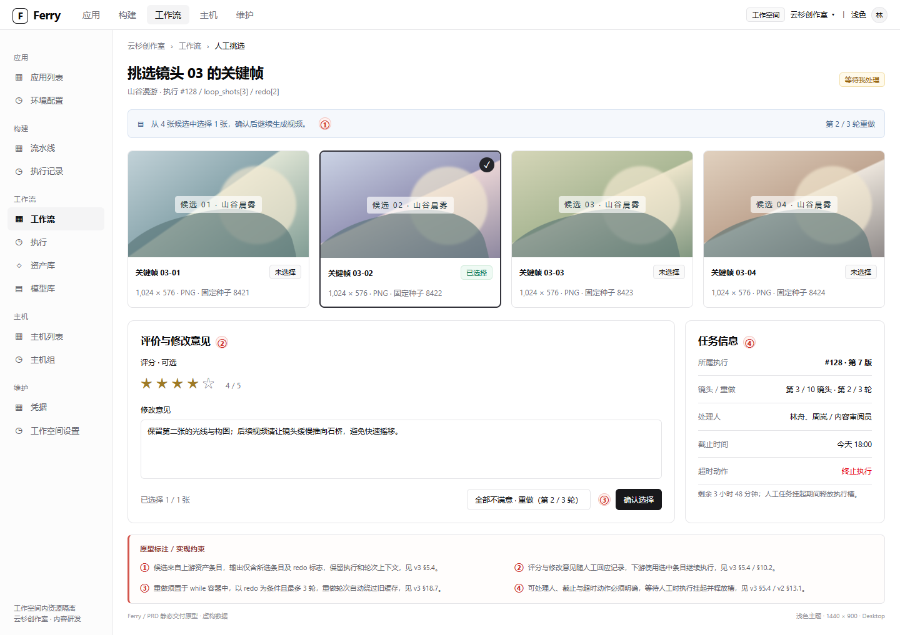

示意图：标注①…④为需求点，其余为示意。①选N项及上下文→FR-HUM-02；②评分意见→02；③重做循环→03；④指派/截止/超时及释放执行槽→01/04。

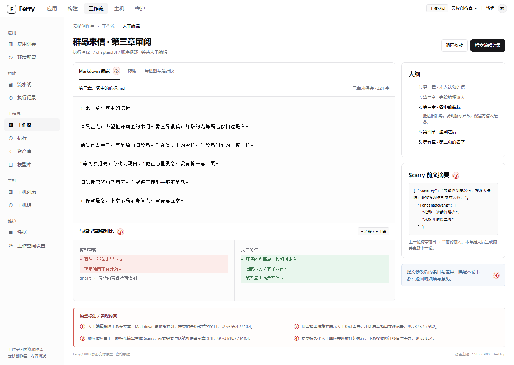

示意图：标注①…④为需求点，其余为示意。①Markdown和预览→FR-HUM-05；②原稿差异→05；③carry→06；④提交修订条目/差异、退回修改及必填意见→FR-HUM-07/10、AC-HUM-03/08/09。自动保存按 FR-HUM-09、AC-HUM-07 每30秒执行；退回后任务结束，由图决定后续路径。

**提示文案**（示例）：「仅选中的候选会传给下一步。」「重新生成将进入下一轮，并重新调用生成服务。」「该审阅链接已失效或已使用。」

| 编号 | Given / When / Then |
|---|---|
| AC-HUM-01 | Given 6个候选要求选2个，When 提交2个并填写可选评分，Then 下游仅收到该2项与回应，未选项不混入；选数不符合配置不得提交。（02） |
| AC-HUM-02 | Given 带3轮上限的示例重做流程，When 拒绝本轮候选，Then 新一轮保留上下文并重新生成、不命中该生成旧缓存；达到该流程上限按配置退出，不推导全局3轮。（03） |
| AC-HUM-03 | Given 模型原稿与上一章carry，When 修改并提交，Then 原稿保持、差异可查、下游收到修改项；下一章引用指定携带输出，重复提交只唤醒一次。（05–07） |
| AC-HUM-04 | Given 外部有效token，When 首次提交后重复或过期再访问，Then 不可再次处理；页面不显示后台列表、其他任务或密钥。（01/04/08） |
| AC-HUM-05 | Given 非审批任务按人员与角色指派，When 有资格成员处理或成员失去对应角色，Then 前者按审批资格规则可处理，后者实时检查拒绝；未改超时配置的任务到7天仍未处理时 fail。（04） |
| AC-HUM-06 | Given 一个外部审阅链接，When 到72小时或被撤销后访问/提交，Then 不能处理；有效期内首次合法回应只受理一次且不赋后台权限。（08） |
| AC-HUM-07 | Given 正在编辑的人工任务，When 经过30秒自动保存，Then 编辑草稿已持久化且下游未唤醒；正式提交才产生修订条目与差异，原稿仍可追溯。（07/09） |
| AC-HUM-08 | Given 有资格的内部审阅者或有效外审链接，When 填写1至500字符意见并退回修改，Then 任务结束且 decision=returned、意见及审计可查；图按 returned 分支进入配置的修改/重做路径，原任务不自动重开。（10） |
| AC-HUM-09 | Given 可处理的内部或外部审阅任务，When 退回意见为空或超过500字符，Then 拒绝并就地提示、保留输入，任务仍待处理；过期、撤销或重复请求也不能再改变结论。（08/10） |
| AC-HUM-10 | Given S2 小说流程已有生成大纲，When 作者修改并提交大纲，Then 原大纲与差异保留，第一章使用已确认的修订大纲，未提交前不开始后续写作。（05/11） |
| AC-HUM-11 | Given 顺序生成的第一章待审，When 编辑修改并提交，Then 保留模型原稿、修订稿及差异，第二章收到修订稿的指定摘要/伏笔 carry；未完成审阅前第二章不继续。（06/07/11） |
| AC-HUM-12 | Given 前两章已审阅且 carry 已保存，When 继续写第三章，Then 使用已确认大纲与第二章指定 carry，三章及模型来源可追溯；退回时按图处理，不把退回稿直接当通过稿续写。（10/11） |
| AC-HUM-13 | Given A、B 同时打开待处理任务，When A 先提交后 B 再提交，Then 只受理 A 一次，B 得到「该任务已被他人处理」并可查看最新结果；B 的未提交文本保留可复制，不再提供有效提交入口。（FR-HUM-07，§6.16） |

<a id="rv-14"></a>

#### 评审补充 14：人工任务（FR-RV-14）

来源：v3 §5.4、§10、§18.6–§18.8；v2 §13.1；ADR Q08/Q17；既有规则 FR-HUM-01–11；行为验收 AC-HUM-01–13；数据结构以[数据模型](ferry-工作流平台数据模型.md) §2/§4–§9为准。以下为来源规则的评审投影，标「源未定义，待补」的内容不是已定规则；缺口登记 G-14（§14）。

**模式差异（入口/操作/可编辑范围）**：待办列表实时资格过滤；编辑任务文本/挑选结果；原稿/差异只读；外部仅任务必要字段；已处理转只读可复制未提交稿。（来源：v3 §5.4、§10、§18.6–§18.8；v2 §13.1；ADR Q08/Q17；总方案 §5/§7/§8）

**字段与校验**：退回/拒绝意见必填1–500字符；挑选N只下传选中项；编辑每30秒保存；外审72h与任务默认7天分开；N上下限/文本长度/空白裁剪源未定义，待补。资源名称默认trim后1–60字符（§1c.5），模块显式例外优先；其他字段来源/默认/回填/可编辑条件及未定长度/正则/上下限不从原型推导；未列出的节点/JSON子字段约束为「源未定义，待补」，不将DDL映射宽度当产品限制。（来源：v3 §5.4、§10、§18.6–§18.8；v2 §13.1；ADR Q08/Q17；数据模型 §1/§4/§7）

**字段联动与清空**：修改大纲→顺序章→已确认章节/摘要伏笔carry；重做保上下文、递增轮次/seed失缓存；returned结束任务由图继续。已保存/历史引用不得因前端切换静默改写；已知依赖选择重置、旧异步结果和手工草稿按§1c.6；未声明的逐节点依赖/回填来源仍按模块缺口。（来源：v3 §5.4、§10、§18.6–§18.8；v2 §13.1；ADR Q08/Q17；总方案 §8；数据模型 §7）

**状态操作矩阵**：状态覆盖 待处理、草稿、已提交/已处理、returned、超时、取消、外链已用/过期/撤销（正式状态码待补）。表中“无”指无需额外输入；不把未知的确认输入补成强制输入名称。表外状态的新增操作规则为「源未定义，待补」。（来源：v3 §5.4、§10、§18.6–§18.8；v2 §13.1；ADR Q08/Q17；数据模型 §6）

| 状态 | 操作 | 可见/可用条件 | 确认/输入 | 副作用 | 失败反馈/可逆性 |
|---|---|---|---|---|---|
| 待处理 | 提交/同意/拒绝/退回 | 实时资格/未过期未撤销未取消；内部外部同规则 | 拒绝/退回意见1–500字符 | 持久化后唤醒一次；returned走图分支 | 竞争失败保留本地文本并转只读 |
| 编辑草稿 | 30秒自动保存 | 仍有处理资格 | 无需正式提交 | 仅持久化草稿不唤醒 | 保存失败反馈，恢复策略细节待补 |
| 已处理/超时/取消/外链失效 | 查看/复制未提交内容 | 仅允许可见数据，不再提交 | 无 | 不二次唤醒 | 明确不可再处理原因 |

**操作记录（审计事件）**：资格/回应/退回/超时/外链撤销及风险操作，意见/结果关联任务；token仅哈希。事件身份、details和永久保留遵§1c.1；修改同事务写activity，不记录秘密或输入值。（来源：FR-AUTH-04；v3 §5.4、§10、§18.6–§18.8；v2 §13.1；ADR Q08/Q17；数据模型 §2）

**删除与保留**：不新增软删除；保留/物理删除按§1c.2/§1c.3及原资源保护例外。 删除弹窗/物理删除及引用保护按§1c.2，保留期/保护例外按§1c.3；不因缺外键跳过范围校验。（来源：ADR Q12；数据模型 §8.3/§8.4）

**数据模型、时间审计、索引与SQL**：human_tasks/responses、workflow_node_runs、assets；30秒草稿/外链撤销已用与轮次关联字段待补。本模块新表/存量新增时间按数据模型 §2配每个xx_at同前缀xx_by BIGINT NOT NULL DEFAULT 0；0=system；不回填猜测历史操作者。索引：human_responses_once为流水线关联；图/外审/轮次幂等键缺口待补。SQL证据：数据模型 §8.2尝试查询；通用人工回应条件推进SQL缺键，源未定义，待补。（来源：数据模型 §2/§4/§5/§8/§9）

**配置来源表**：按§1c.7对应开发发布/运维重启/平台立即/用户保存发布生效，当前无多语言设置。（来源：v3 §5.4、§10、§18.6–§18.8；v2 §13.1；ADR Q08/Q17；总方案 §7/§8；src/components/dsl.ts、ResourceForm.tsx；现状无i18n）：

| 配置项/来源 | 修改主体与频率 | 多语言/枚举 |
|---|---|---|
| 用户：人员/角色/截止/策略/挑选N；开发：默认7天、72h、30秒和资格；完整枚举待补 | 按已授权用户/开发/运维来源修改；生效按§1c.7：开发发布/运维重启/平台立即/用户保存发布，无固定周期 | 业务枚举见数据模型 §6；展示中文硬编码，en-US/ms-MY仍待澄清R01 |
| 原型数据/截图 | 静态示意，非配置中心 | 不得将示例金额/模型/人员或3轮当平台默认 |

**影响与兼容**：本期 S1审批/表单/文本编辑；S2写作；S3媒体挑选编辑；不做 外部不成为空间成员；返回修改不原任务自动重开；自动保存不唤醒；灰度 公开/外审空间默认关闭，外链72h一次性可撤销。核心流程：节点挂起→资格/指派→30秒草稿→提交/退回→加密回应持久化→一次唤醒→图分支/重做→历史。异常：过期/撤销/已用拒绝；多人抢答只受理一次；超时非审批7天fail；取消后不再回应。历史up/down：数据模型 §5.2第7项：旧requires_approval不删，过渡策略待补；回退停接回应保留未完任务；共用回退边界见§1b。三方：无必选三方；机器人卡片可选；媒体预览依资产/服务商。版本兼容：审批重跑重做；表单挑选编辑默认复用可逐项改选；旧任务关联不伪造。计算：非审批7天fail；外链72h；自动保存30秒；重做遵while上限非固定3轮；税/库存/折扣不适用。（来源：v3 §5.4、§10、§18.6–§18.8；v2 §13.1；ADR Q08/Q17；数据模型 §5.2；NFR-COMP-01–03）

**文案表**（zh-CN来自原PRD提示/必需文案、v3、共享组件或RESPONSIVE中的原文；不据此引入i18n。en-US/ms-MY统一仍待澄清R01（§1c.9））：

| 场景/文案键（评审标识） | zh-CN | en-US | ms-MY | ms-MY 长度预留 |
|---|---|---|---|---|
| HUM.key | 该审批任务已处理，请查看最新状态。 | 仍待澄清 R01 | 仍待澄清 R01 | 允许比zh-CN长≥40%；换行/区域滚动保持完整操作，不代表已有翻译 |

**验收追踪与响应式交付**：FR-HUM-01–11 → AC-HUM-01–13 / AC-RV-14 → 下表测试规格。规则对应原型编号；异常按§6.16文字，无独立截图，正常业务专属屏缺口仍逐项列出（§1c.8）；无Figma，Figma screen/variant不适用（当前交付为HTML+PNG），不能声称Figma覆盖。D=1440×900、P=768×1024、M=390×844，full-page PNG可高于视口；断点/键盘/Phone只读图规则见[RESPONSIVE.md](prototypes/RESPONSIVE.md)。

| Desktop / Pad / Phone截图 | 编号与覆盖边界 |
|---|---|
| [Desktop](images/07-human-pick.png) / [Pad](images/pad/07-human-pick.png) / [Phone](images/phone/07-human-pick.png) | ①②③④：选择/反馈/重做/截止；异常/权限视觉按§6.16文字，无独立截图；长文本按RESPONSIVE验收，语言variant仍待澄清R01（§1c.8）；HTML为prototypes/07-human-pick.html |
| [Desktop](images/08-human-edit.png) / [Pad](images/pad/08-human-edit.png) / [Phone](images/phone/08-human-edit.png) | ①②③④：编辑、对比、carry、退回提交；异常/权限视觉按§6.16文字，无独立截图；长文本按RESPONSIVE验收，语言variant仍待澄清R01（§1c.8）；HTML为prototypes/08-human-edit.html |

| 规则→AC | 测试用例（规格，未执行） | Given / When / Then | 设计/状态证据 |
|---|---|---|---|
| FR-RV-14 → AC-RV-14 | TC-RV-14-01 | Given 本期有权用户与有效配置，When 按本功能闭环操作，Then 节点挂起→资格/指派→30秒草稿→提交/退回→加密回应持久化→一次唤醒→图分支/重做→历史 | 07-human-pick.png ①②③④；其余状态待补 |
| FR-HUM-01–11 → AC-RV-14 | TC-RV-14-02 | Given 本功能异常或边界输入，When 执行对应操作，Then 过期/撤销/已用拒绝；多人抢答只受理一次；超时非审批7天fail；取消后不再回应 | 异常视觉交互见§6.16文字，无独立截图，不代表已实测（§1c.8） |
| FR-AUTH-01–05 → AC-RV-14 | TC-RV-14-03 | Given 跨空间/无权成员或失效公开令牌，When 绕过界面直接请求，Then 拒绝且不产生本次业务副作用；公开者不获得后台权限 | 权限拒绝专属状态待补 |
| 数据模型 §5.2 → AC-RV-14 | TC-RV-14-04 | Given 升级前历史夹具与新状态，When 按迁移方案up/人工回退评审，Then 数据模型 §5.2第7项：旧requires_approval不删，过渡策略待补；回退停接回应保留未完任务 | 后端迁移规格，无Figma/截图适用 |
| §1b/RESPONSIVE → AC-RV-14 | TC-RV-14-05 | Given 三布局与中文及长度≥140%的排版占位文本，When 查看本功能操作与错误，Then 核心字段/按钮不被遮挡；Phone图只读、区域内滚动；翻译内容未验收 | 三端基础PNG+callout见上表；异常按§6.16文字，无独立截图；语言variant仍待澄清R01（§1c.8） |

AC-RV-14：本功能已定规则按上述测试规格及既有AC验收；G-14列出的来源缺口须补来源/设计后才可认定对应能力验收通过。本次为需求文档审查，不声称运行测试、迁移或真实三方通过。（来源：用户评审清单；§10；v3 §5.4、§10、§18.6–§18.8；v2 §13.1；ADR Q08/Q17）

### 6.8 版本与发布（VER）

**目标**：让保存和生产生效成为两个明确动作。**用户故事**：作为发布者，我希望先比较变更并确认身份影响，以便生产只运行我确认过的版本。

| 编号 | 需求 | 规则与边界 | 分期 | 来源 |
|---|---|---|---|---|
| FR-VER-01 | 草稿、发布、撤销发布和不可变历史 | 保存草稿不自动切生产；执行绑定版本；版本不可覆盖，可比较增删并恢复为新保存；流水线元数据不形成定义版本，无实质变化不增版，引用版本与最新50保留。 | S0；流水线 P0/P1 | v3 §5.1；v2 §15；原型15① |
| FR-VER-02 | 发布收集版本名与可选说明 | 版本名必填，长度1–64字符，同一定义内唯一；变更说明可选、最多200字符；原型示例不作为默认值。 | S0/S1 | v3 §5.1、§9.2；能力清单 A017；原型15②；ADR 2026-11-02 Q07 |
| FR-VER-03 | 发布前展示受影响生产触发器 | 发布仅影响后续触发，不改在途执行；表单/Webhook等生产地址稳定；撤销发布或归档后生产触发及公开入口停止；归档保留历史且恢复为草稿，仅归档可删除。 | S0/S1 | v3 §5.1、§9.6；原型15③；ADR 2026-11-02 Q12 |
| FR-VER-04 | 其他人发布需确认身份变更 | 流水线与工作流统一：明示旧身份→本次发布者；确认后自动执行绑定发布者，保存草稿不重绑；运行前仍实时鉴权，公开提交者不成为身份；修订 D4。 | S0/S1 | v3 §18.6；原型15④；ADR 2026-11-02 Q14 |

**页面与交互**：对比不可变版本，区分新增/删除；发布表单及确认框走共享组件，不能以保存按钮隐式发布。

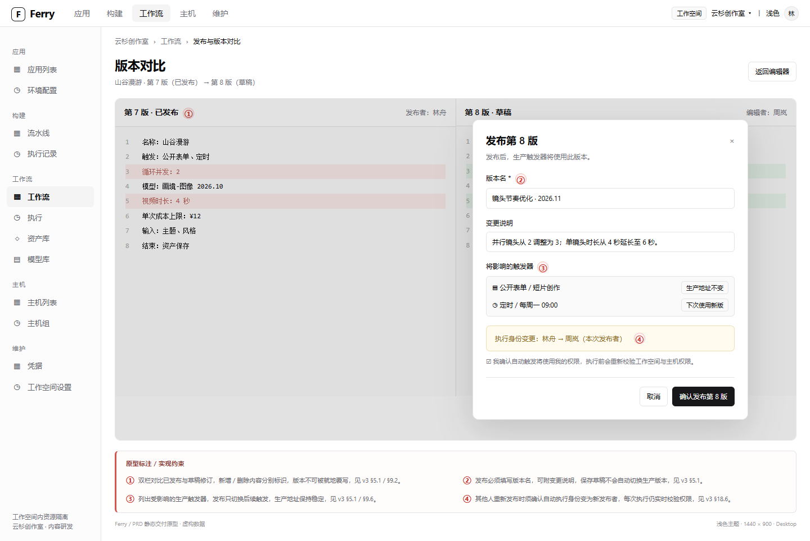

示意图：标注①…④为需求点，其余为示意。①不可变对比→FR-VER-01；②版本名/说明→02；③影响及稳定地址→03；④身份确认→04。

**提示文案**（示例）：「发布后，后续生产触发将使用此版本。」「自动执行身份将变更为本次发布者，请确认。」

| 编号 | Given / When / Then |
|---|---|
| AC-VER-01 | Given 已发布版本A和草稿B，When 仅保存B，Then 后续生产仍用A；发布B后新执行用B，在途A不改变；生产地址保持。（01/03） |
| AC-VER-02 | Given 另一成员发布，When 未确认身份变更，Then 不完成身份切换；确认后记录发布者，真正执行前重查权限；版本名为空、超出1–64字符或在同一定义内重名均阻止发布。（02/04） |
| AC-VER-03 | Given 同一定义的发布版本表单，When 分别填写1字符、64字符、65字符版本名及空/200/201字符说明，Then 唯一的1–64字符名与空或≤200字符说明可用，65字符名、重名或201字符说明被拒绝；不同定义可使用相同版本名。（02） |
| AC-VER-04 | Given 流水线或工作流由 A 发布后 B 保存草稿，When 生产触发，Then 仍用 A 身份与已发布版本；B 确认并发布才改变后续身份，在途执行不变。（01/04） |
| AC-VER-05 | Given 已发布定义，When 撤销发布或归档，Then 生产触发与稳定公开入口停止；归档历史保留、恢复为草稿，不能自动重新发布。（03） |

<a id="rv-15"></a>

#### 评审补充 15：版本与发布（FR-RV-15）

来源：v2 §15；v3 §5.1、§18.6；ADR Q07/Q12/Q14；既有规则 FR-VER-01–04；行为验收 AC-VER-01–05；数据结构以[数据模型](ferry-工作流平台数据模型.md) §2/§4–§9为准。以下为来源规则的评审投影，标「源未定义，待补」的内容不是已定规则；缺口登记 G-15（§14）。

**模式差异（入口/操作/可编辑范围）**：列表选择版本；新增发布元数据；草稿可编辑；历史只读；恢复保存为新版本，不覆写旧版。（来源：v2 §15；v3 §5.1、§18.6；ADR Q07/Q12/Q14；总方案 §5/§7/§8）

**字段与校验**：版本名required 1–64字符、定义内唯一；说明可选≤200字符；number服务端；draft_revision_id/published_revision_id与发布身份绑定事务；发布名列/说明message关系待补。资源名称默认trim后1–60字符（§1c.5），模块显式例外优先；其他字段来源/默认/回填/可编辑条件及未定长度/正则/上下限不从原型推导；未列出的节点/JSON子字段约束为「源未定义，待补」，不将DDL映射宽度当产品限制。（来源：v2 §15；v3 §5.1、§18.6；ADR Q07/Q12/Q14；数据模型 §1/§4/§7）

**字段联动与清空**：其他人发布显示旧身份→新发布者并确认；保存草稿不重绑；在途快照不变，生产URL不变；归档恢复仅草稿。已保存/历史引用不得因前端切换静默改写；已知依赖选择重置、旧异步结果和手工草稿按§1c.6；未声明的逐节点依赖/回填来源仍按模块缺口。（来源：v2 §15；v3 §5.1、§18.6；ADR Q07/Q12/Q14；总方案 §8；数据模型 §7）

**状态操作矩阵**：状态覆盖 草稿、已发布、已发布有变更、已撤销发布、归档、历史版本。表中“无”指无需额外输入；不把未知的确认输入补成强制输入名称。表外状态的新增操作规则为「源未定义，待补」。（来源：v2 §15；v3 §5.1、§18.6；ADR Q07/Q12/Q14；数据模型 §6）

| 状态 | 操作 | 可见/可用条件 | 确认/输入 | 副作用 | 失败反馈/可逆性 |
|---|---|---|---|---|---|
| 有效草稿 | 发布 | 发布权限且阻断校验通过 | 版本名/说明，身份变化确认 | 绑定发布者、指针切后续触发 | 失败不切；可撤销发布非抹版本 |
| 已发布 | 撤销发布/归档 | 对应对象操作权 | 确认输入源未定义，待补 | 停生产/公开入口；保历史 | 恢复草稿后需再发布 |
| 历史版本 | 恢复 | 编辑权限 | 恢复为新保存 | 历史不变；形成新草稿 | 不可原地覆盖历史 |

**操作记录（审计事件）**：保存、恢复、发布、身份确认、撤销发布、归档/恢复（FR-AUTH-04）。事件身份、details和永久保留遵§1c.1；修改同事务写activity，不记录秘密或输入值。（来源：FR-AUTH-04；v2 §15；v3 §5.1、§18.6；ADR Q07/Q12/Q14；数据模型 §2）

**删除与保留**：定义先归档后物理删除，归档停生产且保历史，恢复为草稿（ADR Q12）；引用版本/最近50版保护。 删除弹窗/物理删除及引用保护按§1c.2，保留期/保护例外按§1c.3；不因缺外键跳过范围校验。（来源：ADR Q12；数据模型 §8.3/§8.4）

**数据模型、时间审计、索引与SQL**：definition_revisions、workflows/pipelines发布指针；正式发布名/归档字段待补。本模块新表/存量新增时间按数据模型 §2配每个xx_at同前缀xx_by BIGINT NOT NULL DEFAULT 0；0=system；不回填猜测历史操作者。索引：definition_revisions_number；版本名定义内唯一的正式键待补。SQL证据：数据模型 §8.3最近50/引用保护；发布名检查完整SQL因列未定待补。（来源：数据模型 §2/§4/§5/§8/§9）

**配置来源表**：按§1c.7对应开发发布/运维重启/平台立即/用户保存发布生效，当前无多语言设置。（来源：v2 §15；v3 §5.1、§18.6；ADR Q07/Q12/Q14；总方案 §7/§8；src/components/dsl.ts、ResourceForm.tsx；现状无i18n）：

| 配置项/来源 | 修改主体与频率 | 多语言/枚举 |
|---|---|---|
| 用户：版本名/说明/发布确认；开发：版本比较/唯一规则；不由运维随时改历史 | 按已授权用户/开发/运维来源修改；生效按§1c.7：开发发布/运维重启/平台立即/用户保存发布，无固定周期 | 业务枚举见数据模型 §6；展示中文硬编码，en-US/ms-MY仍待澄清R01 |
| 原型数据/截图 | 静态示意，非配置中心 | 不得将示例金额/模型/人员或3轮当平台默认 |

**影响与兼容**：本期 S0版本与指针；P1流水线生产发布；S1完整编辑；不做 不覆盖不可变版本；不把元数据变化算实质版本；不清被引用/最近50版；灰度 草稿/发布是生产切换机制，无feature flag。核心流程：保存草稿→版本差异→填版本名/说明→确认身份→发布指针→后续触发；撤销/归档停止入口。异常：版本重名/为空/过长拒绝；身份未确认不切；409不覆盖其他修改。历史up/down：数据模型 §5.2第2/4项，现存定义首版、旧执行未知0；存量首次生产授权待补；共用回退边界见§1b。三方：无。版本兼容：D4由保存重绑修订为发布重绑；历史执行不改；恢复不自动生产。计算：保留最近50版与全部被执行引用版本；税/库存/折扣不适用。（来源：v2 §15；v3 §5.1、§18.6；ADR Q07/Q12/Q14；数据模型 §5.2；NFR-COMP-01–03）

**文案表**（zh-CN来自原PRD提示/必需文案、v3、共享组件或RESPONSIVE中的原文；不据此引入i18n。en-US/ms-MY统一仍待澄清R01（§1c.9））：

| 场景/文案键（评审标识） | zh-CN | en-US | ms-MY | ms-MY 长度预留 |
|---|---|---|---|---|
| VER.key | 请选择本次执行使用的定义版本。 | 仍待澄清 R01 | 仍待澄清 R01 | 允许比zh-CN长≥40%；换行/区域滚动保持完整操作，不代表已有翻译 |

**验收追踪与响应式交付**：FR-VER-01–04 → AC-VER-01–05 / AC-RV-15 → 下表测试规格。规则对应原型编号；异常按§6.16文字，无独立截图，正常业务专属屏缺口仍逐项列出（§1c.8）；无Figma，Figma screen/variant不适用（当前交付为HTML+PNG），不能声称Figma覆盖。D=1440×900、P=768×1024、M=390×844，full-page PNG可高于视口；断点/键盘/Phone只读图规则见[RESPONSIVE.md](prototypes/RESPONSIVE.md)。

| Desktop / Pad / Phone截图 | 编号与覆盖边界 |
|---|---|
| [Desktop](images/15-publish-diff.png) / [Pad](images/pad/15-publish-diff.png) / [Phone](images/phone/15-publish-diff.png) | ①②③④：差异、名称、影响、身份确认；异常/权限视觉按§6.16文字，无独立截图；长文本按RESPONSIVE验收，语言variant仍待澄清R01（§1c.8）；HTML为prototypes/15-publish-diff.html |

| 规则→AC | 测试用例（规格，未执行） | Given / When / Then | 设计/状态证据 |
|---|---|---|---|
| FR-RV-15 → AC-RV-15 | TC-RV-15-01 | Given 本期有权用户与有效配置，When 按本功能闭环操作，Then 保存草稿→版本差异→填版本名/说明→确认身份→发布指针→后续触发；撤销/归档停止入口 | 15-publish-diff.png ①②③④；其余状态待补 |
| FR-VER-01–04 → AC-RV-15 | TC-RV-15-02 | Given 本功能异常或边界输入，When 执行对应操作，Then 版本重名/为空/过长拒绝；身份未确认不切；409不覆盖其他修改 | 异常视觉交互见§6.16文字，无独立截图，不代表已实测（§1c.8） |
| FR-AUTH-01–05 → AC-RV-15 | TC-RV-15-03 | Given 跨空间/无权成员或失效公开令牌，When 绕过界面直接请求，Then 拒绝且不产生本次业务副作用；公开者不获得后台权限 | 权限拒绝专属状态待补 |
| 数据模型 §5.2 → AC-RV-15 | TC-RV-15-04 | Given 升级前历史夹具与新状态，When 按迁移方案up/人工回退评审，Then 数据模型 §5.2第2/4项，现存定义首版、旧执行未知0；存量首次生产授权待补 | 后端迁移规格，无Figma/截图适用 |
| §1b/RESPONSIVE → AC-RV-15 | TC-RV-15-05 | Given 三布局与中文及长度≥140%的排版占位文本，When 查看本功能操作与错误，Then 核心字段/按钮不被遮挡；Phone图只读、区域内滚动；翻译内容未验收 | 三端基础PNG+callout见上表；异常按§6.16文字，无独立截图；语言variant仍待澄清R01（§1c.8） |

AC-RV-15：本功能已定规则按上述测试规格及既有AC验收；G-15列出的来源缺口须补来源/设计后才可认定对应能力验收通过。本次为需求文档审查，不声称运行测试、迁移或真实三方通过。（来源：用户评审清单；§10；v2 §15；v3 §5.1、§18.6；ADR Q07/Q12/Q14）

### 6.9 资产库（ASSET）

**目标**：让输入和生成结果可复用、可追溯并控制存储占用。**用户故事**：作为创作者，我希望找到来源素材及生成参数，以便再生成而不丢失来源。

| 编号 | 需求 | 规则与边界 | 分期 | 来源 |
|---|---|---|---|---|
| FR-ASSET-01 | 上传及图像/视频/音频/文本浏览 | 类型、标签、来源执行过滤；列表/网格为共享列表配置的展示方式；媒体元数据、预览按对应期。 | S0 资产/S3 媒体 | v3 §5.5、§9.4；原型09① |
| FR-ASSET-02 | 配额、去重与固定保留 | 默认工作空间50 GiB可配置；同空间同sha256一份，跨空间不共享权限；固定资产不自动清理；引用删除宽限24小时。 | S0 | v3 §5.5、§18.15；原型09② |
| FR-ASSET-03 | 资产操作与追溯 | 插入工作流、下载、来源执行、以来源参数打开、固定；模型/seed/参数随生成来源可追；无权限操作隐藏。 | S0 基础/S3 生成参数 | v3 §5.5、§9.4；原型09③；原型03④ |
| FR-ASSET-04 | 存储与流水线产物边界清晰 | 本地/S3共享后端；流水线产物仍路径式、重跑复制，不冒充资产sha去重；媒体元数据在主机/GPU产出时生成，ffmpeg不移入服务端。 | S0/S3 | v3 §5.5、§11、§18.4；v2 D2/D9 |

**页面与交互**：资产操作菜单按权限提供；空结果显示过滤指引，上传失败保留可读原因；配额占用展示实际值，虚构截图占用不作默认。

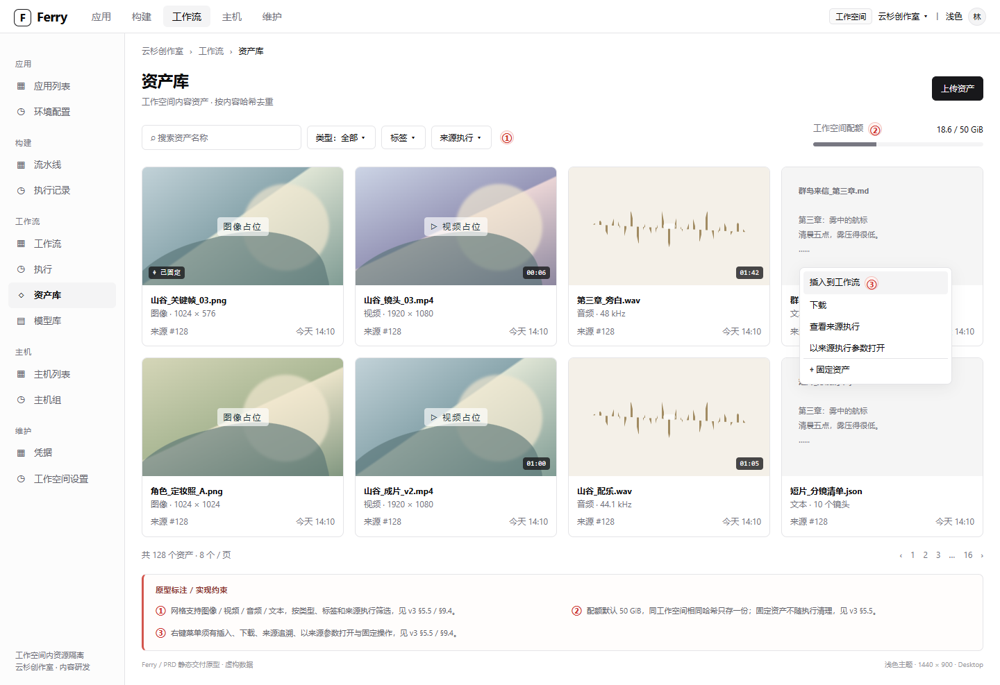

示意图：标注①…③为需求点，其余为示意。①媒体类型与过滤→FR-ASSET-01；②配额/去重/固定→02；③插入/下载/追溯/参数打开/固定→03。

**提示文案**（示例）：「存储配额不足，请清理资产或调整工作空间配额。」「固定资产不会随执行清理。」

| 编号 | Given / When / Then |
|---|---|
| AC-ASSET-01 | Given 同空间两次上传相同内容，When 查看存储，Then 实体按sha去重；另一空间不能凭sha读取；默认额度50 GiB且超额失败有说明。（01/02） |
| AC-ASSET-02 | Given 已固定生成资产及已结束执行，When 自动清理并打开来源参数，Then 固定资产仍在且来源可查；未引用删除遵循24小时宽限；流水线重跑仍复制路径产物。（02–04） |

<a id="rv-16"></a>

#### 评审补充 16：资产库（FR-RV-16）

来源：v3 §5.5、§9.4、§12.1、§18.4/18.15；ADR V11/D2/D9；既有规则 FR-ASSET-01–04；行为验收 AC-ASSET-01/02；AC-UI-04；数据结构以[数据模型](ferry-工作流平台数据模型.md) §2/§4–§9为准。以下为来源规则的评审投影，标「源未定义，待补」的内容不是已定规则；缺口登记 G-16（§14）。

**模式差异（入口/操作/可编辑范围）**：列表/网格共用列表配置；新增上传；编辑标签/固定状态；详情只读来源/参数；媒体编辑新建资产不覆盖原件。（来源：v3 §5.5、§9.4、§12.1、§18.4/18.15；ADR V11/D2/D9；总方案 §5/§7/§8）

**字段与校验**：workspace_id/sha256服务端；sha256为64位十六进制；默认配额50GiB可配置；pinned固定；kind image/video/audio/text/file/model，S5 model3d；标签长度仍待补；名称按§1c.5。资源名称默认trim后1–60字符（§1c.5），模块显式例外优先；其他字段来源/默认/回填/可编辑条件及未定长度/正则/上下限不从原型推导；未列出的节点/JSON子字段约束为「源未定义，待补」，不将DDL映射宽度当产品限制。（来源：v3 §5.5、§9.4、§12.1、§18.4/18.15；ADR V11/D2/D9；数据模型 §1/§4/§7）

**字段联动与清空**：插入图建立引用；固定独立于pinned测试数据；来源过期不删固定资产；同空间去重并发须同事务保护。已保存/历史引用不得因前端切换静默改写；已知依赖选择重置、旧异步结果和手工草稿按§1c.6；未声明的逐节点依赖/回填来源仍按模块缺口。（来源：v3 §5.5、§9.4、§12.1、§18.4/18.15；ADR V11/D2/D9；总方案 §8；数据模型 §7）

**状态操作矩阵**：状态覆盖 上传中/成功/失败、固定/非固定、有引用/无引用宽限/可GC、空库/无匹配。表中“无”指无需额外输入；不把未知的确认输入补成强制输入名称。表外状态的新增操作规则为「源未定义，待补」。（来源：v3 §5.5、§9.4、§12.1、§18.4/18.15；ADR V11/D2/D9；数据模型 §6）

| 状态 | 操作 | 可见/可用条件 | 确认/输入 | 副作用 | 失败反馈/可逆性 |
|---|---|---|---|---|---|
| 有权且配额允许 | 上传/插入/下载/固定 | 按资产与执行来源权限 | 上传文件/固定操作 | 新增引用或保留标记 | 失败保留可恢复引用 |
| 无引用且非固定 | GC | 持久化标记并24h后复查仍无引用 | 系统清理 | 物理对象/记录按策略清理 | 对象失败需恢复账本待补；物理删除不可逆 |
| 有引用/固定 | 自动删除 | 不可清理 | 无 | 保留资产 | 拒绝/跳过并保引用 |

**操作记录（审计事件）**：上传/固定/取消固定/删除及来源敏感访问按§1c.1；关键操作按AUTH。事件身份、details和永久保留遵§1c.1；修改同事务写activity，不记录秘密或输入值。（来源：FR-AUTH-04；v3 §5.5、§9.4、§12.1、§18.4/18.15；ADR V11/D2/D9；数据模型 §2）

**删除与保留**：不新增软删除；保留/物理删除按§1c.2/§1c.3及原资源保护例外。 固定或仍有引用不清理；无引用24小时复查后GC；GC标记及失败恢复待补。 删除弹窗/物理删除及引用保护按§1c.2，保留期/保护例外按§1c.3；不因缺外键跳过范围校验。（来源：ADR Q12；数据模型 §8.3/§8.4）

**数据模型、时间审计、索引与SQL**：assets、asset_refs、asset_tags；GC标记/固定资产历史追溯缺口。本模块新表/存量新增时间按数据模型 §2配每个xx_at同前缀xx_by BIGINT NOT NULL DEFAULT 0；0=system；不回填猜测历史操作者。索引：assets_sha256(workspace_id,sha256)唯一；asset_refs_owner唯一；asset_tags_tag。SQL证据：数据模型 §8.3去重、候选、引用保护SQL；NOT EXISTS只是候选非完整GC。（来源：数据模型 §2/§4/§5/§8/§9）

**配置来源表**：按§1c.7对应开发发布/运维重启/平台立即/用户保存发布生效，当前无多语言设置。（来源：v3 §5.5、§9.4、§12.1、§18.4/18.15；ADR V11/D2/D9；总方案 §7/§8；src/components/dsl.ts、ResourceForm.tsx；现状无i18n）：

| 配置项/来源 | 修改主体与频率 | 多语言/枚举 |
|---|---|---|
| 用户：标签/固定/上传；运维或空间配额管理资格源未定义，待补；开发：hash/引用策略；local/S3部署配置 | 按已授权用户/开发/运维来源修改；生效按§1c.7：开发发布/运维重启/平台立即/用户保存发布，无固定周期 | 业务枚举见数据模型 §6；展示中文硬编码，en-US/ms-MY仍待澄清R01 |
| 原型数据/截图 | 静态示意，非配置中心 | 不得将示例金额/模型/人员或3轮当平台默认 |

**影响与兼容**：本期 S0资产/存储，S3媒体预览与生成参数；不做 不跨空间共享权限；不将路径式流水线产物强转sha资产；不删仍有引用/固定资产；灰度 无。核心流程：上传/生成→同空间hash去重→建引用→浏览/插入/下载/追源→取消引用→无引用标记→24h复查→物理GC。异常：配额不足拒绝；文件/预览失败说明；删除并发新引用要保护；对象删除失败账本待补。历史up/down：数据模型 §5.2第5/15项：内容资产与路径产物并存，GC载体完整前不得启动物理GC；共用回退边界见§1b。三方：默认local，集群S3兼容存储；媒体元数据在主机/GPU产生。版本兼容：不跨库依赖JSON索引；对象存储与DB无跨系统原子承诺。计算：50GiB配额、同空间hash去重、24h引用宽限；税/库存/折扣不适用。（来源：v3 §5.5、§9.4、§12.1、§18.4/18.15；ADR V11/D2/D9；数据模型 §5.2；NFR-COMP-01–03）

**文案表**（zh-CN来自原PRD提示/必需文案、v3、共享组件或RESPONSIVE中的原文；不据此引入i18n。en-US/ms-MY统一仍待澄清R01（§1c.9））：

| 场景/文案键（评审标识） | zh-CN | en-US | ms-MY | ms-MY 长度预留 |
|---|---|---|---|---|
| ASSET.key | 存储配额不足，请清理资产或调整工作空间配额。 | 仍待澄清 R01 | 仍待澄清 R01 | 允许比zh-CN长≥40%；换行/区域滚动保持完整操作，不代表已有翻译 |

**验收追踪与响应式交付**：FR-ASSET-01–04 → AC-ASSET-01/02；AC-UI-04 / AC-RV-16 → 下表测试规格。规则对应原型编号；异常按§6.16文字，无独立截图，正常业务专属屏缺口仍逐项列出（§1c.8）；无Figma，Figma screen/variant不适用（当前交付为HTML+PNG），不能声称Figma覆盖。D=1440×900、P=768×1024、M=390×844，full-page PNG可高于视口；断点/键盘/Phone只读图规则见[RESPONSIVE.md](prototypes/RESPONSIVE.md)。

| Desktop / Pad / Phone截图 | 编号与覆盖边界 |
|---|---|
| [Desktop](images/09-assets-library.png) / [Pad](images/pad/09-assets-library.png) / [Phone](images/phone/09-assets-library.png) | ①②③：类型配额追溯；异常/权限视觉按§6.16文字，无独立截图；长文本按RESPONSIVE验收，语言variant仍待澄清R01（§1c.8）；HTML为prototypes/09-assets-library.html |

| 规则→AC | 测试用例（规格，未执行） | Given / When / Then | 设计/状态证据 |
|---|---|---|---|
| FR-RV-16 → AC-RV-16 | TC-RV-16-01 | Given 本期有权用户与有效配置，When 按本功能闭环操作，Then 上传/生成→同空间hash去重→建引用→浏览/插入/下载/追源→取消引用→无引用标记→24h复查→物理GC | 09-assets-library.png ①②③；其余状态待补 |
| FR-ASSET-01–04 → AC-RV-16 | TC-RV-16-02 | Given 本功能异常或边界输入，When 执行对应操作，Then 配额不足拒绝；文件/预览失败说明；删除并发新引用要保护；对象删除失败账本待补 | 异常视觉交互见§6.16文字，无独立截图，不代表已实测（§1c.8） |
| FR-AUTH-01–05 → AC-RV-16 | TC-RV-16-03 | Given 跨空间/无权成员或失效公开令牌，When 绕过界面直接请求，Then 拒绝且不产生本次业务副作用；公开者不获得后台权限 | 权限拒绝专属状态待补 |
| 数据模型 §5.2 → AC-RV-16 | TC-RV-16-04 | Given 升级前历史夹具与新状态，When 按迁移方案up/人工回退评审，Then 数据模型 §5.2第5/15项：内容资产与路径产物并存，GC载体完整前不得启动物理GC | 后端迁移规格，无Figma/截图适用 |
| §1b/RESPONSIVE → AC-RV-16 | TC-RV-16-05 | Given 三布局与中文及长度≥140%的排版占位文本，When 查看本功能操作与错误，Then 核心字段/按钮不被遮挡；Phone图只读、区域内滚动；翻译内容未验收 | 三端基础PNG+callout见上表；异常按§6.16文字，无独立截图；语言variant仍待澄清R01（§1c.8） |

AC-RV-16：本功能已定规则按上述测试规格及既有AC验收；G-16列出的来源缺口须补来源/设计后才可认定对应能力验收通过。本次为需求文档审查，不声称运行测试、迁移或真实三方通过。（来源：用户评审清单；§10；v3 §5.5、§9.4、§12.1、§18.4/18.15；ADR V11/D2/D9）

### 6.10 AI 服务商、成本与预算（AI）

**目标**：配置真实可用的 AI 服务并限制费用。**用户故事**：作为管理员，我希望并发调用前就预留预算，以便并行任务不会绕过月度限制。

| 编号 | 需求 | 规则与边界 | 分期 | 来源 |
|---|---|---|---|---|
| FR-AI-01 | 服务商凭据与模型配置 | base_url、密钥、可用模型；兼容协议/原生适配按清单区分；密钥走槽位并掩码，非条目/日志；出站遵守安全策略。 | S2 | v3 §7.5、§6.4、§18.12；原型16① |
| FR-AI-02 | 用户按计费单位配置价格 | token输入/输出、张数、视频秒等匹配能力；不内置价格；启用预算但缺价拒绝对应AI节点执行。 | S2/S3 媒体单位 | v3 §5.6、§18.13；原型16② |
| FR-AI-03 | 每凭据限制QPS与并发 | 同凭据并行调用共同受限，不能每节点各自计算；具体配置范围未给，不照抄原型5和3。 | S2 | v3 §18.13；原型16③ |
| FR-AI-04 | 预算先预留后结算 | 可见月度已用、进行中预留、余额；按实际用量结算；工作空间月预算与工作流单次max_cost分别限制，预算不足拒绝新AI调用。 | S2 | v3 §18.13；原型16④ |
| FR-AI-05 | 适配器明确幂等能力 | 异步提交以意图追踪客户端引用；无幂等支持的不确定窗口不自动重提，显示任务可供核对。 | S3 | v3 §8.1、§18.8；原型16⑤ |
| FR-AI-06 | 展示用量与Agent边界 | 节点/执行/工作流成本可追溯；Agent默认10轮最多20轮；评估数据集、规则/LLM评分与版本对比不等同生产执行成功率。 | S2 | v3 §5.6、§18.3、§18.13 |

**页面与交互**：凭据及价格使用共享表单/子列表；预算区域与单次上限来源分开；不因原型未标注的「显示」密钥按钮新增绕过 reveal 审计的操作。

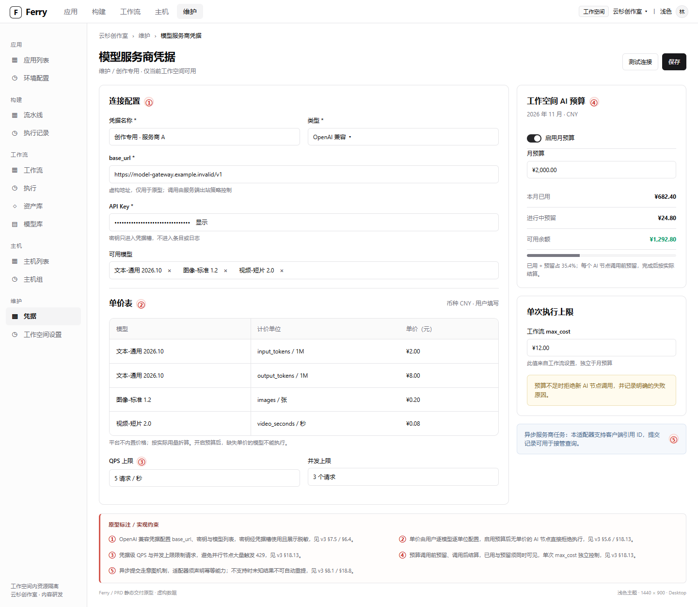

示意图：标注①…⑤为需求点，其余为示意。①连接/槽位掩码→FR-AI-01；②价格→02；③凭据限流→03；④月度预留/结算与单次上限→04；⑤幂等及未知结果→05。

**提示文案**（必需）：「请为该凭据配置单价，否则无法执行预算控制」「已超出本月 AI 预算」。其他示例：「该服务商的提交结果未知，请核对任务后再决定是否重试。」

| 编号 | Given / When / Then |
|---|---|
| AC-AI-01 | Given 月预算已启用且选中模型无价，When 发起AI节点，Then 不请求服务商，显示缺价文案并定位凭据；单价来自用户配置。（01/02） |
| AC-AI-02 | Given 月余额充足但本次已用及预留加新调用预估将超过单次 max_cost，When 请求该 AI 调用，Then 单次上限拒绝可见，服务商调用数为0、不新增预留，不误报为月预算不足。（FR-AI-04） |
| AC-AI-03 | Given Agent设置21轮，When 校验，Then 拒绝超过20；默认10；异步 unknown 不自动产生第二次收费提交。（05/06） |
| AC-AI-04 | Given 单次 max_cost 充足但月已用及预留加新调用预估超过月预算，When 发起调用，Then 不请求服务商、不新增预留，显示「已超出本月 AI 预算」。（FR-AI-04） |
| AC-AI-05 | Given 月预算100、已用80且无预留，两个独立执行各请求预留15并均满足各自 max_cost，When 并发受理，Then 至多一个获准调用，另一个拒绝且服务商调用数为0；已用+预留+余额=100，获准调用按实际10结算后为90+0+10。（FR-AI-04） |
| AC-AI-06 | Given 多节点共享配置了 QPS 和并发上限的同一凭据，When 同时发起调用，Then 实际请求速率和在途数均不超过该凭据生效配置，不按节点分别放大限额。（FR-AI-03） |
| AC-AI-07 | Given 有执行查看权但无预算管理/凭据reveal权的只读成员，When 从历史查看AI用量与成本并直接请求修改预算或查看密钥，Then 可见授权执行的脱敏用量、按币种成本及无价「—」，预算修改和密钥明文请求被拒绝。（FR-AI-01/04/06、FR-AUTH-01） |

<a id="rv-17"></a>

#### 评审补充 17：AI服务商、成本与预算（FR-RV-17）

来源：v3 §5.6、§7.5、§18.8/18.13；ADR Q06/Q11/V7；既有规则 FR-AI-01–06；FR-EDIT-12；FR-STAT-02；行为验收 AC-AI-01–07；AC-STAT-03；数据结构以[数据模型](ferry-工作流平台数据模型.md) §2/§4–§9为准。以下为来源规则的评审投影，标「源未定义，待补」的内容不是已定规则；缺口登记 G-17（§14）。

**模式差异（入口/操作/可编辑范围）**：列表查看脱敏凭据；新增/编辑URL、密钥、模型、价格/额度；查看不回填密钥明文；测试连接独立于保存；历史成本只读。（来源：v3 §5.6、§7.5、§18.8/18.13；ADR Q06/Q11/V7；总方案 §5/§7/§8）

**字段与校验**：金额amount_micros BIGINT整数微单位；币种来自凭据；单价按input/output tokens、张/秒等单位；max_cost与月预算独立；QPS/并发范围、quantity精度/舍入规则源未定义，待补。资源名称默认trim后1–60字符（§1c.5），模块显式例外优先；其他字段来源/默认/回填/可编辑条件及未定长度/正则/上下限不从原型推导；未列出的节点/JSON子字段约束为「源未定义，待补」，不将DDL映射宽度当产品限制。（来源：v3 §5.6、§7.5、§18.8/18.13；ADR Q06/Q11/V7；数据模型 §1/§4/§7）

**字段联动与清空**：启预算且所用模型缺价阻执行但可保存/发布；同凭据所有节点共享限流；模型变更对应价格；跨币种不得混加。已保存/历史引用不得因前端切换静默改写；已知依赖选择重置、旧异步结果和手工草稿按§1c.6；未声明的逐节点依赖/回填来源仍按模块缺口。（来源：v3 §5.6、§7.5、§18.8/18.13；ADR Q06/Q11/V7；总方案 §8；数据模型 §7）

**状态操作矩阵**：状态覆盖 未配置、测试成功/失败、预算关闭/启用、缺价、额度不足、已预留、已结算、unknown。表中“无”指无需额外输入；不把未知的确认输入补成强制输入名称。表外状态的新增操作规则为「源未定义，待补」。（来源：v3 §5.6、§7.5、§18.8/18.13；ADR Q06/Q11/V7；数据模型 §6）

| 状态 | 操作 | 可见/可用条件 | 确认/输入 | 副作用 | 失败反馈/可逆性 |
|---|---|---|---|---|---|
| 预算启用且缺价/不足 | 发起AI调用 | 阻断且定位凭据/模型 | 补价/预算后再执行 | 不调用目标服务 | 可修配置；不冒充免费 |
| 价格与额度可用 | 调用/结算 | 执行与凭据权限、共同限流通过 | 配置单位与上限 | 先预留后按实际结算 | 失败释放/跨月归属细节源未定义，待补 |
| unknown无幂等 | 人工核对/重试或放弃 | 有相应执行权限；不自动重提 | 明确按未提交重试的风险 | 关联意图与外部任务 | 可能重复副作用，保留历史 |

**操作记录（审计事件）**：凭据修改/reveal独立授权、价格预算变更/调用成本/风险确认；预算details按§1c.1。事件身份、details和永久保留遵§1c.1；修改同事务写activity，不记录秘密或输入值。（来源：FR-AUTH-04；v3 §5.6、§7.5、§18.8/18.13；ADR Q06/Q11/V7；数据模型 §2）

**删除与保留**：不新增软删除；保留/物理删除按§1c.2/§1c.3及原资源保护例外。 删除弹窗/物理删除及引用保护按§1c.2，保留期/保护例外按§1c.3；不因缺外键跳过范围校验。（来源：ADR Q12；数据模型 §8.3/§8.4）

**数据模型、时间审计、索引与SQL**：cost_records、execution_intents、既有凭据/设置；credential关联/价格/预留结算载体待补。本模块新表/存量新增时间按数据模型 §2配每个xx_at同前缀xx_by BIGINT NOT NULL DEFAULT 0；0=system；不回填猜测历史操作者。索引：cost_records_workspace/execution；execution_intents_once；按credential账本键待补。SQL证据：数据模型 §8.2按币种SUM(amount_micros)；按凭据明细因credential关联待补不能声称完整。（来源：数据模型 §2/§4/§5/§8/§9）

**配置来源表**：按§1c.7对应开发发布/运维重启/平台立即/用户保存发布生效，当前无多语言设置。（来源：v3 §5.6、§7.5、§18.8/18.13；ADR Q06/Q11/V7；总方案 §7/§8；src/components/dsl.ts、ResourceForm.tsx；现状无i18n）：

| 配置项/来源 | 修改主体与频率 | 多语言/枚举 |
|---|---|---|
| 用户：单价/币种/预算/max_cost/QPS并发；开发：计费单位与适配器幂等声明；无硬编码价格；修改周期由用户决定 | 按已授权用户/开发/运维来源修改；生效按§1c.7：开发发布/运维重启/平台立即/用户保存发布，无固定周期 | 业务枚举见数据模型 §6；展示中文硬编码，en-US/ms-MY仍待澄清R01 |
| 原型数据/截图 | 静态示意，非配置中心 | 不得将示例金额/模型/人员或3轮当平台默认 |

**影响与兼容**：本期 S2文本AI/成本预算，S3媒体计费/幂等；不做 不内置服务商价表；不换汇；不把预算等同最终账单；不重提无幂等unknown；灰度 无（预算启用是业务配置，不是feature flag）。核心流程：配置凭据/模型/单价/币种→测试→预算校验→估算预留→调用→实际用量结算/释放→追踪账本。异常：预算启用缺价/不足拒执行；超QPS共同受限；内容审核拒绝不重试；未知提交人工核对。历史up/down：数据模型 §5.2第14/15项：无历史价格回填，不将缺价填0；回退保留预算/意图账本；共用回退边界见§1b。三方：模型API/原生适配器、账单用量；V7具体服务商S3前选。版本兼容：不同计费单位/币种分开；无价为—；预算预留不能用浮点金额。计算：cost=单价×实际用量，以整数micros记；余额=预算−已用−预留；每凭据币种不换汇，先预留后结算；舍入/跨月待补；税/库存/折扣不适用。（来源：v3 §5.6、§7.5、§18.8/18.13；ADR Q06/Q11/V7；数据模型 §5.2；NFR-COMP-01–03）

**文案表**（zh-CN来自原PRD提示/必需文案、v3、共享组件或RESPONSIVE中的原文；不据此引入i18n。en-US/ms-MY统一仍待澄清R01（§1c.9））：

| 场景/文案键（评审标识） | zh-CN | en-US | ms-MY | ms-MY 长度预留 |
|---|---|---|---|---|
| AI.key | 请为该凭据配置单价，否则无法执行预算控制 | 仍待澄清 R01 | 仍待澄清 R01 | 允许比zh-CN长≥40%；换行/区域滚动保持完整操作，不代表已有翻译 |

**验收追踪与响应式交付**：FR-AI-01–06；FR-EDIT-12；FR-STAT-02 → AC-AI-01–07；AC-STAT-03 / AC-RV-17 → 下表测试规格。规则对应原型编号；异常按§6.16文字，无独立截图，正常业务专属屏缺口仍逐项列出（§1c.8）；无Figma，Figma screen/variant不适用（当前交付为HTML+PNG），不能声称Figma覆盖。D=1440×900、P=768×1024、M=390×844，full-page PNG可高于视口；断点/键盘/Phone只读图规则见[RESPONSIVE.md](prototypes/RESPONSIVE.md)。

| Desktop / Pad / Phone截图 | 编号与覆盖边界 |
|---|---|
| [Desktop](images/16-provider-credential.png) / [Pad](images/pad/16-provider-credential.png) / [Phone](images/phone/16-provider-credential.png) | ①②③④⑤：连接、价格、限流、预算、幂等；异常/权限视觉按§6.16文字，无独立截图；长文本按RESPONSIVE验收，语言variant仍待澄清R01（§1c.8）；HTML为prototypes/16-provider-credential.html |

| 规则→AC | 测试用例（规格，未执行） | Given / When / Then | 设计/状态证据 |
|---|---|---|---|
| FR-RV-17 → AC-RV-17 | TC-RV-17-01 | Given 本期有权用户与有效配置，When 按本功能闭环操作，Then 配置凭据/模型/单价/币种→测试→预算校验→估算预留→调用→实际用量结算/释放→追踪账本 | 16-provider-credential.png ①②③④⑤；其余状态待补 |
| FR-AI-01–06；FR-EDIT-12；FR-STAT-02 → AC-RV-17 | TC-RV-17-02 | Given 本功能异常或边界输入，When 执行对应操作，Then 预算启用缺价/不足拒执行；超QPS共同受限；内容审核拒绝不重试；未知提交人工核对 | 异常视觉交互见§6.16文字，无独立截图，不代表已实测（§1c.8） |
| FR-AUTH-01–05 → AC-RV-17 | TC-RV-17-03 | Given 跨空间/无权成员或失效公开令牌，When 绕过界面直接请求，Then 拒绝且不产生本次业务副作用；公开者不获得后台权限 | 权限拒绝专属状态待补 |
| 数据模型 §5.2 → AC-RV-17 | TC-RV-17-04 | Given 升级前历史夹具与新状态，When 按迁移方案up/人工回退评审，Then 数据模型 §5.2第14/15项：无历史价格回填，不将缺价填0；回退保留预算/意图账本 | 后端迁移规格，无Figma/截图适用 |
| §1b/RESPONSIVE → AC-RV-17 | TC-RV-17-05 | Given 三布局与中文及长度≥140%的排版占位文本，When 查看本功能操作与错误，Then 核心字段/按钮不被遮挡；Phone图只读、区域内滚动；翻译内容未验收 | 三端基础PNG+callout见上表；异常按§6.16文字，无独立截图；语言variant仍待澄清R01（§1c.8） |

AC-RV-17：本功能已定规则按上述测试规格及既有AC验收；G-17列出的来源缺口须补来源/设计后才可认定对应能力验收通过。本次为需求文档审查，不声称运行测试、迁移或真实三方通过。（来源：用户评审清单；§10；v3 §5.6、§7.5、§18.8/18.13；ADR Q06/Q11/V7）

### 6.11 模型库与 GPU（GPU）

**目标**：使模型许可、主机就绪和 GPU 等待可见。**用户故事**：作为本地生成用户，我希望执行前知道模型和显存是否可用，以便避免盲目下载和运行。

| 编号 | 需求 | 规则与边界 | 分期 | 来源 |
|---|---|---|---|---|
| FR-GPU-01 | 登记模型许可与商用信息 | 展示类型/family/大小/许可证、商用允许/受限/禁止；权重许可独立于代码许可；首批家族V6未锁型号。 | S4 | v3 §8.3、§16 V6；原型10① |
| FR-GPU-02 | 按主机显示模型状态 | 就绪/缺失/下载进度，运行前检查目标主机；GPU槽、显存等待、热加载和卸载可解释，不能用崩溃替代显存排队。 | S4 | v3 §8.2–§8.4、§9.4；原型10② |
| FR-GPU-03 | 非允许商用模型首次使用确认 | 明示具体限制、许可正文/版本，由用户确认并审计；确认不代表平台授予不存在的许可。 | S4 | v3 §8.3；原型10③ |
| FR-GPU-04 | 主机直接下载并校验哈希 | 下载上游权重，校验sha256；平台不镜像分发权重；Windows/Linux环境安装前检测，模型仅在支持矩阵内承诺。 | S4 | v3 §8.2–§8.3、§17；原型10④ |
| FR-GPU-05 | 本地推理能力按真实硬件验收 | 实时预览、取消、模型热加载、分段、低显存；多槽调度不等于单模型多GPU分片；训练仅按清单辅助能力，不新增完整训练平台。 | S4；长尾 S5 | v3 §8、§18.4；能力清单 F/H |

**页面与交互**：模型表及许可确认用共享列表/表单配置；按主机状态定位下载任务；不把虚构模型名称作为交付名单。

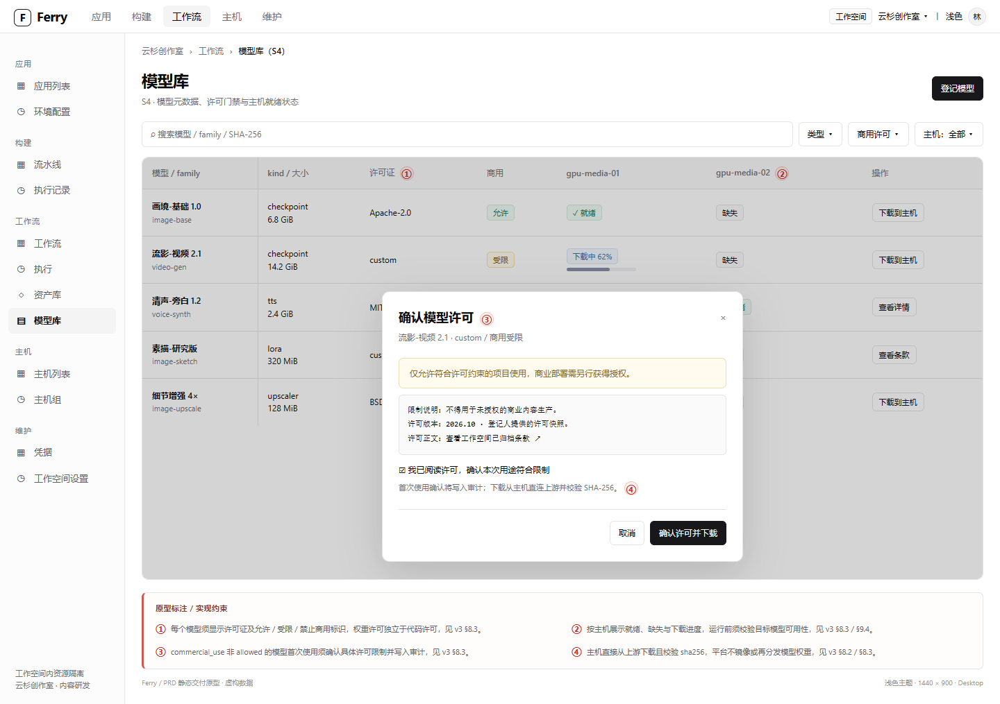

示意图：标注①…④为需求点，其余为示意。①许可/商用→FR-GPU-01；②就绪及进度→02；③首次确认审计→03；④直连下载/sha256→04。

**提示文案**（示例）：「目标主机缺少该模型，请先下载并校验。」「请阅读模型许可，并确认本次用途符合其限制。」「显存不足，正在等待 GPU 资源。」

| 编号 | Given / When / Then |
|---|---|
| AC-GPU-01 | Given commercial_use不为allowed的模型，When 首次使用，Then 显示该模型具体许可并要求确认、写审计；不能仅展示通用免责声明。（01/03） |
| AC-GPU-02 | Given 主机缺失权重，When 下载且哈希不符，Then 不标就绪；正常下载直连上游，平台无权重再分发；进度和错误可见。（02/04） |
| AC-GPU-03 | Given 用户提供的Windows/Linux NVIDIA主机，When 连续图像/视频生成并触发显存压力，Then 已支持模型热加载可证实、等待而非崩溃、可取消并有预览；未测家族不标覆盖。（02/05） |

<a id="rv-18"></a>

#### 评审补充 18：模型库与GPU（FR-RV-18）

来源：v3 §8、§12.1、§18.4；能力清单 F/H；ADR V6/Q15；既有规则 FR-GPU-01–05；行为验收 AC-GPU-01/02/03；AC-UI-04；数据结构以[数据模型](ferry-工作流平台数据模型.md) §2/§4–§9为准。以下为来源规则的评审投影，标「源未定义，待补」的内容不是已定规则；缺口登记 G-18（§14）。

**模式差异（入口/操作/可编辑范围）**：列表按类型/主机/许可筛选；新增登记；编辑元信息不覆盖已冻结版本；详情只读许可/进度；下载单独确认。（来源：v3 §8、§12.1、§18.4；能力清单 F/H；ADR V6/Q15；总方案 §5/§7/§8）

**字段与校验**：commercial_use必填allowed/restricted/forbidden；license_id SPDX/custom、URL和限制；hash校验；gpu_slots默认0，首报GPU数后可改；模型URL长度与slots上限仍待补；模型名称按§1c.5。资源名称默认trim后1–60字符（§1c.5），模块显式例外优先；其他字段来源/默认/回填/可编辑条件及未定长度/正则/上下限不从原型推导；未列出的节点/JSON子字段约束为「源未定义，待补」，不将DDL映射宽度当产品限制。（来源：v3 §8、§12.1、§18.4；能力清单 F/H；ADR V6/Q15；数据模型 §1/§4/§7）

**字段联动与清空**：目标主机模型ready才执行；非allowed首次确认具体许可/版本并审计，确认不授予许可；老Runner不报GPU不影响原任务。已保存/历史引用不得因前端切换静默改写；已知依赖选择重置、旧异步结果和手工草稿按§1c.6；未声明的逐节点依赖/回填来源仍按模块缺口。（来源：v3 §8、§12.1、§18.4；能力清单 F/H；ADR V6/Q15；总方案 §8；数据模型 §7）

**状态操作矩阵**：状态覆盖 absent/downloading/ready/failed；许可待确认/已确认；GPU排队/推理/热加载/卸载。表中“无”指无需额外输入；不把未知的确认输入补成强制输入名称。表外状态的新增操作规则为「源未定义，待补」。（来源：v3 §8、§12.1、§18.4；能力清单 F/H；ADR V6/Q15；数据模型 §6）

| 状态 | 操作 | 可见/可用条件 | 确认/输入 | 副作用 | 失败反馈/可逆性 |
|---|---|---|---|---|---|
| absent/failed | 下载到主机 | 模型/主机相应权限及许可条件 | 限制许可首次具体确认 | 主机直接下载、校验后ready | 失败显示原因可重试 |
| ready | 推理/卸载 | 执行权限与显存/槽位满足 | 非allowed首次确认 | 调度并可看进度 | 显存不足等待，不冒充ready执行 |
| downloading | 查看进度/取消 | 主机相应权限 | 取消确认输入源未定义，待补 | 取消行为按实现验收 | 断连/取消残留处理源未定义，待补 |

**操作记录（审计事件）**：登记/修改、许可首次确认、下载/取消、GPU执行；许可details按§1c.1。事件身份、details和永久保留遵§1c.1；修改同事务写activity，不记录秘密或输入值。（来源：FR-AUTH-04；v3 §8、§12.1、§18.4；能力清单 F/H；ADR V6/Q15；数据模型 §2）

**删除与保留**：不新增软删除；保留/物理删除按§1c.2/§1c.3及原资源保护例外。 删除弹窗/物理删除及引用保护按§1c.2，保留期/保护例外按§1c.3；不因缺外键跳过范围校验。（来源：ADR Q12；数据模型 §8.3/§8.4）

**数据模型、时间审计、索引与SQL**：models、host_models、hosts.gpu_slots。本模块新表/存量新增时间按数据模型 §2配每个xx_at同前缀xx_by BIGINT NOT NULL DEFAULT 0；0=system；不回填猜测历史操作者。索引：models/host_models无新增二级索引；主机模型去重键源未定义，待补。SQL证据：模型§4 DDL可查字段；主机模型筛选/并发下载SQL与索引源未定义，待补。（来源：数据模型 §2/§4/§5/§8/§9）

**配置来源表**：按§1c.7对应开发发布/运维重启/平台立即/用户保存发布生效，当前无多语言设置。（来源：v3 §8、§12.1、§18.4；能力清单 F/H；ADR V6/Q15；总方案 §7/§8；src/components/dsl.ts、ResourceForm.tsx；现状无i18n）：

| 配置项/来源 | 修改主体与频率 | 多语言/枚举 |
|---|---|---|
| 用户：模型/许可记录与目标主机；开发：已支持模型矩阵；运维：驱动/CUDA；家族开放集合待V6 | 按已授权用户/开发/运维来源修改；生效按§1c.7：开发发布/运维重启/平台立即/用户保存发布，无固定周期 | 业务枚举见数据模型 §6；展示中文硬编码，en-US/ms-MY仍待澄清R01 |
| 原型数据/截图 | 静态示意，非配置中心 | 不得将示例金额/模型/人员或3轮当平台默认 |

**影响与兼容**：本期 S4首批本地推理，S5长尾/训练辅助；不做 不镜像分发上游权重；不承诺所有硬件/单模型多GPU分片/完整训练平台；灰度 无（首批家族S4前选，未验证保留未开始）。核心流程：登记许可/版本/hash→首用限制确认→主机直下载→hash验证ready→GPU排队→加载推理→预览/取消/卸载。异常：hash错不ready；显存不足排队不崩溃；许可缺失/拒绝确认不启动；断网下载失败可查。历史up/down：数据模型 §5.2第16项：GPU槽0不影响旧Runner；回退停GPU调度保留权重/记录；共用回退边界见§1b。三方：NVIDIA驱动/CUDA、上游模型权重/许可；用户Windows/Linux真实主机。版本兼容：仅明确支持矩阵；V6型号待选；多槽不等单模型分片；原主机流水线槽不批量重分。计算：gpu_slots=首次GPU数量后用户可调；实际显存等待；税/库存/折扣不适用。（来源：v3 §8、§12.1、§18.4；能力清单 F/H；ADR V6/Q15；数据模型 §5.2；NFR-COMP-01–03）

**文案表**（zh-CN来自原PRD提示/必需文案、v3、共享组件或RESPONSIVE中的原文；不据此引入i18n。en-US/ms-MY统一仍待澄清R01（§1c.9））：

| 场景/文案键（评审标识） | zh-CN | en-US | ms-MY | ms-MY 长度预留 |
|---|---|---|---|---|
| GPU.key | 目标主机缺少该模型，请先下载并校验。 | 仍待澄清 R01 | 仍待澄清 R01 | 允许比zh-CN长≥40%；换行/区域滚动保持完整操作，不代表已有翻译 |

**验收追踪与响应式交付**：FR-GPU-01–05 → AC-GPU-01/02/03；AC-UI-04 / AC-RV-18 → 下表测试规格。规则对应原型编号；异常按§6.16文字，无独立截图，正常业务专属屏缺口仍逐项列出（§1c.8）；无Figma，Figma screen/variant不适用（当前交付为HTML+PNG），不能声称Figma覆盖。D=1440×900、P=768×1024、M=390×844，full-page PNG可高于视口；断点/键盘/Phone只读图规则见[RESPONSIVE.md](prototypes/RESPONSIVE.md)。

| Desktop / Pad / Phone截图 | 编号与覆盖边界 |
|---|---|
| [Desktop](images/10-model-library.png) / [Pad](images/pad/10-model-library.png) / [Phone](images/phone/10-model-library.png) | ①②③④：模型许可、主机状态、确认、下载；异常/权限视觉按§6.16文字，无独立截图；长文本按RESPONSIVE验收，语言variant仍待澄清R01（§1c.8）；HTML为prototypes/10-model-library.html |

| 规则→AC | 测试用例（规格，未执行） | Given / When / Then | 设计/状态证据 |
|---|---|---|---|
| FR-RV-18 → AC-RV-18 | TC-RV-18-01 | Given 本期有权用户与有效配置，When 按本功能闭环操作，Then 登记许可/版本/hash→首用限制确认→主机直下载→hash验证ready→GPU排队→加载推理→预览/取消/卸载 | 10-model-library.png ①②③④；其余状态待补 |
| FR-GPU-01–05 → AC-RV-18 | TC-RV-18-02 | Given 本功能异常或边界输入，When 执行对应操作，Then hash错不ready；显存不足排队不崩溃；许可缺失/拒绝确认不启动；断网下载失败可查 | 异常视觉交互见§6.16文字，无独立截图，不代表已实测（§1c.8） |
| FR-AUTH-01–05 → AC-RV-18 | TC-RV-18-03 | Given 跨空间/无权成员或失效公开令牌，When 绕过界面直接请求，Then 拒绝且不产生本次业务副作用；公开者不获得后台权限 | 权限拒绝专属状态待补 |
| 数据模型 §5.2 → AC-RV-18 | TC-RV-18-04 | Given 升级前历史夹具与新状态，When 按迁移方案up/人工回退评审，Then 数据模型 §5.2第16项：GPU槽0不影响旧Runner；回退停GPU调度保留权重/记录 | 后端迁移规格，无Figma/截图适用 |
| §1b/RESPONSIVE → AC-RV-18 | TC-RV-18-05 | Given 三布局与中文及长度≥140%的排版占位文本，When 查看本功能操作与错误，Then 核心字段/按钮不被遮挡；Phone图只读、区域内滚动；翻译内容未验收 | 三端基础PNG+callout见上表；异常按§6.16文字，无独立截图；语言variant仍待澄清R01（§1c.8） |

AC-RV-18：本功能已定规则按上述测试规格及既有AC验收；G-18列出的来源缺口须补来源/设计后才可认定对应能力验收通过。本次为需求文档审查，不声称运行测试、迁移或真实三方通过。（来源：用户评审清单；§10；v3 §8、§12.1、§18.4；能力清单 F/H；ADR V6/Q15）

### 6.12 公开页面与应用模式（PUBLIC）

**目标**：让非编排者提交输入或受限审阅，不暴露后台能力。**用户故事**：作为外部提交者，我希望按表单提供素材并理解后续步骤，以便完成一次受控请求。

| 编号 | 需求 | 规则与边界 | 分期 | 来源 |
|---|---|---|---|---|
| FR-PUBLIC-01 | 稳定公开表单与聊天入口 | 独立轻量前端包复用共享表单渲染器；多页、必填/校验、生产地址稳定；匿名按已确认 V9 工作空间默认关闭，开启后才生成链接；外审一次性token与表单可复用地址不同。 | S1 表单/S2 聊天 | v3 §9.6、§12.2、§16 V9；原型11① |
| FR-PUBLIC-02 | 上传限制可见且占配额 | 显示允许类型、单文件大小与数量；默认单文件20 MB、最多5个文件；允许类型由各表单字段声明，配置上限为单文件200 MB、20个文件；超限拒绝且合法上传计入工作空间资产配额。 | S1/S3 媒体 | v3 §9.6、§5.5；原型11②；ADR 2026-11-02 Q09 |
| FR-PUBLIC-03 | 防滥用与内容安全 | 按地址与IP限频；公开表单默认每IP每分钟10次提交，聊天每会话每分钟20条消息，聊天上传沿用表单规则；验证码默认关闭，可配置表单限频并切换验证码；Markdown清洗、不接受原始HTML；仅展示所需输入/结果，不带后台凭据或会话。 | S1/S2 | v3 §9.6、§14；原型11③；ADR 2026-11-02 Q09 |
| FR-PUBLIC-04 | 公开来源隔离（V15 已确认） | 推荐配置独立公开域名 `FERRY_PUBLIC_ORIGIN`；未配置时退回同源，公开路由启用严格 CSP（禁内联脚本），且不读取登录会话；公开访问按工作空间开关，默认关闭（V9）。 | 随公开能力（S1 表单/外审，S2 聊天，S5 分享） | v3 §9.6、§16 V15；原型11④；ADR 2026-11-02 V15 |
| FR-PUBLIC-05 | 应用模式隐藏编排复杂度 | 只呈现工作流公开输入与结果，媒体自动试运行仍受纯度限制；限时只读分享/iframe后续提供，不把公开表单当工作空间匿名浏览器。 | S3 应用/S5 分享 | v3 §9.5–§9.6、§18.2 |
| FR-PUBLIC-06 | 公开输入默认值与配置一致展示 | 表单默认20 MB/文件、5文件、每IP每分钟10次提交、验证码关闭；允许类型由各字段声明，上传配置不得超过200 MB/文件及20文件。聊天每会话每分钟20条消息，上传沿用表单规则。管理员可在上述边界内配置，前后端使用同一生效值，超出声明类型或生效限额时给出可读错误。 | S1 表单；S2 聊天；媒体 S3 | ADR 2026-11-02 Q09、PRD review follow-up defaults |

**页面与交互**：公开地址不渲染后台菜单；提供配置要求的字段、步骤、上传错误及结果状态；过期审阅页仅告知不可处理，不泄露其他任务。

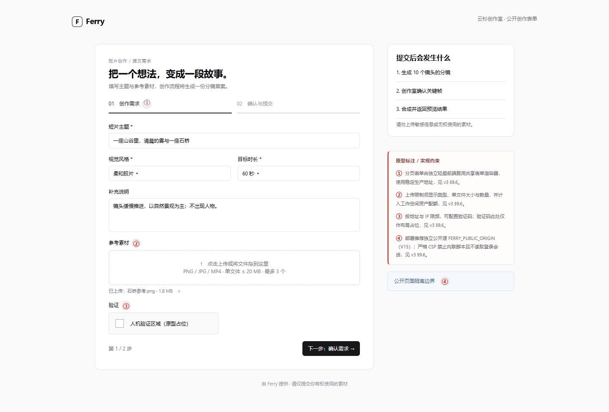

示意图：标注①…④为需求点，其余为示意。①多页/共享渲染/稳定地址→FR-PUBLIC-01；②上传约束/配额→02；③IP及地址限频/验证码→03；④来源隔离→04（V15 已确认为推荐方案）。

**提示文案**（示例）：「文件不符合此表单的类型、大小或数量限制，请调整后重试。」「请求过于频繁，请稍后重试。」「请仅提交你有权使用的素材。」

| 编号 | Given / When / Then |
|---|---|
| AC-PUBLIC-01 | Given 配置了类型/大小/数量的多页表单，When 提交超限文件或必填为空，Then 就地指出字段且不创建合规成功提交；合法上传计入配额，发布换版本不改稳定URL。（01/02） |
| AC-PUBLIC-02 | Given 公开内容含脚本/原始HTML或访问频率超限，When 打开/提交，Then 内容清洗且脚本不执行、超限被阻止，不能读取登录会话或扩大执行身份。（03） |
| AC-PUBLIC-03 | Given 已配置 `FERRY_PUBLIC_ORIGIN`，When 外部用户打开公开表单，Then 页面来自公开域名，浏览器不携带后台登录 Cookie；Given 未配置，When 打开同一表单，Then 响应头含严格 CSP（无 `unsafe-inline` 脚本），公开页面接口不接受后台会话，注入 `<script>` 的 Markdown 被净化。（04/05） |
| AC-PUBLIC-04 | Given 使用默认配置的公开表单，When 提交单文件超过20 MB、第6个文件或同IP一分钟第11次提交，Then 分别拒绝超限项/提交并解释原因；边界内合法提交计入配额，默认不要求验证码。（02/03/06） |
| AC-PUBLIC-05 | Given 管理员修改上传/限频配置并打开验证码，When 公开页面加载并提交，Then 页面显示与服务端校验均使用生效值，按配置验证验证码；关闭后不再要求验证码。（06） |
| AC-PUBLIC-06 | Given 字段声明允许的文件类型及上传配置，When 配置200 MB/文件、20文件并提交边界内的合法文件，Then 按配置受理并计配额；配置超过200 MB或20文件被拒绝，未声明类型的文件也被拒绝，页面与服务端提示一致。（02/06） |
| AC-PUBLIC-07 | Given 同一公开聊天会话，When 一分钟内发送第20和第21条消息，Then 前者在其他校验通过时受理、后者限频拒绝；聊天上传按字段类型及表单生效的大小/数量限制拒绝越界项。（03/06） |
| AC-PUBLIC-08 | Given 已填写公开表单，When 提交成功后执行等待或完成，Then 显示提交成功与受限结果入口，等待时显示执行编号及状态、完成后显示允许的结果，不重复提交原请求；结果入口不赋后台浏览权限。（01，§6.16） |
| AC-PUBLIC-09 | Given 已填写公开表单，When 字段校验、上传或提交请求失败，Then 显示字段或请求原因、保留文本及仍有效的上传引用，可修改后重试；文件引用失效时明确要求重选，不将失败显示为成功。（01/02，§6.16） |

<a id="rv-19"></a>

#### 评审补充 19：公开页面与应用模式（FR-RV-19）

来源：v3 §9.5/9.6、§18.6；ADR V9/V15/Q09/Q18；既有规则 FR-PUBLIC-01–06；行为验收 AC-PUBLIC-01–09；AC-UI-03；数据结构以[数据模型](ferry-工作流平台数据模型.md) §2/§4–§9为准。以下为来源规则的评审投影，标「源未定义，待补」的内容不是已定规则；缺口登记 G-19（§14）。

**模式差异（入口/操作/可编辑范围）**：配置页可编辑字段/步骤/限制；公开填写新增提交；结果只读；应用模式隐藏图；失效外审仅告知不可处理。（来源：v3 §9.5/9.6、§18.6；ADR V9/V15/Q09/Q18；总方案 §5/§7/§8）

**字段与校验**：上传默认20MB/文件、5文件，可配上界200MB/20；类型字段声明；IP每分钟10次，聊天每会话每分钟20条；验证码默认关；长文本字段长度/验证码方案源未定义，待补。资源名称默认trim后1–60字符（§1c.5），模块显式例外优先；其他字段来源/默认/回填/可编辑条件及未定长度/正则/上下限不从原型推导；未列出的节点/JSON子字段约束为「源未定义，待补」，不将DDL映射宽度当产品限制。（来源：v3 §9.5/9.6、§18.6；ADR V9/V15/Q09/Q18；数据模型 §1/§4/§7）

**字段联动与清空**：上传计入配额；失效文件重选；换发布版URL稳定；归档/撤销发布停止入口；同源回退严格CSP且不读会话。已保存/历史引用不得因前端切换静默改写；已知依赖选择重置、旧异步结果和手工草稿按§1c.6；未声明的逐节点依赖/回填来源仍按模块缺口。（来源：v3 §9.5/9.6、§18.6；ADR V9/V15/Q09/Q18；总方案 §8；数据模型 §7）

**状态操作矩阵**：状态覆盖 公开关闭、未发布、填写/上传、字段错误、提交失败、已受理等待、执行成功/失败、链接失效。表中“无”指无需额外输入；不把未知的确认输入补成强制输入名称。表外状态的新增操作规则为「源未定义，待补」。（来源：v3 §9.5/9.6、§18.6；ADR V9/V15/Q09/Q18；数据模型 §6）

| 状态 | 操作 | 可见/可用条件 | 确认/输入 | 副作用 | 失败反馈/可逆性 |
|---|---|---|---|---|---|
| 填写/上传且入口有效 | 提交 | 字段/额度/限频/验证码通过 | 表单声明必填 | 新执行一次受理 | 未受理失败可改后重试 |
| 已受理等待/成功/失败 | 查看/刷新本次结果 | 仅本次受限入口 | 无 | 只读状态/结果，不重复提交 | 失败保摘要；新提交需显式发起 |
| 关闭/未发布/链接失效 | 访问/提交 | 拒绝且不泄露空间数据 | 无 | 不新增执行 | 启用或重新授权按后台流程 |

**操作记录（审计事件）**：公开提交对应执行触发者与发布者身份分开；限频/撤销/风险与回应事件按AUTH；公开配置按§1c.1。事件身份、details和永久保留遵§1c.1；修改同事务写activity，不记录秘密或输入值。（来源：FR-AUTH-04；v3 §9.5/9.6、§18.6；ADR V9/V15/Q09/Q18；数据模型 §2）

**删除与保留**：不新增软删除；保留/物理删除按§1c.2/§1c.3及原资源保护例外。 删除弹窗/物理删除及引用保护按§1c.2，保留期/保护例外按§1c.3；不因缺外键跳过范围校验。（来源：ADR Q12；数据模型 §8.3/§8.4）

**数据模型、时间审计、索引与SQL**：webhook_endpoints、workspaces公开开关、workflow_executions、assets、human_tasks；上传/聊天配置载体待补。本模块新表/存量新增时间按数据模型 §2配每个xx_at同前缀xx_by BIGINT NOT NULL DEFAULT 0；0=system；不回填猜测历史操作者。索引：入口唯一键、资产hash键；会话/限频窗口持久化索引源未定义，待补。SQL证据：数据模型 §8.3上传去重/引用；公开会话/结果授权完整SQL源未定义，待补。（来源：数据模型 §2/§4/§5/§8/§9）

**配置来源表**：按§1c.7对应开发发布/运维重启/平台立即/用户保存发布生效，当前无多语言设置。（来源：v3 §9.5/9.6、§18.6；ADR V9/V15/Q09/Q18；总方案 §7/§8；src/components/dsl.ts、ResourceForm.tsx；现状无i18n）：

| 配置项/来源 | 修改主体与频率 | 多语言/枚举 |
|---|---|---|
| 用户/管理员：字段/限制/验证码开关（资格细节待补）；运维：FERRY_PUBLIC_ORIGIN；开发：CSP与默认限制 | 按已授权用户/开发/运维来源修改；生效按§1c.7：开发发布/运维重启/平台立即/用户保存发布，无固定周期 | 业务枚举见数据模型 §6；展示中文硬编码，en-US/ms-MY仍待澄清R01 |
| 原型数据/截图 | 静态示意，非配置中心 | 不得将示例金额/模型/人员或3轮当平台默认 |

**影响与兼容**：本期 S1表单/外审，S2聊天，S3应用模式，S5只读分享；不做 公开者不获得后台会话/菜单/执行身份；不默认开放匿名访问；灰度 workspace公开访问默认关闭，开启后生成链接；生产使用发布版。核心流程：公开开关/发布→填写/上传→认证/限频/清洗→受理执行→等待→受限结果；失败区分未受理与已受理。异常：类型/大小/数量/配额错误就地；超频拒绝；失败保留文本/有效引用；已受理不自动重投。历史up/down：数据模型 §5.2第4/12/14项；公开开关不能迁移为默认开；历史受限token不扩大权限；共用回退边界见§1b。三方：对象存储与模型服务；验证码供应商源未定义，待补；浏览器公开origin。版本兼容：FERRY_PUBLIC_ORIGIN推荐，未配同源CSP回退不读会话；后台登录Cookie不成为公开权限。计算：文件与请求限额按服务端生效值；税/库存/折扣不适用。（来源：v3 §9.5/9.6、§18.6；ADR V9/V15/Q09/Q18；数据模型 §5.2；NFR-COMP-01–03）

**文案表**（zh-CN来自原PRD提示/必需文案、v3、共享组件或RESPONSIVE中的原文；不据此引入i18n。en-US/ms-MY统一仍待澄清R01（§1c.9））：

| 场景/文案键（评审标识） | zh-CN | en-US | ms-MY | ms-MY 长度预留 |
|---|---|---|---|---|
| PUBLIC.key | 文件不符合此表单的类型、大小或数量限制，请调整后重试。 | 仍待澄清 R01 | 仍待澄清 R01 | 允许比zh-CN长≥40%；换行/区域滚动保持完整操作，不代表已有翻译 |

**验收追踪与响应式交付**：FR-PUBLIC-01–06 → AC-PUBLIC-01–09；AC-UI-03 / AC-RV-19 → 下表测试规格。规则对应原型编号；异常按§6.16文字，无独立截图，正常业务专属屏缺口仍逐项列出（§1c.8）；无Figma，Figma screen/variant不适用（当前交付为HTML+PNG），不能声称Figma覆盖。D=1440×900、P=768×1024、M=390×844，full-page PNG可高于视口；断点/键盘/Phone只读图规则见[RESPONSIVE.md](prototypes/RESPONSIVE.md)。

| Desktop / Pad / Phone截图 | 编号与覆盖边界 |
|---|---|
| [Desktop](images/11-public-form.png) / [Pad](images/pad/11-public-form.png) / [Phone](images/phone/11-public-form.png) | ①②③④：多页/上传/限频/隔离；结果异常态待补；异常/权限视觉按§6.16文字，无独立截图；长文本按RESPONSIVE验收，语言variant仍待澄清R01（§1c.8）；HTML为prototypes/11-public-form.html |

| 规则→AC | 测试用例（规格，未执行） | Given / When / Then | 设计/状态证据 |
|---|---|---|---|
| FR-RV-19 → AC-RV-19 | TC-RV-19-01 | Given 本期有权用户与有效配置，When 按本功能闭环操作，Then 公开开关/发布→填写/上传→认证/限频/清洗→受理执行→等待→受限结果；失败区分未受理与已受理 | 11-public-form.png ①②③④；其余状态待补 |
| FR-PUBLIC-01–06 → AC-RV-19 | TC-RV-19-02 | Given 本功能异常或边界输入，When 执行对应操作，Then 类型/大小/数量/配额错误就地；超频拒绝；失败保留文本/有效引用；已受理不自动重投 | 异常视觉交互见§6.16文字，无独立截图，不代表已实测（§1c.8） |
| FR-AUTH-01–05 → AC-RV-19 | TC-RV-19-03 | Given 跨空间/无权成员或失效公开令牌，When 绕过界面直接请求，Then 拒绝且不产生本次业务副作用；公开者不获得后台权限 | 权限拒绝专属状态待补 |
| 数据模型 §5.2 → AC-RV-19 | TC-RV-19-04 | Given 升级前历史夹具与新状态，When 按迁移方案up/人工回退评审，Then 数据模型 §5.2第4/12/14项；公开开关不能迁移为默认开；历史受限token不扩大权限 | 后端迁移规格，无Figma/截图适用 |
| §1b/RESPONSIVE → AC-RV-19 | TC-RV-19-05 | Given 三布局与中文及长度≥140%的排版占位文本，When 查看本功能操作与错误，Then 核心字段/按钮不被遮挡；Phone图只读、区域内滚动；翻译内容未验收 | 三端基础PNG+callout见上表；异常按§6.16文字，无独立截图；语言variant仍待澄清R01（§1c.8） |

AC-RV-19：本功能已定规则按上述测试规格及既有AC验收；G-19列出的来源缺口须补来源/设计后才可认定对应能力验收通过。本次为需求文档审查，不声称运行测试、迁移或真实三方通过。（来源：用户评审清单；§10；v3 §9.5/9.6、§18.6；ADR V9/V15/Q09/Q18）

### 6.13 通知（NOTIFY）

**目标**：将执行变化发送至已配置渠道且不干扰主流程。**用户故事**：作为协作者，我希望收到等待和最终状态，以便及时处理而不会因通知重复触发动作。

| 编号 | 需求 | 规则与边界 | 分期 | 来源 |
|---|---|---|---|---|
| FR-NOTIFY-01 | 配置机器人/Webhook通知事件 | Webhook、钉钉、飞书、企业微信机器人；启动、等待人工、成功、失败、取消及跳过；可配置提及；本模块不含邮件通知。 | P1/S1 | v2 §14、D7；流水线清单 §3.2 |
| FR-NOTIFY-02 | 通知失败可见且不阻断执行 | URL仅服务端密钥存储、不发主机/日志/定义导出；单次投递、不跟重定向、不记响应正文；失败警告不改执行结果，接管发送未知不重发。 | P1/S1 | v2 §14、§22；v3 §18.8 |
| FR-NOTIFY-03 | 交互卡片回应人工任务 | 卡片按钮回调写入人工回应，仍验证任务资格、一次提交及审计，不形成独立审批旁路。 | S2 | v3 §18.2 H7、§5.4 |

**页面与交互**：定义的通知配置与执行投递历史使用共享表单/子列表，无单独编号原型；与13/05的状态及人工入口关联，不额外生成截图。

**提示文案**（示例）：「通知发送失败，执行结果不受影响。」「该审批任务已处理，请查看最新状态。」

| 编号 | Given / When / Then |
|---|---|
| AC-NOTIFY-01 | Given 通知端点返回错误/重定向，When 发送，Then 仅一次、不跟随、不记录响应正文，主执行结果不变且能看到失败；URL不出现在主机和日志。（01/02） |
| AC-NOTIFY-02 | Given 接管时发送状态未知或卡片重复提交，When 恢复/回调，Then 不自动重发未知通知，人工回应至多被受理一次且仍需资格。（02/03） |

<a id="rv-20"></a>

#### 评审补充 20：通知（FR-RV-20）

来源：v2 §14；v3 §18.2/18.8；ADR D7；既有规则 FR-NOTIFY-01/02/03；行为验收 AC-NOTIFY-01/02；数据结构以[数据模型](ferry-工作流平台数据模型.md) §2/§4–§9为准。以下为来源规则的评审投影，标「源未定义，待补」的内容不是已定规则；缺口登记 G-20（§14）。

**模式差异（入口/操作/可编辑范围）**：新增/编辑渠道配置；列表子视图查看投递历史；处理卡片须人工任务资格；历史不可改。（来源：v2 §14；v3 §18.2/18.8；ADR D7；总方案 §5/§7/§8）

**字段与校验**：渠道webhook/dingtalk/feishu/wecom；提及按配置；URL与密钥服务端存储；完整长度/回调schema、工作流归属源未定义，待补。资源名称默认trim后1–60字符（§1c.5），模块显式例外优先；其他字段来源/默认/回填/可编辑条件及未定长度/正则/上下限不从原型推导；未列出的节点/JSON子字段约束为「源未定义，待补」，不将DDL映射宽度当产品限制。（来源：v2 §14；v3 §18.2/18.8；ADR D7；数据模型 §1/§4/§7）

**字段联动与清空**：通知只反映原执行，不回写成功；卡片必须同任务一次回应；端点不进定义/日志/主机。已保存/历史引用不得因前端切换静默改写；已知依赖选择重置、旧异步结果和手工草稿按§1c.6；未声明的逐节点依赖/回填来源仍按模块缺口。（来源：v2 §14；v3 §18.2/18.8；ADR D7；总方案 §8；数据模型 §7）

**状态操作矩阵**：状态覆盖 sending/sent/failed/unknown；人工卡片待处理/已处理/过期。表中“无”指无需额外输入；不把未知的确认输入补成强制输入名称。表外状态的新增操作规则为「源未定义，待补」。（来源：v2 §14；v3 §18.2/18.8；ADR D7；数据模型 §6）

| 状态 | 操作 | 可见/可用条件 | 确认/输入 | 副作用 | 失败反馈/可逆性 |
|---|---|---|---|---|---|
| sending | 发送 | 服务端单次 | 无 | 记录sent/failed；接管unknown | 主执行不受影响 |
| failed/unknown | 查看 | 执行查看权 | 无 | 不自动重发 | 补发规则源未定义，待补 |
| 卡片待处理 | 回应 | 实时资格/有效期/一次性 | 意见按HUM | 同人工回应持久化后唤醒 | 重复/失效拒绝 |

**操作记录（审计事件）**：投递账本关联事件/渠道/结果；卡片回应审计；不记URL/响应正文/密钥。事件身份、details和永久保留遵§1c.1；修改同事务写activity，不记录秘密或输入值。（来源：FR-AUTH-04；v2 §14；v3 §18.2/18.8；ADR D7；数据模型 §2）

**删除与保留**：不新增软删除；保留/物理删除按§1c.2/§1c.3及原资源保护例外。 删除弹窗/物理删除及引用保护按§1c.2，保留期/保护例外按§1c.3；不因缺外键跳过范围校验。（来源：ADR Q12；数据模型 §8.3/§8.4）

**数据模型、时间审计、索引与SQL**：pipeline_run_notifications、execution_intents、human_responses；workflow通用通知归属待补。本模块新表/存量新增时间按数据模型 §2配每个xx_at同前缀xx_by BIGINT NOT NULL DEFAULT 0；0=system；不回填猜测历史操作者。索引：pipeline_run_notifications_once；图通知唯一键源未定义，待补。SQL证据：数据模型 §8.2意图查询；workflow通知SQL缺归属待补。（来源：数据模型 §2/§4/§5/§8/§9）

**配置来源表**：按§1c.7对应开发发布/运维重启/平台立即/用户保存发布生效，当前无多语言设置。（来源：v2 §14；v3 §18.2/18.8；ADR D7；总方案 §7/§8；src/components/dsl.ts、ResourceForm.tsx；现状无i18n）：

| 配置项/来源 | 修改主体与频率 | 多语言/枚举 |
|---|---|---|
| 用户：事件/渠道/提及；开发：渠道适配与状态；运维：服务端密钥；i18n未引入 | 按已授权用户/开发/运维来源修改；生效按§1c.7：开发发布/运维重启/平台立即/用户保存发布，无固定周期 | 业务枚举见数据模型 §6；展示中文硬编码，en-US/ms-MY仍待澄清R01 |
| 原型数据/截图 | 静态示意，非配置中心 | 不得将示例金额/模型/人员或3轮当平台默认 |

**影响与兼容**：本期 P1/S1通用通知，S2人工卡片回调；不做 不含邮件；不重发unknown，不形成审批旁路；灰度 无。核心流程：定义配置→启动/等待/终态事件→发送账本→单次投递→失败警告；卡片回调→同人工回应闭环。异常：重定向拒随；服务失败不改执行结果；接管未知不重发；重复卡片回应拒绝。历史up/down：数据模型 §5.2第11项：保留sending/unknown账本、回退停发；不补发旧事件；共用回退边界见§1b。三方：Webhook/钉钉/飞书/企业微信。版本兼容：事件started与执行running区分；至多一次，不声称exactly-once。计算：通知每次仅单次投递；税/库存/折扣不适用。（来源：v2 §14；v3 §18.2/18.8；ADR D7；数据模型 §5.2；NFR-COMP-01–03）

**文案表**（zh-CN来自原PRD提示/必需文案、v3、共享组件或RESPONSIVE中的原文；不据此引入i18n。en-US/ms-MY统一仍待澄清R01（§1c.9））：

| 场景/文案键（评审标识） | zh-CN | en-US | ms-MY | ms-MY 长度预留 |
|---|---|---|---|---|
| NOTIFY.key | 通知发送失败，执行结果不受影响。 | 仍待澄清 R01 | 仍待澄清 R01 | 允许比zh-CN长≥40%；换行/区域滚动保持完整操作，不代表已有翻译 |

**验收追踪与响应式交付**：FR-NOTIFY-01/02/03 → AC-NOTIFY-01/02 / AC-RV-20 → 下表测试规格。规则对应原型编号；异常按§6.16文字，无独立截图，正常业务专属屏缺口仍逐项列出（§1c.8）；无Figma，Figma screen/variant不适用（当前交付为HTML+PNG），不能声称Figma覆盖。D=1440×900、P=768×1024、M=390×844，full-page PNG可高于视口；断点/键盘/Phone只读图规则见[RESPONSIVE.md](prototypes/RESPONSIVE.md)。

| Desktop / Pad / Phone截图 | 编号与覆盖边界 |
|---|---|
| [Desktop](images/05-execution-detail.png) / [Pad](images/pad/05-execution-detail.png) / [Phone](images/phone/05-execution-detail.png) | ⑤：关联执行/人工状态，专属通知屏待补；异常/权限视觉按§6.16文字，无独立截图；长文本按RESPONSIVE验收，语言variant仍待澄清R01（§1c.8）；HTML为prototypes/05-execution-detail.html |

| 规则→AC | 测试用例（规格，未执行） | Given / When / Then | 设计/状态证据 |
|---|---|---|---|
| FR-RV-20 → AC-RV-20 | TC-RV-20-01 | Given 本期有权用户与有效配置，When 按本功能闭环操作，Then 定义配置→启动/等待/终态事件→发送账本→单次投递→失败警告；卡片回调→同人工回应闭环 | 05-execution-detail.png ⑤；其余状态待补 |
| FR-NOTIFY-01/02/03 → AC-RV-20 | TC-RV-20-02 | Given 本功能异常或边界输入，When 执行对应操作，Then 重定向拒随；服务失败不改执行结果；接管未知不重发；重复卡片回应拒绝 | 异常视觉交互见§6.16文字，无独立截图，不代表已实测（§1c.8） |
| FR-AUTH-01–05 → AC-RV-20 | TC-RV-20-03 | Given 跨空间/无权成员或失效公开令牌，When 绕过界面直接请求，Then 拒绝且不产生本次业务副作用；公开者不获得后台权限 | 权限拒绝专属状态待补 |
| 数据模型 §5.2 → AC-RV-20 | TC-RV-20-04 | Given 升级前历史夹具与新状态，When 按迁移方案up/人工回退评审，Then 数据模型 §5.2第11项：保留sending/unknown账本、回退停发；不补发旧事件 | 后端迁移规格，无Figma/截图适用 |
| §1b/RESPONSIVE → AC-RV-20 | TC-RV-20-05 | Given 三布局与中文及长度≥140%的排版占位文本，When 查看本功能操作与错误，Then 核心字段/按钮不被遮挡；Phone图只读、区域内滚动；翻译内容未验收 | 三端基础PNG+callout见上表；异常按§6.16文字，无独立截图；语言variant仍待澄清R01（§1c.8） |

AC-RV-20：本功能已定规则按上述测试规格及既有AC验收；G-20列出的来源缺口须补来源/设计后才可认定对应能力验收通过。本次为需求文档审查，不声称运行测试、迁移或真实三方通过。（来源：用户评审清单；§10；v2 §14；v3 §18.2/18.8；ADR D7）

### 6.14 权限与审计（AUTH）

**目标**：让界面可见性、服务端授权和执行身份一致。**用户故事**：作为管理员，我希望撤权后自动执行也失效，以便旧发布不能继续使用已撤销权限。

| 编号 | 需求 | 规则与边界 | 分期 | 来源 |
|---|---|---|---|---|
| FR-AUTH-01 | 继续使用工作空间扁平权限及依赖 | 角色为权限集合；依赖自动补齐；服务端空间ID来自路径验证，非请求体；无权操作不渲染且直接API仍拒绝；viewer无密钥明文。 | 现有/S0/S1 | 总方案 §4.2–§4.3；v2 §20；v3 §11 |
| FR-AUTH-02 | 流水线/工作流级D14权限 | 工作空间权限为上限；对象 owner/all/run/view 在上限内授权；成员继承分组授权并与对象授权取并集，无显式 deny；归属可转让给具备编辑权限的成员；仅显示有权限对象。 | P2 | 流水线清单 §3.1 D14；v3 §11、§18.2 I4；ADR 2026-11-02 Q03 |
| FR-AUTH-03 | 实时鉴权执行身份及敏感操作 | 流水线与工作流自动执行身份均在发布时绑定发布者，保存草稿不重绑（修订 D4）；手动/重跑用操作者，子执行继承；实时检查成员、定义执行、主机执行、运行流水线所需pipelines.run等；reveal独立授权并审计。 | S0/S1 | v3 §18.6；总方案 §8；v2 §20；ADR 2026-11-02 Q14 |
| FR-AUTH-04 | 审计关键业务与安全事件 | 创建/修改/版本恢复、发布/身份确认、手动/自动执行、重跑/取消、审批/回应、保护修改/绕过、归属转让、凭据明文查看、许可确认、风险确认；保留操作者、对象及结果，不能记密钥/token明文。 | 按事件所属期 | v2 §20；v3 §5.4、§8.3、§18.6、§18.11、§18.14；总方案 §4 |
| FR-AUTH-05 | 统一对象权限判定矩阵 | 按下表判定工作空间上限、对象角色及分组并集；无显式拒绝；转让目标必须为具备编辑权限的成员，归属变化审计可查。 | P2 | ADR 2026-11-02 Q03 |

权限矩阵（来源：ADR 2026-11-02 Q03；对象角色均受工作空间对应权限上限约束）：

| 判定项 | 授权或规则 | 结果与边界 |
|---|---|---|
| 工作空间上限 | 先检查成员及工作空间对应权限 | 对象或分组授权不能突破上限。 |
| view | 对象查看角色 | 可查看；不因该角色获得执行、编辑或归属管理。 |
| run | 对象执行角色 | 可查看、执行；仍需对应执行/主机等权限，不因该角色获得编辑。 |
| all | 对象全部操作角色 | 在工作空间上限内允许查看、执行、编辑及其他对象操作。 |
| owner | 对象所有者 | 在工作空间上限内行使对象全部权限及归属转让。 |
| 分组继承与合并 | 成员继承分组授权；多个分组与直接对象授权取并集 | 有效权限 = 工作空间权限上限 ∩（对象授权 ∪ 所继承分组授权）；不存在显式 deny。 |
| 归属转让 | 转让给具备编辑权限的工作空间成员 | 不向无编辑权限或非成员转让；记录归属变化审计。 |

**页面与交互**：对象权限作为资源配置/共享表单；审计在既有操作记录资源中筛选。05身份、06待我处理、15身份确认、10许可及14保护分别是关联页面，相关编号已在各模块转写，不重复嵌图。

**提示文案**（示例）：「当前执行身份已无权访问目标主机，执行未启动。」「你没有处理此任务的权限。」

| 编号 | Given / When / Then |
|---|---|
| AC-AUTH-01 | Given 只读或跨空间账号，When 通过URL/API直接执行、编辑或取密钥，Then 服务端拒绝，界面无对应入口；改请求体workspace_id不改变授权范围。（01） |
| AC-AUTH-02 | Given 发布后撤销主机执行权限，When 下一次自动触发，Then 再鉴权失败，有审计原因；公开提交者不替代发布者。（03） |
| AC-AUTH-03 | Given 许可确认、风险确认、保护绕过及敏感查看，When 操作完成，Then 对应审计可按对象/操作者定位，无密钥/token正文；D14 权限按下列矩阵用例验收。（02/04/05） |
| AC-AUTH-04 | Given 成员有对象 all/owner 或分组 run 但缺工作空间对应操作权限，When 直接请求该操作，Then 服务端拒绝，对象或分组不能突破工作空间上限。（02/05） |
| AC-AUTH-05 | Given 有工作空间相应权限的成员直接获 view、分组获 run，When 查看、执行、编辑，Then 并集允许查看/执行，编辑仍拒绝；多组授权同样取并集，不存在显式 deny 覆盖。（02/05） |
| AC-AUTH-06 | Given owner 转让归属，When 目标为有编辑权限的成员、无编辑权限成员或非成员，Then 仅第一种允许，归属变化有审计，转让不能扩大工作空间权限上限。（02/04/05） |
| AC-AUTH-07 | Given 流水线已发布且保存者不同于发布者，When 保存草稿后自动触发，Then 身份不重绑；新发布者确认发布才切换后续自动身份，运行前实时鉴权。（03） |

<a id="rv-21"></a>

#### 评审补充 21：权限与审计（FR-RV-21）

来源：总方案 §4/§6/§8；v3 §11/§18.6；ADR Q03/Q14/D14；既有规则 FR-AUTH-01–05；行为验收 AC-AUTH-01–07；数据结构以[数据模型](ferry-工作流平台数据模型.md) §2/§4–§9为准。以下为来源规则的评审投影，标「源未定义，待补」的内容不是已定规则；缺口登记 G-21（§14）。

**模式差异（入口/操作/可编辑范围）**：列表/查看权限过滤及总数；新增/编辑授权使用共享表单；转让仅给有编辑权成员；审计只读不泄密。（来源：总方案 §4/§6/§8；v3 §11/§18.6；ADR Q03/Q14/D14；总方案 §5/§7/§8）

**字段与校验**：角色owner/admin/developer/operator/viewer及自定义；对象owner/all/run/view；ID十进制雪花字符串；reveal独立授权；ACL正式表/完整字段长度源未定义，待补。资源名称默认trim后1–60字符（§1c.5），模块显式例外优先；其他字段来源/默认/回填/可编辑条件及未定长度/正则/上下限不从原型推导；未列出的节点/JSON子字段约束为「源未定义，待补」，不将DDL映射宽度当产品限制。（来源：总方案 §4/§6/§8；v3 §11/§18.6；ADR Q03/Q14/D14；数据模型 §1/§4/§7）

**字段联动与清空**：有效权限=空间上限∩(对象授权∪继承分组授权)；自动发布者/手动操作者/子继承；组变化即时生效。已保存/历史引用不得因前端切换静默改写；已知依赖选择重置、旧异步结果和手工草稿按§1c.6；未声明的逐节点依赖/回填来源仍按模块缺口。（来源：总方案 §4/§6/§8；v3 §11/§18.6；ADR Q03/Q14/D14；总方案 §8；数据模型 §7）

**状态操作矩阵**：状态覆盖 成员/非成员、空间允许/拒绝、view/run/all/owner、已撤权、敏感查看已授权/拒绝。表中“无”指无需额外输入；不把未知的确认输入补成强制输入名称。表外状态的新增操作规则为「源未定义，待补」。（来源：总方案 §4/§6/§8；v3 §11/§18.6；ADR Q03/Q14/D14；数据模型 §6）

| 状态 | 操作 | 可见/可用条件 | 确认/输入 | 副作用 | 失败反馈/可逆性 |
|---|---|---|---|---|---|
| 空间允许且view/run/all/owner | 查看/执行/编辑/转让 | 按原权限矩阵；转让仅owner且目标可编辑 | 转让确认输入源未定义，待补 | 授权变化/执行记录审计 | 不能扩大空间权限 |
| 空间拒绝/非成员/跨空间 | 任何对象敏感操作 | 入口不渲染；API拒绝 | 无 | 零业务副作用 | 展示权限原因 |
| 已发布后撤权 | 自动执行 | 执行前实时复核失败 | 无 | 不启动受限任务 | 审计拒绝原因 |

**操作记录（审计事件）**：FR-AUTH-04完整事件：创建修改/恢复、发布身份、执行重跑取消、回应、保护绕过、转让、reveal、许可/风险确认；操作者/对象/结果，无token明文。事件身份、details和永久保留遵§1c.1；修改同事务写activity，不记录秘密或输入值。（来源：FR-AUTH-04；总方案 §4/§6/§8；v3 §11/§18.6；ADR Q03/Q14/D14；数据模型 §2）

**删除与保留**：不新增软删除；保留/物理删除按§1c.2/§1c.3及原资源保护例外。 删除弹窗/物理删除及引用保护按§1c.2，保留期/保护例外按§1c.3；不因缺外键跳过范围校验。（来源：ADR Q12；数据模型 §8.3/§8.4）

**数据模型、时间审计、索引与SQL**：既有成员/角色/操作记录；Q03 ACL正式表未给；发布身份列见模型。本模块新表/存量新增时间按数据模型 §2配每个xx_at同前缀xx_by BIGINT NOT NULL DEFAULT 0；0=system；不回填猜测历史操作者。索引：ACL/审计扩展检索索引源未定义，待补；不造ACL表。SQL证据：空间作用域提取沿既有代码；对象ACL完整SQL源未定义，待补。（来源：数据模型 §2/§4/§5/§8/§9）

**配置来源表**：按§1c.7对应开发发布/运维重启/平台立即/用户保存发布生效，当前无多语言设置。（来源：总方案 §4/§6/§8；v3 §11/§18.6；ADR Q03/Q14/D14；总方案 §7/§8；src/components/dsl.ts、ResourceForm.tsx；现状无i18n）：

| 配置项/来源 | 修改主体与频率 | 多语言/枚举 |
|---|---|---|
| 用户（权限管理资格）：成员/角色/对象授权；开发：判定公式和权限依赖；运维不靠环境变量绕过对象鉴权 | 按已授权用户/开发/运维来源修改；生效按§1c.7：开发发布/运维重启/平台立即/用户保存发布，无固定周期 | 业务枚举见数据模型 §6；展示中文硬编码，en-US/ms-MY仍待澄清R01 |
| 原型数据/截图 | 静态示意，非配置中心 | 不得将示例金额/模型/人员或3轮当平台默认 |

**影响与兼容**：本期 现有空间扁平权限；P2对象/分组授权；随模块记录关键事件；不做 无显式deny；对象授权不能突破空间上限；画像不新增内置角色；灰度 无；D14 P2，不造临时all替代。核心流程：路径提取空间→成员/空间权限上限→对象与组并集→敏感操作/执行身份复核→审计结果。异常：跨空间/越权/撤权实时拒绝；隐藏入口不能替代API鉴权；不得伪造公开/子调用身份。历史up/down：数据模型 §5.2第4/13项及§9 ACL缺口；不回填虚假历史操作者；旧权限行为不能混入新all；共用回退边界见§1b。三方：无新增必选三方；外部OAuth2/密钥库按PLAT分期。版本兼容：空间权限仍上限；D14 P2；D4按发布重绑修订；既有角色继续有效。计算：权限集合交并集，无金额；税/库存/折扣不适用。（来源：总方案 §4/§6/§8；v3 §11/§18.6；ADR Q03/Q14/D14；数据模型 §5.2；NFR-COMP-01–03）

**文案表**（zh-CN来自原PRD提示/必需文案、v3、共享组件或RESPONSIVE中的原文；不据此引入i18n。en-US/ms-MY统一仍待澄清R01（§1c.9））：

| 场景/文案键（评审标识） | zh-CN | en-US | ms-MY | ms-MY 长度预留 |
|---|---|---|---|---|
| AUTH.key | 你没有处理此任务的权限。 | 仍待澄清 R01 | 仍待澄清 R01 | 允许比zh-CN长≥40%；换行/区域滚动保持完整操作，不代表已有翻译 |

**验收追踪与响应式交付**：FR-AUTH-01–05 → AC-AUTH-01–07 / AC-RV-21 → 下表测试规格。规则对应原型编号；异常按§6.16文字，无独立截图，正常业务专属屏缺口仍逐项列出（§1c.8）；无Figma，Figma screen/variant不适用（当前交付为HTML+PNG），不能声称Figma覆盖。D=1440×900、P=768×1024、M=390×844，full-page PNG可高于视口；断点/键盘/Phone只读图规则见[RESPONSIVE.md](prototypes/RESPONSIVE.md)。

| Desktop / Pad / Phone截图 | 编号与覆盖边界 |
|---|---|
| [Desktop](images/15-publish-diff.png) / [Pad](images/pad/15-publish-diff.png) / [Phone](images/phone/15-publish-diff.png) | ④：身份确认；异常/权限视觉按§6.16文字，无独立截图；长文本按RESPONSIVE验收，语言variant仍待澄清R01（§1c.8）；HTML为prototypes/15-publish-diff.html |
| [Desktop](images/14-environment-protection.png) / [Pad](images/pad/14-environment-protection.png) / [Phone](images/phone/14-environment-protection.png) | ④：绕过；专属ACL屏待补；异常/权限视觉按§6.16文字，无独立截图；长文本按RESPONSIVE验收，语言variant仍待澄清R01（§1c.8）；HTML为prototypes/14-environment-protection.html |

| 规则→AC | 测试用例（规格，未执行） | Given / When / Then | 设计/状态证据 |
|---|---|---|---|
| FR-RV-21 → AC-RV-21 | TC-RV-21-01 | Given 本期有权用户与有效配置，When 按本功能闭环操作，Then 路径提取空间→成员/空间权限上限→对象与组并集→敏感操作/执行身份复核→审计结果 | 15-publish-diff.png ④；其余状态待补 |
| FR-AUTH-01–05 → AC-RV-21 | TC-RV-21-02 | Given 本功能异常或边界输入，When 执行对应操作，Then 跨空间/越权/撤权实时拒绝；隐藏入口不能替代API鉴权；不得伪造公开/子调用身份 | 异常视觉交互见§6.16文字，无独立截图，不代表已实测（§1c.8） |
| FR-AUTH-01–05 → AC-RV-21 | TC-RV-21-03 | Given 跨空间/无权成员或失效公开令牌，When 绕过界面直接请求，Then 拒绝且不产生本次业务副作用；公开者不获得后台权限 | 权限拒绝专属状态待补 |
| 数据模型 §5.2 → AC-RV-21 | TC-RV-21-04 | Given 升级前历史夹具与新状态，When 按迁移方案up/人工回退评审，Then 数据模型 §5.2第4/13项及§9 ACL缺口；不回填虚假历史操作者；旧权限行为不能混入新all | 后端迁移规格，无Figma/截图适用 |
| §1b/RESPONSIVE → AC-RV-21 | TC-RV-21-05 | Given 三布局与中文及长度≥140%的排版占位文本，When 查看本功能操作与错误，Then 核心字段/按钮不被遮挡；Phone图只读、区域内滚动；翻译内容未验收 | 三端基础PNG+callout见上表；异常按§6.16文字，无独立截图；语言variant仍待澄清R01（§1c.8） |

AC-RV-21：本功能已定规则按上述测试规格及既有AC验收；G-21列出的来源缺口须补来源/设计后才可认定对应能力验收通过。本次为需求文档审查，不声称运行测试、迁移或真实三方通过。（来源：用户评审清单；§10；总方案 §4/§6/§8；v3 §11/§18.6；ADR Q03/Q14/D14）

### 6.15 环境保护（ENV）

**目标**：确保执行进入环境前完成授权与审批。**用户故事**：作为发布管理员，我希望保护独立于流水线定义，以便删除 YAML 审批也不能绕过环境规则。

| 编号 | 需求 | 规则与边界 | 分期 | 来源 |
|---|---|---|---|---|
| FR-ENV-01 | 门禁在任何任务前生效 | 未通过前全部任务未启动、不下发受保护变量；重跑仍检查；显示阻断执行、等待进度和跳转。 | P1 核心 | v2 §13.0；原型14① |
| FR-ENV-02 | 人员与角色并集及会签 | 角色ID实时判成员资格，需1–10个不同人通过；任一拒绝失败且意见必填≤500字；原本未指定审批人按v2默认资格，但删除引用导致空集合则保持等待，不能扩大人群。 | P1 | v2 §13.0–§13.1；原型14② |
| FR-ENV-03 | ref准入及超时可配置 | 创建执行时检查允许ref；手动非法400，事件记skipped/protection_denied；审批超时0–43200分钟，0无限，配置超时拒绝/通过且自动通过留记录。 | P1 核心 | v2 §13.0–§13.1；原型14③ |
| FR-ENV-04 | 自审和管理员绕过默认关闭 | 每环境显式允许才可绕过；环境规则保存于环境资源、由环境编辑权限维护；与定义审批叠加，删除YAML节点不能跳过环境门禁。 | P1 | v2 D12、§13.0；流水线清单 D15；原型14④ |

**页面与交互**：环境编辑页保护分区使用共享表单，等待区关联共享执行列表；会签人数、超时、ref、自审、绕过和当前状态都以可读文本呈现。

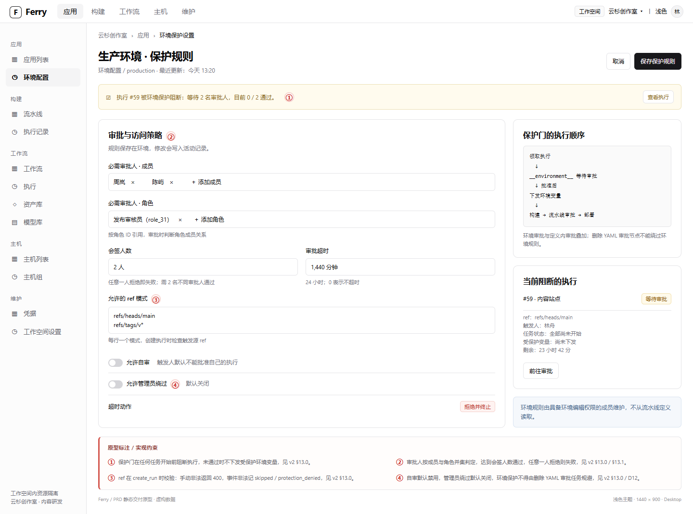

示意图：标注①…④为需求点，其余为示意。①前置门禁/变量→FR-ENV-01；②人员角色并集/会签→02；③ref校验→03；④自审/绕过默认关闭且规则独立→04。

**提示文案**（示例）：「执行正在等待环境审批，受保护变量尚未下发。」「当前引用不符合此环境的准入规则。」「拒绝执行前，请填写意见。」

| 编号 | Given / When / Then |
|---|---|
| AC-ENV-01 | Given 生产环境需2人会签，When 同人重复同意或仅1人同意，Then 不通过；第2个不同资格人同意才下发变量并启动任务；任一拒绝失败且需≤500字意见。（01/02） |
| AC-ENV-02 | Given 不允许ref，When 手动/事件分别进入，Then 分别400和skipped/protection_denied；未启动主机/服务端任务。（03） |
| AC-ENV-03 | Given 自审/管理员绕过默认关闭且删除YAML审批，When 发起者或管理员尝试处理，Then 不能凭默认身份绕过环境规则；显式开启的绕过留审计。（04） |
| AC-ENV-04 | Given 审批引用的角色被删或配置超时自动通过，When 到达处理/超时，Then 前者仍等待且不扩大资格，后者有自动通过记录；0分钟不超时。（02/03） |

<a id="rv-22"></a>

#### 评审补充 22：环境保护（FR-RV-22）

来源：v2 §13.0–§13.1；ADR D12/D15；流水线清单 H；既有规则 FR-ENV-01–04；行为验收 AC-ENV-01–04；数据结构以[数据模型](ferry-工作流平台数据模型.md) §2/§4–§9为准。以下为来源规则的评审投影，标「源未定义，待补」的内容不是已定规则；缺口登记 G-22（§14）。

**模式差异（入口/操作/可编辑范围）**：环境列表→新增/编辑保护分区；查看阻断执行/历史；审批处理独立于编辑规则。（来源：v2 §13.0–§13.1；ADR D12/D15；流水线清单 H；总方案 §5/§7/§8）

**字段与校验**：人员/角色ID；min_approvals 1–10；timeout_minutes 0–43200，默认值未定义待补，0不超时；allow_initiator/管理员绕过默认false；拒绝意见1–500字符；ref完整格式待补。资源名称默认trim后1–60字符（§1c.5），模块显式例外优先；其他字段来源/默认/回填/可编辑条件及未定长度/正则/上下限不从原型推导；未列出的节点/JSON子字段约束为「源未定义，待补」，不将DDL映射宽度当产品限制。（来源：v2 §13.0–§13.1；ADR D12/D15；流水线清单 H；数据模型 §1/§4/§7）

**字段联动与清空**：ref创建时查；变量通过门后发；角色实时；YAML审批叠加；删除引用不放宽资格。已保存/历史引用不得因前端切换静默改写；已知依赖选择重置、旧异步结果和手工草稿按§1c.6；未声明的逐节点依赖/回填来源仍按模块缺口。（来源：v2 §13.0–§13.1；ADR D12/D15；流水线清单 H；总方案 §8；数据模型 §7）

**状态操作矩阵**：状态覆盖 未配置保护、规则编辑、ref拒绝、等待/部分通过、通过、拒绝、超时通过/拒绝。表中“无”指无需额外输入；不把未知的确认输入补成强制输入名称。表外状态的新增操作规则为「源未定义，待补」。（来源：v2 §13.0–§13.1；ADR D12/D15；流水线清单 H；数据模型 §6）

| 状态 | 操作 | 可见/可用条件 | 确认/输入 | 副作用 | 失败反馈/可逆性 |
|---|---|---|---|---|---|
| 规则编辑 | 保存 | 环境编辑权限且范围有效 | 保护规则 | 新规则独立保存并审计 | 字段错误就地，409保本地 |
| 等待/部分通过 | 同意/拒绝/显式绕过 | 实时资格/开关；会签不同人 | 拒绝意见1–500；绕过确认输入待补 | 通过放行；拒绝失败；绕过审计 | 不允许默认绕过 |
| 超时 | 自动通过/拒绝 | timeout>0且配置到期动作 | 系统 | 按动作与审计推进 | 0不触发超时 |

**操作记录（审计事件）**：保护修改/回应/自动通过/绕过；系统by=0；拒绝意见保留脱敏查看。事件身份、details和永久保留遵§1c.1；修改同事务写activity，不记录秘密或输入值。（来源：FR-AUTH-04；v2 §13.0–§13.1；ADR D12/D15；流水线清单 H；数据模型 §2）

**删除与保留**：不新增软删除；保留/物理删除按§1c.2/§1c.3及原资源保护例外。 删除弹窗/物理删除及引用保护按§1c.2，保留期/保护例外按§1c.3；不因缺外键跳过范围校验。（来源：ADR Q12；数据模型 §8.3/§8.4）

**数据模型、时间审计、索引与SQL**：pipeline_contexts.protection、human_tasks/responses、pipeline_run_jobs。本模块新表/存量新增时间按数据模型 §2配每个xx_at同前缀xx_by BIGINT NOT NULL DEFAULT 0；0=system；不回填猜测历史操作者。索引：human_responses_once；环境沿用已有键；图通用人审键待补。SQL证据：数据模型 §8.2尝试读取；完整会签条件写因通用关联缺口待补。（来源：数据模型 §2/§4/§5/§8/§9）

**配置来源表**：按§1c.7对应开发发布/运维重启/平台立即/用户保存发布生效，当前无多语言设置。（来源：v2 §13.0–§13.1；ADR D12/D15；流水线清单 H；总方案 §7/§8；src/components/dsl.ts、ResourceForm.tsx；现状无i18n）：

| 配置项/来源 | 修改主体与频率 | 多语言/枚举 |
|---|---|---|
| 环境编辑者：人员/角色/会签/ref/超时动作/自审绕过；开发：默认false和数值范围；枚举源见模型§6 | 按已授权用户/开发/运维来源修改；生效按§1c.7：开发发布/运维重启/平台立即/用户保存发布，无固定周期 | 业务枚举见数据模型 §6；展示中文硬编码，en-US/ms-MY仍待澄清R01 |
| 原型数据/截图 | 静态示意，非配置中心 | 不得将示例金额/模型/人员或3轮当平台默认 |

**影响与兼容**：本期 P1环境配置/门禁/会签；不做 不以平台管理员默认绕过；环境规则不属于YAML可删除节点；灰度 自审与管理员绕过每环境显式开启，默认关闭；无feature flag。核心流程：环境编辑保存保护→ref准入→前置门→会签→通过下发变量；拒绝/超时按策略终止。异常：角色删除资格为空继续等待；同人重复票无效；非法ref拒绝；0分钟无限。历史up/down：数据模型 §5.2第7/8项：NULL原行为，不删旧requires_approval；旧版无门禁不能直接回退；共用回退边界见§1b。三方：无新增三方；通知卡片可选。版本兼容：重跑重新门禁/审批，不复用保护结论；旧审批过渡待补。计算：不同人数会签1–10；超时0–43200分钟；税/库存/折扣不适用。（来源：v2 §13.0–§13.1；ADR D12/D15；流水线清单 H；数据模型 §5.2；NFR-COMP-01–03）

**文案表**（zh-CN来自原PRD提示/必需文案、v3、共享组件或RESPONSIVE中的原文；不据此引入i18n。en-US/ms-MY统一仍待澄清R01（§1c.9））：

| 场景/文案键（评审标识） | zh-CN | en-US | ms-MY | ms-MY 长度预留 |
|---|---|---|---|---|
| ENV.key | 拒绝执行前，请填写意见。 | 仍待澄清 R01 | 仍待澄清 R01 | 允许比zh-CN长≥40%；换行/区域滚动保持完整操作，不代表已有翻译 |

**验收追踪与响应式交付**：FR-ENV-01–04 → AC-ENV-01–04 / AC-RV-22 → 下表测试规格。规则对应原型编号；异常按§6.16文字，无独立截图，正常业务专属屏缺口仍逐项列出（§1c.8）；无Figma，Figma screen/variant不适用（当前交付为HTML+PNG），不能声称Figma覆盖。D=1440×900、P=768×1024、M=390×844，full-page PNG可高于视口；断点/键盘/Phone只读图规则见[RESPONSIVE.md](prototypes/RESPONSIVE.md)。

| Desktop / Pad / Phone截图 | 编号与覆盖边界 |
|---|---|
| [Desktop](images/14-environment-protection.png) / [Pad](images/pad/14-environment-protection.png) / [Phone](images/phone/14-environment-protection.png) | ①②③④：全保护配置及阻断执行；异常/权限视觉按§6.16文字，无独立截图；长文本按RESPONSIVE验收，语言variant仍待澄清R01（§1c.8）；HTML为prototypes/14-environment-protection.html |

| 规则→AC | 测试用例（规格，未执行） | Given / When / Then | 设计/状态证据 |
|---|---|---|---|
| FR-RV-22 → AC-RV-22 | TC-RV-22-01 | Given 本期有权用户与有效配置，When 按本功能闭环操作，Then 环境编辑保存保护→ref准入→前置门→会签→通过下发变量；拒绝/超时按策略终止 | 14-environment-protection.png ①②③④；其余状态待补 |
| FR-ENV-01–04 → AC-RV-22 | TC-RV-22-02 | Given 本功能异常或边界输入，When 执行对应操作，Then 角色删除资格为空继续等待；同人重复票无效；非法ref拒绝；0分钟无限 | 异常视觉交互见§6.16文字，无独立截图，不代表已实测（§1c.8） |
| FR-AUTH-01–05 → AC-RV-22 | TC-RV-22-03 | Given 跨空间/无权成员或失效公开令牌，When 绕过界面直接请求，Then 拒绝且不产生本次业务副作用；公开者不获得后台权限 | 权限拒绝专属状态待补 |
| 数据模型 §5.2 → AC-RV-22 | TC-RV-22-04 | Given 升级前历史夹具与新状态，When 按迁移方案up/人工回退评审，Then 数据模型 §5.2第7/8项：NULL原行为，不删旧requires_approval；旧版无门禁不能直接回退 | 后端迁移规格，无Figma/截图适用 |
| §1b/RESPONSIVE → AC-RV-22 | TC-RV-22-05 | Given 三布局与中文及长度≥140%的排版占位文本，When 查看本功能操作与错误，Then 核心字段/按钮不被遮挡；Phone图只读、区域内滚动；翻译内容未验收 | 三端基础PNG+callout见上表；异常按§6.16文字，无独立截图；语言variant仍待澄清R01（§1c.8） |

AC-RV-22：本功能已定规则按上述测试规格及既有AC验收；G-22列出的来源缺口须补来源/设计后才可认定对应能力验收通过。本次为需求文档审查，不声称运行测试、迁移或真实三方通过。（来源：用户评审清单；§10；v2 §13.0–§13.1；ADR D12/D15；流水线清单 H）

### 6.16 关键页面状态与恢复

下表是 §6 共享状态规则在专用页面的具体要求，随对应页面交付；文字、操作和输入保留均须验收。来源：总方案 §7–§8；v3 §9.2–§9.6、§18.7/§18.14；ADR Q08/Q09。公开结果只展示本次请求允许访问的数据，不新增后台匿名访问权限。

| 页面/状态 | 显示内容 | 可用操作 | 是否保留输入 | 恢复方式与验收关联 |
|---|---|---|---|---|
| 编辑画布首次加载失败或刷新失败 | 明确显示加载失败原因；不得将失败显示为可保存的空图；已有画布标明尚未刷新 | 重试、返回列表；未载入定义时禁用保存/发布/运行 | 刷新失败保留本地未保存修改，重试不得自动覆盖；首次失败无可恢复图时明确说明 | 重新加载成功后核对版本，有冲突按409规则处理；AC-UI-01 |
| 执行详情无节点数据 | 区分尚未运行、未保存及按策略清理，保留执行状态、版本和可用日志；不显示伪成功或伪空输出 | 刷新、查看历史定义/可用日志；已清理时只可在授权后全部重跑 | 筛选/轮次选择保留；不存在的数据不伪造 | 临时读取失败可重试；已清理不可恢复原中间数据；AC-RUN-03、AC-UI-02 |
| 人工任务已被他人处理 | 显示最新处理状态及可见结果，明确本次提交未受理 | 查看结果、复制未提交文本、返回待办；关闭提交/退回入口 | 保留本地未提交文本可复制；不得覆盖先受理的回应 | 刷新任务状态后转只读，不能二次唤醒；AC-HUM-13 |
| 公开表单提交成功但执行仍等待 | 显示提交已受理、执行编号、等待原因及受限结果入口 | 查看/刷新本次结果；不重复发送已受理请求 | 保留本次提交摘要及仍有效的上传引用供确认，提交按钮不再重复提交同一请求 | 结果入口从等待更新至终态；AC-PUBLIC-08 |
| 公开表单执行成功 | 显示成功及本次获准的结果/下载；不显示后台菜单 | 查看/下载获准结果，按表单入口开始新提交 | 本次摘要可查，新提交明确为新请求 | 用本次受限结果入口访问结果；AC-PUBLIC-08 |
| 公开表单提交失败或受理后执行失败 | 区分校验/网络/上传错误与已受理执行失败；后者显示执行编号及允许公开的失败原因 | 未受理可修改后重试；已受理可刷新结果或显式开始新提交，不暗中重投原执行 | 文本与仍有效的上传引用保留；失效文件明确要求重选 | 字段修正或网络恢复后重试；执行失败不冒充可继续成功，保留受限结果入口；AC-PUBLIC-09、AC-UI-03 |
| 资产库/模型库为空 | 区分尚无资源与筛选无匹配，模型库说明需登记/同步，不能显示假模型或假资产 | 有权者上传资产/登记模型或同步；其他成员只可清空过滤/刷新 | 保留筛选；无创建权限者不显示创建操作 | 创建或同步成功后刷新；上传/下载失败显示原因并可重试；AC-UI-04 |

| 编号 | Given / When / Then |
|---|---|
| AC-UI-01 | Given 画布首次载入失败或有未保存修改时刷新失败，When 页面呈现错误并重试，Then 显示原因及重试入口，不将失败当空图保存；已有本地修改保留，恢复后版本冲突按409规则提示。（§6.16，FR-EDIT-13） |
| AC-UI-02 | Given 尚未运行、未保存或已清理节点数据的执行，When 打开详情，Then 分别显示原因且保留执行元数据；清理后只能授权全部重跑，不能展示伪输出或提供可用的局部重跑。（§6.16，FR-RUN-10） |
| AC-UI-03 | Given 公开请求已受理后执行失败，When 查看结果或刷新，Then 显示执行编号和允许公开的失败原因，不自动创建第二次执行；原输入摘要可查，新提交必须由用户明确发起。（§6.16，FR-PUBLIC-01） |
| AC-UI-04 | Given 资产或模型库为空、有过滤无匹配、或用户只读，When 打开列表，Then 分别显示对应空态及清空过滤/刷新入口，上传/登记/同步仅有权者可见，恢复后出现真实资源。（§6.16，FR-ASSET-01/FR-GPU-01/FR-AUTH-01） |

<a id="rv-23"></a>

#### 评审补充 23：页面状态与恢复（FR-RV-23）

来源：总方案 §7–§8；v3 §9.2–§9.6、§18.7/18.14；ADR Q08/Q09；既有规则 FR-EDIT-13；FR-RUN-10；FR-PUBLIC-01；FR-AUTH-01；行为验收 AC-UI-01–04；AC-HUM-13；AC-PUBLIC-08/09；数据结构以[数据模型](ferry-工作流平台数据模型.md) §2/§4–§9为准。以下为来源规则的评审投影，标「源未定义，待补」的内容不是已定规则；缺口登记 G-23（§14）。

**模式差异（入口/操作/可编辑范围）**：列表空库/无匹配分开；新增/编辑保本地稿；查看历史区分已清理；已处理任务只读复制；公开结果受限。（来源：总方案 §7–§8；v3 §9.2–§9.6、§18.7/18.14；ADR Q08/Q09；总方案 §5/§7/§8）

**字段与校验**：输入/过滤/轮次保留；失效文件重选；已清理不造输出；读取失败不能保存空图；新字段长度无新增。资源名称默认trim后1–60字符（§1c.5），模块显式例外优先；其他字段来源/默认/回填/可编辑条件及未定长度/正则/上下限不从原型推导；未列出的节点/JSON子字段约束为「源未定义，待补」，不将DDL映射宽度当产品限制。（来源：总方案 §7–§8；v3 §9.2–§9.6、§18.7/18.14；ADR Q08/Q09；数据模型 §1/§4/§7）

**字段联动与清空**：失败恢复后核对版本；任务已处理禁提交但留本地文本；成功受理后按钮不重复发请求。已保存/历史引用不得因前端切换静默改写；已知依赖选择重置、旧异步结果和手工草稿按§1c.6；未声明的逐节点依赖/回填来源仍按模块缺口。（来源：总方案 §7–§8；v3 §9.2–§9.6、§18.7/18.14；ADR Q08/Q09；总方案 §8；数据模型 §7）

**状态操作矩阵**：状态覆盖 loading、空库、无匹配、错误、无权、409、未运行/未保存/已清理、已处理、公开等待/成功/失败。表中“无”指无需额外输入；不把未知的确认输入补成强制输入名称。表外状态的新增操作规则为「源未定义，待补」。（来源：总方案 §7–§8；v3 §9.2–§9.6、§18.7/18.14；ADR Q08/Q09；数据模型 §6）

| 状态 | 操作 | 可见/可用条件 | 确认/输入 | 副作用 | 失败反馈/可逆性 |
|---|---|---|---|---|---|
| 首次载入失败 | 重试/返回 | 可见；保存/发布/运行禁用 | 无 | 加载成功后核对版本 | 不能空图保存 |
| 刷新失败/409 | 重试/复制本地稿 | 保留本地修改 | 覆盖/合并具体交互源未定义，待补 | 不自动覆盖本地稿 | 版本冲突整句提示 |
| 已处理任务/已清理输出 | 查看/复制/全部重跑 | 任务禁再次提交；清理后仅授权全部重跑 | 新执行选择 | 历史元信息保留 | 不提供假局部重跑 |
| 公开受理后失败 | 刷新结果/显式新提交 | 限本次受限入口 | 新提交明确新请求 | 不自动重投 | 保摘要/有效引用 |

**操作记录（审计事件）**：状态渲染无新增审计；重试导致的实际提交/新执行按所属模块事件；不能伪造已受理记录。事件身份、details和永久保留遵§1c.1；修改同事务写activity，不记录秘密或输入值。（来源：FR-AUTH-04；总方案 §7–§8；v3 §9.2–§9.6、§18.7/18.14；ADR Q08/Q09；数据模型 §2）

**删除与保留**：无独立删除入口；关联资源删除沿本模块引用的原资源规则。 删除弹窗/物理删除及引用保护按§1c.2，保留期/保护例外按§1c.3；不因缺外键跳过范围校验。（来源：ADR Q12；数据模型 §8.3/§8.4）

**数据模型、时间审计、索引与SQL**：无新增状态页表；依原执行/任务/资产/模型表。无独立新增时间字段；原资源按数据模型 §2配每个xx_at同前缀xx_by BIGINT NOT NULL DEFAULT 0；0=system；不回填猜测历史操作者。索引：无（复用原资源查询索引）。SQL证据：无独立SQL；读取证据见数据模型 §8.2/8.3。（来源：数据模型 §2/§4/§5/§8/§9）

**配置来源表**：按§1c.7对应开发发布/运维重启/平台立即/用户保存发布生效，当前无多语言设置。（来源：总方案 §7–§8；v3 §9.2–§9.6、§18.7/18.14；ADR Q08/Q09；总方案 §7/§8；src/components/dsl.ts、ResourceForm.tsx；现状无i18n）：

| 配置项/来源 | 修改主体与频率 | 多语言/枚举 |
|---|---|---|
| 开发：状态视图/中文整句；用户：保留的本地输入与URL过滤；不新增状态配置中心 | 按已授权用户/开发/运维来源修改；生效按§1c.7：开发发布/运维重启/平台立即/用户保存发布，无固定周期 | 业务枚举见数据模型 §6；展示中文硬编码，en-US/ms-MY仍待澄清R01 |
| 原型数据/截图 | 静态示意，非配置中心 | 不得将示例金额/模型/人员或3轮当平台默认 |

**影响与兼容**：本期 随页面交付加载/空态/错误/并发/恢复；不做 不把错误当空图/伪成功；不在受理后自动创建第二执行；灰度 无。核心流程：首次加载/刷新→状态区分→保留本地输入→显示错误/有效历史→显式重试→核对版本→恢复或只读。异常：编辑失败、409、节点未运行/未保存/已清理、任务竞争、公开受理后失败、资产/模型空库。历史up/down：无独立迁移；数据清理/旧状态识别依数据模型 §5.2/§6；共用回退边界见§1b。三方：无额外三方；读取依所属资源。版本兼容：共享错误/空态/409规则，HTML静态按钮不当后端实现。计算：不适用（页面状态无独立计算；税/库存/折扣不适用）。（来源：总方案 §7–§8；v3 §9.2–§9.6、§18.7/18.14；ADR Q08/Q09；数据模型 §5.2；NFR-COMP-01–03）

**文案表**（zh-CN来自原PRD提示/必需文案、v3、共享组件或RESPONSIVE中的原文；不据此引入i18n。en-US/ms-MY统一仍待澄清R01（§1c.9））：

| 场景/文案键（评审标识） | zh-CN | en-US | ms-MY | ms-MY 长度预留 |
|---|---|---|---|---|
| UI.key | 这条记录已被他人修改，请刷新后重试 | 仍待澄清 R01 | 仍待澄清 R01 | 允许比zh-CN长≥40%；换行/区域滚动保持完整操作，不代表已有翻译 |

**验收追踪与响应式交付**：FR-EDIT-13；FR-RUN-10；FR-PUBLIC-01；FR-AUTH-01 → AC-UI-01–04；AC-HUM-13；AC-PUBLIC-08/09 / AC-RV-23 → 下表测试规格。规则对应原型编号；异常按§6.16文字，无独立截图，正常业务专属屏缺口仍逐项列出（§1c.8）；无Figma，Figma screen/variant不适用（当前交付为HTML+PNG），不能声称Figma覆盖。D=1440×900、P=768×1024、M=390×844，full-page PNG可高于视口；断点/键盘/Phone只读图规则见[RESPONSIVE.md](prototypes/RESPONSIVE.md)。

| Desktop / Pad / Phone截图 | 编号与覆盖边界 |
|---|---|
| [Desktop](images/04-problems-panel.png) / [Pad](images/pad/04-problems-panel.png) / [Phone](images/phone/04-problems-panel.png) | ①②③④：仅校验错误；异常/权限视觉按§6.16文字，无独立截图；长文本按RESPONSIVE验收，语言variant仍待澄清R01（§1c.8）；HTML为prototypes/04-problems-panel.html |
| [Desktop](images/06-executions-queue.png) / [Pad](images/pad/06-executions-queue.png) / [Phone](images/phone/06-executions-queue.png) | ③④：等待；异常/权限视觉按§6.16文字，无独立截图；长文本按RESPONSIVE验收，语言variant仍待澄清R01（§1c.8）；HTML为prototypes/06-executions-queue.html |
| [Desktop](images/11-public-form.png) / [Pad](images/pad/11-public-form.png) / [Phone](images/phone/11-public-form.png) | ②③：上传/限频；其他异常态待补；异常/权限视觉按§6.16文字，无独立截图；长文本按RESPONSIVE验收，语言variant仍待澄清R01（§1c.8）；HTML为prototypes/11-public-form.html |

| 规则→AC | 测试用例（规格，未执行） | Given / When / Then | 设计/状态证据 |
|---|---|---|---|
| FR-RV-23 → AC-RV-23 | TC-RV-23-01 | Given 本期有权用户与有效配置，When 按本功能闭环操作，Then 首次加载/刷新→状态区分→保留本地输入→显示错误/有效历史→显式重试→核对版本→恢复或只读 | 04-problems-panel.png ①②③④；其余状态待补 |
| FR-EDIT-13；FR-RUN-10；FR-PUBLIC-01；FR-AUTH-01 → AC-RV-23 | TC-RV-23-02 | Given 本功能异常或边界输入，When 执行对应操作，Then 编辑失败、409、节点未运行/未保存/已清理、任务竞争、公开受理后失败、资产/模型空库 | 异常视觉交互见§6.16文字，无独立截图，不代表已实测（§1c.8） |
| FR-AUTH-01–05 → AC-RV-23 | TC-RV-23-03 | Given 跨空间/无权成员或失效公开令牌，When 绕过界面直接请求，Then 拒绝且不产生本次业务副作用；公开者不获得后台权限 | 权限拒绝专属状态待补 |
| 数据模型 §5.2 → AC-RV-23 | TC-RV-23-04 | Given 升级前历史夹具与新状态，When 按迁移方案up/人工回退评审，Then 无独立迁移；数据清理/旧状态识别依数据模型 §5.2/§6 | 后端迁移规格，无Figma/截图适用 |
| §1b/RESPONSIVE → AC-RV-23 | TC-RV-23-05 | Given 三布局与中文及长度≥140%的排版占位文本，When 查看本功能操作与错误，Then 核心字段/按钮不被遮挡；Phone图只读、区域内滚动；翻译内容未验收 | 三端基础PNG+callout见上表；异常按§6.16文字，无独立截图；语言variant仍待澄清R01（§1c.8） |

AC-RV-23：本功能已定规则按上述测试规格及既有AC验收；G-23列出的来源缺口须补来源/设计后才可认定对应能力验收通过。本次为需求文档审查，不声称运行测试、迁移或真实三方通过。（来源：用户评审清单；§10；总方案 §7–§8；v3 §9.2–§9.6、§18.7/18.14；ADR Q08/Q09）

### 6.17 平台能力补充与清单追溯（PLAT）

本节核对能力清单 A、E 的全部平台行，补齐仅有整类引用、没有具体行为的条目；完整节点目录仍按 §6.4 验收。表内来源只说明需求依据，不表示对标功能或 Ferry 已验证。A039、E013 等证据缺口仍受 FR-NODE-06 约束，补测不能以入口截图代替行为证据。

| 编号 | 需求 | 规则与边界 | 分期 | 来源 |
|---|---|---|---|---|
| FR-PLAT-01 | 画布导航、布局与外观辅助 | 提供小地图、命令面板、聚焦选择、自动排版、带快捷键提示的右键菜单与设置入口。组移动包含组内节点，可添加便签、重命名节点与组；中转点只改变布线，节点固定、折叠及颜色只改变展示，不改变依赖、固定数据或执行结果。 | S1 | v3 §9.1–§9.2；能力清单 A001–A003、E001/E005/E006/E011/E031 |
| FR-PLAT-02 | 参数变化后标记下游结果过期 | 修改节点配置后，将受影响的该节点及下游已有结果标为过期，保留旧结果及来源供查看，不把旧成功状态当成新配置的有效输出；重新执行成功后更新对应标记，无关分支保持有效。 | S1 | v3 §9.2；能力清单 A009 |
| FR-PLAT-03 | 分类搜索节点及选择手动触发器 | 节点库按类别与输入/输出类型过滤，双击画布可搜索；同一图有多个可手动触发入口时，运行前明确选择入口，不默认同时触发所有入口；执行到所选节点只运行其必要上游闭包。 | S1 | v3 §5.2、§6.6、§9.2；能力清单 A004/A010、E002/E022 |
| FR-PLAT-04 | 实时日志树与进度 | 底部日志树按节点/轮次展示状态、条目数、耗时，点击可定位输入输出及日志；运行时更新节点及整体进度，浏览器标题显示进度，结束后显示真实终态；成本在 S2 加入，不用缺价0元占位。 | S1；成本 S2 | v3 §9.2–§9.3、§12.2；能力清单 A011、E016/E025 |
| FR-PLAT-05 | 执行标注可写入并检索 | 节点可为当前执行写入 key/value 自定义标注，列表按标注和注释筛选；写入、读取与筛选均受当前工作空间及执行权限约束。 | S1 | v3 §18.3；能力清单 A015 |
| FR-PLAT-06 | 工作流设置可保存并实际生效 | 共享设置表单配置错误工作流、时区、超时及成功/失败/手动执行数据保存策略；运行使用所选版本设置，保存策略清理不覆盖不可变定义；关闭保存时提示局部重跑受限。 | S1 | v3 §6.1、§18.7、§18.13–§18.14；能力清单 A016 |
| FR-PLAT-07 | 通用凭据与 OAuth2 接入工作流 | 复用既有凭据资源、凭据槽及空间隔离，支持 OAuth2 授权配置、回调和失效反馈；授权失败不得标为连接成功，令牌不能进入条目、日志或定义导出。具体集成的 OAuth2 必须逐成员验证。 | S0 通用凭据 | v3 §7.5、§14；能力清单 A025 |
| FR-PLAT-08 | 工作空间变量接入图执行 | 复用已有工作空间变量资源，执行只读取当前空间授权的普通变量；敏感变量仍按凭据/密钥注入规则处理，不借变量入口让表达式读取 secrets 或 $env。 | S0 接入；表达式 S1 | v3 §6.4、§11；能力清单 A026 |
| FR-PLAT-09 | 自有模板、工作流侧栏与导入导出 | 提供工作流/模板侧栏及 Ferry 自有图格式导入导出；导入先校验 schema、节点版本和绑定，失败说明具体问题且不覆盖当前草稿；导出剥离密钥，固定数据按安全策略处理。不导入 n8n/ComfyUI 格式，四类官方场景模板在 S5 验收。 | S1；官方场景模板 S5 | v3 §5.1、§9.1、§15、§18.14；能力清单 A032、E029/E030 |
| FR-PLAT-10 | MCP 工具服务与客户端 | 可将授权工作流暴露为 MCP 工具，Agent 可调用配置的 MCP 服务；工具输入按声明校验，调用仍受执行身份及子工作流准入约束，不能因工具入口获得额外权限。 | S2 | v3 §7.4、§18.6；能力清单 A033 |
| FR-PLAT-11 | 数据集评测与版本比较 | 使用数据表选择评测样本，按评测运行模式逐行执行并记录规则/LLM评分，按版本对比已完成样本；失败或未运行样本必须明确标注，不能算作通过。 | S2 | v3 §18.3；能力清单 A034 |
| FR-PLAT-12 | 执行事件外送 | 可配置 Webhook 或 OTLP 目的地外送执行事件，展示投递状态及错误；外送内容经过与展示/导出相同的脱敏，权限及出站限制仍适用，不外送密钥或令牌明文。 | S5 | v3 §18.3、§18.14；能力清单 A035 |
| FR-PLAT-13 | 凭据引用外部密钥库 | 凭据可引用 Vault/云 KMS 等外部密钥库，执行时取值，通过凭据槽传给节点；定义仅存引用。读取失败时节点给出脱敏错误并拒绝使用该凭据调用目标服务，不以空值或旧明文静默替代。 | S5 | v3 §18.3；能力清单 A036 |
| FR-PLAT-14 | 工作流 Git 同步 | 工作流定义可与配置的 Git 来源同步并查看差异，拉取修改先进入草稿及校验，不隐式发布或切换生产身份；冲突可定位处理，失败保留现有定义。 | S5 | v3 §15；能力清单 A037 |
| FR-PLAT-15 | 自有扩展规范与 SDK | 按 Ferry 声明式规范及 WASM/主机扩展契约接入自定义节点，声明输入输出、版本及运行位置并接受同样的权限校验；不加载 n8n npm/custom-node 或 ComfyUI 插件。 | S2 规范；S5 SDK | v3 §7.1、§18.3；能力清单 A038；ADR V12 |
| FR-PLAT-16 | AI 辅助编排按自有图规范生成草稿 | 由 LLM/Agent 生成或修改 Ferry 图草稿，用户可查看变更并编辑；输出须经 schema、节点及权限/绑定检查，不因生成成功直接发布或执行。入口存在不等于能力已验证，覆盖声明必须附生成/修改图的行为证据。 | S5 | v3 §15；能力清单 A039 |
| FR-PLAT-17 | 图 schema 与节点版本兼容检查 | 导入、打开及升级时检查 Ferry 图 schema/type_version；不支持版本显示具体错误，不静默丢字段或执行，节点升级先提示影响并确认；不输出第三方产品迁移报告。 | S1 | v3 §6.1、§7.1、§9.1；能力清单 A040 |
| FR-PLAT-18 | 组件端口与版本升级 | S3 可保存内联组件、声明组件端口并用面包屑进入/返回子图；组件可含 GPU 内部类型，仍受运行段类型约束。S5 版本引用组件批量升级先展示影响范围，经确认后更新，不自动修改已发布版本。 | S3 内联；S5 版本升级 | v3 §9.2、§18.2–§18.4；能力清单 E007/E008/E009 |
| FR-PLAT-19 | 批次入队与队首操作 | 按用户设置的批次数创建可区分的排队项；有相应操作权限者可请求插入队首，服务端验证资格并展示生效优先级，不能抢占已运行节点或突破并发限制；具体授权与优先级按能力清单要求在交付时演示。 | S3 | v3 §2.3、§5.3；能力清单 E014/E015 |
| FR-PLAT-20 | 历史精确参数与媒体输入 | 从历史「以本次定义打开」读取当时定义与精确参数，不替换为最新草稿；S3 媒体参数控件支持上传、粘贴及从资产库选择图像，绑定均可追溯到资产，保存遮罩仍创建新资产。 | S1 历史定义；S3 媒体/历史参数 | v3 §9.3、§18.4；能力清单 E027/E034 |
| FR-LIST-06 | 工作流收藏、标签与描述 | S1 列表可收藏/取消收藏工作流，编辑描述与标签并按标签/收藏筛选；收藏不授予对象权限，被撤权对象不因已收藏继续可见；流水线 P2 收藏独立分期。 | S1 | v3 §18.3；能力清单 A030 |

| 编号 | Given / When / Then |
|---|---|
| AC-PLAT-01 | Given 大图与选中节点，When 从小地图移动视口、命令面板聚焦节点或执行自动排版，Then 视口/布局发生对应变化、依赖不变，右键菜单有快捷键提示；移动组包含内部节点，固定/折叠/颜色/中转点不改变执行结果。（01） |
| AC-PLAT-02 | Given A→B 与独立分支 C 均有成功结果，When 修改 A 参数，Then A/B显示过期且旧输出仍可查，C保持有效；按新配置重算成功后才清除对应过期标记。（02） |
| AC-PLAT-03 | Given 有多个手动入口的图，When 按类型搜索并选其中一个触发入口运行，Then 只从所选入口开始；执行到目标节点时仅运行目标必要上游闭包，不运行无关分支。（03） |
| AC-PLAT-04 | Given 含循环的运行中执行，When 打开日志树并点击某轮节点，Then 定位对应输入输出/日志，节点/整体/标题进度随事件更新，完成或取消后显示真实终态；无价成本不显示0元。（04） |
| AC-PLAT-05 | Given 节点写入标注 topic=novel，When 列表按该标注筛选，Then 找到该执行且总数正确，另一空间及无查看权账号不能搜索到该记录。（05） |
| AC-PLAT-06 | Given 配置错误工作流、超时、时区和不保存成功数据，When 发布并分别触发失败、超时和成功执行，Then 各设置按发布版生效，成功数据清理后不可局部重跑且原因可见，定义版本仍可读。（06） |
| AC-PLAT-07 | Given OAuth2凭据配置，When 合法授权回调或授权失败/失效，Then 前者可经槽位使用，后者显示脱敏错误且不冒充连接成功；另一空间无法引用，日志和导出无令牌明文。（07） |
| AC-PLAT-08 | Given 两空间同名普通变量及敏感变量，When 执行图读取变量，Then 只读取当前空间普通值，不能经表达式取 secrets/$env 或另一空间值。（08） |
| AC-PLAT-09 | Given Ferry自有图模板，When 导出再导入有效图，Then 保留可支持的节点/连线并提示需要重新绑定的资源，无密钥明文；不支持格式或校验失败时说明具体原因且不覆盖现有草稿。（09/17） |
| AC-PLAT-10 | Given 已授权工作流工具与 MCP 服务，When Agent 合法调用，Then 按声明参数和继承身份运行；无权或违反被调用方策略的直接工具请求被拒绝，不执行目标节点。（10） |
| AC-PLAT-11 | Given 同一评测数据集及两个版本，When 运行规则/LLM评分并比较，Then 每个样本关联版本、执行和评分，失败/未运行项单列、不计通过，结果不混作生产成功率。（11） |
| AC-PLAT-12 | Given Webhook/OTLP外送配置，When 执行产生事件并分别投递成功和失败，Then 目的地可核对脱敏事件，界面有实际投递状态及错误，事件不含凭据/token明文。（12） |
| AC-PLAT-13 | Given 凭据引用外部密钥库，When 执行时取值成功或被拒绝/不可用，Then 前者通过槽位调用目标且定义/日志不含明文；后者显示脱敏原因、目标服务调用数为0，不回退空值或旧明文。（13） |
| AC-PLAT-14 | Given 已发布图与 Git 新版本，When 同步拉取或产生冲突，Then 新变更只进入草稿并可比较，冲突/失败保留原定义，生产版本与身份不自动变化。（14） |
| AC-PLAT-15 | Given 按 Ferry SDK/声明规范构建的扩展节点，When 注册并在授权位置运行，Then 按声明类型收发条目、记录版本并受权限校验；不支持的第三方插件包不能冒充可执行扩展。（15） |
| AC-PLAT-16 | Given AI辅助编排输入，When 生成或修改图，Then 产物是可审阅的 Ferry 草稿且差异可见；不合法 schema/节点/绑定被定位，未确认不发布、不执行，覆盖声明附实际行为证据。（16） |
| AC-PLAT-17 | Given 不支持的图 schema 或节点版本，When 打开/导入/升级，Then 明确指出版本问题、不静默执行或丢字段；支持的节点升级需确认，拒绝确认不改版本。（17） |
| AC-PLAT-18 | Given 含输入/输出端口的组件，When 保存并进入/返回子图，Then 端口和面包屑可用、保存定义内联；S5批量升级先显示所有受影响引用，确认前不更新，已发布不可变版本不被覆盖。（18） |
| AC-PLAT-19 | Given 批次数3且存在排队项，When 批量入队并由有权用户请求队首，Then 生成3个可区分项、队首位置与生效优先级可见，不抢占运行节点且仍受并发限制；无权直接请求被拒绝。（19） |
| AC-PLAT-20 | Given 历史执行参数 A 而当前草稿为 B，When 以本次定义打开并在S3上传/粘贴/选择图像，Then 打开 A，图像均成为可追溯资产引用，修改不覆盖历史A；新遮罩不覆盖来源资产。（20） |
| AC-LIST-05 | Given 有查看/编辑权的工作流，When 收藏、填写描述/标签并按收藏或标签筛选，Then 重进列表仍可查到相应结果；取消收藏后不再匹配收藏筛选；撤销查看权后该收藏对象与总数均不可见。（FR-LIST-06） |

能力清单编号 → FR → AC → 分期（A、E 平台行全量核对；一行内不同能力按所列分期分别验收）：

| 能力清单编号 | FR | AC | 分期 |
|---|---|---|---|
| A001 | FR-EDIT-13、FR-PLAT-01 | AC-PLAT-01 | S1 |
| A002 | FR-PLAT-01、FR-EDIT-08 | AC-PLAT-01、AC-EDIT-02 | S1 |
| A003 | FR-PLAT-01 | AC-PLAT-01 | S1 |
| A004 | FR-PLAT-03、FR-NODE-01 | AC-PLAT-03、AC-NODE-01 | S1 |
| A005 | FR-EDIT-06 | AC-EDIT-03、AC-UI-02 | S1 |
| A006 | FR-EDIT-07 | AC-EDIT-03 | S1 |
| A007 | FR-EDIT-08、FR-RUN-07 | AC-EDIT-02、AC-RUN-06 | S1 |
| A008 | FR-EDIT-08 | AC-EDIT-02 | S1 |
| A009 | FR-PLAT-02 | AC-PLAT-02 | S1 |
| A010 | FR-PLAT-03、FR-EDIT-05、FR-RUN-07 | AC-PLAT-03、AC-RUN-06 | S1 |
| A011 | FR-PLAT-04 | AC-PLAT-04 | S1；成本 S2 |
| A012 | FR-RUN-12、FR-EDIT-13 | AC-RUN-14、AC-PLAT-04 | S1 |
| A013 | FR-RUN-02/03 | AC-RUN-02/03 | S1；按轮次媒体 S3 |
| A014 | FR-RUN-05、FR-VER-01 | AC-RUN-05、AC-VER-01 | S1 |
| A015 | FR-PLAT-05、FR-RUN-05 | AC-PLAT-05 | S1 |
| A016 | FR-PLAT-06、FR-RUN-10 | AC-PLAT-06、AC-RUN-03 | S1 |
| A017 | FR-VER-01/02/03 | AC-VER-01/03/05 | S0 |
| A018 | FR-VER-01 | AC-VER-01 | S0 |
| A019 | FR-TRIG-01、FR-RUN-13 | AC-TRIG-01、AC-RUN-10–13 | S1 |
| A020 | FR-TRIG-02/03/04 | AC-TRIG-02/03 | S1 |
| A021 | FR-TRIG-07 | AC-TRIG-06–10 | S1 |
| A022 | FR-HUM-01、FR-TRIG-05、FR-PUBLIC-01 | AC-HUM-05、AC-PUBLIC-01/08 | S1 |
| A023 | FR-TRIG-05、FR-PUBLIC-06 | AC-TRIG-04、AC-PUBLIC-07 | S2 |
| A024 | FR-RUN-13、FR-VER-03 | AC-RUN-10–13、AC-VER-05 | S1 |
| A025 | FR-PLAT-07 | AC-PLAT-07 | S0 |
| A026 | FR-PLAT-08 | AC-PLAT-08 | S0 接入；S1 表达式 |
| A027 | FR-NODE-02（NFR-CAP-08） | AC-CAP-02/03 | S2 |
| A028 | FR-LIST-01、FR-AUTH-01 | AC-LIST-01、AC-AUTH-01 | S0 基础；S1 组织 |
| A029 | FR-AUTH-02/05 | AC-AUTH-04–06 | P2 |
| A030 | FR-LIST-01/05/06 | AC-LIST-01/03/04/05 | S1 |
| A031 | FR-STAT-01/04、FR-RUN-05 | AC-STAT-01/02/06、AC-RUN-05 | S1 工作流统计；S2 成本 |
| A032 | FR-PLAT-09 | AC-PLAT-09 | S1 |
| A033 | FR-PLAT-10 | AC-PLAT-10 | S2 |
| A034 | FR-PLAT-11 | AC-PLAT-11 | S2 |
| A035 | FR-PLAT-12 | AC-PLAT-12 | S5 |
| A036 | FR-PLAT-13 | AC-PLAT-13 | S5 |
| A037 | FR-PLAT-14 | AC-PLAT-14 | S5 |
| A038 | FR-PLAT-15 | AC-PLAT-15 | S2 规范；S5 SDK |
| A039 | FR-PLAT-16、FR-NODE-06 | AC-PLAT-16、AC-NODE-03 | S5，补测后才标验证 |
| A040 | FR-PLAT-17 | AC-PLAT-17 | S1 |
| E001 | FR-EDIT-13、FR-PLAT-01 | AC-PLAT-01 | S1 |
| E002 | FR-PLAT-03 | AC-PLAT-03 | S1 |
| E003 | FR-EDIT-01 | AC-EDIT-01 | S1 |
| E004 | FR-EDIT-01/04/06 | AC-EDIT-01、AC-NODE-01 | S3 |
| E005 | FR-PLAT-01 | AC-PLAT-01 | S1 |
| E006 | FR-PLAT-01 | AC-PLAT-01 | S1 |
| E007 | FR-PLAT-18 | AC-PLAT-18 | S3 |
| E008 | FR-PLAT-18 | AC-PLAT-18 | S3 |
| E009 | FR-PLAT-18 | AC-PLAT-18 | S5 |
| E010 | FR-EDIT-08 | AC-EDIT-02 | S1 |
| E011 | FR-PLAT-01 | AC-PLAT-01 | S1 |
| E012 | FR-EDIT-05/14 | AC-EDIT-06/07 | S3 |
| E013 | FR-NODE-06、FR-EDIT-05 | AC-NODE-03、AC-EDIT-06 | S3，独立模式差异须补测，入口不算覆盖 |
| E014 | FR-PLAT-19 | AC-PLAT-19 | S3 |
| E015 | FR-PLAT-19 | AC-PLAT-19 | S3 |
| E016 | FR-PLAT-04 | AC-PLAT-04 | S1 |
| E017 | FR-GPU-05 | AC-GPU-03 | S4 |
| E018 | FR-RUN-12 | AC-RUN-14 | S1 |
| E019 | FR-RUN-06/12 | AC-RUN-09/14 | S1 |
| E020 | FR-EDIT-03（NFR-CAP-10） | AC-EDIT-05、AC-CAP-05 | S1 |
| E021 | FR-EDIT-03/14 | AC-EDIT-05/07、AC-HUM-02 | S3 |
| E022 | FR-PLAT-03 | AC-PLAT-03 | S1 |
| E023 | FR-EDIT-15 | AC-EDIT-08–11 | S1；预算 S2；模型 S4 |
| E024 | FR-EDIT-10、FR-GPU-02/04 | AC-GPU-02、AC-EDIT-09/10 | S4 |
| E025 | FR-EDIT-13、FR-PLAT-04 | AC-PLAT-04 | S1 |
| E026 | FR-ASSET-01/03 | AC-ASSET-01/02、AC-UI-04 | S0 基础；S3 媒体 |
| E027 | FR-PLAT-20 | AC-PLAT-20 | S3 |
| E028 | FR-GPU-01/02/03/04 | AC-GPU-01/02 | S4 |
| E029 | FR-PLAT-09 | AC-PLAT-09 | S1 |
| E030 | FR-NODE-05、FR-PLAT-09 | AC-NODE-01、AC-PLAT-09 | S5 |
| E031 | FR-PLAT-01 | AC-PLAT-01 | S1 |
| E032 | FR-PUBLIC-05 | AC-PUBLIC-03/08 | S3 |
| E033 | FR-EDIT-13、FR-PLAT-20 | AC-EDIT-06、AC-PLAT-20 | S3 |
| E034 | FR-PLAT-20 | AC-PLAT-20 | S3 |
| E035 | FR-EDIT-13、FR-PLAT-18 | AC-PLAT-18、AC-EDIT-12 | S3 |
| E036 | FR-EDIT-13/14 | AC-EDIT-05/07/12 | S3 |
| E037 | FR-GPU-05 | AC-GPU-03 | S4 |
| E038 | FR-NODE-05 | AC-NODE-01 | S5 |

<a id="rv-24"></a>

#### 评审补充 24：平台能力补充与清单追溯（FR-RV-24）

来源：v3 §9/§15/§18.2–§18.5；能力清单 A/E；ADR V12/Q15；既有规则 FR-PLAT-01–20；FR-LIST-06；行为验收 AC-PLAT-01–20；AC-LIST-05；数据结构以[数据模型](ferry-工作流平台数据模型.md) §2/§4–§9为准。以下为来源规则的评审投影，标「源未定义，待补」的内容不是已定规则；缺口登记 G-24（§14）。

**模式差异（入口/操作/可编辑范围）**：目录/侧栏列表；新增模板/标注/扩展按分期；编辑参数/设置；历史精确参数只读；组件升级先影响确认。（来源：v3 §9/§15/§18.2–§18.5；能力清单 A/E；ADR V12/Q15；总方案 §5/§7/§8）

**字段与校验**：标注key/value、type_version、组件端口/版本、评测数据集、外送目的地、调用名单；完整字段必填/默认/长度/JSON Schema源未定义，待补；不造通用上限。资源名称默认trim后1–60字符（§1c.5），模块显式例外优先；其他字段来源/默认/回填/可编辑条件及未定长度/正则/上下限不从原型推导；未列出的节点/JSON子字段约束为「源未定义，待补」，不将DDL映射宽度当产品限制。（来源：v3 §9/§15/§18.2–§18.5；能力清单 A/E；ADR V12/Q15；数据模型 §1/§4/§7）

**字段联动与清空**：参数变更仅相关下游过期；组/颜色/中转不改依赖；Git/AI只改草稿；外部密钥仅槽位；组件保存内联。已保存/历史引用不得因前端切换静默改写；已知依赖选择重置、旧异步结果和手工草稿按§1c.6；未声明的逐节点依赖/回填来源仍按模块缺口。（来源：v3 §9/§15/§18.2–§18.5；能力清单 A/E；ADR V12/Q15；总方案 §8；数据模型 §7）

**状态操作矩阵**：状态覆盖 结果有效/过期、导入支持/拒绝、Git无冲突/冲突、评测未运行/成功/失败、扩展未开始/进行/已验证。表中“无”指无需额外输入；不把未知的确认输入补成强制输入名称。表外状态的新增操作规则为「源未定义，待补」。（来源：v3 §9/§15/§18.2–§18.5；能力清单 A/E；ADR V12/Q15；数据模型 §6）

| 状态 | 操作 | 可见/可用条件 | 确认/输入 | 副作用 | 失败反馈/可逆性 |
|---|---|---|---|---|---|
| 可编辑草稿 | 导入/AI生成/Git拉取/组件升级 | 编辑权且schema/绑定支持 | 节点/组件升级影响确认 | 进入草稿不切生产 | 失败保原定义 |
| 结果过期 | 查看/重算 | 查看/执行分别授权 | 执行范围 | 新结果成功才清过期 | 不覆盖旧来源 |
| 队列项 | 队首/批次入队 | 相应资格；确切权限码待补 | 批次数，范围源未定义，待补 | 优先级可见不抢占 | 不突破并发 |
| 外部密钥失败 | 执行调用 | 阻断凭据依赖调用 | 无 | 不退空值/旧明文 | 脱敏错误，目标调用0 |

**操作记录（审计事件）**：配置/同步/扩展注册/组件升级按§1c.1；发布/执行/reveal/风险确认按AUTH。事件身份、details和永久保留遵§1c.1；修改同事务写activity，不记录秘密或输入值。（来源：FR-AUTH-04；v3 §9/§15/§18.2–§18.5；能力清单 A/E；ADR V12/Q15；数据模型 §2）

**删除与保留**：定义先归档后物理删除，归档停生产且保历史，恢复为草稿（ADR Q12）；引用版本/最近50版保护。 删除弹窗/物理删除及引用保护按§1c.2，保留期/保护例外按§1c.3；不因缺外键跳过范围校验。（来源：ADR Q12；数据模型 §8.3/§8.4）

**数据模型、时间审计、索引与SQL**：execution_annotations、data_tables/rows、definition_revisions、图JSON；扩展/组件/同步完整载体待补。本模块新表/存量新增时间按数据模型 §2配每个xx_at同前缀xx_by BIGINT NOT NULL DEFAULT 0；0=system；不回填猜测历史操作者。索引：标注检索/data_rows索引/组件引用键源未定义，待补；不猜value_hash。SQL证据：数据模型 §8.2/8.3已知意图/版本；评测/标注/Git/扩展完整SQL因schema缺口待补。（来源：数据模型 §2/§4/§5/§8/§9）

**配置来源表**：按§1c.7对应开发发布/运维重启/平台立即/用户保存发布生效，当前无多语言设置。（来源：v3 §9/§15/§18.2–§18.5；能力清单 A/E；ADR V12/Q15；总方案 §7/§8；src/components/dsl.ts、ResourceForm.tsx；现状无i18n）：

| 配置项/来源 | 修改主体与频率 | 多语言/枚举 |
|---|---|---|
| 开发/扩展作者：schema/SDK；用户：模板、设置、目的地/同步；运维：外部密钥服务；完整枚举待补 | 按已授权用户/开发/运维来源修改；生效按§1c.7：开发发布/运维重启/平台立即/用户保存发布，无固定周期 | 业务枚举见数据模型 §6；展示中文硬编码，en-US/ms-MY仍待澄清R01 |
| 原型数据/截图 | 静态示意，非配置中心 | 不得将示例金额/模型/人员或3轮当平台默认 |

**影响与兼容**：本期 S1导航/Schema/设置/标注/模板，S2MCP/评测/规范，S3组件/批次，S5同步/外送/密钥库/SDK/AI编排；不做 不嵌第三方代码/插件；不将评测当生产成功；不自动发布AI生成/Git拉取；队首不抢占；灰度 草稿/发布；其他无；证据缺口保持未开始。核心流程：清单行→成员→FR/AC→配置/执行→实际结果→证据状态；生成/同步只进草稿→校验→用户发布。异常：未知版本拒绝；Git冲突保原定义；外部密钥失败零调用；外送脱敏失败可查；过期结果不当有效。历史up/down：数据模型 §5.2第12/14/15项；旧图版本检查；新扩展隔离，不改冻结历史；共用回退边界见§1b。三方：OAuth2/MCP/OTLP/Vault/KMS/Git/LLM与节点服务商按成员验证。版本兼容：type_version检查不静默丢字段；第三方格式不导入；节点版本升级需确认。计算：批次每项独立编号；无抢占；评测未运行/失败不算通过；税/库存/折扣不适用。（来源：v3 §9/§15/§18.2–§18.5；能力清单 A/E；ADR V12/Q15；数据模型 §5.2；NFR-COMP-01–03）

**文案表**（zh-CN来自原PRD提示/必需文案、v3、共享组件或RESPONSIVE中的原文；不据此引入i18n。en-US/ms-MY统一仍待澄清R01（§1c.9））：

| 场景/文案键（评审标识） | zh-CN | en-US | ms-MY | ms-MY 长度预留 |
|---|---|---|---|---|
| PLAT.key | 主机节点以 Runner 的身份执行 | 仍待澄清 R01 | 仍待澄清 R01 | 允许比zh-CN长≥40%；换行/区域滚动保持完整操作，不代表已有翻译 |

**验收追踪与响应式交付**：FR-PLAT-01–20；FR-LIST-06 → AC-PLAT-01–20；AC-LIST-05 / AC-RV-24 → 下表测试规格。规则对应原型编号；异常按§6.16文字，无独立截图，正常业务专属屏缺口仍逐项列出（§1c.8）；无Figma，Figma screen/variant不适用（当前交付为HTML+PNG），不能声称Figma覆盖。D=1440×900、P=768×1024、M=390×844，full-page PNG可高于视口；断点/键盘/Phone只读图规则见[RESPONSIVE.md](prototypes/RESPONSIVE.md)。

| Desktop / Pad / Phone截图 | 编号与覆盖边界 |
|---|---|
| [Desktop](images/02-workflow-editor.png) / [Pad](images/pad/02-workflow-editor.png) / [Phone](images/phone/02-workflow-editor.png) | ①⑤：节点与结果；异常/权限视觉按§6.16文字，无独立截图；长文本按RESPONSIVE验收，语言variant仍待澄清R01（§1c.8）；HTML为prototypes/02-workflow-editor.html |
| [Desktop](images/03-node-detail.png) / [Pad](images/pad/03-node-detail.png) / [Phone](images/phone/03-node-detail.png) | ③④：设置/输出；S2–S5专属屏待补；异常/权限视觉按§6.16文字，无独立截图；长文本按RESPONSIVE验收，语言variant仍待澄清R01（§1c.8）；HTML为prototypes/03-node-detail.html |

| 规则→AC | 测试用例（规格，未执行） | Given / When / Then | 设计/状态证据 |
|---|---|---|---|
| FR-RV-24 → AC-RV-24 | TC-RV-24-01 | Given 本期有权用户与有效配置，When 按本功能闭环操作，Then 清单行→成员→FR/AC→配置/执行→实际结果→证据状态；生成/同步只进草稿→校验→用户发布 | 02-workflow-editor.png ①⑤；其余状态待补 |
| FR-PLAT-01–20；FR-LIST-06 → AC-RV-24 | TC-RV-24-02 | Given 本功能异常或边界输入，When 执行对应操作，Then 未知版本拒绝；Git冲突保原定义；外部密钥失败零调用；外送脱敏失败可查；过期结果不当有效 | 异常视觉交互见§6.16文字，无独立截图，不代表已实测（§1c.8） |
| FR-AUTH-01–05 → AC-RV-24 | TC-RV-24-03 | Given 跨空间/无权成员或失效公开令牌，When 绕过界面直接请求，Then 拒绝且不产生本次业务副作用；公开者不获得后台权限 | 权限拒绝专属状态待补 |
| 数据模型 §5.2 → AC-RV-24 | TC-RV-24-04 | Given 升级前历史夹具与新状态，When 按迁移方案up/人工回退评审，Then 数据模型 §5.2第12/14/15项；旧图版本检查；新扩展隔离，不改冻结历史 | 后端迁移规格，无Figma/截图适用 |
| §1b/RESPONSIVE → AC-RV-24 | TC-RV-24-05 | Given 三布局与中文及长度≥140%的排版占位文本，When 查看本功能操作与错误，Then 核心字段/按钮不被遮挡；Phone图只读、区域内滚动；翻译内容未验收 | 三端基础PNG+callout见上表；异常按§6.16文字，无独立截图；语言variant仍待澄清R01（§1c.8） |

AC-RV-24：本功能已定规则按上述测试规格及既有AC验收；G-24列出的来源缺口须补来源/设计后才可认定对应能力验收通过。本次为需求文档审查，不声称运行测试、迁移或真实三方通过。（来源：用户评审清单；§10；v3 §9/§15/§18.2–§18.5；能力清单 A/E；ADR V12/Q15）

## 7. 非功能需求

本节 NFR 引用同样是验收依据；实现路径由引用设计确定，不在产品文档复制租约/缓存键/意图表结构。

### 7.1 性能与容量

| 编号 | 产品可见约束与验收阈值 | 来源 |
|---|---|---|
| NFR-CAP-01 | 工作流图≤2 MiB、≤500节点；固定测试数据≤1 MiB；单条目≤1 MiB、单节点输出≤16 MiB，超过64 KiB的输出通过资产承载；超限必须可定位，不静默丢数据。 | v3 §6、§18.15 |
| NFR-CAP-02 | 单执行节点运行次数默认5000、最大50000，包含轮次/重试；整棵子执行树默认20000（平台可配）；子调用深度10；自递归只允许并发scope none。 | v3 §18.15 |
| NFR-CAP-03 | 流水线实例执行槽默认4、最大64；工作流默认16；同步in-flight默认64；主机槽默认2、1–32；循环/同时节点限制见FR-RUN-08。等待子工作流不造成父子占满同组死锁。 | v2 §8.2；v3 §18.7、§18.15 |
| NFR-CAP-04 | 流水线定义≤128 KiB、jobs1–50、展开≤200、矩阵≤64；每事件最多触发50流水线；每任务日志32 MiB、单执行128 MiB，到限标记截断且执行继续。 | v2 §21 |
| NFR-CAP-05 | SSE心跳15秒、实例最多500连接，降级1秒轮询且恢复后无重复/丢失；同步响应默认30秒、1–300秒、超时504仍继续。未给出的页面加载毫秒SLA不自创新值。 | v2 §21；v3 §18.10 |
| NFR-CAP-06 | 资产默认50 GiB、引用删除宽限24小时；工作流单次 max_cost 和月预算独立。出站 HTTP 客户端的响应体上限默认50 MiB，可配置；读取超过上限即停止，节点显示超限原因及生效上限，不将截断内容冒充完整成功输出；重定向最多5次。此数值不定义后台入站请求或公开上传的限制；公开上传单独按 FR-PUBLIC-02/06 及 ADR 默认值验收。 | v3 §5.5、§7.3、§18.12–§18.15；ADR Q09、PRD review follow-up defaults |
| NFR-CAP-07 | JS默认128 MiB、默认30秒、最多300秒；技术验证需覆盖Windows/Linux、恶性正则中断及每秒10000次表达式求值目标，未达标不得宣称沙箱阶段完成。 | v3 §18.12 |
| NFR-CAP-08 | S2 数据表每表最多100000行、最多5个带索引的类型化列，适用于三种数据库；不提供突破上述上限的配置。新增第100001行或第6个索引列时拒绝、保留原数据并提示改用外部数据库；非索引字段过滤允许执行，但界面必须提示「全表扫描」，不能冒充索引查询。 | v3 §12.1；能力清单 A027 |
| NFR-CAP-09 | S2 SQLite/MySQL 内置向量集合最多20000条，不提供提高此上限的配置；第20001条拒绝、保留现有集合并提示使用外部向量后端。PostgreSQL 可选 pgvector，使用 pgvector 时不适用此20000条上限；未启用时不得声称获得 pgvector 能力。 | v3 §12.1、V10 |
| NFR-CAP-10 | S1 纯节点缓存默认每工作空间20 GiB，配额可按工作空间配置，超额按 LRU 淘汰缓存并正确维护资产引用，不删除仍被执行或固定资产引用的内容。清缓存仅影响缓存复用，不覆盖原执行记录；不得与流水线主机缓存2/10 GiB规则混用。 | v3 §6.6、§18.9；能力清单 E020 |

容量验收对每个限额覆盖边界内、边界值、边界外；默认值、配置后的值与错误定位一致。来源只声明可配置而未给上下限时，不将原型样例或本文测试值当作新的配置上限。

| 编号 | Given / When / Then |
|---|---|
| AC-CAP-01 | Given 出站响应体上限50 MiB，When 分别读取小于、等于和超过50 MiB的响应，Then 前两者在其他校验通过时可完成，超限停止读取、节点显示原因及上限，不产生伪完整输出；改配置后按新上限验证，公开上传仍用自身限制。（NFR-CAP-06） |
| AC-CAP-02 | Given 数据表已有99999行和4个索引类型列，When 添加第100000行及第5个索引列，Then 成功；再添加第100001行或第6个索引列时拒绝且原数据不变，三库结果一致。（NFR-CAP-08） |
| AC-CAP-03 | Given 同一数据表的索引字段和非索引字段过滤，When 执行查询，Then 结果符合条件，非索引过滤明确显示全表扫描提示，索引过滤不错误标为全表扫描。（NFR-CAP-08） |
| AC-CAP-04 | Given SQLite/MySQL 集合已有19999条，When 写入第20000及第20001条，Then 前者成功后者拒绝且集合仍为20000条；在启用 pgvector 的 PostgreSQL 集合写入第20001条时，不因该上限拒绝。（NFR-CAP-09） |
| AC-CAP-05 | Given 空间A默认20 GiB缓存且已用19 GiB，When 新成功结果使缓存达到20 GiB再超过配额，Then 达限可保存，超额按最近使用顺序淘汰；再次访问被淘汰项会重算，空间B缓存不受影响，仍被执行或固定资产引用的内容可读；降低A配额后按新值执行 LRU。（NFR-CAP-10） |

### 7.2 可靠性

| 编号 | 可观察要求与验收 | 来源 |
|---|---|---|
| NFR-REL-01 | 双实例故障接管≤45秒；已完成任务/节点不得无故重跑；终态不被旧实例回写。验收按租约和栅栏故障注入，时钟漂移<5秒；P0升级全停，不承诺滚动升级。 | v2 §8.4；v3 §5.3、§18.8 |
| NFR-REL-02 | 审批/表单回应、子调用及部署/通知/媒体副作用遵循对应幂等边界；通知发送未知不重发；非幂等媒体未知提交要求人工处理，不宣称所有外部副作用exactly-once。 | v2 §8、§14；v3 §18.8–§18.9 |
| NFR-REL-03 | Runner/SSH两通道取消、断连和恢复需真实主机验证；SSH host_lost自动重试在真实sshd取消验证前不启用。接管时同步HTTP连接不能恢复须显示未送达。 | v2 §8.4、§25；v3 §18.10 |

### 7.3 安全

| 编号 | 产品安全要求与验收 | 来源 |
|---|---|---|
| NFR-SEC-01 | V13已确认：独立低权限沙箱，不能取得vault密钥/数据库；JS无文件、进程、原生模块/npm；超时/内存超限有明确错误。主机节点明示「主机节点以 Runner 的身份执行」，不承诺主机代码沙箱。 | v3 §14、§18.12；ADR V13 |
| NFR-SEC-02 | 默认禁止私网/回环/链路本地/元数据/IPv6敏感地址访问；解析后IP固定，每次重定向重检，跨源移除认证头；内部地址放行仅平台管理员白名单。SSRF用DNS重绑定、重定向和IPv6反例验收。 | v3 §7.3、§18.12 |
| NFR-SEC-03 | 密钥不入条目、表达式、命令行和导出；主机注入仅环境/0600临时文件并清理。命令文本含{{拒绝保存；公开/不可信输入进入CLI前必须有前置审批，或发布者勾选并审计必需文字「我了解提示注入风险」。 | v3 §18.11 |
| NFR-SEC-04 | 执行输出与日志静态加密；展示/导出脱敏，原始加密数据不因显示掩码被破坏；固定数据扫描密钥/PII并警告，导出/模板可剥离固定数据。 | v3 §18.14 |
| NFR-SEC-05 | 公开页限频、上传限额、内容清洗、token隔离；按 V15 已确认方案验收（独立公开域名优先，同源回退时严格 CSP 且不读取会话）；服务商内容审核拒绝原样展示，不提供绕过；模型许可展示和确认可审计。 | v3 §9.6、§14、§18.6；V15 |

### 7.4 兼容性

| 编号 | 要求与验收 | 来源 |
|---|---|---|
| NFR-COMP-01 | SQLite/MySQL/PostgreSQL三库运行共同场景；Docker与桌面形态可用，不能将某库专有能力变成所有部署硬依赖。V10 已确认：内置暴力向量检索，PostgreSQL 可选 pgvector。 | 总方案 §2–§3；v3 §15、V10 |
| NFR-COMP-02 | 旧 JSON 流水线经迁移转换后行为一致、可追溯；Windows 主机以 act 主机模式执行 Actions 任务（ADR 2026-11-01，已实现并实测），容器镜像在 Windows 上明确拒绝；Windows 后台运行不得弹出命令窗口，PowerShell 文本保持 UTF-8；Windows 取消为强制终止，post 步骤可能不执行（已知限制）。 | v2 §23；ADR Windows 2026-11-01；v3 §13 |
| NFR-COMP-03 | 本地推理首批仅对明确驱动/CUDA/模型组合负责；Windows/Linux各一真实NVIDIA主机；不把多GPU槽验收等同单模型分片。 | v3 §8、§15、§17；能力清单 F/H |

### 7.5 可观测、可访问性与响应式

| 编号 | 要求与验收 | 来源 |
|---|---|---|
| NFR-OBS-01 | 日志可按任务/节点/轮次追溯，显示排队原因、恢复、重试、缓存/复用来源、用量与成本；统计与评估分开。Webhook/OTLP日志导出S5，不扩成日志检索/时序平台。 | v2 §19、§21；v3 §5.6–§5.7、§18.3 |
| NFR-UX-01 | 在375/768/1280/1920宽度和浅色/深色主题验收；关键状态不只靠颜色/图标，交互具键盘入口及可读标签；画布节点可聚焦、方向键移动选择、Enter开面板，流水线DAG移动端用纵向任务列表；窄屏按共享组件滚动/折叠而不挤碎列，编辑器关键操作可达。 | v2 §19.5；v3 §9.1–§9.2；总方案 §7–§8 |
| NFR-UX-02 | 共享列表表头、序号列、操作列及固定底部行为一致；搜索/清空/刷新符合总方案；只读表单值为可复制文本，secret仅已设置/未设置；错误为中文整句，字段错误就地呈现。 | 总方案 §6–§8；ADR Unified list and form migration |

<a id="rv-25"></a>

#### 评审补充 25：非功能需求（FR-RV-25）

来源：v2 §8/§19.5/§21–§25；v3 §14/§18.10–§18.15；总方案 §7–§8；ADR V13/V15；既有规则 NFR-CAP-01–10；NFR-REL-01–03；NFR-SEC-01–05；NFR-COMP-01–03；NFR-OBS-01；NFR-UX-01/02；行为验收 AC-CAP-01–04；§10验收总则；数据结构以[数据模型](ferry-工作流平台数据模型.md) §2/§4–§9为准。以下为来源规则的评审投影，标「源未定义，待补」的内容不是已定规则；缺口登记 G-25（§14）。

**模式差异（入口/操作/可编辑范围）**：资源列表/新增/编辑/查看复用共享模式；安全限额在相应操作前校验；只读secret仅设置状态；Phone图只读。（来源：v2 §8/§19.5/§21–§25；v3 §14/§18.10–§18.15；总方案 §7–§8；ADR V13/V15；总方案 §5/§7/§8）

**字段与校验**：见NFR-CAP完整上限；JS默认128MiB/30秒最大300秒；HTTP响应默认50MiB/重定向≤5；SSE心跳15秒/实例500连接/降级1秒；缺参数范围标待补。资源名称默认trim后1–60字符（§1c.5），模块显式例外优先；其他字段来源/默认/回填/可编辑条件及未定长度/正则/上下限不从原型推导；未列出的节点/JSON子字段约束为「源未定义，待补」，不将DDL映射宽度当产品限制。（来源：v2 §8/§19.5/§21–§25；v3 §14/§18.10–§18.15；总方案 §7–§8；ADR V13/V15；数据模型 §1/§4/§7）

**字段联动与清空**：重定向每次重检IP、跨源移认证头；公开CLI输入须审批或风险确认；输出>64KiB转资产；超限不伪成功。已保存/历史引用不得因前端切换静默改写；已知依赖选择重置、旧异步结果和手工草稿按§1c.6；未声明的逐节点依赖/回填来源仍按模块缺口。（来源：v2 §8/§19.5/§21–§25；v3 §14/§18.10–§18.15；总方案 §7–§8；ADR V13/V15；总方案 §8；数据模型 §7）

**状态操作矩阵**：状态覆盖 正常、超限、截断、失租约、降级、接管、沙箱超时/超内存、权限拒绝、公开关闭。表中“无”指无需额外输入；不把未知的确认输入补成强制输入名称。表外状态的新增操作规则为「源未定义，待补」。（来源：v2 §8/§19.5/§21–§25；v3 §14/§18.10–§18.15；总方案 §7–§8；ADR V13/V15；数据模型 §6）

| 状态 | 操作 | 可见/可用条件 | 确认/输入 | 副作用 | 失败反馈/可逆性 |
|---|---|---|---|---|---|
| 正常/边界内 | 执行/请求 | 权限及容量通过 | 风险语句：我了解提示注入风险 | 按对应流程执行 | 安全失败不降级绕过 |
| 超限/截断/沙箱失败 | 拒绝/展示原因 | 显示生效限额；日志截断仍执行按NFR | 无 | 保原数据；不伪造完整结果 | 修正输入/配置后重试 |
| 失租约/断连 | 接管/降级 | 租约与epoch校验 | 系统 | 旧实例不能写终态，SSE按序恢复 | ≤45秒目标需故障证据 |

**操作记录（审计事件）**：安全拒绝/恢复/风险确认、reveal/许可；日志脱敏、持久化加密；事件/期限按§1c.1。事件身份、details和永久保留遵§1c.1；修改同事务写activity，不记录秘密或输入值。（来源：FR-AUTH-04；v2 §8/§19.5/§21–§25；v3 §14/§18.10–§18.15；总方案 §7–§8；ADR V13/V15；数据模型 §2）

**删除与保留**：不新增软删除；保留/物理删除按§1c.2/§1c.3及原资源保护例外。 删除弹窗/物理删除及引用保护按§1c.2，保留期/保护例外按§1c.3；不因缺外键跳过范围校验。（来源：ADR Q12；数据模型 §8.3/§8.4）

**数据模型、时间审计、索引与SQL**：租约/执行/日志/意图/资产表；无独立nfr表。本模块新表/存量新增时间按数据模型 §2配每个xx_at同前缀xx_by BIGINT NOT NULL DEFAULT 0；0=system；不回填猜测历史操作者。索引：执行dispatch/concurrency、logs_seq、意图唯一；数据/向量缺口沿模型。SQL证据：数据模型 §8.1条件租约SQL；§5.1三库方言差异；不将候选SQL当完整安全调度。（来源：数据模型 §2/§4/§5/§8/§9）

**配置来源表**：按§1c.7对应开发发布/运维重启/平台立即/用户保存发布生效，当前无多语言设置。（来源：v2 §8/§19.5/§21–§25；v3 §14/§18.10–§18.15；总方案 §7–§8；ADR V13/V15；总方案 §7/§8；src/components/dsl.ts、ResourceForm.tsx；现状无i18n）：

| 配置项/来源 | 修改主体与频率 | 多语言/枚举 |
|---|---|---|
| 开发：固定安全边界；运维/平台：实例槽、白名单、树限额；用户：定义限额；各值来源见NFR-CAP，不全当可配 | 按已授权用户/开发/运维来源修改；生效按§1c.7：开发发布/运维重启/平台立即/用户保存发布，无固定周期 | 业务枚举见数据模型 §6；展示中文硬编码，en-US/ms-MY仍待澄清R01 |
| 原型数据/截图 | 静态示意，非配置中心 | 不得将示例金额/模型/人员或3轮当平台默认 |

**影响与兼容**：本期 各分期容量/恢复/安全/三库/两形态/响应式；不做 不发明页面毫秒SLA；不承诺外部exactly-once或主机代码沙箱；不声称三库迁移已验证；灰度 P0-1全停升级；公开访问默认关闭；无feature flag。核心流程：配置限额→边界校验→超限反馈→运行/降级→故障接管→审计与证据；真实环境验收另存证据。异常：租约栅栏/45秒接管、SSE降级、DNS重绑定/SSRF、沙箱恶性正则中断、限额/截断、窗口/取消。历史up/down：数据模型 §5.2全部：追加builder、schema_tests三库，自动down返回错误；旧唯一键验证；回退全停备份保schema；共用回退边界见§1b。三方：数据库三种、S3可选、Runner/SSH、sandbox、GPU驱动/服务商；真实外部验收前置。版本兼容：Docker/桌面Tauri；Windows/Linux Runner；Windows act既有模式；PG pgvector可选，不能强加其他库。计算：45秒接管/漂移<5秒；所有CAP上下界；税/库存/折扣不适用。（来源：v2 §8/§19.5/§21–§25；v3 §14/§18.10–§18.15；总方案 §7–§8；ADR V13/V15；数据模型 §5.2；NFR-COMP-01–03）

**文案表**（zh-CN来自原PRD提示/必需文案、v3、共享组件或RESPONSIVE中的原文；不据此引入i18n。en-US/ms-MY统一仍待澄清R01（§1c.9））：

| 场景/文案键（评审标识） | zh-CN | en-US | ms-MY | ms-MY 长度预留 |
|---|---|---|---|---|
| NFR.key | 我了解提示注入风险 | 仍待澄清 R01 | 仍待澄清 R01 | 允许比zh-CN长≥40%；换行/区域滚动保持完整操作，不代表已有翻译 |

**验收追踪与响应式交付**：NFR-CAP-01–10；NFR-REL-01–03；NFR-SEC-01–05；NFR-COMP-01–03；NFR-OBS-01；NFR-UX-01/02 → AC-CAP-01–04；§10验收总则 / AC-RV-25 → 下表测试规格。规则对应原型编号；异常按§6.16文字，无独立截图，正常业务专属屏缺口仍逐项列出（§1c.8）；无Figma，Figma screen/variant不适用（当前交付为HTML+PNG），不能声称Figma覆盖。D=1440×900、P=768×1024、M=390×844，full-page PNG可高于视口；断点/键盘/Phone只读图规则见[RESPONSIVE.md](prototypes/RESPONSIVE.md)。

| Desktop / Pad / Phone截图 | 编号与覆盖边界 |
|---|---|
| [Desktop](images/06-executions-queue.png) / [Pad](images/pad/06-executions-queue.png) / [Phone](images/phone/06-executions-queue.png) | ③④：容量/等待；异常/权限视觉按§6.16文字，无独立截图；长文本按RESPONSIVE验收，语言variant仍待澄清R01（§1c.8）；HTML为prototypes/06-executions-queue.html |
| [Desktop](images/04-problems-panel.png) / [Pad](images/pad/04-problems-panel.png) / [Phone](images/phone/04-problems-panel.png) | ①②③④：问题；故障/拒绝完整状态设计待补；异常/权限视觉按§6.16文字，无独立截图；长文本按RESPONSIVE验收，语言variant仍待澄清R01（§1c.8）；HTML为prototypes/04-problems-panel.html |

| 规则→AC | 测试用例（规格，未执行） | Given / When / Then | 设计/状态证据 |
|---|---|---|---|
| FR-RV-25 → AC-RV-25 | TC-RV-25-01 | Given 本期有权用户与有效配置，When 按本功能闭环操作，Then 配置限额→边界校验→超限反馈→运行/降级→故障接管→审计与证据；真实环境验收另存证据 | 06-executions-queue.png ③④；其余状态待补 |
| NFR-CAP-01–10；NFR-REL-01–03；NFR-SEC-01–05；NFR-COMP-01–03；NFR-OBS-01；NFR-UX-01/02 → AC-RV-25 | TC-RV-25-02 | Given 本功能异常或边界输入，When 执行对应操作，Then 租约栅栏/45秒接管、SSE降级、DNS重绑定/SSRF、沙箱恶性正则中断、限额/截断、窗口/取消 | 异常视觉交互见§6.16文字，无独立截图，不代表已实测（§1c.8） |
| FR-AUTH-01–05 → AC-RV-25 | TC-RV-25-03 | Given 跨空间/无权成员或失效公开令牌，When 绕过界面直接请求，Then 拒绝且不产生本次业务副作用；公开者不获得后台权限 | 权限拒绝专属状态待补 |
| 数据模型 §5.2 → AC-RV-25 | TC-RV-25-04 | Given 升级前历史夹具与新状态，When 按迁移方案up/人工回退评审，Then 数据模型 §5.2全部：追加builder、schema_tests三库，自动down返回错误；旧唯一键验证；回退全停备份保schema | 后端迁移规格，无Figma/截图适用 |
| §1b/RESPONSIVE → AC-RV-25 | TC-RV-25-05 | Given 三布局与中文及长度≥140%的排版占位文本，When 查看本功能操作与错误，Then 核心字段/按钮不被遮挡；Phone图只读、区域内滚动；翻译内容未验收 | 三端基础PNG+callout见上表；异常按§6.16文字，无独立截图；语言variant仍待澄清R01（§1c.8） |

AC-RV-25：本功能已定规则按上述测试规格及既有AC验收；G-25列出的来源缺口须补来源/设计后才可认定对应能力验收通过。本次为需求文档审查，不声称运行测试、迁移或真实三方通过。（来源：用户评审清单；§10；v2 §8/§19.5/§21–§25；v3 §14/§18.10–§18.15；总方案 §7–§8；ADR V13/V15）

## 8. 统计与报表

| 编号 | 用户可见内容与验收规则 | 分期 | 来源 |
|---|---|---|---|
| STAT-01 | 按定义/时间查看执行次数、成功率、耗时及趋势；流水线详情统计还包括 MTTR 与按 job 失败率。成功率=succeeded/(succeeded+failed)，skipped/cancelled 不入分母；耗时扣除排队与纯等待，等待单列，零分母显示「—」；工作空间时区分桶，筛选和跳转保持执行权限范围。细则见 FR-STAT-01/03/04。 | P2 流水线统计；S1 工作流统计，成本 S2 | 流水线清单 M1、§3.2；v3 §5.7；ADR Q11、PRD review follow-up defaults |
| STAT-02 | 节点/执行/工作流的token、媒体用量与成本，近7日成本和月预算已用/预留/余额；成本=配置单价×实际用量，按每凭据币种汇总，不跨币换汇；无价或无AI成本显示「—」，不当作0；不声称等同服务商最终账单。 | S2；媒体 S3 | v3 §5.6、§18.13；原型01③、16④；ADR 2026-11-02 Q11 |
| STAT-03 | 待我处理数量与列表资格一致，点击后进入同一权限筛选；任务处理完成或资格变化后按服务端当前状态更新，不泄漏他人待办。 | S1 文本；媒体挑选编辑 S3 | v3 §5.4、§5.7、§9.4 |
| STAT-04 | JUnit结果、质量红线与执行摘要属于执行报告；AI评估数据集、规则/LLM评分及版本比较S2独立展示，不能将未运行样本算已通过。 | P2 报告/S2 AI评估 | v2 §11.3、§13.2；v3 §18.3 |

| 编号 | 需求 | 规则与边界 | 分期 | 来源 |
|---|---|---|---|---|
| FR-STAT-01 | 成功率与耗时口径一致 | 成功率=succeeded/(succeeded+failed)，skipped/cancelled 不入分母；执行耗时排除排队及纯等待，等待单列展示；零分母显示「—」，时间桶按 FR-STAT-04；不以图表渲染代替原始执行对账。 | 同 STAT-01 | ADR 2026-11-02 Q11、PRD review follow-up defaults |
| FR-STAT-02 | 成本按凭据币种独立核算 | 配置单价×实际用量，按凭据币种汇总，不做汇率换算；无价或无 AI 成本显示「—」，不得冒充0或混入已知金额总额。 | S2；媒体 S3 | ADR 2026-11-02 Q11 |
| FR-STAT-03 | 流水线恢复时间与按任务失败率 | 在流水线详情「统计」页签查看 MTTR 及每个 job 的失败率，并可跳到原始样本。恢复时间为同一定义一次 failed 执行结束至其后下一次 succeeded 执行结束的间隔，按窗口内失败样本的已恢复间隔求平均；未恢复样本单列数量，不按0计入均值，无已恢复样本显示「—」。按稳定 job 标识分别统计 failed/(succeeded+failed)，skipped/cancelled 不入分母；只统计实际执行的任务结果，不把 reused 再算一次运行，尝试明细可追溯。 | P2 | 流水线清单 M1、§3.2；ADR 2026-11-02 Q11、PRD review follow-up defaults |
| FR-STAT-04 | 时间桶、耗时与空样本口径固定 | 近7日、月度及趋势按工作空间时区分桶，未配置时使用服务器时区；耗时扣除排队与纯等待，等待单独显示。成功率或失败率分母为0时显示「—」。恢复样本按失败结束时间归入窗口，只配对截至查询时已经结束的下一次成功执行，跨窗口恢复仍归原失败样本，显示配对时间以供对账。 | S1 工作流统计；S2 成本；P2 流水线统计 | ADR 2026-11-02 Q11、PRD review follow-up defaults；流水线清单 M1 |

| 编号 | Given / When / Then |
|---|---|
| AC-STAT-01 | Given 3次 succeeded、1次 failed、2次 skipped、2次 cancelled，When 查看成功率，Then 为3/(3+1)=75%，跳过和取消不进分母；执行筛选与权限保持一致。（FR-STAT-01） |
| AC-STAT-02 | Given 某执行总历时100秒，其中排队20秒、纯等待30秒，When 查看耗时，Then 执行耗时为50秒、等待单列30秒，原始时间区间可对账；只有 skipped/cancelled 的样本窗口成功率显示「—」。（FR-STAT-01/04） |
| AC-STAT-03 | Given 凭据A的CNY用量2×3、凭据B的USD用量4×5及无价用量，When 汇总，Then 各自为6 CNY与20 USD，不产生跨币总额；无价项显示「—」且不记0，无AI成本同样显示「—」。（FR-STAT-02） |
| AC-STAT-04 | Given 同一定义窗口内失败 F1 于10:00结束、F2于10:10结束，随后第一次成功 S 于10:30结束，另一定义同时成功，When 查看 MTTR，Then F1/F2分别配对同定义 S 得30/20分钟，平均25分钟；其他定义成功不参与，配对原始执行可打开；未恢复样本不计0，无已恢复样本时为「—」。（FR-STAT-03） |
| AC-STAT-05 | Given job A 的实际执行结果3次成功、1次失败、2次跳过、1次取消、1次 reused，以及 job B 仅跳过，When 查看按任务失败率，Then A 为1/(3+1)=25%、B为「—」；重试明细可查，reused 不重复计数，统计样本可逐项对账且不含无权执行。（FR-STAT-03） |
| AC-STAT-06 | Given 空间时区 Asia/Kuala_Lumpur，执行在UTC 10月31日16:30结束，When 查询11月1日及月度统计，Then 归入空间时间11月1日00:30与11月；未设空间时区时采用服务器时区。窗口末失败而下一窗口成功的恢复样本，归入失败窗口并显示配对时间。（FR-STAT-04） |

统计验收使用已知状态、用量与时间记录逐项对账到原始执行；统计时间、空样本与恢复口径按 ADR「PRD review follow-up defaults」及上述 FR/AC 验收。

<a id="rv-26"></a>

#### 评审补充 26：统计与报表（FR-RV-26）

来源：ADR Q11/Q19/review follow-up；流水线清单 M1；v3 §5.6/5.7、§18.13；既有规则 STAT-01–04；FR-STAT-01–04；行为验收 AC-STAT-01–06；数据结构以[数据模型](ferry-工作流平台数据模型.md) §2/§4–§9为准。以下为来源规则的评审投影，标「源未定义，待补」的内容不是已定规则；缺口登记 G-26（§14）。

**模式差异（入口/操作/可编辑范围）**：列表/趋势/详情只读；新增/编辑不适用（统计不直接改原始执行）；配置价格预算回AI设置；筛选可改URL。（来源：ADR Q11/Q19/review follow-up；流水线清单 M1；v3 §5.6/5.7、§18.13；总方案 §5/§7/§8）

**字段与校验**：定义/版本/时间窗/工作空间时区（未配服务器）；稳定job标识；amount_micros整数；耗时扣多段纯等待需累计，物理载体待补；时间窗精确端点源未定义，待补。资源名称默认trim后1–60字符（§1c.5），模块显式例外优先；其他字段来源/默认/回填/可编辑条件及未定长度/正则/上下限不从原型推导；未列出的节点/JSON子字段约束为「源未定义，待补」，不将DDL映射宽度当产品限制。（来源：ADR Q11/Q19/review follow-up；流水线清单 M1；v3 §5.6/5.7、§18.13；数据模型 §1/§4/§7）

**字段联动与清空**：筛选/跳转同权限；失败结束归窗口，配对截至查询已结束下次成功，跨窗口恢复归原失败样本；待办数同实时资格。已保存/历史引用不得因前端切换静默改写；已知依赖选择重置、旧异步结果和手工草稿按§1c.6；未声明的逐节点依赖/回填来源仍按模块缺口。（来源：ADR Q11/Q19/review follow-up；流水线清单 M1；v3 §5.6/5.7、§18.13；总方案 §8；数据模型 §7）

**状态操作矩阵**：状态覆盖 有样本、零样本、部分缺价、未恢复、全部已恢复、查询失败/加载；报告截断另标。表中“无”指无需额外输入；不把未知的确认输入补成强制输入名称。表外状态的新增操作规则为「源未定义，待补」。（来源：ADR Q11/Q19/review follow-up；流水线清单 M1；v3 §5.6/5.7、§18.13；数据模型 §6）

| 状态 | 操作 | 可见/可用条件 | 确认/输入 | 副作用 | 失败反馈/可逆性 |
|---|---|---|---|---|---|
| 有样本/部分缺价/未恢复 | 筛选/看趋势/跳样本 | 查看权限，权限过滤先于聚合 | 筛选条件 | 只读统计与原始样本可对账 | 查询失败可重试 |
| 零分母/无恢复样本 | 查看 | 显示—与样本计数 | 无 | 不伪造0%/0恢复时间 | 扩大窗口须显式筛选 |
| 报告超限 | 查看报告 | 执行查看权 | 无 | 标截断不假装完整 | 保原执行结果与实际报告状态 |

**操作记录（审计事件）**：查看/筛选无新增审计；报告生成/导出按§1c.1；原执行与成本记录保审计。事件身份、details和永久保留遵§1c.1；修改同事务写activity，不记录秘密或输入值。（来源：FR-AUTH-04；ADR Q11/Q19/review follow-up；流水线清单 M1；v3 §5.6/5.7、§18.13；数据模型 §2）

**删除与保留**：不新增软删除；保留/物理删除按§1c.2/§1c.3及原资源保护例外。 删除弹窗/物理删除及引用保护按§1c.2，保留期/保护例外按§1c.3；不因缺外键跳过范围校验。（来源：ADR Q12；数据模型 §8.3/§8.4）

**数据模型、时间审计、索引与SQL**：pipeline_runs/jobs、workflow_executions/node_runs、cost_records、pipeline_run_reports；等待累计/时区载体待补。本模块新表/存量新增时间按数据模型 §2配每个xx_at同前缀xx_by BIGINT NOT NULL DEFAULT 0；0=system；不回填猜测历史操作者。索引：runs_pipeline/workflow_executions_workflow、cost_records_workspace/execution、reports_run；等待桶索引未定。SQL证据：数据模型 §8.2分币SUM；统计成功率/MTTR示例见本节评审补充，等待/凭据键缺失不伪造完整SQL。（来源：数据模型 §2/§4/§5/§8/§9）

**配置来源表**：按§1c.7对应开发发布/运维重启/平台立即/用户保存发布生效，当前无多语言设置。（来源：ADR Q11/Q19/review follow-up；流水线清单 M1；v3 §5.6/5.7、§18.13；总方案 §7/§8；src/components/dsl.ts、ResourceForm.tsx；现状无i18n）：

| 配置项/来源 | 修改主体与频率 | 多语言/枚举 |
|---|---|---|
| 用户：筛选和凭据单价；空间时区默认服务器，配置权限/载体源未定义，待补；开发：公式/空样本规则；枚举随真实状态 | 按已授权用户/开发/运维来源修改；生效按§1c.7：开发发布/运维重启/平台立即/用户保存发布，无固定周期 | 业务枚举见数据模型 §6；展示中文硬编码，en-US/ms-MY仍待澄清R01 |
| 原型数据/截图 | 静态示意，非配置中心 | 不得将示例金额/模型/人员或3轮当平台默认 |

**影响与兼容**：本期 S1工作流统计/待办，S2成本/评测，P2流水线MTTR/job失败率/报告；不做 不换汇；不把无价/无分母当0；不重复计reused；评测不算生产成功率；灰度 无。核心流程：选择空间/定义/时间/版本→权限过滤样本→时区分桶→公式聚合→原始执行对账→跳回样本。异常：零分母—；未恢复单列；缺价—不混金额总额；无权样本不入列表和总数。历史up/down：数据模型 §5.2第3/13/14项，旧revision未知0；不回填猜测等待/价格/来源；共用回退边界见§1b。三方：无新增必选三方；用量来自服务商，不等最终账单；评测LLM可选。版本兼容：Q11与M1口径统一；原始执行不因聚合重写；reused不重复记运行。计算：成功率=succeeded/(succeeded+failed)；job失败率=failed/(succeeded+failed)仅实际执行；耗时扣排队/纯等待；MTTR为同定义失败结束至下次成功结束间隔的已恢复均值；成本按凭据币种micros不换汇；税/库存/折扣不适用。（来源：ADR Q11/Q19/review follow-up；流水线清单 M1；v3 §5.6/5.7、§18.13；数据模型 §5.2；NFR-COMP-01–03）

**文案表**（zh-CN来自原PRD提示/必需文案、v3、共享组件或RESPONSIVE中的原文；不据此引入i18n。en-US/ms-MY统一仍待澄清R01（§1c.9））：

| 场景/文案键（评审标识） | zh-CN | en-US | ms-MY | ms-MY 长度预留 |
|---|---|---|---|---|
| STAT.key | — | 仍待澄清 R01 | 仍待澄清 R01 | 允许比zh-CN长≥40%；换行/区域滚动保持完整操作，不代表已有翻译 |

**验收追踪与响应式交付**：STAT-01–04；FR-STAT-01–04 → AC-STAT-01–06 / AC-RV-26 → 下表测试规格。规则对应原型编号；异常按§6.16文字，无独立截图，正常业务专属屏缺口仍逐项列出（§1c.8）；无Figma，Figma screen/variant不适用（当前交付为HTML+PNG），不能声称Figma覆盖。D=1440×900、P=768×1024、M=390×844，full-page PNG可高于视口；断点/键盘/Phone只读图规则见[RESPONSIVE.md](prototypes/RESPONSIVE.md)。

| Desktop / Pad / Phone截图 | 编号与覆盖边界 |
|---|---|
| [Desktop](images/01-workflow-list.png) / [Pad](images/pad/01-workflow-list.png) / [Phone](images/phone/01-workflow-list.png) | ③：近7日成本；异常/权限视觉按§6.16文字，无独立截图；长文本按RESPONSIVE验收，语言variant仍待澄清R01（§1c.8）；HTML为prototypes/01-workflow-list.html |
| [Desktop](images/16-provider-credential.png) / [Pad](images/pad/16-provider-credential.png) / [Phone](images/phone/16-provider-credential.png) | ④：已用/预留；MTTR/job失败率专属屏待补；异常/权限视觉按§6.16文字，无独立截图；长文本按RESPONSIVE验收，语言variant仍待澄清R01（§1c.8）；HTML为prototypes/16-provider-credential.html |

| 规则→AC | 测试用例（规格，未执行） | Given / When / Then | 设计/状态证据 |
|---|---|---|---|
| FR-RV-26 → AC-RV-26 | TC-RV-26-01 | Given 本期有权用户与有效配置，When 按本功能闭环操作，Then 选择空间/定义/时间/版本→权限过滤样本→时区分桶→公式聚合→原始执行对账→跳回样本 | 01-workflow-list.png ③；其余状态待补 |
| STAT-01–04；FR-STAT-01–04 → AC-RV-26 | TC-RV-26-02 | Given 本功能异常或边界输入，When 执行对应操作，Then 零分母—；未恢复单列；缺价—不混金额总额；无权样本不入列表和总数 | 异常视觉交互见§6.16文字，无独立截图，不代表已实测（§1c.8） |
| FR-AUTH-01–05 → AC-RV-26 | TC-RV-26-03 | Given 跨空间/无权成员或失效公开令牌，When 绕过界面直接请求，Then 拒绝且不产生本次业务副作用；公开者不获得后台权限 | 权限拒绝专属状态待补 |
| 数据模型 §5.2 → AC-RV-26 | TC-RV-26-04 | Given 升级前历史夹具与新状态，When 按迁移方案up/人工回退评审，Then 数据模型 §5.2第3/13/14项，旧revision未知0；不回填猜测等待/价格/来源 | 后端迁移规格，无Figma/截图适用 |
| §1b/RESPONSIVE → AC-RV-26 | TC-RV-26-05 | Given 三布局与中文及长度≥140%的排版占位文本，When 查看本功能操作与错误，Then 核心字段/按钮不被遮挡；Phone图只读、区域内滚动；翻译内容未验收 | 三端基础PNG+callout见上表；异常按§6.16文字，无独立截图；语言variant仍待澄清R01（§1c.8） |

AC-RV-26：本功能已定规则按上述测试规格及既有AC验收；G-26列出的来源缺口须补来源/设计后才可认定对应能力验收通过。本次为需求文档审查，不声称运行测试、迁移或真实三方通过。（来源：用户评审清单；§10；ADR Q11/Q19/review follow-up；流水线清单 M1；v3 §5.6/5.7、§18.13）

## 9. 分期规划（产品视角）

依赖以 v3 §18.16 覆盖 §15 旧并行图：**v2 P0 → S0 → P1-1/P1-4核心规则 → S1 → P1其余与S2并行 → 后续S3 → S4 → S5**。P2作为既有流水线增强线按依赖并行；P3是v2既有另行立项扩展，不改名或新增阶段，Windows 按已实现的 act 主机模式验收，D5/D6 已被实现取代。V1–V12 已确认，V6/V7 具体家族/服务商分别在 S4/S3 前选定。

| 阶段 | 用户可感知能力与MVP边界 | 交付即验收场景 | 来源 |
|---|---|---|---|
| v2 P0通用化 | 执行排队/并发、不可变版本、故障可恢复；同一底座支持工作流类型；无工作流图编辑承诺 | 双实例故障≤45秒接管；三库与旧流水线回归；证明workflow类型适用 | v2 §24；v3 §15、§18.16 |
| S0共用外壳 | 工作流资源、保存/发布/撤销发布、执行统一列表、local/S3资产、通用人工任务承载；不等于已可运行完整图引擎 | 创建与版本切换；资产上传去重；两类执行交错排序/总数准确；三库 | v3 §5、§15；V11 |
| P1核心前置（P1-1/P1-4核心规则） | 冻结事件上下文与环境/审批契约，供S1复用；不把整期P1当阻塞条件 | 事件身份/ref输入、环境前置保护、资格与重跑审批边界能独立验证 | v3 §18.16；v2 §9、§13 |
| S1数据流MVP | 图编辑/类型/表达式/安全沙箱，基础控制/循环、HTTP、主机、审批表单、测试/生产/同步Webhook、执行到节点、固定数据、错误与暂停；归档、收藏、注释搜索、手动清缓存、基础文本/Markdown人工编辑 | 分支合并/三类循环/空项/跳过/错误输出逐项；生产发布切换；同步超时与接管；取消与失败分开；Windows沙箱验证 | v3 §7.4、§18.2–§18.4、§18.7、§18.16 |
| P1其余 | 流水线触发→构建→审批→部署→通知闭环，重跑链路、D16/D17及清单P1补充 | 真实推送到真实主机、门禁、产物部署、通知，精确提交与重跑复用 | v2 §24；流水线清单 §3 |
| S2 AI文本与首批集成 | LLM/Agent/工具记忆/MCP、向量/数据表、聊天流式、持久轮询、文档转换、真实价格/预算、评估；首批集成按清单，不包含长尾全部原生节点 | 真实账号完成大纲修改、逐章审阅并续写3章、Agent调用子工作流工具、新声明式集成不改核心代码、预算拦截、轮询接管 | v3 §7.4、§15、§18.3、§18.13 |
| P2流水线增强（并行线） | D14对象权限及受控跳过失败任务、矩阵、报告/红线、缓存、统计、批量/收藏/模板/诊断、保留策略等清单P2项；K8s策略等应用依赖不强行提前 | 真实报告边界、MR只读缓存、矩阵产物、对象权限及逐项补充项回归 | v2 §24；流水线清单 §3.1–§3.2 |
| S3云媒体 | V7选定服务商、类型预览、挂起轮询、纯缓存、媒体挑选/编辑增强、重做/按轮次重跑、主机ffmpeg、遮罩/组件/应用模式；不提前承诺全部G候选服务商 | 视频；短剧1集10镜头；改1镜头新增生成1次；幂等/unknown故障注入、等待释放槽 | v3 §15、§18.4、§18.7–§18.9 |
| S4本地GPU | 模型库/许可/主机下载、GPU排队/热加载、首批V6家族与预览；不自动等于全家族/单模型多GPU/完整训练 | 用户提供Windows与Linux NVIDIA主机，真实文生图/视频、热加载、低显存排队 | v3 §8、§15；能力清单 F |
| S5模板与扩充 | 四类创作/开发场景模板、长尾集成/模型、Git同步、版本组件升级、资源选择器、只读分享、日志导出、外部密钥库、扩展SDK及清单余项；未验证条目继续未开始 | 能力清单逐行逐成员、功能证据与真实环境映射，全部声明覆盖项可复现 | v3 §15、§18.2–§18.5；能力清单 |

不能以「S1类似P1」低估范围，v3 §18.16 已明确S1更大。部分S5能力可提前实现，但不得未经确认移动清单分期或把代表性实现当整期完成。

## 10. 验收总则

1. 建立FR/AC → 来源章节 → 能力清单行/家族成员 → 验证结果的对应关系。能力清单841行（n8n部分605、ComfyUI部分236）及各行包含的每一个成员都需分别结论；不能用一个通用节点、一个模型或代表性样例覆盖整族。状态保留未开始/进行中/已验证的证据区别；仅看到入口或付费锁定项不能当功能已覆盖。（v3 §18.5；能力清单验收规则/H）
2. 每期交付即验收§9所列闭环；七类旅程分别执行，并覆盖权限拒绝、错误、空数据、跳过、取消、预算不足、幂等未知及恢复等反例。截图仅说明；验收依据FR/AC及来源能力，不以像素相似为准。
3. 回归覆盖旧JSON/v1流水线、现有执行/分类/仓库事件用例（v2 §25记录154/29/120项基线）、工作空间隔离、共享列表/表单、REST与URL状态、三库、两部署形态、浅深主题和四种宽度。基线数字不是当前已运行结果，实际数量与证据在交付时记录。
4. 真实主机（Runner与SSH、相应Windows/Linux/NVIDIA硬件）、真实代码平台和AI/媒体服务商账号由用户提供。真实事件、真实提交、真实产物、真实调用/账单量及故障接管需单独证据；夹具、mock、模拟推理通过不能表述为真实云或真实GPU验收。缺少账号/硬件时写明未验收，不补造结论。（v2 §25；v3 §15）
5. 每个限额验证边界与超限反馈；安全验证SSRF、注入、沙箱中断、跨空间/对象越权、token过期重放、日志/导出脱敏。副作用按已声明幂等能力验证，不承诺外部系统无法提供的保证。
6. 按 ADR 2026-11-02 已确认 V1–V15、D1–D17 与 Q01–Q15 决议验收；D5/D6 已被实现取代，D4 按发布绑定修订。有证据缺口的能力清单行在 V6/V7 选择前保持「未开始」，选定不等于验证通过，仍须逐行逐成员真实证据（FR-NODE-06/AC-NODE-03）。后续确有新增未决规则时，才写入 §13「仍待澄清」并确认，不从原型推导。本文是需求交付，静态校验不等同产品功能测试、上线或真实场景通过。

## 11. 术语表

| 术语 | 产品含义与边界 |
|---|---|
| 流水线 / 工作流 | 前者用于研发交付任务DAG，后者用于条目数据流图；两种定义并存、共享外壳。 |
| 条目（item） | 节点流转的单个数据单位，可含结构数据与资产引用；不是日志文本。 |
| 节点 | 读取输入条目、产出结果或等待用户/外部系统的一步；有版本、端口和允许运行位置。 |
| 端口类型 | 连线契约，如main、text、image/video/audio/file、json<schema>、model、gpu内部类型；决定兼容关系。 |
| 运行位置 | 服务端、用户主机或GPU；由节点能力决定，不是任意切换的展示选项。 |
| 纯节点 | 在完整相同输入与版本等条件下允许复用成功结果的节点；不是所有代码/网络节点默认纯。人工、等待、触发、发送不能开启纯缓存。 |
| 缓存命中（cached） | 基于纯节点输入签名找到成功缓存，附来源；不是重跑沿用旧执行结果。 |
| 重跑复用（reused） | 新执行/尝试在重跑闭包外沿用指定历史成功结果；需标来源，与缓存命中区分。 |
| 轮次 / iteration_path | 循环中的一次输入处理及其嵌套路径；用于查看、重做与限定重跑范围。 |
| 携带状态（carry） | 顺序循环中指定上一轮输出给下一轮的数据，如摘要/伏笔；不是全局共享可变变量。 |
| 挂起（waiting） | 等人工、外部任务或暂停等，不占执行级槽；并发组是否仍占用按类型规则。 |
| 意图（intent） | 对待发生外部副作用的可追踪记录，帮助恢复识别已提交、未知或需人工处理；不保证所有服务商绝不重复。 |
| 执行身份 | 真正用于权限校验的成员：自动发布者、手动操作者或父执行继承身份；不同于公开提交者。 |
| 草稿 / 发布 | 保存可编辑内容与将指定不可变版本用于后续生产触发两个动作。 |
| 尝试 / 重跑 | 失败后的新尝试/新执行，保留原始记录和关联；流水线重跑新编号；不会覆盖原执行。 |
| 重做 | 在循环内重新生成候选，保留上下文、改变轮次与生成缓存条件；不同于简单继续。 |
| 暂停 / 继续 | 等当前运行节点结束后挂起，再按原快照恢复；当前版本继续属于重跑，不改原快照。 |
| 并发组 / 执行槽 | 前者限制同类业务执行的相互影响，后者限制实例调度容量；人工挂起释放槽不一定释放组额度。 |
| 资产 / 流水线产物 | 资产为工作空间内容寻址对象；流水线产物保持路径式和重跑复制；可共享存储后端但语义不同。 |
| 固定数据（pinned data） / 固定资产 | 前者替代节点测试输入/输出、生产忽略；后者防自动清理，两者不是同一开关。 |
| 应用模式 | 隐去图编排、仅呈输入与结果的工作流运行界面；不是现有应用部署资源的替代品。 |
| unknown / skipped / cancelled | 分别为外部提交结果未知、条件等导致跳过、主动取消；不能一律显示失败。 |

定义依据：v3 §5–§9、§18.6–§18.15；v2 §8、§11。

## 12. 决策记录

以 ADR 2026-11-02 最新决议为准；与 v2/v3 冲突时本 PRD 与该 ADR 优先。下表覆盖 V1–V15、D1–D17；「已确认」不代表开发或真实验收完成。D4 按 Q14 修订，D5/D6 按「D5/D6 superseded by implemented decisions」处理。

| 决策 | 已决议方案与边界 | 状态 |
|---|---|---|
| V1 图引擎 | 一个条目＋类型端口＋运行位置引擎 | **已确认（2026-11-02）** |
| V2 定义 | 工作流图 JSON 与流水线 YAML 并存 | **已确认（2026-11-02）** |
| V3 表达式 | 工作流 JS；流水线保留 Actions 表达式；安全模型按 V13 | **已确认（2026-11-02）** |
| V4 Python | 仅在用户主机运行，服务端不嵌入 | **已确认（2026-11-02）** |
| V5 媒体顺序 | 云端 S3 优先、本地 S4 随后 | **已确认（2026-11-02）** |
| V6 本地首批 | 图像、视频、TTS 各一个主流开源家族；具体家族/型号在 S4 前按许可和效果选定 | **已确认（2026-11-02）** |
| V7 云服务商 | 国内外各1–2家覆盖图像/视频/TTS；具体服务商在 S3 前由产品负责人结合账号选定 | **已确认（2026-11-02）** |
| V8 ffmpeg | 使用用户主机，不内置服务端 | **已确认（2026-11-02）** |
| V9 匿名公开页 | 允许，工作空间默认关闭，开启后生成链接 | **已确认（2026-11-02）** |
| V10 向量库 | 内置暴力检索，PostgreSQL 可选 pgvector | **已确认（2026-11-02）** |
| V11 存储前置 | ArtifactStore、资产库与 S3 存储提前 S0 | **已确认（2026-11-02）** |
| V12 集成扩展 | 声明式节点为主，社区贡献走模板市场 | **已确认（2026-11-02）** |
| V13 沙箱 | 独立低权限 ferry-sandbox，隔离 vault/数据库；S1 先技术验证 | 已确认（2026-11-02） |
| V14 范围 | 不做托管构建集群、包协议制品库、Go template 预渲染；K8s 分批/蓝绿/灰度随应用计划 | 已确认（2026-11-02） |
| V15 公开来源 | 推荐 FERRY_PUBLIC_ORIGIN；未配置同源回退但严格 CSP、不读取会话；空间默认关闭 | 已确认（2026-11-02） |
| D1 表达式求值 | worker evaluate 子命令用于服务端表达式 | 已确认（2026-11-02） |
| D2 集群产物 | S3 兼容 ArtifactStore | 已确认（2026-11-02） |
| D3 定时 | 拒绝 YAML on.schedule，使用定时任务 | 已确认（2026-11-02） |
| D4 自动身份 | 按 Q14 修订：发布时绑定发布者，保存草稿不重绑 | 已确认（2026-11-02，按 Q14 修订） |
| D5 旧 JSON | 已写入转换及迁移为 Actions 格式（c32c4ee/02df78a），不再冻结旧格式另提供转换工具 | 已被实现取代（2026-11-02） |
| D6 Windows | 已实现既有 act 引擎 Windows 主机模式，不另造 P3 原生执行器；容器镜像 Linux-only | 已被实现取代（2026-11-02） |
| D7 通知 | 机器人 Webhook，不含邮件通知 | 已确认（2026-11-02） |
| D8 分期 | P0 → P1 → P2；跨平面依赖按 §9 | 已确认（2026-11-02） |
| D9 重跑 | 新执行编号并复制产物 | 已确认（2026-11-02） |
| D10 并发 | 信封 settings 配置并发，事件默认 queue_latest | 已确认（2026-11-02） |
| D11 fork MR | 不自动执行 | 已确认（2026-11-02） |
| D12 环境保护 | 进入环境前的独立保护门禁 | 已确认（2026-11-02） |
| D13 环境映射 | trigger_environments 映射 | 已确认（2026-11-02） |
| D14 对象权限 | P2 owner/all/run/view、转让与分组继承；合并规则按 Q03 | 已确认（2026-11-02） |
| D15 管理员绕过 | 默认关闭，按环境显式开关 | 已确认（2026-11-02） |
| D16 草稿/发布 | P1，事件与定时触发使用已发布版本 | 已确认（2026-11-02） |
| D17 通用 Webhook | P1，secret 校验、body 映射 inputs、异步触发 | 已确认（2026-11-02） |

## 13. 已决议事项

决议来源为 ADR 2026-11-02「v3 V1–V12 and PRD open items Q03–Q15 confirmed as recommended」及「D5/D6 superseded by implemented decisions」；Q02 同时引用 ADR 2026-11-01 Windows 决定。下表记录决议及落入的 PRD 行，最新「PRD review follow-up defaults」已解决原有剩余细节，补记 Q16–Q19；不撤销此前已确认部分。

| 编号 | 决议 | 受影响的 PRD 行/章节 | 日期 |
|---|---|---|---|
| Q01 | V1–V12 按推荐全部确认；V6/V7 具体家族/服务商在 S4/S3 前选定，V13–V15 已确认 | §1、§3、§5、§9、§10、§12；FR-NODE-03/04/06；FR-PUBLIC-01；NFR-COMP-01 | 2026-11-02 |
| Q02 | D5 以旧格式迁移为 Actions 取代；D6 以现有 act 的 Windows 主机模式取代，不另造 P3 执行器 | FR-PIPE-01；NFR-COMP-02；§9、§12 | 2026-11-02 |
| Q03 | 工作空间为权限上限；对象 owner/all/run/view，分组继承与对象授权并集，无 deny；可转让给有编辑权限成员 | §3；FR-AUTH-02/05 及权限矩阵；AC-AUTH-03–06 | 2026-11-02 |
| Q04 | all 权限仅可跳过 failed/timed-out 主机任务；不可跳过审批、部署、环境门禁；下游继续并审计，分期与历史补充见 Q16 | FR-PIPE-17/21；AC-PIPE-09/10 | 2026-11-02 |
| Q05 | merged MR 检出事件精确 merge commit，绝不使用目标分支最新提交 | FR-PIPE-18/21；FR-TRIG-06；AC-PIPE-11/18；AC-TRIG-05 | 2026-11-02 |
| Q06 | 保存阻断：语法、命令插值；发布阻断：缺凭据/主机绑定/模型；执行阻断：预算缺价、目标主机模型未就绪；其余提示 | FR-EDIT-09/10/12/15 及严重性表；AC-EDIT-08–11 | 2026-11-02 |
| Q07 | 版本名必填1–64字符、定义内唯一；变更说明可选≤200字符 | FR-VER-02；AC-VER-02/03 | 2026-11-02 |
| Q08 | 非审批指派沿用审批资格；默认7天超时 fail；外审链接72小时且可撤销；编辑每30秒自动保存草稿 | FR-HUM-04/08/09；AC-HUM-05–07 | 2026-11-02 |
| Q09 | 公开表单默认20 MB/文件、5文件、每IP每分钟10次，验证码默认关，均可配置 | FR-PUBLIC-02/03/06；AC-PUBLIC-04/05 | 2026-11-02 |
| Q10 | 队列为集群聚合；显示并发组/主机/GPU等具体原因；成员只见本空间 | FR-RUN-06/11；AC-RUN-09 | 2026-11-02 |
| Q11 | 成功率=succeeded/(succeeded+failed)；耗时排除排队、等待单列；成本按凭据币种汇总不换汇；无价「—」 | FR-LIST-03；FR-EDIT-12；STAT-01/02；FR-STAT-01/02；AC-STAT-01–03 | 2026-11-02 |
| Q12 | 归档自动撤销发布、停止触发和公开入口；保留历史、恢复为草稿；仅归档可删除 | FR-LIST-04/05；FR-PIPE-14；FR-VER-03；AC-LIST-03/04；AC-VER-05 | 2026-11-02 |
| Q13 | 新增页面路由按 §5；REST 按总方案 §6，无 DELETE body，操作用名词子资源 | §5 路由表；FR-IA-01；AC-IA-01；FR-PIPE-21 | 2026-11-02 |
| Q14 | 流水线在发布时绑定身份，保存草稿不重绑，与工作流/D16一致，修订 D4 | FR-PIPE-19；FR-VER-04；FR-AUTH-03；AC-PIPE-12；AC-VER-02/04；AC-AUTH-07；§12 D4 | 2026-11-02 |
| Q15 | 证据缺口行在 V6/V7 选择前保持「未开始」，不提前承诺；选定后仍按成员取得验证证据 | FR-NODE-06；AC-NODE-03；§10 第6条 | 2026-11-02 |
| Q16 | 跳过失败任务与D14同在P2交付；不创建新attempt，记录skipped_by/reason并保留失败尝试日志 | FR-PIPE-17/21；AC-PIPE-09/10；§9 | 2026-11-02 |
| Q17 | 内外部审阅均可退回修改，意见必填且≤500字符；结束任务decision=returned，由图决定后续 | FR-HUM-10；AC-HUM-08/09；原型08④ | 2026-11-02 |
| Q18 | 上传类型由字段声明，配置上限200 MB/文件及20文件；聊天每会话每分钟20条，上传沿用表单规则 | FR-PUBLIC-02/03/06；AC-PUBLIC-06/07 | 2026-11-02 |
| Q19 | 按工作空间时区（默认服务器时区）分桶，耗时排除纯等待，零分母「—」；恢复时间按同定义失败至下次成功的间隔求平均，补充按任务失败率 | FR-STAT-01/03/04；AC-STAT-02/04–06；STAT-01 | 2026-11-02 |

### 仍待澄清

| 编号 | 仍待澄清事项 | 已知事实/不作决定 | 影响与追踪 |
|---|---|---|---|
| R01 | 是否引入i18n，以及若引入时的范围、交付分期、语言资源维护责任与验收方式，由产品负责人确认。 | 当前无i18n框架，UI为硬编码zh-CN；本稿仅交付关键中文，en-US/ms-MY均仍待澄清R01；≥40%长度预留只是布局要求。 | 全模块文案/配置；§1b及所有模块文案表；不由本稿默认引入或排除i18n。 |

原Q04、Q08/Q09、Q11细节已由ADR follow-up解决并记Q16–Q19；未定物理字段/来源证据按§14标待补，不重新打开已确认决议。

## 14. 评审缺口与交付边界

### 14.1 已补齐的文档缺口

本稿新增26个评审契约，按来源折入各模块，覆盖原先未集中说明的模式、字段来源/边界/清空、状态操作、副作用与失败、操作记录、删除保留、配置来源、历史up/down与三方兼容、文案和响应式追踪。FR-RV/AC-RV是既有规则的可审查投影，不扩大原分期或替代原FR/AC。每条规则、用例与截图按模块对应，不把基础原型当全部状态覆盖。（来源：用户本次任务；§10；各模块所列来源）

### 14.2 保留的来源缺口（待补，不是已确认产品决定）

本表逐功能登记全部已发现但无法从限定来源确定的内容；各补充块中的逐字段/确认输入/状态/文案缺口同属对应G编号。§1c已解决的全局项不再作为缺口；其余共用缺口另列下表，不编造列、索引或三方方案。具体型号/服务商选择按已决V6/V7时间点执行；这不撤销已确认范围。（来源：数据模型 §9；ADR Q15；用户“无源标待补”要求）

| 缺口 | 功能/来源 | 源未定义，待补 | 已补PRD规则/验收 | 处理边界 |
|---|---|---|---|---|
| G-01 | §5 信息架构；总方案 §5–§8；ADR Q13 | 导航本身无新schema；失效资源跳转规则源未定义，待补 | FR-RV-01 / AC-RV-01（模块内TC-RV-01-01–05） | 已写明来源与交付门槛；仅对应缺口仍待补来源，不伪称已实现 |
| G-02 | §6.1 流水线·编辑与校验；v2 §7、§19、§21、§23；流水线清单 B/C；ADR D5 superseded、Q06 | 输入Schema完整长度/正则、收藏/备注载体及发布名正式列源未定义，待补 | FR-RV-02 / AC-RV-02（模块内TC-RV-02-01–05） | 已写明来源与交付门槛；仅对应缺口仍待补来源，不伪称已实现 |
| G-03 | §6.1 流水线·触发与投递；v2 §9；流水线清单 C；ADR D3/D11/D13/D16/D17、Q05/Q14 | pipeline_id/run_id通用化、公开/测试配置载体源未定义，待补 | FR-RV-03 / AC-RV-03（模块内TC-RV-03-01–05） | 已写明来源与交付门槛；仅对应缺口仍待补来源，不伪称已实现 |
| G-04 | §6.1 流水线·执行与重跑；v2 §8、§11、§19、§23；流水线清单 F/G/J；ADR D9 | 运行备注/缓存闲置与单产物保留正式字段、产物解析失败策略源未定义，待补 | FR-RV-04 / AC-RV-04（模块内TC-RV-04-01–05） | 已写明来源与交付门槛；仅对应缺口仍待补来源，不伪称已实现 |
| G-05 | §6.1 流水线·跳过/手动任务；流水线清单 B9、§3.2；ADR Q04/Q16、review follow-up | 手动等待/已受理载体、防重索引、reason长度及撤销跳过规则源未定义，待补 | FR-RV-05 / AC-RV-05（模块内TC-RV-05-01–05） | 已写明来源与交付门槛；仅对应缺口仍待补来源，不伪称已实现 |
| G-06 | §6.1 流水线·环境保护；v2 §13.0–§13.1；ADR D12/D15 | allowed_refs精确格式、旧审批过渡、通用任务schema与绕过确认输入源未定义，待补 | FR-RV-06 / AC-RV-06（模块内TC-RV-06-01–05） | 已写明来源与交付门槛；仅对应缺口仍待补来源，不伪称已实现 |
| G-07 | §6.1 流水线·部署任务；v2 §7.3、§8.5、§12–§13；流水线清单 I、§3.2；ADR V14 | 应用策略未交付状态截图、部署unknown人工处理完整输入源未定义，待补 | FR-RV-07 / AC-RV-07（模块内TC-RV-07-01–05） | 已写明来源与交付门槛；仅对应缺口仍待补来源，不伪称已实现 |
| G-08 | §6.1 流水线·通知；v2 §14；ADR D7；v3 §18.8 | skip通知event码、通用workflow归属、配置长度及手动重发源未定义，待补 | FR-RV-08 / AC-RV-08（模块内TC-RV-08-01–05） | 已写明来源与交付门槛；仅对应缺口仍待补来源，不伪称已实现 |
| G-09 | §6.2 工作流列表与组织；v3 §5.1、§9.2、§18.3；能力清单 A；ADR Q11/Q12 | 分组/收藏/归档载体、描述/标签长度及索引仍待补；名称及删除确认按§1c.5/§1c.2 | FR-RV-09 / AC-RV-09（模块内TC-RV-09-01–05） | 已写明来源与交付门槛；仅对应缺口仍待补来源，不伪称已实现 |
| G-10 | §6.3 工作流编辑器；v3 §6、§9.2、§18.7/18.9/18.11；ADR Q06 | 各节点完整字段约束、seed/组件正式字段仍待补；已知依赖清空按§1c.6，业务枚举按数据模型§6/§9 | FR-RV-10 / AC-RV-10（模块内TC-RV-10-01–05） | 已写明来源与交付门槛；仅对应缺口仍待补来源，不伪称已实现 |
| G-11 | §6.4 节点目录；v3 §7.1/7.4、§18.3–§18.5；能力清单 B–H；ADR V6/V7/Q15 | 清单逐成员Schema/真实证据、数据/向量模型与V6/V7具体选型源未定，待补 | FR-RV-11 / AC-RV-11（模块内TC-RV-11-01–05） | 已写明来源与交付门槛；仅对应缺口仍待补来源，不伪称已实现 |
| G-12 | §6.5 触发；v3 §5.2、§12.2、§18.3/18.6/18.10；ADR D3/D11/D17/Q05 | 窗口/未送达/游标字段，endpoint唯一键冲突、认证schema源未定义，待补 | FR-RV-12 / AC-RV-12（模块内TC-RV-12-01–05） | 已写明来源与交付门槛；仅对应缺口仍待补来源，不伪称已实现 |
| G-13 | §6.6 执行、重试与队列；v3 §5.3/5.7、§18.6–§18.10/18.15；ADR Q10 | 完整图终态/原因码、等待累计、标注/调用名单载体源未定义，待补 | FR-RV-13 / AC-RV-13（模块内TC-RV-13-01–05） | 已写明来源与交付门槛；仅对应缺口仍待补来源，不伪称已实现 |
| G-14 | §6.7 人工任务；v3 §5.4、§10、§18.6–§18.8；v2 §13.1；ADR Q08/Q17 | 通用状态码/关联/草稿/外审幂等与撤销载体、N约束源未定义，待补 | FR-RV-14 / AC-RV-14（模块内TC-RV-14-01–05） | 已写明来源与交付门槛；仅对应缺口仍待补来源，不伪称已实现 |
| G-15 | §6.8 版本与发布；v2 §15；v3 §5.1、§18.6；ADR Q07/Q12/Q14 | 版本名列/唯一键、message关系、存量生产授权及确认输入源未定义，待补 | FR-RV-15 / AC-RV-15（模块内TC-RV-15-01–05） | 已写明来源与交付门槛；仅对应缺口仍待补来源，不伪称已实现 |
| G-16 | §6.9 资产库；v3 §5.5、§9.4、§12.1、§18.4/18.15；ADR V11/D2/D9 | GC标记/并发锁/失败恢复、标签长度及配额配置权限仍待补；名称按§1c.5 | FR-RV-16 / AC-RV-16（模块内TC-RV-16-01–05） | 已写明来源与交付门槛；仅对应缺口仍待补来源，不伪称已实现 |
| G-17 | §6.10 AI服务商、成本与预算；v3 §5.6、§7.5、§18.8/18.13；ADR Q06/Q11/V7 | credential键/预留结算释放schema、quantity精度/舍入/跨月与限流范围源未定义，待补 | FR-RV-17 / AC-RV-17（模块内TC-RV-17-01–05） | 已写明来源与交付门槛；仅对应缺口仍待补来源，不伪称已实现 |
| G-18 | §6.11 模型库与GPU；v3 §8、§12.1、§18.4；能力清单 F/H；ADR V6/Q15 | 型号/硬件组合选择与证据、下载防重/残留、URL长度及slots上限仍待补；模型名称/许可审计按§1c.5/§1c.1 | FR-RV-18 / AC-RV-18（模块内TC-RV-18-01–05） | 已写明来源与交付门槛；仅对应缺口仍待补来源，不伪称已实现 |
| G-19 | §6.12 公开页面与应用模式；v3 §9.5/9.6、§18.6；ADR V9/V15/Q09/Q18 | 公开配置/会话/限频载体、验证码服务与长字段约束源未定义，待补；应用/聊天结果专属设计待补 | FR-RV-19 / AC-RV-19（模块内TC-RV-19-01–05） | 已写明来源与交付门槛；仅对应缺口仍待补来源，不伪称已实现 |
| G-20 | §6.13 通知；v2 §14；v3 §18.2/18.8；ADR D7 | 通用归属/跳过event码、配置/回调schema与手动补发源未定义，待补 | FR-RV-20 / AC-RV-20（模块内TC-RV-20-01–05） | 已写明来源与交付门槛；仅对应缺口仍待补来源，不伪称已实现 |
| G-21 | §6.14 权限与审计；总方案 §4/§6/§8；v3 §11/§18.6；ADR Q03/Q14/D14 | ACL物理模型/索引/SQL、转让确认输入仍待补；审计事件/永久保留按§1c.1 | FR-RV-21 / AC-RV-21（模块内TC-RV-21-01–05） | 已写明来源与交付门槛；仅对应缺口仍待补来源，不伪称已实现 |
| G-22 | §6.15 环境保护；v2 §13.0–§13.1；ADR D12/D15；流水线清单 H | ref格式/完整配置schema、默认超时、旧审批过渡/确认输入源未定义，待补 | FR-RV-22 / AC-RV-22（模块内TC-RV-22-01–05） | 已写明来源与交付门槛；仅对应缺口仍待补来源，不伪称已实现 |
| G-23 | §6.16 页面状态与恢复；总方案 §7–§8；v3 §9.2–§9.6、§18.7/18.14；ADR Q08/Q09 | 字段级覆盖合并/重新应用细节仍待补；错误/空/409/受理后结果按§6.16文字，无独立截图（§1c.8） | FR-RV-23 / AC-RV-23（模块内TC-RV-23-01–05） | 已写明来源与交付门槛；仅对应缺口仍待补来源，不伪称已实现 |
| G-24 | §6.17 平台能力补充与清单追溯；v3 §9/§15/§18.2–§18.5；能力清单 A/E；ADR V12/Q15 | 20项补充能力字段/状态/专属设计及逐成员真实证据源未定义，待补 | FR-RV-24 / AC-RV-24（模块内TC-RV-24-01–05） | 已写明来源与交付门槛；仅对应缺口仍待补来源，不伪称已实现 |
| G-25 | §7 非功能需求；v2 §8/§19.5/§21–§25；v3 §14/§18.10–§18.15；总方案 §7–§8；ADR V13/V15 | 三库/真实主机故障证据及部分参数配置范围仍待补；审计/错误按§1c.1/§1c.4，展示状态按§6.16文字 | FR-RV-25 / AC-RV-25（模块内TC-RV-25-01–05） | 已写明来源与交付门槛；仅对应缺口仍待补来源，不伪称已实现 |
| G-26 | §8 统计与报表；ADR Q11/Q19/review follow-up；流水线清单 M1；v3 §5.6/5.7、§18.13 | 多段等待/时区/credential关联载体、时间窗端点/配置权限与统计专属设计源未定义，待补 | FR-RV-26 / AC-RV-26（模块内TC-RV-26-01–05） | 已写明来源与交付门槛；仅对应缺口仍待补来源，不伪称已实现 |

| 共用缺口 | 状态与处理 | 追踪 |
|---|---|---|
| 完整字段/状态码与物理Schema | 待补：数据模型 §9专属物理缺口保留，已由§1c解决的全局口径（如许可审计载荷、默认保留/名称）不再算缺口，包括发布名/归档、人工/外审/草稿、数据/向量、GC、身份/计数器/时区/等待、成本预留、完整码、Webhook、ACL/公开配置（许可审计details按§1c.1）、历史过渡、手动任务/备注/收藏/名单/保留策略；不可部署占位DDL | 各G-01–26；数据模型 §5.2/§9 |
| 文案与翻译 | zh-CN关键文案已列；错误按§1c.4；所有en-US/ms-MY仍待澄清R01（§1c.9） | 各模块文案表；§1b；R01 |
| 设计稿/状态variants | 无Figma，HTML+48张三端PNG已标记替代；异常/空/权限/409/受理后结果按§6.16文字，无独立截图；语言仍待澄清R01；正常长尾专属屏仍待补（§1c.8） | 各模块三端表/TC-RV-xx-05；RESPONSIVE |
| 发布/测试/真实环境证据 | 文档自查不是实现测试；AC与TC为验收规格，三库迁移、旧数据up/down、Runner/SSH/GPU/三方幂等与真实账单需后续实现阶段举证 | §10；NFR；数据模型 §5.2 |

### 14.3 SQL示例的使用范围

下例只使用已定型列，辅助核对计算口径。调用前按FR-AUTH完成对象授权；workspace_id来自已验证路径，不接受请求体切换空间。时间窗边界若来源未明确仍待补，下例只使用调用方提供的已确定窗口；不据此新增窗口规则。SQL不是ACL、等待累计、逐凭据成本或完整MTTR的实现承诺。（来源：ADR Q11/Q19；数据模型 §4/§8.2；总方案 §4.3）

~~~sql
SELECT
  SUM(CASE WHEN state = 'succeeded' THEN 1 ELSE 0 END) AS succeeded_count,
  SUM(CASE WHEN state = 'failed' THEN 1 ELSE 0 END) AS failed_count
FROM pipeline_runs
WHERE workspace_id = :workspace_id
  AND pipeline_id = :authorized_pipeline_id
  AND finished_at >= :window_start AND finished_at < :window_end;
-- 展示层按两计数算success/(success+failed)，分母0显示“—”。
-- skipped/cancelled等不进入任一计数；不把节点/任务reused算一次实际执行。
SELECT currency, SUM(amount_micros) AS amount_micros
FROM cost_records
WHERE workspace_id = :workspace_id
  AND execution_id = :authorized_execution_id
  AND created_at >= :window_start AND created_at < :window_end
GROUP BY currency;
-- 仅给已授权执行内已知成本的币种汇总，不换汇；未定价独立显示“—”。
-- credential关联缺口未补前，不能将本示例宣称为逐凭据预算账本。
~~~

租约/发件箱、尝试日志/意图、引用/两阶段GC候选SQL分别引用数据模型 §8.1/§8.2/§8.3。执行非终态、资产仍有引用、已固定或GC宽限未过时不得以候选查询直接物理删除。所有新时间写入配xx_by；存量原时间不批量补审计。索引名/字段及三库差异以数据模型 §4/§5.1为准。（来源：数据模型 §2/§8）
